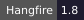
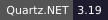
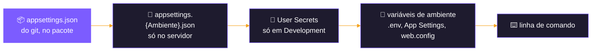
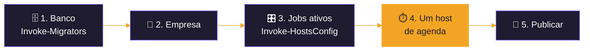

<div align="center">


</div>

# 🚢 Deploy dos projetos

<div align="center">

  

  

</div>

<p align="center">
  <b>Como publicar o WebApi, o Worker, o WebJob e o painel em cada ambiente testado, sem credencial no repositório.</b><br>
  <sub>O uso na máquina de desenvolvimento está no <a href="GUIA-DE-USO.md">GUIA-DE-USO</a>; os testes que embasam este
  documento, em <a href="docs/PROPOSTA-TESTES-CENARIOS-HOSPEDAGEM.md">PROPOSTA-TESTES-CENARIOS-HOSPEDAGEM</a>.</sub>
</p>

<p align="center">
  <a href="#-a-regra-da-configuração">Configuração</a> ·
  <a href="#-antes-de-publicar">Antes de publicar</a> ·
  <a href="#️-onde-cada-projeto-roda">Onde roda</a> ·
  <a href="#-máquina-de-desenvolvimento">Desenvolvimento</a> ·
  <a href="#-docker-com-nginx">Docker</a> ·
  <a href="#-serviço-do-windows-worker">Serviço do Windows</a> ·
  <a href="#️-azure-app-service">App Service</a> ·
  <a href="#-iis-não-testado">IIS</a> ·
  <a href="#-conferência-depois-do-deploy">Conferência</a>
</p>

---

## 🔐 A regra da configuração

O `appsettings.json` de cada projeto **vai no pacote** e **não tem credencial**: só a estrutura e os padrões (seções do
Hangfire e do Quartz, `BaseUrl` das APIs, fuso, tempos). Tudo o que depende do ambiente entra por uma camada própria dele,
que o .NET lê por cima do arquivo:



Cada camada à direita vence a da esquerda. Em variável de ambiente, o `:` da chave vira `__`
(`ConnectionStrings:Connection` → `ConnectionStrings__Connection`).

**O que cada projeto recebe da camada do ambiente:**

| Projeto | Chaves | Observação |
|---|---|---|
| 🌐 **WebApi** | `ConnectionStrings:Connection`, `Hangfire:Enabled`, `Hangfire:Dashboard:UserName`, `Hangfire:Dashboard:Password` | sem `Hangfire:Enabled = true`, só as rotas e o Swagger |
| 🪟 **Worker** | `ConnectionStrings:Connection`, `Quartz:Enabled` | o `appsettings.json` do git já vem com `Quartz:Enabled = true` |
| ☁️ **WebJob** | `ConnectionStrings:Connection` e, para a recuperação, `Recovery:*` | um processo por job, escolhido no `run.cmd` |
| 🖥️ **WebApp** | `Database:Enabled`, `ConnectionStrings:Connection` (`etl_monitor`), `ConnectionStrings:QueryConnection` (`etl_query`), `LoggedCompany:DocCompany` | `Assistant:ApiKey` só se for usar o assistente |
| 🧩 Todos os hosts | opcional: `InitialLoad:MaxMonths` (carga inicial limitada), `<Módulo>:BaseUrl` (só para apontar outra API), `DataWarehouse:Pepper` | as `BaseUrl` de produção já estão no `appsettings.json` |

> [!CAUTION]
> Nunca commitar connection string, senha do dashboard, chave de API ou `appsettings.{Ambiente}.json` com valores. O
> `publish-worker.ps1` recusa publicar um `appsettings.json` com `ConnectionStrings`; nos outros projetos, a regra é a
> mesma, conferida na revisão.

---

## 🧭 Antes de publicar



1. **Banco.** A tela [`tools/migrators/Invoke-Migrators.ps1`](tools/migrators/Invoke-Migrators.ps1) sobe as tabelas, com o
   host de agenda escolhido (o Worker tem tabelas próprias, schema `quartz`). **No Azure SQL**, crie o banco antes, com a collation `Latin1_General_100_CI_AS_SC_UTF8`: o DbUp
   criaria no tier padrão, que é pago, e a collation não muda depois ([MIGRATOR-CSX](docs/MIGRATOR-CSX.md)).
2. **Empresa.** **Nova empresa…** na tela [`tools/hosts/Invoke-HostsConfig.ps1`](tools/hosts/Invoke-HostsConfig.ps1)
   (ou `auditing.sp_Add_Company` e `auditing.sp_Add_Company_App` à mão, [GUIA-DE-USO, passo 3](GUIA-DE-USO.md#-3-empresa-e-parâmetros)).
   Os jobs nascem inativos.
3. **Credenciais e jobs ativos.** Na mesma tela: um módulo com API externa só ativa jobs com a credencial dele, que a
   tela pede e grava na tabela `<Módulo>Parameters` junto com os jobs, direto no banco. Vale para qualquer ambiente com
   acesso ao banco. Com as senhas do `etl_monitor` e do `etl_query`, ela também cria os dois usuários do painel no banco.
   A parte de **configuração dos projetos** dela grava só User Secrets: serve para a máquina de desenvolvimento, não para
   servidor.
4. **Um host de agenda por banco.** Hangfire (WebApi), Quartz (Worker) ou WebJobs: dois agendadores no mesmo banco rodam
   os jobs em dobro (teste A2). Antes de ligar um, pare os outros.
5. **Publicar**, conforme o ambiente abaixo.

---

## 🗺️ Onde cada projeto roda

| Ambiente | WebApi | Worker | WebJob | WebApp | Camada da configuração | Testes |
|---|:---:|:---:|:---:|:---:|---|---|
| 💻 Máquina de desenvolvimento | ✅ | ✅ | ✅ (`--job`) | ✅ | User Secrets (`Invoke-HostsConfig`) | C1, C3, C4, C6 |
| 🐳 Docker com nginx | ✅ | — | — | ✅ | `.env` do compose → variáveis de ambiente | C2, C5 |
| 🪟 Serviço do Windows | — | ✅ | — | — | `appsettings.Production.json` na pasta do serviço | C4b, A3 |
| ☁️ Azure App Service (Windows) | ✅ ¹ | — | ✅ | ✅ | App Settings e Connection strings | C7, A9, A10 |
| 🏢 IIS | ✅ | — | — | ✅ | `web.config` ou `appsettings.Production.json` no servidor | não testado |

¹ Funcionou, mas num plano B1 junto com 12 WebJobs e o painel o HTTP do WebApi não respondeu (100% de CPU): Hangfire no
App Service pede plano próprio ou maior.

> [!NOTE]
> Em qualquer ambiente fora de `Development`, as telas **Sob Demanda** e **Executar Querys** do painel somem do menu: é o
> esperado, elas só existem na máquina de desenvolvimento.

---

## 💻 Máquina de desenvolvimento

Não é deploy, mas é o mesmo esquema de camadas: `dotnet run` roda em `Development` e lê os **User Secrets**.

```powershell
./tools/hosts/Invoke-HostsConfig.ps1 -Database EtlTeste -SchedulingHost WebApi
dotnet run --project src/Backend/Hosts/WebApi --launch-profile http
dotnet run --project src/Frontend/WebApp --launch-profile http
```

A tela grava, nos User Secrets dos quatro projetos, a connection string do banco, o host de agenda ligado e os outros
desligados, o dashboard do Hangfire, as `BaseUrl` em `http://127.0.0.1:9/` (sem chamada às APIs, marcado por padrão) e a
configuração do painel. Contra o Azure SQL (C3, C6), o servidor da tela é o `<servidor>.database.windows.net`, com a
regra de firewall para o IP da máquina.

---

## 🐳 Docker com nginx

Testado no C2 (WebApi com Hangfire e painel) e no C5 (só o painel, com o Worker agendando). Os arquivos ficam numa pasta
**fora do git**.

**1. Publicar:**

```powershell
dotnet publish src/Backend/Hosts/WebApi -c Release -o publish/webapi
dotnet publish src/Frontend/WebApp -c Release -o publish/webapp
```

**2. `Dockerfile`** (um só, com o app por build arg):

```dockerfile
FROM mcr.microsoft.com/dotnet/aspnet:10.0
ARG APP
ARG APP_DLL
ENV APP_DLL=${APP_DLL} ASPNETCORE_URLS=http://+:8080
WORKDIR /app
COPY publish/${APP}/ .
ENTRYPOINT ["sh", "-c", "exec dotnet /app/$APP_DLL"]
```

Use a imagem `aspnet:10.0` (Debian): a Alpine e a chiseled vêm sem ICU e tzdata, e o código usa o fuso
`E. South America Standard Time`, que a Debian converte para `America/Sao_Paulo`.

**3. `compose.yaml`** (resumo):

| Serviço | Imagem | Ambiente |
|---|---|---|
| `webapi` (profile `webapi`) | build com `APP=webapi` | `ASPNETCORE_ENVIRONMENT=Production`, `Hangfire__Enabled=true`, `ConnectionStrings__Connection`, `Hangfire__Dashboard__UserName/Password` |
| `webapp` | build com `APP=webapp` | `ASPNETCORE_ENVIRONMENT=Production`, `Database__Enabled=true`, `ConnectionStrings__Connection`, `ConnectionStrings__QueryConnection` |
| `nginx` | `nginx:1.27` | porta 8080 → painel, 8081 → WebApi (Swagger e `/hangfire`) |

As senhas vão num arquivo `.env` (fora do git), passado com `--env-file`:

```bash
docker compose --env-file secrets.env --profile webapi up -d --build
```

**4. `nginx.conf`:** `resolver 127.0.0.11` e `set $up webapp:8080; proxy_pass http://$up;` (o nginx sobe mesmo sem o
`webapi`). No painel, o Blazor Server precisa de WebSocket: `proxy_http_version 1.1`, os cabeçalhos
`Upgrade`/`Connection` e `proxy_read_timeout 1h`.

| ⚠️ | Ponto | O que fazer |
|:---:|---|---|
| 🔑 | Data Protection | as chaves do painel ficam dentro do container e se perdem ao recriá-lo (as sessões abertas caem); para manter, um volume para elas |
| 🔒 | HTTPS | testado só em HTTP. O código não usa `UseForwardedHeaders`: com o nginx terminando TLS, a aplicação não sabe que a requisição era HTTPS |
| 🗄️ | Banco | do container, o SQL Server da máquina é `host.docker.internal,1433` |

---

## 🪟 Serviço do Windows (Worker)

O [`publish-worker.ps1`](src/Backend/Hosts/Worker/Publish/publish-worker.ps1) (PowerShell 7, **como administrador** na
máquina de destino) publica, para o serviço, copia sem apagar o `appsettings.Production.json` da pasta, cria o serviço na
primeira vez (início automático atrasado, reinício se cair, `DOTNET_ENVIRONMENT`) e confere que ficou rodando. Os perfis
ficam em [`publish-profiles.psd1`](src/Backend/Hosts/Worker/Publish/publish-profiles.psd1), só com máquina, pasta, serviço
e conta.

**Antes da primeira instalação**, crie na pasta do serviço (`InstallPath` do perfil, ex.: `C:\Services\EtlWorker`) o
`appsettings.Production.json`, que nunca sai da máquina:

```json
{
  "ConnectionStrings": {
    "Connection": "Server=<servidor>,1433;Database=<banco>;User Id=<usuário>;Password=<senha>;TrustServerCertificate=True"
  }
}
```

```powershell
& 'C:\...\src\Backend\Hosts\Worker\Publish\publish-worker.ps1' -Profile prod -DryRun
& 'C:\...\src\Backend\Hosts\Worker\Publish\publish-worker.ps1' -Profile prod
```

* O caminho completo do script, porque o PowerShell de administrador abre em `C:\Windows\System32`.
* Variável de ambiente do serviço não serve: o script regrava o ambiente dele só com `DOTNET_ENVIRONMENT` e
  `Service__Name` a cada publicação. A configuração fica no `appsettings.Production.json`.
* Sem o arquivo, o serviço cai na subida e a conferência do script aponta a falha (teste C4b).
* **Mais de um Worker** no mesmo banco (A3): um serviço por máquina, o mesmo banco, `Quartz:Storage:Clustered = true` (padrão). Os
  nós dividem o trabalho e o vivo assume quando o outro cai.
* Para remover: `-Uninstall` (a pasta fica, com o `appsettings.Production.json`).

---

## ☁️ Azure App Service

Testado no C7 (WebJobs e painel), A9 (fuso) e A10 (WebApi com Hangfire), num plano **Windows**. O
[`tools/azure/New-AzureTestResources.ps1`](tools/azure/New-AzureTestResources.ps1) monta tudo isso para teste; em
produção, os mesmos comandos `az` com os recursos de lá.

**O que cada App Service precisa:**

| | WebJobs | Painel (WebApp) | WebApi com Hangfire |
|---|---|---|---|
| Plano | Windows, **Basic ou acima** (Always On) | o mesmo ou outro | **próprio ou maior** que B1 |
| Runtime | `dotnet:10`, 64 bits | `dotnet:10`, 64 bits | `dotnet:10`, 64 bits |
| Configuração geral | **Always On** | **Web sockets** ligado | **Always On** |
| Connection strings | `Connection` (tipo `SQLAzure`) | `Connection` (`etl_monitor`) e `QueryConnection` (`etl_query`) | `Connection` |
| App Settings | `Recovery__*` (se usar a recuperação) | `Database__Enabled=true` | `Hangfire__Enabled=true`, `Hangfire__Dashboard__UserName/Password` |

```bash
az webapp config set -g <grupo> -n <app> --always-on true --use-32bit-worker-process false
az webapp config appsettings set -g <grupo> -n <app> --settings Database__Enabled=true
az webapp config connection-string set -g <grupo> -n <app> --connection-string-type SQLAzure --settings "Connection=<connection string>"
```

Os valores entram pelo portal ou pelo `az` de quem publica: **nunca** num arquivo do repositório.

**Publicar:**

* **WebJobs:** [`publish-webjob.ps1`](src/Backend/Hosts/WebJob/Publish/publish-webjob.ps1) (PowerShell 7 e `az login`),
  um WebJob contínuo por job do perfil, chamado `<Title> - V<versão>`. Os perfis em
  [`publish-profiles.psd1`](src/Backend/Hosts/WebJob/Publish/publish-profiles.psd1) têm só assinatura, grupo, App Service
  e a lista de jobs. Um job ativo na tabela só roda se tiver WebJob publicado.

  ```powershell
  ./src/Backend/Hosts/WebJob/Publish/publish-webjob.ps1 -Profile prod -ListJobs
  ./src/Backend/Hosts/WebJob/Publish/publish-webjob.ps1 -Profile prod
  ```

* **Painel e WebApi:** sem script próprio. `dotnet publish -c Release`, zip da pasta e `az webapp deploy`:

  ```powershell
  dotnet publish src/Frontend/WebApp -c Release -o publish/webapp
  Compress-Archive publish/webapp/* webapp.zip -Force
  az webapp deploy -g <grupo> -n <app> --src-path webapp.zip --type zip
  ```

| ⚠️ | Ponto | O que fazer |
|:---:|---|---|
| 🔥 | Firewall do Azure SQL | liberar os IPs de saída de cada App Service (`possibleOutboundIpAddresses`) |
| 🕒 | Fuso | o App Service roda em UTC; os hosts gravam em horário de Brasília (`TimeZone` do `appsettings.json`) e o painel usa a hora de Brasília |
| 📦 | Tamanho do plano | 12 WebJobs + painel + WebApi saturam o B1 (1 núcleo, 1,75 GB); em produção, plano maior ou o painel em outro plano |
| 🛟 | Recuperação dos WebJobs | precisa de identidade gerenciada com o papel Website Contributor, que só um Owner da assinatura dá; não testada |
| 💤 | Azure SQL serverless | o banco pausado leva até ≈ 90 s para acordar; os hosts repetem sozinhos, o migrator pode precisar de nova tentativa |
| 🌐 | APIs com restrição de IP | conferir se Totvs ou Microvix exigem liberar o IP de saída da Azure |

---

## 🏢 IIS (não testado)

O comportamento da aplicação é o mesmo do Docker; muda a configuração do servidor:

* **ASP.NET Core Hosting Bundle do .NET 10** e o recurso **WebSocket Protocol** (painel).
* Um site e um pool por aplicação, pool **No Managed Code**.
* Configuração por `<environmentVariables>` no `web.config` do servidor, fora do git, ou por um
  `appsettings.Production.json` só no servidor. A publicação não pode sobrescrever nenhum dos dois.
* **WebApi com Hangfire:** o pool para por ociosidade e recicla, e os recorrentes param junto. Use
  `Start Mode = AlwaysRunning`, `Idle Time-out = 0` e `preloadEnabled = true` (Application Initialization).

---

## ✅ Conferência depois do deploy

| Onde | O que conferir |
|---|---|
| `auditing.SchedulingHosts` | um só tipo de host de agenda ativo no banco |
| `auditing.vw_JobsHeartbeat` | a última execução de cada job ativo, no horário de Brasília |
| `auditing.Logs` e `auditing.Messages` | o primeiro ciclo sem erro inesperado; na carga inicial, alguns jobs só trazem dados no segundo ciclo (dependem de filiais e lojas) |
| Painel | os mesmos números do banco, lendo pelo `etl_monitor` |
| `/hangfire` (WebApi) | os recorrentes criados a partir de `auditing.Jobs`; pede usuário e senha do dashboard |
| Reinício | reiniciar o host (serviço, container ou App Service) e ver o ciclo seguinte normal |

Os pontos em aberto dos testes (perda de tickets da Movidesk, plano, recuperação) estão na
[seção 8.3](docs/PROPOSTA-TESTES-CENARIOS-HOSPEDAGEM.md#83-pontos-em-aberto) da proposta de testes.
