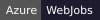
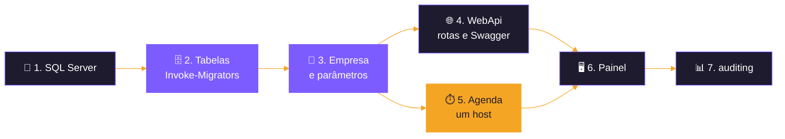
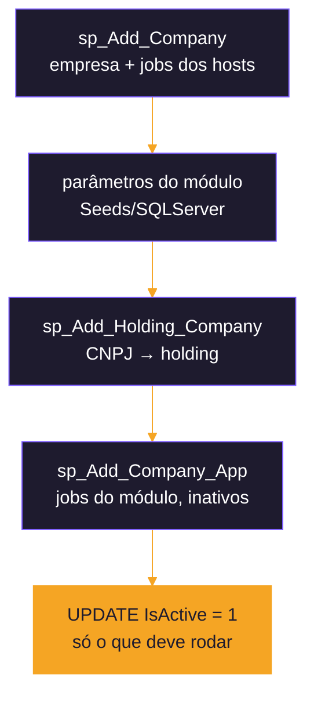
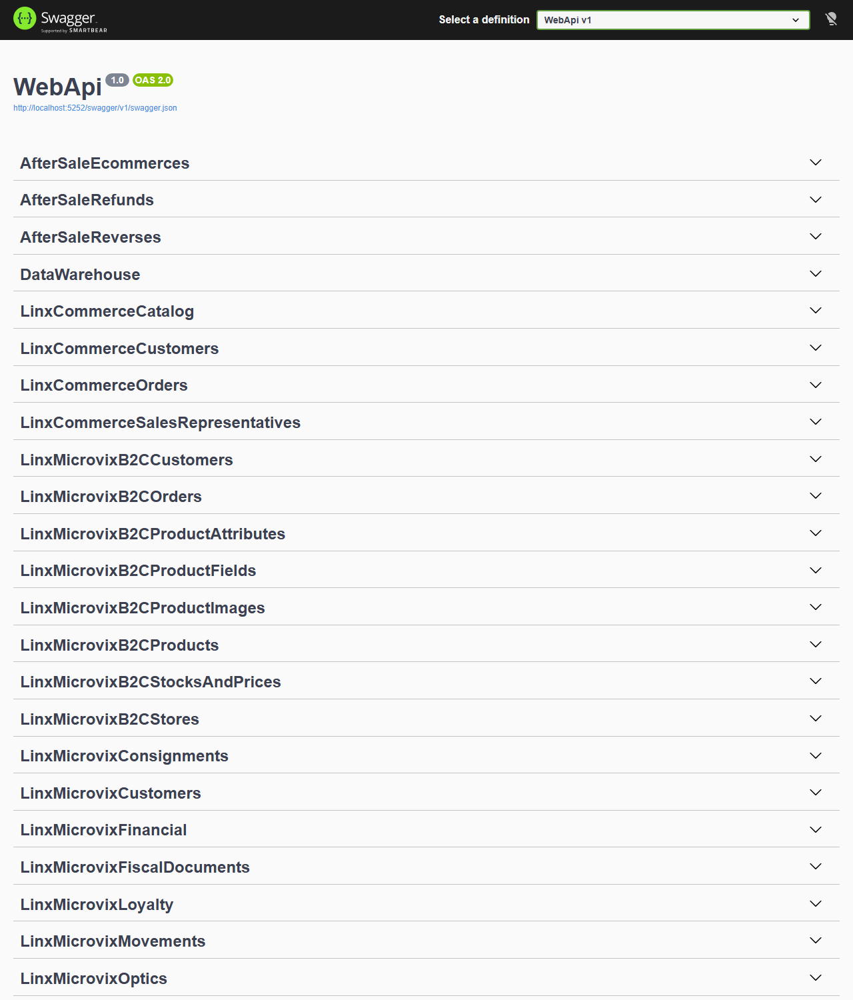
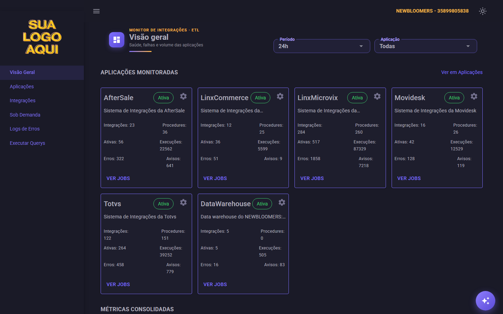

<div align="center">


</div>

# 🚀 Guia de uso

<div align="center">

  

  

</div>

<p align="center">
  <b>Do banco vazio às integrações rodando: o passo a passo para usar cada projeto do repositório.</b><br>
  <sub>O panorama do sistema está no <a href="README.md">README</a>; os detalhes de cada projeto, no README dele.</sub>
</p>

<p align="center">
  <a href="#-os-projetos">Projetos</a> ·
  <a href="#-pré-requisitos">Pré-requisitos</a> ·
  <a href="#-1-sql-server">Banco</a> ·
  <a href="#-2-tabelas">Tabelas</a> ·
  <a href="#-3-empresa-e-parâmetros">Empresa</a> ·
  <a href="#-4-rotas-do-webapi">Rotas</a> ·
  <a href="#-5-agenda">Agenda</a> ·
  <a href="#-6-painel">Painel</a> ·
  <a href="#-7-onde-ver-o-que-rodou">Acompanhar</a> ·
  <a href="#-solução-de-problemas">Problemas</a>
</p>

---

## 🗺️ O caminho



> [!IMPORTANT]
> Num banco novo **nada roda até existir uma empresa**: os migrators criam só a estrutura e o catálogo do produto, e os
> jobs de cada empresa nascem **inativos**.

---

## 📦 Os projetos

| | Projeto | Pasta | Para que serve | README |
|:---:|---|---|---|:---:|
| 🌐 | **WebApi** | `src/Backend/Hosts/WebApi` | Host web: rotas de leitura e escrita de todos os módulos, Swagger e, opcional, o Hangfire | [📖](src/Backend/Hosts/WebApi/README.md) |
| ☁️ | **WebJob** | `src/Backend/Hosts/WebJob` | Um processo por job, publicado como WebJob contínuo na Azure | [📖](src/Backend/Hosts/WebJob/README.md) |
| 🪟 | **Worker** | `src/Backend/Hosts/Worker` | Serviço do Windows com o Quartz.NET: todos os jobs num processo | [📖](src/Backend/Hosts/Worker/README.md) |
| 🧩 | **Hosts.Scheduling** | `src/Backend/Hosts/Hosts.Scheduling` | Biblioteca comum aos três hosts: liga cada `IdJob` ao método do módulo | — |
| 🟣 | **Módulos** | `src/Backend/Modules/*` | Totvs, LinxMicrovix, LinxCommerce, Movidesk, AfterSale e DataWarehouse (bibliotecas, não sobem sozinhos) | [README](README.md#-módulos) |
| ⚫ | **Shared** | `src/Backend/Shared` | Auditoria, cliente HTTP, repositório comum, trava de concorrência e empresa da execução | — |
| 🖥️ | **WebApp** | `src/Frontend/WebApp` | Painel Monitor de Integrações (Blazor), hoje com dados mockados | [📖](src/Frontend/WebApp/README.md) |
| 📱 | **MobileApp** | `src/Mobile/MobileApp` | App .NET MAUI, em construção | — |
| 🗄️ | **Invoke-Migrators** | `tools/migrators` | Tela (ou console) que sobe as tabelas de todas as aplicações na ordem certa | [MIGRATOR-CSX](docs/MIGRATOR-CSX.md) |
| 🧪 | **Import-TestSeeds** | `tools/seeds` | Carrega uma empresa de teste: parâmetros, CNPJs e jobs | [plano](docs/PLANO-TELA-CADASTRO-EMPRESA.md#3-script-ps1-de-dados-de-teste--feito-em-42) |

---

## ✅ Pré-requisitos

| | Ferramenta | Como instalar ou conferir |
|:---:|---|---|
| 💻 | **.NET 10 SDK** | `dotnet --version` (10.x) |
| 🐚 | **PowerShell 7** | `pwsh --version`; os scripts de `tools/` e de publicação exigem a 7 |
| 📜 | **dotnet-script** | `dotnet tool install -g dotnet-script` (roda os `migrator.csx`) |
| 🗄️ | **SQL Server** | uma instância local, de rede ou no Docker (passo 1) |
| 🧰 | **sqlcmd** | só para o banco de teste (`Import-TestSeeds.ps1`); precisa estar no `PATH` |
| ☁️ | **Azure CLI** | só para publicar o WebJob (`az login`) |

---

## 🐳 1. SQL Server

Qualquer SQL Server serve. Para testes, o padrão do projeto é o container **`sql-server`** do Docker, na porta **1433**:

```bash
docker run -d --name sql-server -e "ACCEPT_EULA=Y" -e "MSSQL_SA_PASSWORD=<senha forte>" -p 1433:1433 mcr.microsoft.com/mssql/server:2025-latest
```

> [!WARNING]
> Testes sempre num **banco de teste próprio** (com `Test` ou `Teste` no nome), nunca no LocalDB e nunca no banco de
> produção. Apague o banco de teste no fim.

---

## 🗄️ 2. Tabelas

A tela [`tools/migrators/Invoke-Migrators.ps1`](tools/migrators/Invoke-Migrators.ps1) roda o `migrator.csx` (DbUp) de cada
aplicação marcada, na ordem **Shared → integrações → DataWarehouse → host de agenda**, para no primeiro erro e mostra a
senha como `****` no log. O banco é criado pelo DbUp se não existir.

```powershell
./tools/migrators/Invoke-Migrators.ps1
```

<div align="center">


</div>

| | Campo da tela | O que preencher |
|:---:|---|---|
| 🖧 | **Servidor, Porta, Banco** | ex.: `localhost`, `1433`, `EtlTeste` |
| 🔑 | **Usuário e Senha** | login do SQL Server; o botão **Testar conexão** confere antes de rodar |
| ⏱️ | **Host de agenda** | o host que vai agendar neste banco: **WebApi (Hangfire)**, **WebJob (Azure)** ou **Worker (Quartz.NET)**. Só o Worker tem tabelas próprias (schema `quartz`) |
| 🧪 | **Banco de teste** | marcado, roda o `Import-TestSeeds.ps1` no fim, com o CNPJ e a razão social da tela (passo 3). **Ativar os jobs** liga os jobs da empresa: eles chamam as APIs reais |
| ☑️ | **Catálogo** | as aplicações a subir; o **Shared** é obrigatório |

Sem tela, no console:

```powershell
./tools/migrators/Invoke-Migrators.ps1 -NoGui -Database EtlTeste -SchedulingHost WebApi
./tools/migrators/Invoke-Migrators.ps1 -NoGui -Database EtlTeste -Apps Totvs,DataWarehouse -SchedulingHost Worker -TestSeeds
```

<details>
<summary><b>🔧 Um migrator à mão</b></summary>

De dentro da pasta `Scripts/SQLServer` da aplicação, depois do Shared:

```bash
dotnet script migrator.csx -- "Server=localhost,1433;Database=EtlTeste;User Id=sa;Password=...;TrustServerCertificate=True;"
```

No Windows, o caminho dos módulos passa de 260 caracteres: mapeie a pasta com `subst X: "<pasta SQLServer>"` e rode a
partir de `X:`. Detalhes e solução de problemas em [MIGRATOR-CSX.md](docs/MIGRATOR-CSX.md).

</details>

---

## 🏢 3. Empresa e parâmetros

A empresa é a **holding** (CNPJ, só dígitos) em `monitor.Company`. Cada módulo guarda as credenciais por CNPJ na tabela
`*Parameters` dele, e `monitor.HoldingCompanies` liga esses CNPJs (marcas, filiais) à holding.



**Num banco de teste**, o [`tools/seeds/Import-TestSeeds.ps1`](tools/seeds/Import-TestSeeds.ps1) faz tudo isso com os
scripts de `Infrastructure.<Módulo>/Seeds/SQLServer` (ou marque **Banco de teste** na tela do passo 2):

```powershell
./tools/seeds/Import-TestSeeds.ps1 -Database 'EtlTeste'
./tools/seeds/Import-TestSeeds.ps1 -Database 'EtlTeste' -Modules Totvs,Movidesk -ActivateJobs
```

> [!CAUTION]
> Os scripts de `Seeds/` têm **credenciais reais**. Os jobs nascem inativos e o script recusa banco sem `Test`/`Teste` no
> nome (salvo `-Force`). Os scripts de LinxMicrovix e LinxCommerce ficam fora do git: sem eles, o módulo fica sem
> parâmetros e o script avisa.

**Fora de teste**, a empresa vai entrar pela tela de cadastro do WebApp (em construção, fase 4.6 do
[plano](docs/PLANO-TELA-CADASTRO-EMPRESA.md)). Até lá, pelas procedures:

```sql
EXEC auditing.sp_Add_Company @company = '44065634000106', @name = N'NEWBLOOMERS';
-- parâmetros do módulo (INSERT na tabela *Parameters) e, para cada CNPJ deles:
EXEC auditing.sp_Add_Holding_Company @company = '44065634000106', @docCompany = '<CNPJ do parâmetro>';
EXEC auditing.sp_Add_Company_App @company = '44065634000106', @idParent = 30;  -- 30 = Movidesk
```

**Ligar e desligar jobs** é um `UPDATE` na linha da empresa:

```sql
-- um job
UPDATE auditing.Jobs SET IsActive = 1 WHERE IdType = 2 AND IdJob = 3000 AND Company = '44065634000106';
-- um módulo inteiro (faixa de IdJob do módulo, ex.: Movidesk 3000 a 3499), só os com agenda
UPDATE auditing.Jobs SET IsActive = 1 WHERE IdType = 2 AND IdJob BETWEEN 3000 AND 3499
   AND IntervalTimeInMinutes > 0 AND Company = '44065634000106';
```

---

## 🌐 4. Rotas do WebApi

```bash
dotnet run --project src/Backend/Hosts/WebApi --launch-profile http
```

O Swagger abre em **`http://localhost:5252/swagger`**, com uma tag por service de cada módulo.

<div align="center">



</div>

| Tipo de rota | Exemplo | Cabeçalhos |
|---|---|---|
| 🔄 **Leitura recorrente** (carga do banco) | `POST /MovideskJobs/Movidesk/Tickets` | `X-Company: <holding>` (sem `{docCompany}` na rota, é ele que diz a empresa) |
| 🎯 **Leitura sob demanda** | `GET /TotvsJobs/Totvs/Customers/{docCompany}/{code}` | `X-User-Name` (obrigatório); `X-Company` opcional |
| ✍️ **Escrita** | `PATCH /MovideskJobs/Movidesk/Tickets/{docCompany}/{id}` | `X-User-Name`; corpo validado antes de chamar a API |

```http
GET http://localhost:5252/TotvsJobs/Totvs/Customers/44065634000106/123
X-User-Name: fulano
X-Company: 44065634000106
```

> [!CAUTION]
> Cada rota roda a integração **de verdade** contra a API configurada. Para testar sem tráfego real, aponte as
> `BaseUrl` dos módulos para uma porta local fechada: `Movidesk__BaseUrl=http://127.0.0.1:9/` (idem `Totvs`,
> `LinxMicrovix`, `AfterSale`). A Totvs de produção é **só leitura** nos testes.

---

## ⏱️ 5. Agenda

A agenda é a mesma (`auditing.Jobs`, uma linha por job e empresa) e **só um host agenda por vez** no mesmo banco. O
`WebApi` em modo só API combina com qualquer um, para o disparo manual pelas rotas.

| Host | Ligar | Desligar |
|---|---|---|
| 🌐 **WebApi (Hangfire)** | `Hangfire__Enabled=true` + usuário e senha do dashboard por variável de ambiente ou user-secrets; dashboard em `/hangfire` | `Hangfire:Enabled = false` (padrão) |
| ☁️ **WebJob (Azure)** | `dotnet run --project src/Backend/Hosts/WebJob -- --job 9002` no local; na Azure, `Publish/publish-webjob.ps1 -Profile <perfil>` | parar os WebJobs no App Service |
| 🪟 **Worker (Quartz.NET)** | `dotnet run --project src/Backend/Hosts/Worker` no local; serviço com `Publish/publish-worker.ps1 -Profile <perfil>` (como administrador) | `Stop-Service EtlWorker` ou `Quartz:Enabled = false` |

```powershell
# WebApi com o Hangfire
$env:Hangfire__Enabled = 'true'; $env:Hangfire__Dashboard__UserName = '<usuário>'; $env:Hangfire__Dashboard__Password = '<senha>'
dotnet run --project src/Backend/Hosts/WebApi --launch-profile http

# WebJob: lista os jobs que conhece, sem banco
dotnet run --project src/Backend/Hosts/WebJob -- --list-jobs
```

> [!TIP]
> A connection string do WebJob e do Worker fica fora do `appsettings.json`:
> `dotnet user-secrets set "ConnectionStrings:Connection" "<connection string>" --project src/Backend/Hosts/Worker`.

---

## 🖥️ 6. Painel

```bash
dotnet run --project src/Frontend/WebApp --launch-profile http
```

Abre em **`http://localhost:5067`**, sem banco nem API: os dados são **mockados**.

<div align="center">



</div>

| Chave (user-secrets do WebApp) | Efeito |
|---|---|
| `Admin:Enabled = true` | mostra as telas **Sob Demanda** e **Executar Querys** (só em `Development`) |
| `Assistant:ApiKey` | liga o **assistente de IA** (Claude); as perguntas e os dados consultados vão para a API da Anthropic |
| `Database:Enabled = true` | troca os mocks pelo banco: painel e cadastro em `ConnectionStrings:Connection` (usuário `etl_monitor`) e Executar Querys em `ConnectionStrings:QueryConnection` (`etl_query`) |
| `LoggedCompany:DocCompany` | CNPJ da empresa logada em `monitor.Company` (padrão `44065634000106`) |

```bash
dotnet user-secrets set "Admin:Enabled" "true" --project src/Frontend/WebApp
```

---

## 📊 7. Onde ver o que rodou

| Onde | O quê |
|---|---|
| `auditing.Logs` | cada execução (job, empresa, início e fim) |
| `auditing.Messages` | erros e avisos de cada execução |
| `auditing.Records` | o registro integrado (JSON ou XML) pela chave |
| `<schema>.<Módulo>Requests` | cada chamada sob demanda e escrita, com usuário, corpo e resposta |
| `auditing.vw_JobsHeartbeat` | a última execução de cada job e empresa |

```sql
-- últimas execuções com erro de uma empresa
SELECT TOP 50 L.IdJob, J.Title, L.StartDate, L.EndDate, M.Message
FROM auditing.Logs L
JOIN auditing.Jobs J ON J.IdJob = L.IdJob AND J.IdType = L.IdType AND J.Company = L.Company
JOIN auditing.Messages M ON M.Execution = L.Execution AND M.IsError = 1
WHERE L.Company = '44065634000106'
ORDER BY L.StartDate DESC;
```

---

## 🩺 Solução de problemas

| Sintoma | Causa provável | O que fazer |
|---|---|---|
| Nada roda na agenda | nenhuma empresa ativa, ou jobs com `IsActive = 0` | passo 3: cadastrar a empresa e ligar os jobs |
| `sp_Log_Start` recusa com **50005** | execução sem empresa | informar `X-Company` na rota (ou usar uma rota com `{docCompany}`) |
| **50001** ao abrir o log | a empresa não tem aquele job | `sp_Add_Company_App` do módulo para a empresa |
| **400** numa rota com `{docCompany}` | CNPJ sem holding em `monitor.HoldingCompanies` ou `X-Company` diferente da holding | `sp_Add_Holding_Company` ou corrigir o cabeçalho |
| Migrator falha ao carregar a DLL do SQL Client | caminho com mais de 260 caracteres | usar o `Invoke-Migrators.ps1` (já usa `subst`) |
| `Skipped: previous execution ... still running` | a execução anterior da mesma empresa ainda roda | normal; se for sempre, aumentar o intervalo do job |
| `Rescheduled: job:<IdJob> running for another company` | outra empresa está rodando o mesmo job | normal: volta em 1 minuto (Hangfire e Worker) |
| Um script de credenciais roda no migrator | cópia antiga em `Scripts/SQLServer/Parameters` | mover para `Seeds/SQLServer` |

---

## 📚 Mais detalhes

| Assunto | Onde |
|---|---|
| Panorama, módulos, banco e DW | [README](README.md) |
| Migrators e a tela | [docs/MIGRATOR-CSX.md](docs/MIGRATOR-CSX.md) |
| Cadastro de empresas | [docs/PLANO-TELA-CADASTRO-EMPRESA.md](docs/PLANO-TELA-CADASTRO-EMPRESA.md) |
| Padrões de código, scripts e cache | [docs/PADRAO-CODIGO-E-SCRIPTS-INTEGRACOES.md](docs/PADRAO-CODIGO-E-SCRIPTS-INTEGRACOES.md) · [docs/PADRAO-CACHE-INTEGRACOES.md](docs/PADRAO-CACHE-INTEGRACOES.md) |
| Data warehouse | [src/Backend/Modules/DataWarehouse/docs](src/Backend/Modules/DataWarehouse/docs/00-ordem-de-leitura.md) |

---

<div align="center">


<sub>Sistema de integrações · feito com .NET 10</sub>

</div>
