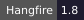
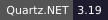
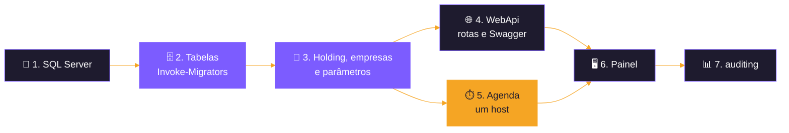
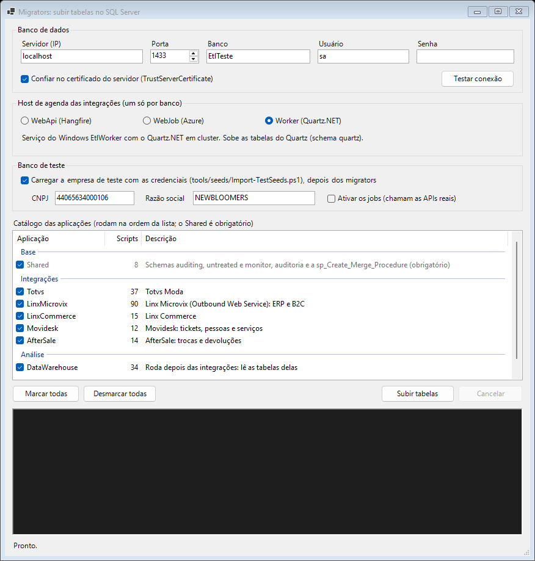
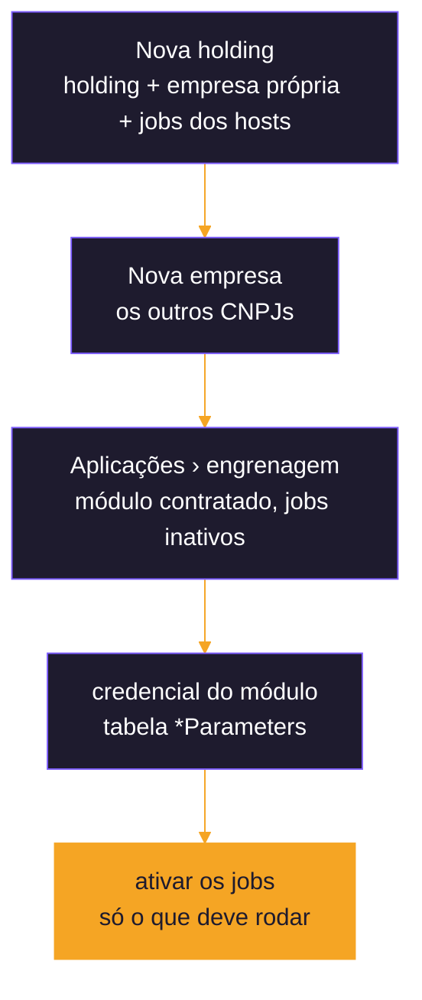

<div align="center">


</div>

# 🚀 Guia de uso

<div align="center">

  

  

</div>

<p align="center">
  <b>Do banco vazio às integrações rodando: o passo a passo para usar cada projeto do repositório.</b><br>
  <sub>O panorama do sistema está no <a href="README.md">README</a>; os detalhes de cada projeto, no README dele.</sub>
</p>

<p align="center">
  <a href="#-os-projetos">Projetos</a> ·
  <a href="#-pré-requisitos">Pré-requisitos</a> ·
  <a href="#-1-sql-server">Banco</a> ·
  <a href="#-2-tabelas">Tabelas</a> ·
  <a href="#-3-holding-empresas-e-parâmetros">Empresas</a> ·
  <a href="#-4-rotas-do-webapi">Rotas</a> ·
  <a href="#-5-agenda">Agenda</a> ·
  <a href="#-6-painel">Painel</a> ·
  <a href="#-7-onde-ver-o-que-rodou">Acompanhar</a> ·
  <a href="#-solução-de-problemas">Problemas</a>
</p>

---

## 🗺️ O caminho



> [!IMPORTANT]
> Num banco novo **nada roda até existir uma holding com empresas**: os migrators criam só a estrutura e o catálogo do produto, e os
> jobs de cada empresa nascem **inativos**.

---

## 📦 Os projetos

| | Projeto | Pasta | Para que serve | README |
|:---:|---|---|---|:---:|
| 🌐 | **WebApi** | `src/Backend/Hosts/WebApi` | Host web: rotas de leitura e escrita de todos os módulos, Swagger e, opcional, o Hangfire | [📖](src/Backend/Hosts/WebApi/README.md) |
| ☁️ | **WebJob** | `src/Backend/Hosts/WebJob` | Um processo por job, publicado como WebJob contínuo na Azure | [📖](src/Backend/Hosts/WebJob/README.md) |
| 🪟 | **Worker** | `src/Backend/Hosts/Worker` | Serviço do Windows com o Quartz.NET: todos os jobs num processo | [📖](src/Backend/Hosts/Worker/README.md) |
| 🧩 | **Hosts.Scheduling** | `src/Backend/Hosts/Hosts.Scheduling` | Biblioteca comum aos três hosts: liga cada `IdJob` ao método do módulo | — |
| 🟣 | **Módulos** | `src/Backend/Modules/*` | Totvs, LinxMicrovix, LinxCommerce, Movidesk, AfterSale e DataWarehouse (bibliotecas, não sobem sozinhos) | [README](README.md#-módulos) |
| ⚫ | **Shared** | `src/Backend/Shared` | Auditoria, cliente HTTP, repositório comum, trava de concorrência e empresa da execução | — |
| 🖥️ | **WebApp** | `src/Frontend/WebApp` | Painel Monitor de Integrações (Blazor): dados mockados por padrão, ou o banco com `Database:Enabled`; cadastro de holdings, empresas, módulos, credenciais e jobs | [📖](src/Frontend/WebApp/README.md) |
| 📱 | **MobileApp** | `src/Mobile/MobileApp` | App .NET MAUI, em construção | — |
| 🗄️ | **Invoke-Migrators** | `tools/migrators` | Tela (ou console) que sobe as tabelas de todas as aplicações na ordem certa | [MIGRATOR-CSX](.docs/MIGRATOR-CSX.md) |
| 🧪 | **Import-TestSeeds** | `tools/seeds` | Script avulso: carrega uma holding de teste, as empresas dela e as credenciais de `Seeds/SQLServer` (jobs inativos, agenda sugerida) | [passo 3](#-3-holding-empresas-e-parâmetros) |

---

## ✅ Pré-requisitos

| | Ferramenta | Como instalar ou conferir |
|:---:|---|---|
| 💻 | **.NET 10 SDK** | `dotnet --version` (10.x) |
| 🐚 | **PowerShell 7** | `pwsh --version`; os scripts de `tools/` e de publicação exigem a 7 |
| 📜 | **dotnet-script** | `dotnet tool install -g dotnet-script` (roda os `migrator.csx`) |
| 🗄️ | **SQL Server** | uma instância local, de rede ou no Docker (passo 1) |
| 🧰 | **sqlcmd** | só para o banco de teste (`Import-TestSeeds.ps1`); precisa estar no `PATH` |
| ☁️ | **Azure CLI** | só para publicar o WebJob (`az login`) |

---

## 🐳 1. SQL Server

Qualquer SQL Server serve. Para testes, o padrão do projeto é o container **`sql-server`** do Docker, na porta **1433**:

```bash
docker run -d --name sql-server -e "ACCEPT_EULA=Y" -e "MSSQL_SA_PASSWORD=<senha forte>" -p 1433:1433 mcr.microsoft.com/mssql/server:2025-latest
```

> [!WARNING]
> Testes sempre num **banco de teste próprio** (com `Test` ou `Teste` no nome), nunca no LocalDB e nunca no banco de
> produção. Apague o banco de teste no fim.

---

## 🗄️ 2. Tabelas

A tela [`tools/migrators/Invoke-Migrators.ps1`](tools/migrators/Invoke-Migrators.ps1) roda o `migrator.csx` (DbUp) de cada
aplicação marcada, na ordem **Shared → integrações → DataWarehouse → host de agenda**, para no primeiro erro e mostra a
senha como `****` no log. O banco é criado pelo DbUp se não existir.

```powershell
./tools/migrators/Invoke-Migrators.ps1
```

<div align="center">



</div>

| | Campo da tela | O que preencher |
|:---:|---|---|
| 🖧 | **Servidor, Porta, Banco** | ex.: `localhost`, `1433`, `EtlTeste` |
| 🔑 | **Usuário e Senha** | login do SQL Server; o botão **Testar conexão** confere antes de rodar |
| ⏱️ | **Host de agenda** | o host que vai agendar neste banco: **WebApi (Hangfire)**, **WebJob (Azure)** ou **Worker (Quartz.NET)**. Só o Worker tem tabelas próprias (schema `quartz`) |
| ☑️ | **Catálogo** | as aplicações, os services e, nas integrações, os **jobs** que vão ter tabelas (só os marcados ganham tabelas; os já criados aparecem em cinza, e rodar de novo com mais jobs só cria as que faltam); o **Shared** é obrigatório, e `Parameters` e o catálogo dos jobs sobem sempre |

Sem tela, no console:

```powershell
./tools/migrators/Invoke-Migrators.ps1 -NoGui -Database EtlTeste -SchedulingHost WebApi
./tools/migrators/Invoke-Migrators.ps1 -NoGui -Database EtlTeste -Apps Totvs,DataWarehouse -SchedulingHost Worker
./tools/migrators/Invoke-Migrators.ps1 -NoGui -Database EtlTeste -Apps Totvs -Jobs 13007,13002 -SchedulingHost Worker
```

O migrator só cria a estrutura e o catálogo de jobs (`auditing.Catalog`). Holding, empresas, credenciais dos módulos e
quais jobs rodam ficam no WebApp (passo 3). Os usuários do WebApp (`etl_monitor` e `etl_query`) são criados pelo
migrator do Shared com as senhas da seção **Usuários de banco do WebApp** da tela (em branco, o usuário não é criado
agora; quem já existe passa a ter a senha informada). Sem a tela:

```powershell
./tools/migrators/Invoke-Migrators.ps1 -NoGui -Database EtlTeste -SchedulingHost Worker -MonitorPassword (Read-Host -AsSecureString) -QueryPassword (Read-Host -AsSecureString)
```

A configuração dos projetos na máquina de desenvolvimento (User Secrets) é à mão, com `dotnet user-secrets set` (passos
5 e 6 e o README de cada host).

<details>
<summary><b>🔧 Um migrator à mão</b></summary>

De dentro da pasta `Scripts/SQLServer` da aplicação, depois do Shared:

```bash
dotnet script migrator.csx -- "Server=localhost,1433;Database=EtlTeste;User Id=sa;Password=...;TrustServerCertificate=True;"
```

No Windows, o caminho dos módulos passa de 260 caracteres: mapeie a pasta com `subst X: "<pasta SQLServer>"` e rode a
partir de `X:`. Detalhes e solução de problemas em [MIGRATOR-CSX.md](.docs/MIGRATOR-CSX.md).

</details>

---

## 🏢 3. Holding, empresas e parâmetros

A **holding** (CNPJ, só dígitos) fica em `auditing.Holders`, e as **empresas** dela (marcas, filiais; o `doc_company`
das tabelas `*Parameters`) em `auditing.Companies`: uma holding tem n empresas, uma empresa é de uma holding só e pode
ser a própria holding (`Company = Holder`). Cada módulo guarda as credenciais por CNPJ na tabela `*Parameters` dele, e
os jobs, a agenda, a ativação e o log são **de cada empresa** (`auditing.Jobs`, chave `IdJob, IdType, Holder, Company`).
Os jobs dos hosts (IdParent 140, como o 14000) são um por holding, na empresa que é a própria holding.



**Pelo WebApp** (com `Database:Enabled`; o que cada usuário faz vem do [perfil](src/Frontend/WebApp/README.md#-perfis-de-acesso)):

| | Onde | O que faz |
|:---:|---|---|
| 🏢 | Tela inicial › **Primeiro acesso** (`/registration`), aberto a todos | **Nova holding** grava a holding, a empresa que é a própria holding, os jobs dos hosts dela, inativos, e o primeiro usuário (Gestor); **Nova empresa** acrescenta um CNPJ à holding; **Abrir painel** entra no painel com a empresa escolhida |
| 🔀 | Seletor de empresa no topo do painel | troca a empresa entre as da holding (a escolha fica no navegador) |
| 🧩 | **Aplicações** › engrenagem de cada aplicação (`/applications`) | contratar o módulo (jobs com a agenda sugerida, editável, inativos), a credencial (segredos mascarados) e remover o módulo |
| 👥 | **Cadastros** › Cadastrar Empresas (`/companies`) e Cadastrar Usuário (`/users`) | as empresas da holding e os usuários, com o perfil de cada um (Gestor e Administrador) |
| ⏱️ | **Hosts de Agenda** (`/scheduling-hosts`) | qual host de agenda está no ar e qual agenda; só mostra: ligar e desligar host continua na configuração de cada um (só o dono do aplicativo) |
| ☑️ | Tela **Integrações** | liga e desliga os jobs da empresa |

Totvs, LinxMicrovix, LinxCommerce, Movidesk e AfterSale só ativam jobs com a credencial da empresa: ativar sem ela abre
o formulário da credencial e, depois, pede confirmação de que o host vai chamar a API de verdade. O botão **Testar
conexão** ainda está desabilitado (próximo passo, item 4.6.1 do [plano](.docs/PLANO-TELA-CADASTRO-EMPRESA.md)).

A agenda sugerida de cada job é a [`.docs/AGENDA-SUGERIDA-JOBS.csv`](.docs/AGENDA-SUGERIDA-JOBS.csv); o catálogo
(`auditing.Catalog`) não tem agenda, e a de cada empresa fica em `auditing.Jobs`. O WebApp grava direto em
`auditing.Holders`, `auditing.Companies` e `auditing.Jobs` (não há procedures de cadastro). Detalhes do modelo em
[PROPOSTA-SCHEMA-AUDITING-HOLDERS-CATALOG.md](.docs/PROPOSTA-SCHEMA-AUDITING-HOLDERS-CATALOG.md).

**Num banco de teste**, o script avulso [`tools/seeds/Import-TestSeeds.ps1`](tools/seeds/Import-TestSeeds.ps1) carrega
de uma vez a holding, as empresas (cada `doc_company` dos scripts de parâmetros) e as credenciais de
`Infrastructure.<Módulo>/Seeds/SQLServer`, com os jobs de cada empresa inativos e com a agenda sugerida:

```powershell
./tools/seeds/Import-TestSeeds.ps1 -Database 'EtlTeste'
./tools/seeds/Import-TestSeeds.ps1 -Database 'EtlTeste' -Modules Totvs,Movidesk
./tools/seeds/Import-TestSeeds.ps1 -Database 'EtlTeste' -Holder '44065634000106' -HolderName 'NEWBLOOMERS'
```

> [!CAUTION]
> Os scripts de `Seeds/` têm **credenciais reais**. Os jobs nascem inativos e o script recusa banco sem `Test`/`Teste` no
> nome (salvo `-Force`). Os scripts de LinxMicrovix e LinxCommerce ficam fora do git: sem eles, o módulo fica sem
> parâmetros e o script avisa.

**Ligar e desligar jobs à mão** é um `UPDATE` na linha da empresa:

```sql
-- um job
UPDATE auditing.Jobs SET IsActive = 1 WHERE IdType = 2 AND IdJob = 3000 AND Company = '44065634000106';
-- um módulo inteiro (faixa de IdJob do módulo, ex.: Movidesk 3000 a 3499), só os com agenda
UPDATE auditing.Jobs SET IsActive = 1 WHERE IdType = 2 AND IdJob BETWEEN 3000 AND 3499
   AND IntervalTimeInMinutes > 0 AND Company = '44065634000106';
```

---

## 🌐 4. Rotas do WebApi

```bash
dotnet run --project src/Backend/Hosts/WebApi --launch-profile http
```

O Swagger abre em **`http://localhost:5252/swagger`**, com uma tag por service de cada módulo.

<div align="center">


</div>

| Tipo de rota | Exemplo | Cabeçalhos |
|---|---|---|
| 🔄 **Leitura recorrente** (carga do banco) | `POST /MovideskJobs/Movidesk/Tickets` | `X-Company: <CNPJ da empresa>` (sem `{docCompany}` na rota, é ele que diz a empresa da execução) |
| 🎯 **Leitura sob demanda** | `GET /TotvsJobs/Totvs/Customers/{docCompany}/{code}` | `X-User-Name` (obrigatório); `X-Company` opcional, igual ao `{docCompany}` |
| ✍️ **Escrita** | `PATCH /MovideskJobs/Movidesk/Tickets/{docCompany}/{id}` | `X-User-Name`; corpo validado antes de chamar a API |

```http
GET http://localhost:5252/TotvsJobs/Totvs/Customers/44065634000106/123
X-User-Name: fulano
X-Company: 44065634000106
```

A empresa da execução é o `{docCompany}` da rota ou, sem ele, o `X-Company` (CNPJ da empresa, não da holding); com os
dois, precisam ser iguais. O CNPJ precisa estar em `auditing.Companies`, e a holding sai dele.

> [!CAUTION]
> Cada rota roda a integração **de verdade** contra a API configurada. Para testar sem tráfego real, aponte as
> `BaseUrl` dos módulos para uma porta local fechada: `Movidesk__BaseUrl=http://127.0.0.1:9/` (idem `Totvs`,
> `LinxMicrovix`, `AfterSale`). A Totvs de produção é **só leitura** nos testes.

---

## ⏱️ 5. Agenda

A agenda é a mesma (`auditing.Jobs`, uma linha por job e empresa) e **só um host agenda por vez** no mesmo banco. O
`WebApi` em modo só API combina com qualquer um, para o disparo manual pelas rotas.

| Host | Ligar | Desligar |
|---|---|---|
| 🌐 **WebApi (Hangfire)** | `Hangfire__Enabled=true` + usuário e senha do dashboard por variável de ambiente ou user-secrets; dashboard em `http://localhost:5252/hangfire` | `Hangfire:Enabled = false` (padrão) |
| ☁️ **WebJob (Azure)** | `dotnet run --project src/Backend/Hosts/WebJob -- --job 9002` no local; na Azure, `Publish/publish-webjob.ps1 -Profile <perfil>` | parar os WebJobs no App Service |
| 🪟 **Worker (Quartz.NET)** | `dotnet run --project src/Backend/Hosts/Worker` no local; serviço com `Publish/publish-worker.ps1 -Profile <perfil>` (como administrador) | `Stop-Service EtlWorker` ou `Quartz:Enabled = false` |

```powershell
# WebApi com o Hangfire (dashboard em http://localhost:5252/hangfire)
$env:Hangfire__Enabled = 'true'; $env:Hangfire__Dashboard__UserName = '<usuário>'; $env:Hangfire__Dashboard__Password = '<senha>'
dotnet run --project src/Backend/Hosts/WebApi --launch-profile http

# WebJob: lista os jobs que conhece, sem banco
dotnet run --project src/Backend/Hosts/WebJob -- --list-jobs
```

> [!TIP]
> Na máquina de desenvolvimento, isso vai à mão para os User Secrets de cada host (as chaves estão no README dele). A
> connection string do WebApi, do WebJob e do Worker fica no `appsettings.json` deles, gravada pelo
> `Invoke-Migrators.ps1` (passo 2).
> A tela **Cadastro › Hosts de Agenda** do WebApp mostra qual host está no ar e qual agenda.

**Carga inicial limitada (testes).** Com o banco vazio, alguns jobs leem o histórico inteiro (Totvs e Linx Microvix
desde 2000). A chave `InitialLoad:MaxMonths` limita a primeira carga aos últimos N meses, nos três hosts; a leitura
incremental (com dado no banco) não muda. Fica **desligada no git** e entra por variável de ambiente:

```powershell
$env:InitialLoad__MaxMonths = '3'
```

Vale para Totvs, Linx Microvix, Movidesk e LinxCommerce. No Microvix, a carga inicial passa a mandar a data e
`filtra_somente_timestamp = 0` (detalhes em [.docs/PROPOSTA-TESTES-CENARIOS-HOSPEDAGEM.md](.docs/PROPOSTA-TESTES-CENARIOS-HOSPEDAGEM.md#1-carga-inicial-limitada-a-3-meses)).

**A carga inicial completa leva dois ciclos.** No primeiro, os jobs que dependem de filiais (Totvs) e lojas (Linx
Microvix) rodam junto com os que as carregam e saem com pouco ou nada, com o aviso "sem lojas ... rode o ... antes" (nível
aviso: o job não fica em erro). No ciclo seguinte, os dados vêm. Para ter tudo no primeiro ciclo, rode antes
`TotvsGetBranchesList` e `LinxGrupoLojas` pela tela Sob Demanda ([melhorias, 5.2](.docs/PROPOSTA-MELHORIAS-TESTES-HOSPEDAGEM.md#52-ponto-5-carga-completa-em-2-ciclos)).

---

## 🖥️ 6. Painel

```bash
dotnet run --project src/Frontend/WebApp --launch-profile http
```

Abre em **`http://localhost:5067`**, sem API. Por padrão, os dados são **mockados**; para ler o banco, veja abaixo.

<div align="center">


</div>

| Chave (user-secrets do WebApp) | Efeito |
|---|---|
| `Assistant:ApiKey` | liga o **assistente de IA** (Claude); as perguntas e os dados consultados vão para a API da Anthropic |
| `Database:Enabled = true` | troca os mocks pelo banco: painel e cadastro em `ConnectionStrings:Connection` (usuário `etl_monitor`) e Executar Querys em `ConnectionStrings:QueryConnection` (`etl_query`) |
| `LoggedCompany:DocCompany` | só a primeira escolha de empresa (padrão `44065634000106`); o seletor do topo troca a holding e a empresa em cada aba do navegador |

O acesso às telas vem do **perfil** do usuário em `monitor.Users`, não de chave: **Visualizador** só vê o painel,
**Gestor** muda o painel da empresa (inclusive Sob Demanda e Cadastros) e **Administrador** faz o mesmo e dá o perfil
Administrador, sempre dentro da holding dele. O **primeiro usuário do banco** nasce Administrador e **dono do
aplicativo**: só o dono vê Executar Querys, Hosts de Agenda e Todas as holdings. O primeiro usuário de cada holding
nova nasce Gestor ([README do WebApp](src/Frontend/WebApp/README.md#-perfis-de-acesso)).

**Painel com o banco.** À mão, na máquina de desenvolvimento, contra o SQL Server do Docker (troque `SEU_BANCO` e
`SUA_SENHA`; o banco precisa dos migrators; a holding e as empresas entram depois, pela tela inicial), e reinicie o
WebApp depois:

```bash
dotnet user-secrets set "Database:Enabled" "true" --project src/Frontend/WebApp
```

As connection strings (`Connection` e `QueryConnection`) ficam no `appsettings.json` do WebApp, gravadas pelo
`Invoke-Migrators.ps1` no fim da migração (passo 2); para outro banco, rode o migrator para ele ou edite a seção
`ConnectionStrings` do arquivo.

Em homologação e produção, use os usuários `etl_monitor` (`Connection`) e `etl_query` (`QueryConnection`), criados pelo
`Invoke-Migrators.ps1`, com as senhas da seção Usuários de banco do WebApp (passo 2)
([README do WebApp](src/Frontend/WebApp/README.md#️-banco-de-dados-fase-5)).

---

## 📊 7. Onde ver o que rodou

| Onde | O quê |
|---|---|
| `auditing.Logs` | cada execução (job, empresa, início e fim) |
| `auditing.Messages` | erros e avisos de cada execução |
| `auditing.Records` | o registro integrado (JSON ou XML) pela chave |
| `<schema>.<Módulo>Requests` | cada chamada sob demanda e escrita, com usuário, corpo e resposta |
| `auditing.vw_JobsHeartbeat` | a última execução de cada job e empresa |

```sql
-- últimas execuções com erro de uma empresa
SELECT TOP 50 L.IdJob, C.Title, L.StartDate, L.EndDate, M.Message
FROM auditing.Logs L
JOIN auditing.Catalog C ON C.IdJob = L.IdJob AND C.IdType = L.IdType
JOIN auditing.Messages M ON M.Execution = L.Execution AND M.[Level] = 3
WHERE L.Company = '44065634000106'
ORDER BY L.StartDate DESC;
```

---

## 🩺 Solução de problemas

| Sintoma | Causa provável | O que fazer |
|---|---|---|
| Nada roda na agenda | nenhuma empresa ativa, ou jobs com `IsActive = 0` | passo 3: cadastrar a holding e as empresas e ligar os jobs |
| `sp_Log_Start` recusa com **50005** | execução sem empresa | informar `X-Company` na rota (ou usar uma rota com `{docCompany}`) |
| `sp_Log_Start` recusa com **50002** | empresa fora de `auditing.Companies` | cadastrar a empresa na holding (passo 3) |
| **50001** ao abrir o log | a empresa não tem aquele job | contratar o módulo para a empresa na engrenagem da aplicação, em Aplicações |
| **400** numa rota | CNPJ fora de `auditing.Companies` ou `X-Company` diferente do `{docCompany}` da rota | cadastrar a empresa (passo 3) ou corrigir o cabeçalho |
| Migrator falha ao carregar a DLL do SQL Client | caminho com mais de 260 caracteres | usar o `Invoke-Migrators.ps1` (já usa `subst`) |
| `Skipped: previous execution ... still running` | a execução anterior da mesma empresa ainda roda | normal; se for sempre, aumentar o intervalo do job |
| `Rescheduled: job:<IdJob> running for another company` | outra empresa está rodando o mesmo job | normal: volta em 1 minuto (Hangfire e Worker) |
| Um script de credenciais roda no migrator | cópia antiga em `Scripts/SQLServer/Parameters` | mover para `Seeds/SQLServer` |
| Migrator falha com `Connection Timeout Expired` no Azure SQL | banco serverless pausado (acorda em até ≈ 90 s) | rodar de novo, ou `Connect Timeout=120` ([MIGRATOR-CSX.md](.docs/MIGRATOR-CSX.md)) |
| Worker cai com `Database schema validation failed ... created the database tables` | quase sempre o banco fora do ar ou a connection string, não tabela faltando | conferir a conexão; como serviço, o Windows reinicia o processo a cada minuto até o banco voltar |
| Serviço `EtlWorker` para logo depois de iniciar | sem `appsettings.Production.json` (connection string) na pasta do serviço | criar o arquivo na pasta e rodar o `publish-worker.ps1` de novo |
| Uma execução que caiu no meio não aparece no painel | o log em `auditing.Logs` só é gravado no fim da execução | normal por enquanto: a próxima execução roda; a queda fica só no log do host |
| Execução sem nenhuma mensagem e erro de PK em `auditing.Logs` no log do host | o bulk insert de `auditing.Messages` falhou (deadlock ou "schema change") e o `CommitError` tentou gravar o log de novo | ponto em aberto dos [testes de hospedagem](.docs/PROPOSTA-TESTES-CENARIOS-HOSPEDAGEM.md#83-pontos-em-aberto); a próxima execução grava normalmente |
| O mesmo job roda duas vezes por ciclo | dois hosts de agenda ligados no mesmo banco | deixar só um (passo 5) |
| Painel publicado mostra "Atualizado às" 3 h adiantado | servidor em UTC (container, App Service) e a tela usa a hora da máquina | os horários das execuções estão certos; ver o [README do WebApp](src/Frontend/WebApp/README.md#-publicado-production) |
| Executar Querys e Sob Demanda somem do menu | painel em `Production` | esperado: as duas só existem em `Development` |
| Erro `access a socket in a way forbidden by its access permissions` no App Service | `BaseUrl` numa porta local (`127.0.0.1:9`) dentro da sandbox da Azure | esperado nos testes sem API |

---

## 📚 Mais detalhes

| Assunto | Onde |
|---|---|
| Panorama, módulos, banco e DW | [README](README.md) |
| Migrators e a tela | [.docs/MIGRATOR-CSX.md](.docs/MIGRATOR-CSX.md) |
| Cadastro de empresas | [.docs/PLANO-TELA-CADASTRO-EMPRESA.md](.docs/PLANO-TELA-CADASTRO-EMPRESA.md) |
| Padrões de código, scripts e cache | [.docs/PADRAO-CODIGO-E-SCRIPTS-INTEGRACOES.md](.docs/PADRAO-CODIGO-E-SCRIPTS-INTEGRACOES.md) · [.docs/PADRAO-CACHE-INTEGRACOES.md](.docs/PADRAO-CACHE-INTEGRACOES.md) |
| Data warehouse | [src/Backend/Modules/DataWarehouse/.docs](src/Backend/Modules/DataWarehouse/.docs/00-ordem-de-leitura.md) |
| Deploy dos projetos e a configuração de cada ambiente | [DEPLOY.md](DEPLOY.md) |
| Hospedagem testada (Docker, nginx, serviço do Windows, Azure) e pontos em aberto | [.docs/PROPOSTA-TESTES-CENARIOS-HOSPEDAGEM.md](.docs/PROPOSTA-TESTES-CENARIOS-HOSPEDAGEM.md) |

---

<div align="center">


<sub>Sistema de integrações · feito com .NET 10</sub>

</div>
