<div align="center">


</div>

<div align="center">

   

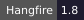 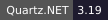 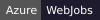 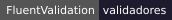 

</div>

<p align="center">
  <b>Lê os ERPs e SaaS das marcas, grava tudo no SQL Server com auditoria e alimenta o data warehouse.</b><br>
  <sub>Totvs Moda · Linx Microvix · Linx Commerce · Movidesk · AfterSale</sub>
</p>

<p align="center">
  <a href="#-visão-geral">Visão geral</a> ·
  <a href="#️-como-executar">Como executar</a> ·
  <a href="GUIA-DE-USO.md">Guia de uso</a> ·
  <a href="#-empresas-multiempresa">Empresas</a> ·
  <a href="#️-agendamento-dos-jobs">Agendamento</a> ·
  <a href="#️-painel-webapp">Painel</a> ·
  <a href="#️-data-warehouse">Data warehouse</a> ·
  <a href="#-documentação">Documentação</a>
</p>

---

## 🧭 Visão geral

O sistema de integrações da **Newbloomers** lê os dados dos ERPs e SaaS usados pelas marcas, grava tudo num banco
**SQL Server** com **histórico de auditoria**, oferece **leituras e escritas sob demanda** para outros sistemas e alimenta
um **data warehouse** com dimensões, fatos e agregados.

* 📦 Cada integração é um pacote independente (`Domain`, `Application` e `Infrastructure`).
* 🌐 O host web **`WebApi`** ([README](src/Backend/Hosts/WebApi/README.md)) registra todos os módulos e expõe as rotas.
* ⏱️ A agenda dos jobs recorrentes sai de `auditing.Jobs` e roda em **um de três hosts**: Hangfire no `WebApi`, WebJobs
  na Azure ou o serviço `Worker` com o Quartz.NET.
* 🏢 **Multiempresa:** cada empresa cliente (a holding) fica em `monitor.Company` e tem os **próprios jobs, logs e
  parâmetros**. Dados de cliente não ficam no DbUp: entram pela tela de cadastro (em construção) ou, nos testes, pelo
  [`tools/seeds/Import-TestSeeds.ps1`](tools/seeds/Import-TestSeeds.ps1).
* 🖥️ O painel **Monitor de Integrações** (`WebApp`) mostra o que os jobs gravam em `auditing`.

> [!TIP]
> Este documento dá o panorama. Os detalhes de cada módulo e de cada host estão no README dele.

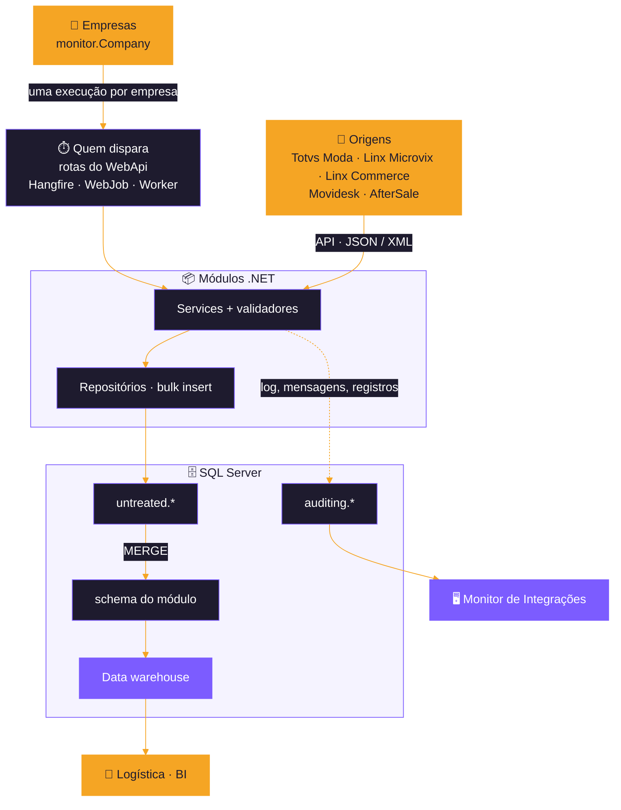

---

## 📌 Sumário

| | | |
|---|---|---|
| 🛠️ [Tecnologias](#️-tecnologias) | 🗂️ [Estrutura do repositório](#️-estrutura-do-repositório) | 🧩 [Módulos](#-módulos) |
| ⚙️ [Como uma integração funciona](#️-como-uma-integração-funciona) | 🏢 [Empresas (multiempresa)](#-empresas-multiempresa) | ⏱️ [Agendamento dos jobs](#️-agendamento-dos-jobs) |
| 🌐 [Endpoints](#-endpoints) | 🗄️ [Banco de dados e scripts](#️-banco-de-dados-e-scripts) | 🔧 [Configuração](#-configuração) |
| ▶️ [Como executar](#️-como-executar) | | |
| 📊 [Auditoria e relatórios](#-auditoria-e-relatórios) | 🖥️ [Painel (WebApp)](#️-painel-webapp) | 🏛️ [Data warehouse](#️-data-warehouse) |
| 📐 [Padrões do código](#-padrões-do-código) | 🚧 [Fora do host e pendências](#-fora-do-host-e-pendências) | 📚 [Documentação](#-documentação) |

---

## 🛠️ Tecnologias

| Camada | Tecnologia |
|---|---|
| 💻 **Linguagem e runtime** | C# / **.NET 10** (`net10.0`) |
| 🌐 **Host** | ASP.NET Core (`WebApplication.CreateSlimBuilder`), controllers e **Swagger** (Swashbuckle) |
| ⏱️ **Agendamento** | Agenda em `auditing.Jobs`, executada por um de três hosts: **Hangfire** 1.8 no `WebApi` (opcional, `Hangfire:Enabled`), **WebJobs** contínuos na Azure (`WebJob`) ou **Quartz.NET** 3.19 como serviço do Windows (`Worker`). O código comum fica em `Hosts.Scheduling` |
| 🗃️ **Acesso a dados** | **Dapper** e bulk insert (`ISharedRepository`), SQL montado nos *command handlers* |
| 🗄️ **Banco** | **SQL Server** (dados, auditoria e DW); scripts para MySQL e PostgreSQL existem só como `migrator.csx` |
| 🔁 **Migrações** | **DbUp** executado por `dotnet-script` (`migrator.csx` em cada módulo): só estrutura e catálogo do produto |
| 🧰 **Ferramentas** | `tools/migrators/Invoke-Migrators.ps1` (tela Windows Forms ou console) sobe as tabelas de todas as aplicações; `tools/seeds/Import-TestSeeds.ps1` (PowerShell 7 + `sqlcmd`) carrega empresa, parâmetros e jobs num banco de teste |
| ✅ **Validação** | **FluentValidation** (um validador por DTO) |
| 🔌 **HTTP e JSON** | `IHttpClientFactory` (`IApiClient` nomeado por módulo), **Newtonsoft.Json**, XML (`System.Xml.Linq`) no Linx Microvix |
| ⚡ **Cache** | `IMemoryCache` ([padrão](docs/PADRAO-CACHE-INTEGRACOES.md)) |
| 🖥️ **Front-end** | Blazor Web App (interativo no servidor) com **MudBlazor** 9, visual pronto sobre dados mockados e um **assistente de IA** (Claude, pacote `Anthropic`, só leitura) ([README](src/Frontend/WebApp/README.md)) |
| 📱 **Mobile** | .NET MAUI (`src/Mobile/MobileApp`), em construção |

---

## 🗂️ Estrutura do repositório

```text
extract-transform-load-integrations-system/
├── 📄 etl-integrations-system.slnx          solução
├── 📚 docs/                                 padrões, migrator, plano do cadastro de empresas e imagens dos READMEs
├── 📂 src/
│   ├── Backend/
│   │   ├── Hosts/
│   │   │   ├── Hosts.Scheduling/         comum aos hosts de agenda: mapa IdJob → método ([JobVersion]), cron e executor
│   │   │   ├── WebApi/                   host web: controllers, Swagger, registro dos módulos e o Hangfire opcional
│   │   │   ├── WebJob/                   host dos WebJobs na Azure: um WebJob por job
│   │   │   └── Worker/                   serviço do Windows com o Quartz.NET: todos os jobs num processo
│   │   ├── Shared/                       auditoria, cliente HTTP, repositório comum, trava, middlewares e scripts base
│   │   └── Modules/
│   │       ├── Totvs/
│   │       ├── LinxMicrovix/             Outbound Web Service (leituras) e Inbound (vazio)
│   │       ├── LinxCommerce/
│   │       ├── General/                  AfterSale, Movidesk (ativos); Dootax, Mobsim, Oto, Pagarme (fora do host)
│   │       ├── Shippment/                FlashCourier, Jadlog, Stone, TotalExpress (fora do host)
│   │       └── DataWarehouse/
│   ├── Frontend/WebApp/                  painel Blazor (visão geral, aplicações, integrações, erros, sob demanda e consultas)
│   └── Mobile/MobileApp/                 app MAUI
├── 🧰 tools/
│   ├── migrators/                        Invoke-Migrators.ps1: tela para rodar os migrators na ordem certa
│   └── seeds/                            Import-TestSeeds.ps1: carrega uma empresa de teste (parâmetros e jobs)
└── 🧪 tests/                                (vazio)
```

<details>
<summary><b>📦 Desenho de cada módulo</b></summary>

```text
<Módulo>/
├── Domain.<Módulo>/          DTOs (Dtos/Reads e Dtos/Writes), entidades, enums (EnumJob) e interfaces dos repositórios
├── Application.<Módulo>/     services (regras de leitura e escrita), command handlers (SQL) e validadores
├── Infrastructure.<Módulo>/  repositórios, injeção de dependência, Scripts/SQLServer (DbUp: estrutura e catálogo)
│                             e Seeds/SQLServer (parâmetros de uma empresa, fora do DbUp, lidos só pelo .ps1)
├── docs/                     propostas, planos, implementações e modelagens do módulo, e as respostas de
│                             exemplo da API (Responsed Jsons ou Responsed XMLs, com dados fictícios)
└── README.md                 documentação do módulo
```

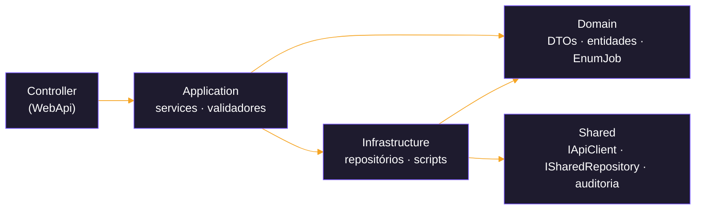

</details>

---

## 🧩 Módulos

Registrados no host (`src/Backend/Hosts/WebApi/Extensions/ServicesExtensions.cs`):

| Módulo | Sistema | App | Schema | Rota base | Rotas | README |
|---|---|:---:|---|---|:---:|:---:|
| 🟣 **Totvs** | Totvs Moda (ERP: pessoas, produtos, pedidos, notas, financeiro) | `130` | `totvs` | `TotvsJobs/Totvs` | **123** | [📖](src/Backend/Modules/Totvs/README.md) |
| 🟣 **LinxMicrovix** (Outbound) | Linx Microvix (ERP e B2C, web services XML) | `80` | `linxmicrovix` | `LinxMicrovixJobs/LinxMicrovix` | **284** | [📖](src/Backend/Modules/LinxMicrovix/LinxMicrovix%20-%20Outbound%20Web%20Service/README.md) |
| 🟣 **LinxCommerce** | Linx Commerce (e-commerce: pedidos, clientes, catálogo) | `70` | `linxcommerce` | `LinxCommerceJobs/LinxCommerce` | **12** | [📖](src/Backend/Modules/LinxCommerce/README.md) |
| 🟣 **Movidesk** | Movidesk (help desk: tickets, pessoas, serviços) | `30` | `movidesk` | `MovideskJobs/Movidesk` | **16** | [📖](src/Backend/Modules/General/Movidesk/README.md) |
| 🟣 **AfterSale** | Troque Fácil (pós-venda: reversas e reembolsos) | `50` | `aftersale` | `AfterSaleJobs/AfterSale` | **24** | [📖](src/Backend/Modules/General/AfterSale/README.md) |
| 🟠 **DataWarehouse** | DW do NEWBLOOMERS (lê as tabelas dos módulos) | `90` | `dw_*`, `datawarehouse`, `datamart` | `DataWarehouseJobs/DataWarehouse` | **5** | [📖](src/Backend/Modules/DataWarehouse/docs/00-ordem-de-leitura.md) |
| ⚫ **Hosts** | Jobs dos próprios hosts de agenda (job 14000 `StuckJobsRecovery`, só no WebJob; um por empresa) | `140` | — | — | — | [📖](src/Backend/Hosts/WebJob/README.md) |
| ⚫ **Shared** | Base comum: auditoria, `IApiClient`, `ISharedRepository`, trava de concorrência (`IJobLock`), empresa da execução (`ICompanyContext`) | — | `auditing`, `monitor`, `untreated`, `dbo` | — | — | — |

<sub>**App** = `IdParent` em `auditing.Apps`. Rotas contadas no Swagger do host.</sub>

<div align="center">

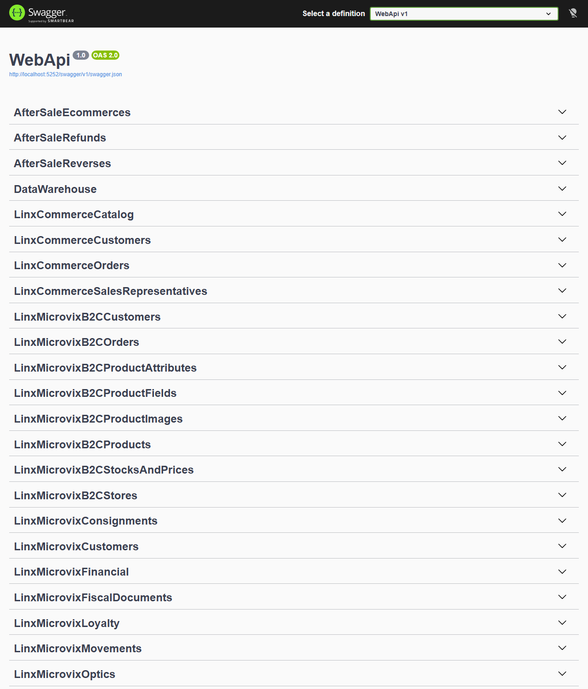

<sub><b>Swagger do WebApi</b> — uma tag por service de cada módulo (<code>http://localhost:5252/swagger</code>)</sub>

</div>

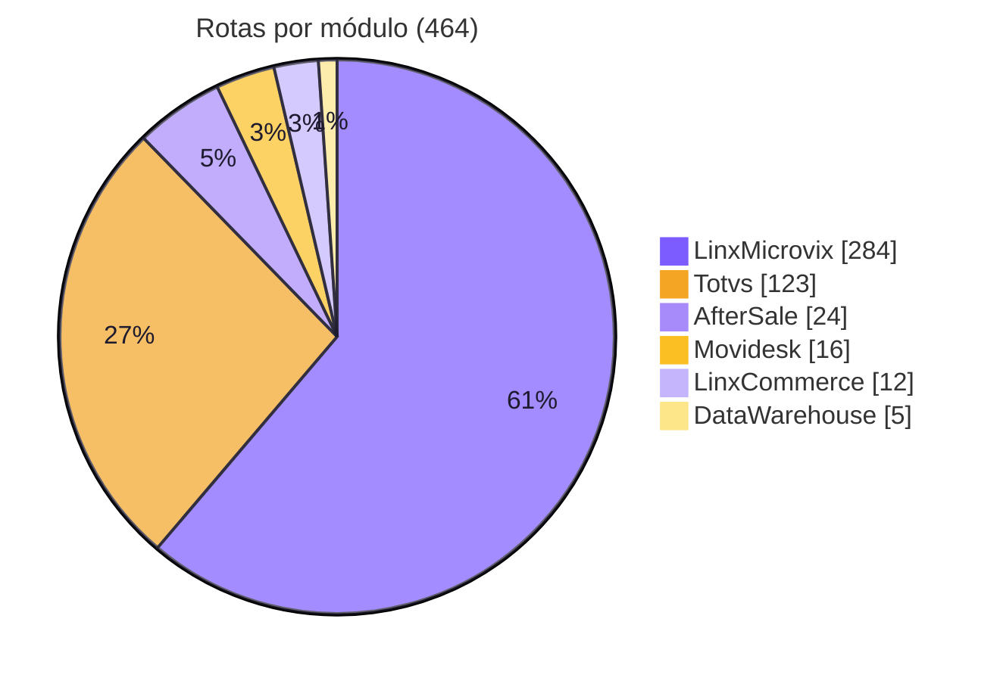

---

## ⚙️ Como uma integração funciona

### 🔄 Leitura recorrente (carga do banco)

1. Uma rota (`POST` ou `GET` sem parâmetros) ou o agendador dispara o job **para uma empresa** (`ICompanyContext`); ele
   abre um log em `auditing.Logs` com o `IdJob` do `EnumJob` e a `Company`.
2. A service lê os CNPJs da empresa na tabela de parâmetros do módulo (`<schema>.<Módulo>Parameters`, pelo join com
   `monitor.HoldingCompanies`) e, para cada um, chama a API com **paginação**, **nova tentativa** em 401/429/502/503/504
   e a **janela de alteração** (data ou `timestamp`).
3. Cada registro é **validado** (FluentValidation; erro vira mensagem no log, não interrompe), convertido em entidade com
   o **mesmo horário de lote** e o CNPJ da empresa (`doc_company`) e filtrado pelo cache/estado já gravado (só novos ou
   alterados).
4. O repositório faz o **bulk insert** em `untreated.<Tabela>` e a procedure `<schema>.sp_<Tabela>_Sync` (gerada pelo
   `dbo.sp_Create_Merge_Procedure` do Shared, que recebe `@Company`) faz o `MERGE` na tabela final `<schema>.<Tabela>`,
   com PK.
5. O JSON/XML de cada registro vai para `auditing.Records`, as mensagens para `auditing.Messages`, e o log é fechado com
   o total gravado.

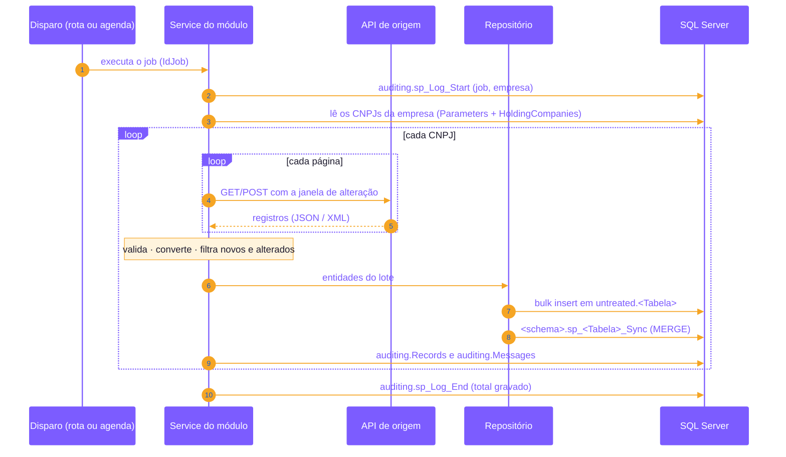

### 🎯 Leitura sob demanda (um registro por chave)

Rotas `GET .../{docCompany}/{chave}` chamadas por sistemas externos: exigem o cabeçalho **`X-User-Name`** (até 100
caracteres) e o CNPJ na rota, que precisa estar em `monitor.HoldingCompanies` (a empresa da execução é a holding dele;
ver [Empresas](#-empresas-multiempresa)); leem só aquele registro, gravam pelo mesmo caminho da leitura recorrente e
registram a chamada em `<schema>.<Módulo>Requests`.

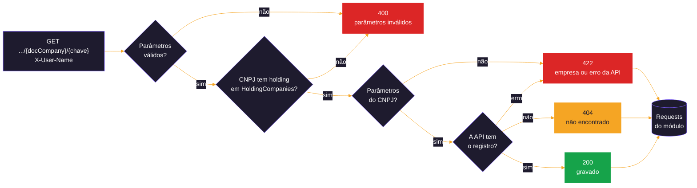

### ✍️ Escrita (Totvs, Movidesk, AfterSale)

Rotas `POST`/`PUT`/`PATCH`/`DELETE` com corpo **validado antes** de chamar a API (400 com os erros, sem chamada). Cada
chamada fica em `<Módulo>Requests` com usuário, rota, corpo, resposta e `status_code`.

> [!IMPORTANT]
> Na **Totvs**, cada grupo de escrita só roda com `Totvs:Writes:<grupo>:Enabled = true` (senão **422**) e há uma trava
> contra a repetição do mesmo corpo em **10 minutos**.

---

## 🏢 Empresas (multiempresa)

O sistema atende mais de um cliente. A **empresa** de tudo é a **holding** cadastrada em `monitor.Company` (CNPJ, só
dígitos), e ela entra na chave de `auditing.Jobs`, `Logs`, `Messages` e `Records` (coluna **`Company`**). As decisões e
as fases estão em [PLANO-TELA-CADASTRO-EMPRESA.md](docs/PLANO-TELA-CADASTRO-EMPRESA.md) e na
[proposta](src/Backend/Shared/docs/PROPOSTA-DOC-COMPANY-AUDITING.md).

| | Peça | Para que serve |
|:---:|---|---|
| 🏢 | `monitor.Company` | Empresas clientes (holding): razão social, nome fantasia e `IsActive`. Só as ativas entram na agenda |
| 🔗 | `monitor.HoldingCompanies` | De/para dos CNPJs que aparecem em `doc_company` nas tabelas `*Parameters` (marcas, filiais) para a holding. Um CNPJ é de uma holding só |
| 📚 | `auditing.JobCatalog` | Catálogo de jobs do produto, sem empresa, criado pelo DbUp (inclusive o 14000 dos hosts) |
| 🗓️ | `auditing.Jobs` | Uma linha por **(job, empresa)**, com a `IsActive` daquela empresa: ativar é um `UPDATE` na linha dela |
| ➕ | `auditing.sp_Add_Company` | Cadastra a empresa e já cria os jobs dos hosts dela |
| 🧩 | `auditing.sp_Add_Company_App` / `sp_Remove_Company_App` | Contrata (copia o catálogo do módulo para `auditing.Jobs`, inativos) ou remove (desativa) uma integração |
| 🔑 | `auditing.sp_Add_Holding_Company` | Liga um CNPJ de parâmetro à holding |
| 🧠 | `ICompanyContext` (Shared) | A empresa da execução, uma por escopo: o log, os repositórios e a `sp_*_Sync` leem dela |
| 🖼️ | `monitor.AppImage` / `monitor.AppSetting` | Imagem e parâmetros de apresentação do painel por módulo e empresa (`Company = '*'` é o padrão) |

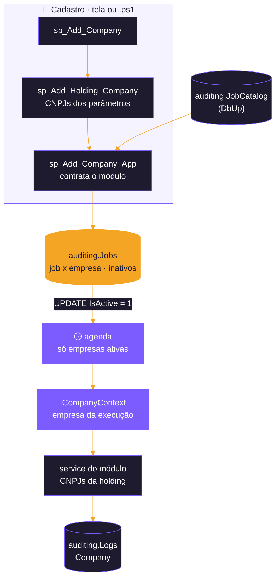

**Empresa numa rota** (`CompanyContextFilter`, global no `WebApi`): vem do cabeçalho **`X-Company`** (CNPJ da holding)
ou, sem ele, da holding do `{docCompany}` da rota.

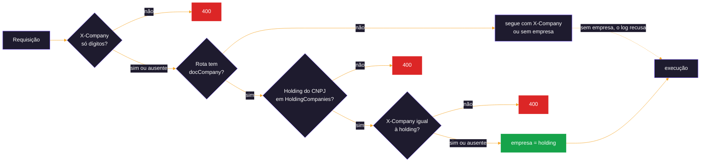

> [!IMPORTANT]
> Num ambiente novo o sistema sobe **sem nenhuma empresa**, e nada roda até alguém cadastrar uma. Os parâmetros
> (credenciais) ficam em **texto puro** nas tabelas `*Parameters` nesta fase.

---

## ⏱️ Agendamento dos jobs

A agenda é uma só, em `auditing.Jobs`, com **uma linha por (job, empresa)** e só das empresas ativas em
`monitor.Company`:

| Coluna | Significado |
|---|---|
| `Company` | a empresa (holding) daquela linha; o agendador roda **uma execução por (job, empresa)** |
| `IsActive` | só com `1` o job entra na agenda para aquela empresa; **todo insert nasce `0`** |
| `IntervalTimeInMinutes` | intervalo; `0` = sob demanda, fora da agenda |
| `RunningDailyAt` | preenchida, o job é diário e roda nessa hora (só com intervalo `1440`) |
| `Queue` | fila do Hangfire (não divide jobs entre os hosts) |

O `Hosts.Scheduling` liga cada `IdJob` ao método do service e é usado pelos três hosts:

| Host | Como agenda | Onde roda | README |
|---|---|---|:---:|
| 🌐 `WebApi` | Hangfire, com `Hangfire:Enabled = true` (padrão `false`: só API) e dashboard em `/hangfire` | junto das rotas | [📖](src/Backend/Hosts/WebApi/README.md) |
| ☁️ `WebJob` | um processo por job (`--job <IdJob>`), que atende todas as empresas ativas, uma de cada vez, lendo a agenda a cada ciclo | WebJobs contínuos na Azure (`Publish/publish-webjob.ps1`) | [📖](src/Backend/Hosts/WebJob/README.md) |
| 🪟 `Worker` | Quartz.NET com `AdoJobStore` em cluster (schema `quartz`), agenda relida pelo `SchedulerRefreshJob` | serviço do Windows `EtlWorker` (`Publish/publish-worker.ps1`) | [📖](src/Backend/Hosts/Worker/README.md) |

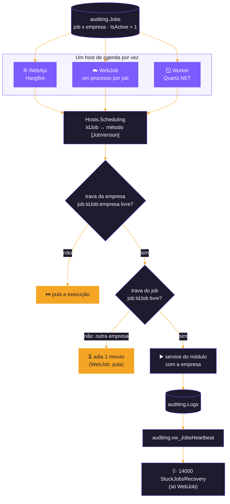

> [!WARNING]
> **Um host de agenda por vez** no mesmo banco. O `WebApi` em modo só API combina com qualquer um deles, para o disparo
> manual pelas rotas.

* 🔒 **Trava de concorrência em duas chaves:** o `IJobLock` do Shared (`sp_getapplock`) usa as mesmas chaves nos três
  hosts. A **da empresa** (`job:<IdJob>:<empresa>`, ou `group:datawarehouse:<empresa>` no DW) ocupada quer dizer que a
  execução anterior da mesma empresa ainda roda: **pula**. A **do job** (`job:<IdJob>`) vale entre empresas, porque todas
  escrevem nas mesmas tabelas (`untreated` e a `sp_*_Sync`): ocupada por outra empresa, no Hangfire e no Worker a
  execução **volta em 1 minuto** (`Rescheduled: job:<IdJob> running for another company`); no WebJob, que atende as
  empresas uma de cada vez, o horário é pulado. As rotas do `WebApi` ficam fora dessas travas.
* 🏷️ **Versão dos jobs:** o método chamado por um job recorrente leva `[JobVersion("MAJOR.MINOR.PATCH")]`; o nome do job
  no agendador leva a versão e a empresa (`<IdJob>-<Title> - V<versão> - <empresa>` no Hangfire e no Quartz;
  `<Title> - V<versão>` no WebJob, que atende todas as empresas), e uma versão nova troca o job antigo na releitura da
  agenda. Sem versão, o host com agenda não sobe.
* 🩺 **Heartbeat:** a view `auditing.vw_JobsHeartbeat` dá a última execução de cada (job, empresa); no WebJob, o 14000
  `StuckJobsRecovery` de cada empresa lê o heartbeat só dela e reinicia na Azure os WebJobs com o heartbeat off (sem
  execução em 1 × o intervalo).

---

## 🌐 Endpoints

O Swagger do host lista todas as rotas, agrupadas pela tag de cada service: **`http://localhost:5252/swagger`** (perfil de
desenvolvimento).

| Módulo | 🔄 Leituras recorrentes | 🎯 Sob demanda | ✍️ Escritas e ações |
|---|---|---|---|
| **Totvs** | **43** (pessoas, filiais, vendedores, produtos, saldos, preços, pedidos, notas, duplicatas, catálogos) | **24** (`GET` por chave) | **56** (`POST`/`PUT`/`DELETE` com `{docCompany}`: pessoas, produtos, preços, pedidos de compra e de venda, duplicatas, bônus, fiscal) |
| **LinxMicrovix** | **260** (`POST <Método>`, um por método da API: 191 do ERP e 69 do B2C) | **24** | — |
| **LinxCommerce** | **6** (`SearchOrders`, `SearchOrderStatus`, `SearchCustomer`, `SearchProduct`, `SearchSKU`, `SearchSalesRepresentative`) | **6** | — |
| **Movidesk** | **3** (`Tickets`, `People`, `Services`) | **3** | **10** (tickets, anexos, pessoas, serviços) |
| **AfterSale** | **12** (e-commerce, reversas, reembolsos e domínios) | **2** (`Reverses/{docCompany}/{id}`, `Refunds/{docCompany}/{id}`) | **10** (reversas: aprovar, receber produtos, nota de devolução, nota e XML, registro administrativo; reembolsos: aprovar, cancelar, pagar, alterar valor) |
| **DataWarehouse** | `RunHourly`, `RunDaily`, `RunShortCycle`, `RunMonthlyStock?positionDate=`, `RunLinxLegacy` | — | — |

```http
POST http://localhost:5252/TotvsJobs/Totvs/Customers
GET  http://localhost:5252/TotvsJobs/Totvs/Customers/44065634000106/123
X-User-Name: fulano
X-Company: 44065634000106

POST http://localhost:5252/LinxMicrovixJobs/LinxMicrovix/LinxProdutos
POST http://localhost:5252/DataWarehouseJobs/DataWarehouse/RunHourly
```

> [!CAUTION]
> O `[Authorize]` dos controllers está comentado: o host ainda não tem um esquema de autenticação configurado
> (`Api/Auth/token` existe, mas não protege as rotas).

---

## 🗄️ Banco de dados e scripts

### Schemas

| Schema | Conteúdo |
|---|---|
| 📝 `auditing` | `Apps`, `JobCatalog`, `Jobs`, `Types`, `Logs`, `Messages`, `Records` (com `Company`), as procedures `sp_Log_Start/Message/Error/End`, `sp_Add_Company`, `sp_Add_Company_App`, `sp_Remove_Company_App`, `sp_Add_Holding_Company`, a função `fn_JobCatalogTree` e a view `vw_JobsHeartbeat` (Shared) |
| 🏢 `monitor` | `Company`, `HoldingCompanies`, `AppImage` e `AppSetting`: empresas clientes e a apresentação do painel por empresa (Shared, `Script008`) |
| 📥 `untreated` | Carga bruta de cada tabela de dados, sem chave (recebe o bulk insert) |
| 🧩 `totvs`, `linxmicrovix`, `linxcommerce`, `movidesk`, `aftersale` | Tabelas finais (com PK), procedures `sp_<Tabela>_Sync` (com `@Company`), parâmetros e `<Módulo>Requests` |
| 🔧 `dbo` | `sp_Create_Merge_Procedure` (gera os merges), `sp_TryApplock`, limpeza de logs e manutenção (Shared) |
| 🪟 `quartz` | Tabelas do Quartz.NET (`QRTZ_*`), só para o host `Worker` (migrator do próprio host) |
| 🌐 `HangFire` | Storage do Hangfire, criado por ele mesmo quando o `WebApi` sobe com `Hangfire:Enabled = true` |
| 🏛️ `dw_landing`, `dw_history`, `dw_intermediate`, `dw_personal_data`, `datawarehouse`, `datamart`, `dw_outbound`, `dw_reference`, `dw_control` | Data warehouse |

Toda tabela de dados tem **`doc_company`** (CNPJ da empresa) e **`integrated_or_updated_at`** (horário da gravação, em
Brasília).

<details>
<summary><b>🗺️ Modelo de <code>auditing</code> e <code>monitor</code></b></summary>

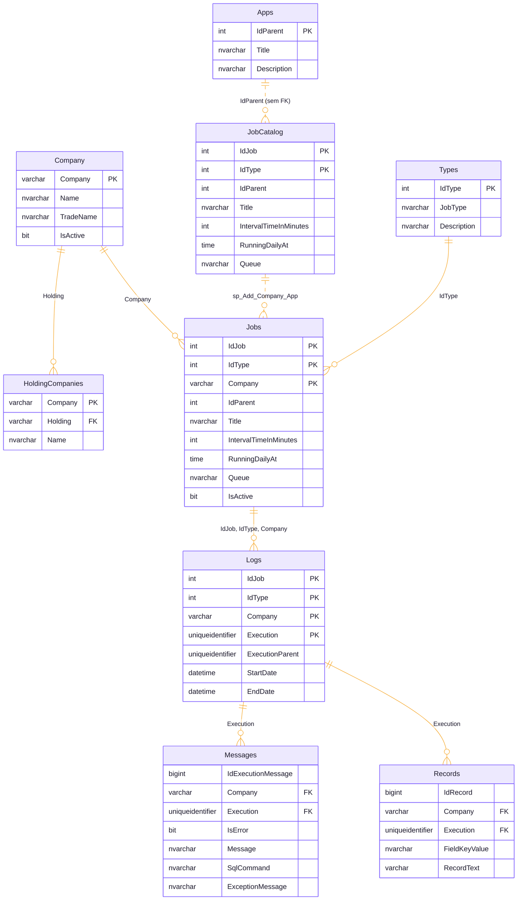

</details>

### Scripts (DbUp)

O DbUp cria **estrutura e catálogo do produto**; tudo o que depende de um cliente (linhas de `*Parameters` e de
`auditing.Jobs`) fica fora dele. Cada módulo tem:

```text
Infrastructure.<Módulo>/
├── Scripts/SQLServer/     ← DbUp (estrutura e catálogo)
│   ├── migrator.csx
│   ├── Parameters/        schema, tabela de parâmetros, app e a tabela de requests
│   └── <Service>/         um trio por service: _Tables, _Sync_Procedures e _Jobs_Into_Jobs_Table (→ auditing.JobCatalog)
└── Seeds/SQLServer/       ← fora do DbUp: parâmetros (credenciais) de uma empresa, lidos só pelo .ps1 de teste
```

* O **`Shared`**, base dos outros, não tem services e mantém os scripts direto em `SQLServer/` (`Script001` a
  `Script008`: schemas e tabelas de `auditing`, procedures de log e de cadastro, merge, `dbo`, tipos, views, os jobs do
  app 140 `Hosts` no catálogo e o schema `monitor`).
* Os scripts de credenciais de LinxMicrovix e LinxCommerce ficam **fora do git** (`.gitignore`), só com o `.example`;
  os de Totvs, Movidesk e AfterSale estão no git, em `Seeds/SQLServer`.
* O host **`Worker`** tem o próprio migrator, com as tabelas do Quartz.
* A numeração é **única e sequencial** no módulo e define a ordem de execução (o `migrator.csx` lê as subpastas e ordena
  pelo número). No DW as pastas são por camada (`Parameters`, `Landing`, `History`, `PersonalData`, `Dimensions`,
  `Intermediate`, `Facts`, `Datamart`, `Outbound`, `Checks`).
* Uma correção de tabela, procedure ou view vai **no script de criação**, não num `ALTER` novo.

**Ordem entre os migrators:**

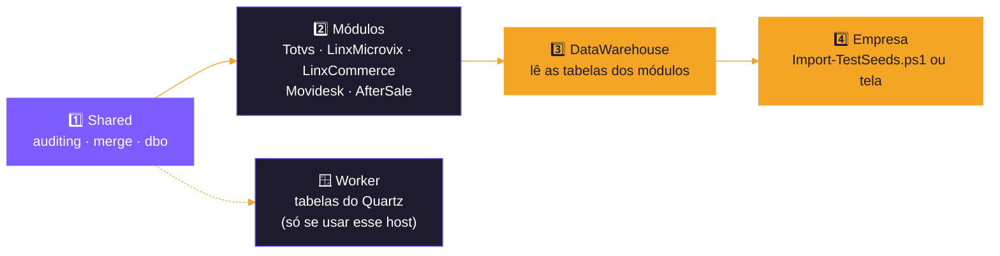

> [!WARNING]
> Renomear, dividir ou renumerar scripts: em bancos que já rodaram as migrações, o DbUp vê os scripts como novos e
> executa de novo.

---

## 🔧 Configuração

`src/Backend/Hosts/WebApi/appsettings.json` (o `WebJob` e o `Worker` têm o próprio, com as seções dos módulos e a do
agendador; ver o README de cada host):

| Chave | Uso |
|---|---|
| `ConnectionStrings:Connection` | SQL Server (dados, auditoria e DW) |
| `<Módulo>:BaseUrl` | Endereço da API de cada módulo (`Totvs`, `LinxMicrovix`, `Movidesk`, `AfterSale`...); homologação é outro valor no ambiente |
| `Totvs:Writes:<grupo>:Enabled` | Liga as escritas da Totvs por grupo (`AccountsPayable`, `Bonus`, `Invoices`, `People`, `Products`, `PurchaseOrders`, `SalesOrders`) |
| `Totvs:Writes:Products:AllowedValueCodes`, `AllowedValueBranches`, `MaxValueVariationPercent` | Limites da escrita de preço e custo |
| `DataWarehouse:Pepper` | Pepper do hash de CPF/CNPJ no DW; sem ele, as etapas com `doc_hash` são puladas |
| `Hangfire:Enabled` e `Hangfire:Dashboard:*` | Liga o Hangfire no `WebApi`; usuário e senha do dashboard só por variável de ambiente ou user-secrets |

As empresas e credenciais de cada API ficam **no banco**: a empresa em `monitor.Company` e as credenciais na tabela de
parâmetros do módulo (`TotvsParameters`, `LinxMicrovixParameters`, `LinxCommerceParameters`, `MovideskParameters`,
`AfterSaleParameters`), uma linha por CNPJ. Elas entram pela tela de cadastro (em construção) ou, nos testes, pelos
scripts de `Seeds/SQLServer` via `tools/seeds/Import-TestSeeds.ps1`. O Linx Commerce não tem `BaseUrl`: o endereço é de
cada cliente, na tabela de parâmetros.

> [!NOTE]
> Credenciais nunca são gravadas em logs nem nas tabelas de requests.

---

## ▶️ Como executar

> [!TIP]
> O passo a passo completo, com cada projeto, está no **[Guia de uso](GUIA-DE-USO.md)**.

**Pré-requisitos:** ✅ .NET 10 SDK · ✅ SQL Server · ✅ PowerShell 7 · ✅ `dotnet-script`
(`dotnet tool install -g dotnet-script`) · ✅ `sqlcmd` (só para o banco de teste)

**1. 🗄️ Banco** — a tela [`tools/migrators/Invoke-Migrators.ps1`](tools/migrators/Invoke-Migrators.ps1) roda os
migrators das aplicações marcadas na ordem certa (Shared, integrações, DataWarehouse e o host de agenda escolhido), cada
um a partir de uma unidade `subst` (sem o limite de 260 caracteres do Windows), para no primeiro erro e mostra a senha
como `****` no log:

```powershell
./tools/migrators/Invoke-Migrators.ps1
./tools/migrators/Invoke-Migrators.ps1 -NoGui -Database EtlTeste -SchedulingHost Worker -TestSeeds
```

<div align="center">

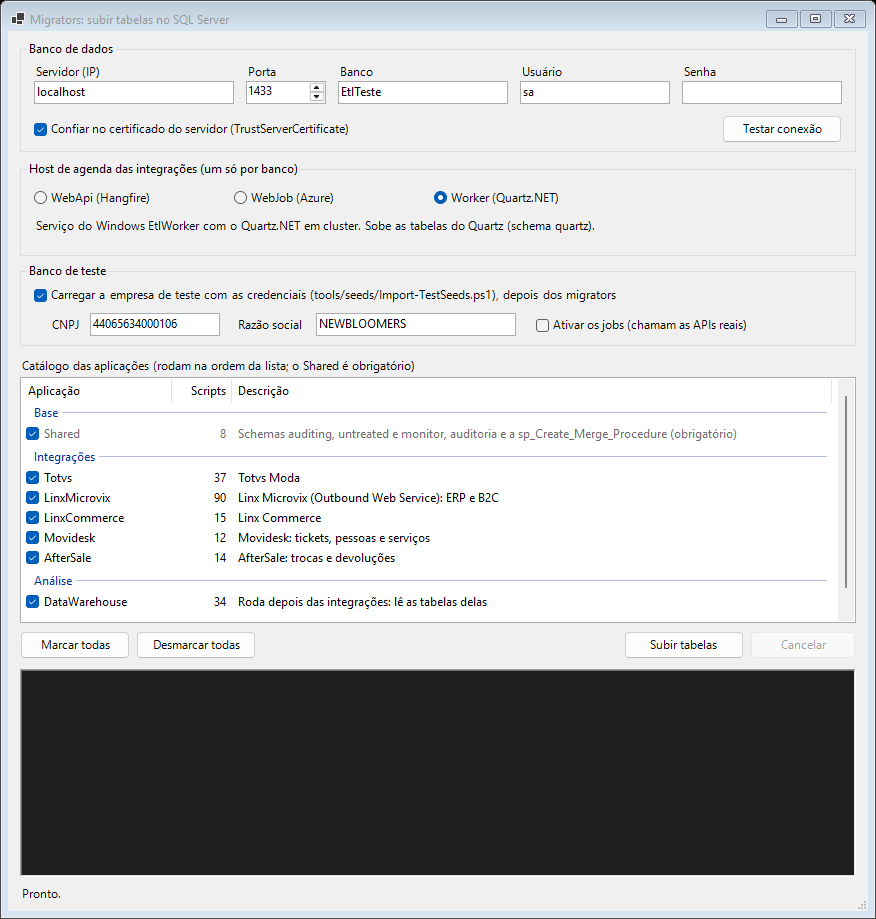

<sub><b>Invoke-Migrators</b> — banco, host de agenda, banco de teste e o catálogo das aplicações</sub>

</div>

<details>
<summary><b>🔧 Rodar um migrator à mão</b></summary>

De dentro da pasta `Scripts/SQLServer` de cada aplicação, na mesma ordem, passando a connection string:

```bash
dotnet script migrator.csx -- "Server=localhost;Database=NEWBLOOMERS;User Id=sa;Password=...;TrustServerCertificate=True;"
```

No Windows, o caminho dos módulos passa de 260 caracteres: mapeie a pasta com `subst X: "<pasta SQLServer>"` e rode o
migrator a partir de `X:` ([MIGRATOR-CSX.md](docs/MIGRATOR-CSX.md)). O migrator do DW exige a connection string como
argumento e não imprime usuário nem senha.

</details>

**2. 🏢 Empresa de teste** — a opção **Banco de teste** da tela (ou `-TestSeeds`) já faz este passo. Sozinho, ele cadastra a empresa, liga os CNPJs dos parâmetros, carrega os parâmetros de
`Seeds/SQLServer` e cria os jobs (inativos, salvo `-ActivateJobs`). Só aceita banco com `Test`/`Teste` no nome (ou
`-Force`):

```powershell
./tools/seeds/Import-TestSeeds.ps1 -Database 'EtlTeste'
./tools/seeds/Import-TestSeeds.ps1 -Database 'EtlTeste' -Modules Totvs,DataWarehouse -ActivateJobs
```

**3. 🌐 Host**

```bash
dotnet run --project src/Backend/Hosts/WebApi
```

O Swagger abre em `http://localhost:5252/swagger`.

**4. ⏱️ Agenda** *(opcional, um host por vez)* — o `WebApi` com `Hangfire__Enabled=true`, o `WebJob` ou o `Worker` (a
connection string vai por user-secrets ou variável de ambiente; detalhes no README de cada host):

```bash
dotnet run --project src/Backend/Hosts/WebJob -- --job 9002
```

<div align="center">

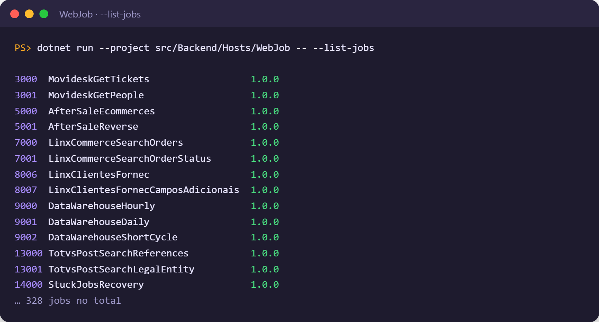

<sub><code>--list-jobs</code> lista os jobs que o host conhece, sem subir o host nem acessar o banco</sub>

</div>

```bash
dotnet run --project src/Backend/Hosts/Worker
```

> [!CAUTION]
> Num banco de teste criado pelos migrators, as credenciais dos módulos são **reais**: aponte as `BaseUrl` para uma porta
> local fechada (ex.: `Movidesk__BaseUrl=http://127.0.0.1:9/`), senão os jobs ativos chamam as APIs de verdade.

**5. 🖥️ Painel** — sem banco nem API (dados mockados), em `http://localhost:5067`. O assistente de IA precisa de
`Assistant:ApiKey` nos user-secrets do WebApp.

```bash
dotnet run --project src/Frontend/WebApp --launch-profile http
```

**6. 🏗️ Build da solução** — o host compila sozinho (`dotnet build src/Backend/Hosts/WebApi`); a solução inteira hoje
falha no restore de módulos fora do host (pacotes sem versão em Dootax, Oto, Stone e TotalExpress).

---

## 📊 Auditoria e relatórios

| Onde | O que fica registrado |
|---|---|
| `auditing.Logs` | Cada execução de job: `IdJob`, `IdType`, `Company`, `Execution` (GUID), execução pai, início e fim |
| `auditing.Messages` | Mensagens da execução: erros de validação, respostas de erro da API, avisos |
| `auditing.Records` | O registro integrado (JSON ou XML) pela chave (`FieldKeyValue`), para conferir o que veio da origem |
| `<schema>.<Módulo>Requests` | Cada leitura sob demanda e escrita: usuário (`X-User-Name`), rota, chave, corpo, resposta, `is_success`, `status_code` |
| `auditing.JobCatalog` / `auditing.Apps` | Catálogo dos jobs (id, título, intervalo, tipo: integração ou procedure) por app |
| `auditing.Jobs` | Os jobs de cada empresa, com a agenda e a ativação dela |
| `auditing.vw_JobsHeartbeat` | Última execução de cada (job, empresa) (heartbeat dos hosts de agenda) |
| `dw_control.CheckResult` | Resultado das checagens do DW em cada carga |
| `dw_control.Watermark` | Até onde cada origem já foi lida pelo DW |

**Relatórios gerados pelo DW:**

* 📈 **Fatos e dimensões** (`datawarehouse`): vendas por item (`FactSalesItem`), pedidos (`FactOrderItem`), pagamentos de
  notas, estoque mensal (`FactMonthlyStock`), compras, contas a pagar, comissões, recepção de loja, chamadas de API
  (`FactApiRequest`), tickets e reembolsos; dimensões de data, loja, produto, cliente, vendedor, fornecedor, forma de
  pagamento, operação, canal, marca, representante, região e promoção.
* 🧮 **Agregados** (`datamart.DailySales`, atualizado por `sp_DailySales_Refresh`).
* 🚚 **Visões de saída** (`dw_outbound.WmsOrders`, `dw_outbound.LogisticsShipments`) para os sistemas de logística.
* ✅ **Checagens** (9 views `vw_Check_*`: grão do fato, membro desconhecido, soma dos produtos, pedido sem tipo, filhas
  apagadas, conciliação do faturado, estoque negativo ou sem custo, sobreposição de ERP e de/para de produto), com o
  resultado gravado em `CheckResult`.
* 🔐 **Dado pessoal** separado em `dw_personal_data`; nas tabelas do DW o cliente aparece só pelo hash do documento.

---

## 🖥️ Painel (WebApp)

O **Monitor de Integrações** ([README](src/Frontend/WebApp/README.md) · [plano](src/Frontend/WebApp/docs/PLANO-WEBAPP.md))
é um Blazor Web App com MudBlazor que lê as tabelas de `auditing`. Hoje roda sobre **dados mockados**
(`MockMonitorRepository` e `MockQueryRunner`), sem autenticação, com o visual aprovado por mockup, **tema escuro e claro**
e telas responsivas para celular e tablet.

<div align="center">

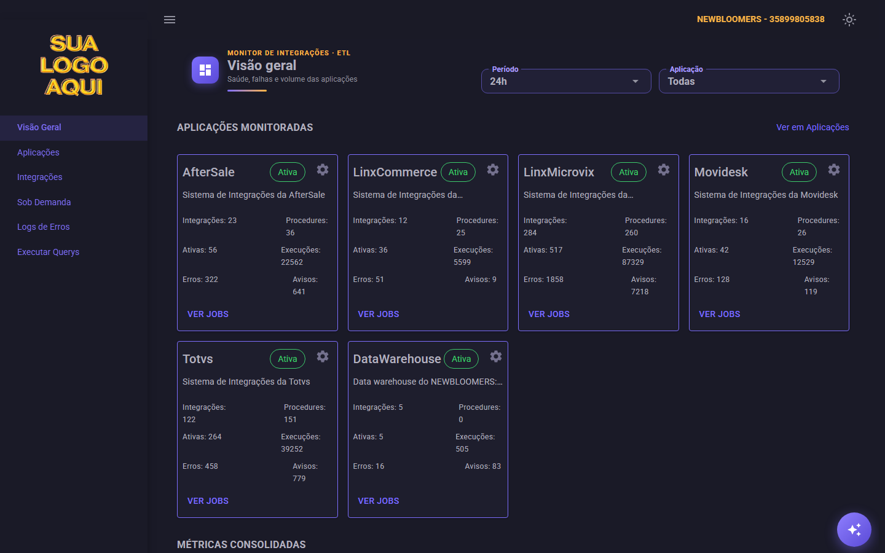

<sub><b>Visão Geral</b> — cards das aplicações com integrações, execuções, erros e avisos</sub>

</div>

| 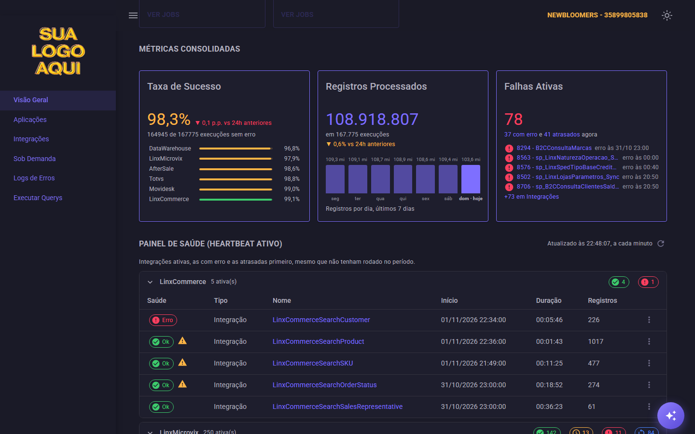<br> <sub><b>Métricas e painel de saúde</b> — taxa de sucesso, registros por dia e falhas ativas</sub> | 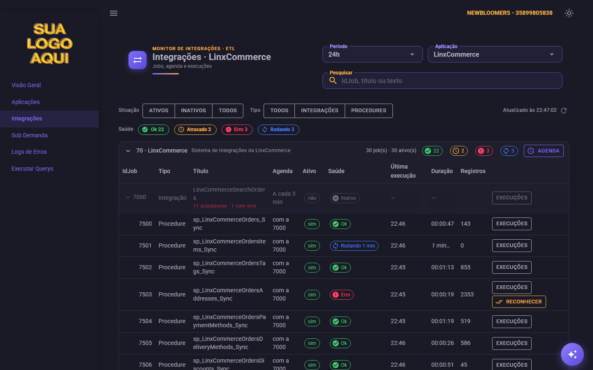<br> <sub><b>Integrações</b> — jobs por aplicação, procedures, saúde, Executar agora e Agenda</sub> |
|:---:|:---:|
| 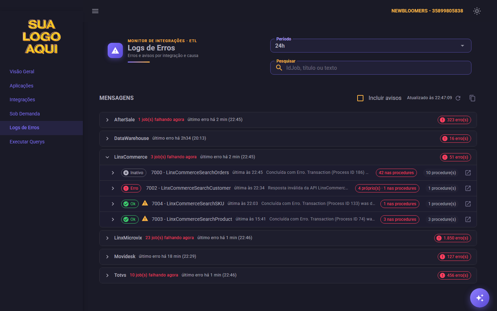<br> <sub><b>Logs de Erros</b> — mensagens por aplicação, integração e causa</sub> | 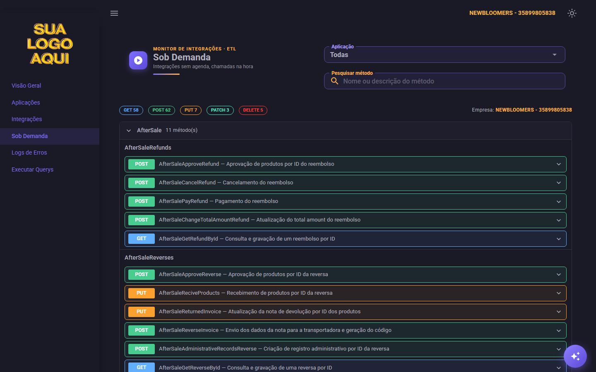<br> <sub><b>Sob Demanda</b> — integrações sem agenda, no estilo do Swagger</sub> |
| 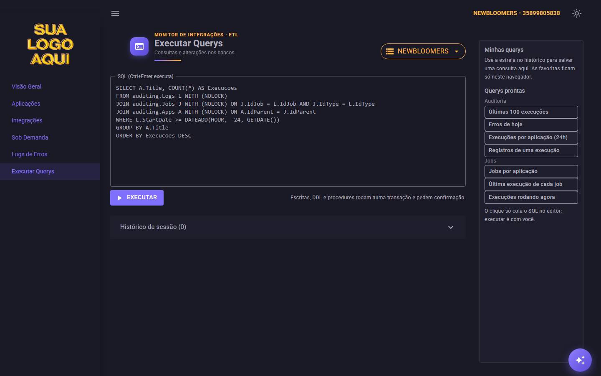<br> <sub><b>Executar Querys</b> — SQL com favoritas e querys prontas</sub> | 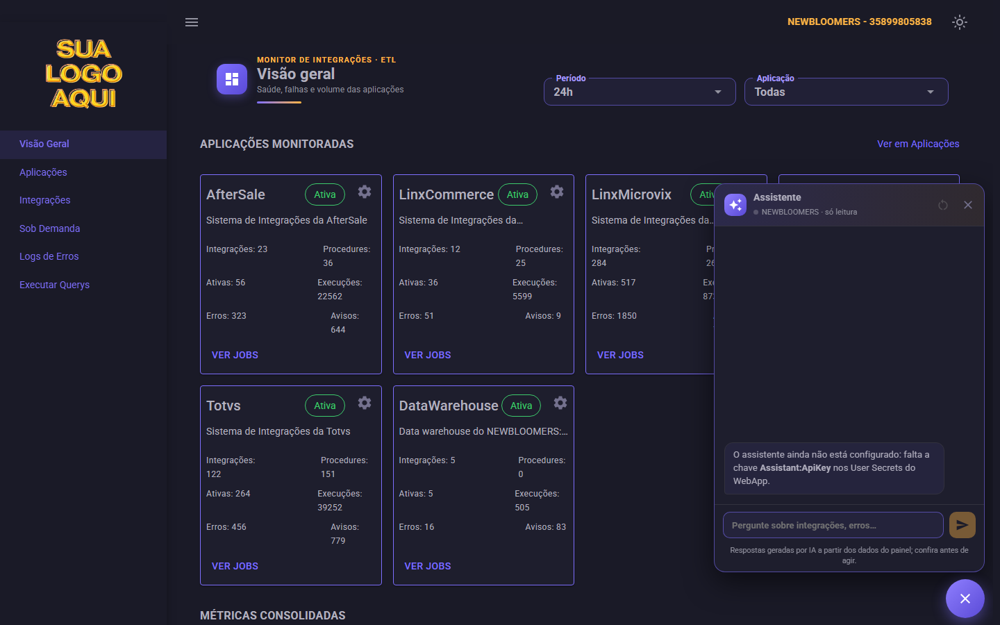<br> <sub><b>Assistente de IA</b> — chat com o Claude, só leitura</sub> |

<details>
<summary><b>🌗 Tema claro, 📱 celular e Aplicações</b></summary>

<div align="center">

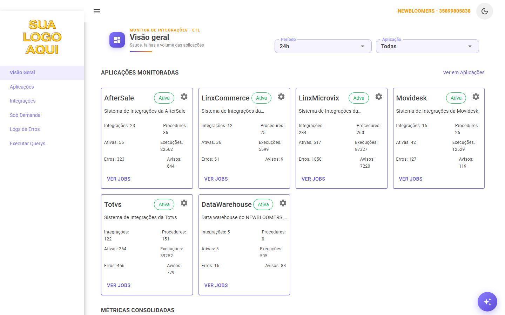

<sub><b>Tema claro</b> — a escolha fica salva no navegador</sub>

</div>

<div align="center">

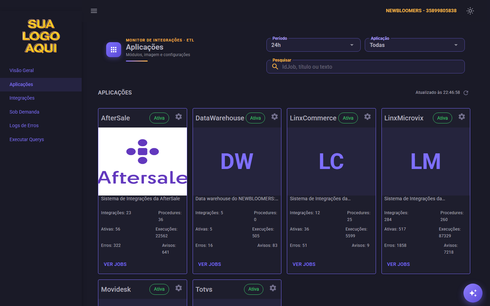

<sub><b>Aplicações</b> — imagem da empresa e o chip que liga ou desliga o módulo</sub>

</div>

<div align="center">

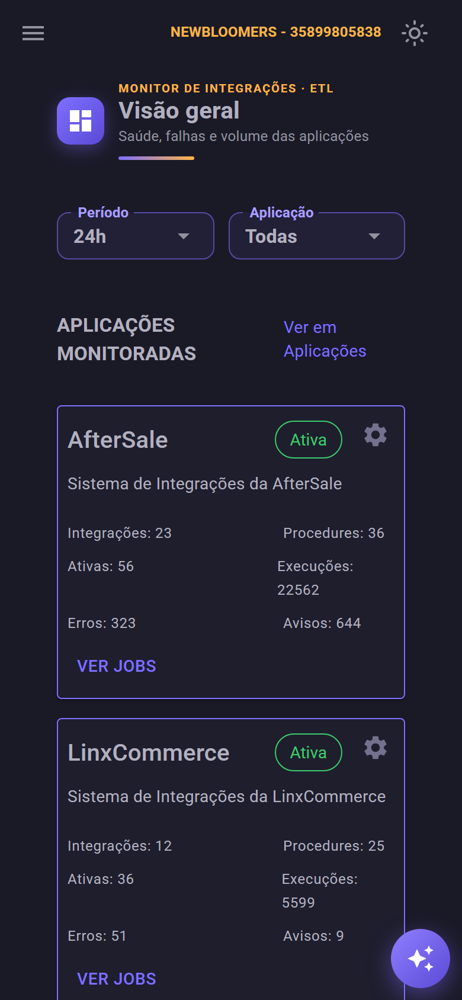 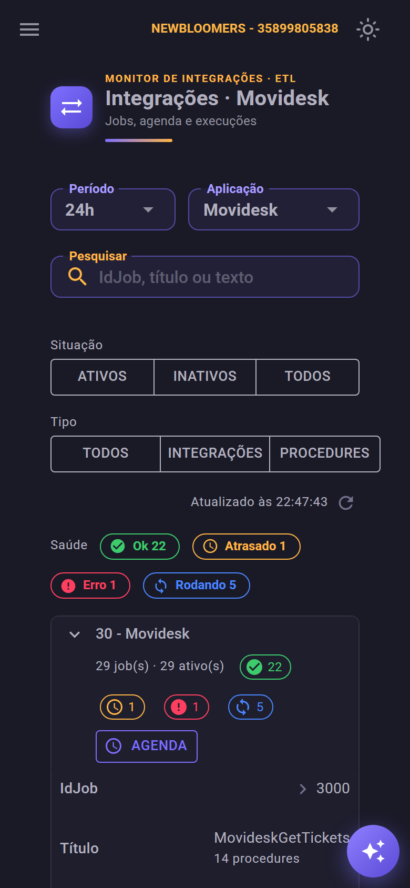

<sub><b>Celular</b> — abaixo de 600px as tabelas viram blocos e os diálogos ocupam a tela toda</sub>

</div>

</details>

| Tela | Rota | O que mostra |
|---|---|---|
| 🏠 **Visão Geral** | `/home` | Cards das aplicações, métricas e taxa de sucesso, falhas ativas, registros por dia e painel de saúde por aplicação |
| 🧩 **Aplicações** | `/applications` | Cards por módulo com a imagem da empresa e o chip que liga ou desliga o módulo |
| 🔀 **Integrações** | `/integrations` | Todos os jobs por aplicação, com as procedures dentro da integração pai, filtros de situação, tipo e saúde, Executar agora, Reconhecer e a edição da agenda |
| ⚠️ **Logs de Erros** | `/errors` | Mensagens de erro e aviso por aplicação, integração e causa, com a execução num diálogo |
| ▶️ **Sob Demanda** | `/on-demand` | As integrações sem agenda, no estilo do Swagger (só com `Admin:Enabled`) |
| 💻 **Executar Querys** | `/queries` | Consultas SQL com favoritas e querys prontas (só com `Admin:Enabled`) |

O **cadastro de empresas** já tem os repositórios no WebApp (`ICompanyRepository` e `IModuleParametersRepository`, fase
4.5 do [plano](docs/PLANO-TELA-CADASTRO-EMPRESA.md)): mock por padrão e Dapper com `Cadastro:UseDatabase = true`. A
tela (fase 4.6) só começa depois do mockup aprovado.

> [!NOTE]
> O **assistente de IA** (botão roxo no canto inferior direito, em todas as telas menos o login) é um chat com o Claude que
> responde sobre integrações, erros e execuções da empresa logada, só com consultas de leitura. As perguntas e os dados
> que ele consulta vão para a API da Anthropic.

---

## 🏛️ Data warehouse

O DW lê as tabelas finais dos módulos (Totvs, legado Linx Microvix, Movidesk, AfterSale e, quando houver carga real,
Linx Commerce) e monta as camadas:

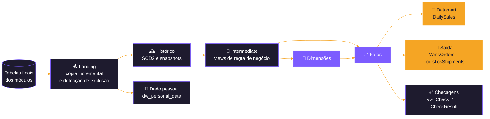

As cargas são disparadas pelas rotas do `DataWarehouseController` (ou pela agenda):

| Rota | Job | O que faz |
|---|:---:|---|
| `RunHourly` | `9000` | Landing, snapshots de notas e pedidos, dimensões, fatos, agregados e checagens |
| `RunDaily` | `9001` | A horária mais os snapshots de cadastros, custos e preços, a detecção de exclusões e, no dia 1, o estoque do mês |
| `RunShortCycle` | `9002` | Ciclo curto da logística: landing de pedidos, notas e clientes e o endereço de entrega |
| `RunMonthlyStock` | `9003` | Recarga manual da posição de estoque de um fim de mês |
| `RunLinxLegacy` | `9004` | Carga única do legado Linx Microvix |

📘 O guia completo (premissas, arquitetura, modelo, DDL, procedures, operação, acesso e riscos) está em
[src/Backend/Modules/DataWarehouse/docs](src/Backend/Modules/DataWarehouse/docs/00-ordem-de-leitura.md), junto das regras
de prefixo dos pedidos e do funcionamento do DW.

---

## 📐 Padrões do código

As regras de organização valem para todos os módulos e estão em
[PADRAO-CODIGO-E-SCRIPTS-INTEGRACOES.md](docs/PADRAO-CODIGO-E-SCRIPTS-INTEGRACOES.md):

* ♻️ refatoração de estilo **não muda o comportamento**;
* 🔒 método privado só existe quando é usado por **mais de um método**; senão, vai para dentro do pai (código direto ou
  função local);
* 📑 nas services, **públicos primeiro** e privados no fim, depois de uma linha `// ----`;
* 🪞 `Validations` espelha os DTOs (`Reads/` e `Writes/`);
* 🧱 **um command handler por service**, usado só pelo repositório dele;
* 🏷️ o método chamado por um job recorrente leva `[JobVersion("MAJOR.MINOR.PATCH")]`;
* 🗄️ scripts em `Parameters/` e uma pasta por service, numeração sequencial, correção no script de criação.

⚡ O cache segue [PADRAO-CACHE-INTEGRACOES.md](docs/PADRAO-CACHE-INTEGRACOES.md).

---

## 🚧 Fora do host e pendências

| | Item | Situação |
|:---:|---|---|
| 🔌 | **Módulos fora do host** | Dootax, Mobsim, Oto, Pagarme (General) e FlashCourier, Jadlog, Stone, TotalExpress (Shippment) têm código do sistema antigo, mas o registro no host e os controllers estão comentados. O `LinxMicrovix - Inbound Web Service` (escritas do B2C) está vazio |
| ⏱️ | **Agendamento** | Os três hosts de agenda estão prontos, mas **nenhum está em produção**: o Hangfire está desligado no `WebApi`, os WebJobs não foram publicados e o `Worker` não foi instalado numa máquina. Hoje os jobs rodam pelas rotas, chamadas por um agendador externo |
| 🖥️ | **Painel** | O `WebApp` ainda usa dados mockados; a leitura do banco e a autenticação são as fases 5 e 6 do [plano](src/Frontend/WebApp/docs/PLANO-WEBAPP.md) |
| 🏢 | **Cadastro de empresas** | Banco, seed de teste, log, agenda e services por empresa e os repositórios do WebApp estão **feitos** (fases 4.1 a 4.5 do [plano](docs/PLANO-TELA-CADASTRO-EMPRESA.md)); falta a **tela** (4.6, com Testar conexão) e o Dapper do WebApp ainda não rodou contra o banco. Contratar cria os jobs inativos e remover só desativa: o banco ainda não distingue os dois casos |
| 🔑 | **Credenciais em texto puro** | As tabelas `*Parameters` guardam segredos sem criptografia nesta fase; o acesso ao banco é o único controle |
| 🔔 | **Nível de mensagem** | Informação, aviso e erro em `auditing.Messages`: ainda é só [proposta](src/Backend/Shared/docs/PROPOSTA-NIVEL-MENSAGEM-AUDITING.md) |
| 🔐 | **Autenticação** | O `[Authorize]` dos controllers está comentado, e o painel ainda não tem login (fase 4.7 do plano) |
| ⚙️ | **Jobs só de procedure** | `RecurringJobDefinition.ForProcedure` está todo comentado; ao descomentar um, a procedure precisa receber `@Company` |
| 🧪 | **Testes** | A pasta `tests` está vazia |

---

## 📚 Documentação

| Documento | Conteúdo |
|---|---|
| 📖 README de cada módulo | Conceitos da API, services e métodos, fluxos, endpoints, scripts, jobs, configuração e pendências |
| ⏱️ README e `docs/PLANO-HOST-*.md` de cada host | [WebApi](src/Backend/Hosts/WebApi/README.md), [WebJob](src/Backend/Hosts/WebJob/README.md) e [Worker](src/Backend/Hosts/Worker/README.md): como rodar, publicar e configurar, e a decisão de cada passo |
| 🖥️ [src/Frontend/WebApp](src/Frontend/WebApp/README.md) | Painel: telas, assistente de IA e o plano do front-end (`docs/PLANO-WEBAPP.md`) |
| 🏢 [PLANO-TELA-CADASTRO-EMPRESA.md](docs/PLANO-TELA-CADASTRO-EMPRESA.md) | Cadastro de empresas: o que sai do DbUp, o `.ps1` de teste, log, agenda e services por empresa e as fases da tela |
| 🏛️ [src/Backend/Modules/DataWarehouse/docs](src/Backend/Modules/DataWarehouse/docs/00-ordem-de-leitura.md) | Guia do data warehouse |
| 📐 [PADRAO-CODIGO-E-SCRIPTS-INTEGRACOES.md](docs/PADRAO-CODIGO-E-SCRIPTS-INTEGRACOES.md) | Padrão de código e scripts |
| ⚡ [PADRAO-CACHE-INTEGRACOES.md](docs/PADRAO-CACHE-INTEGRACOES.md) | Padrão de cache |
| 🚀 [GUIA-DE-USO.md](GUIA-DE-USO.md) | Passo a passo para subir o banco, carregar uma empresa e usar cada projeto |
| 🔁 [MIGRATOR-CSX.md](docs/MIGRATOR-CSX.md) | Como rodar o `migrator.csx` e a tela `Invoke-Migrators.ps1` |
| 🔍 [REVISAO-PADRAO-CODIGO-E-SCRIPTS.md](docs/REVISAO-PADRAO-CODIGO-E-SCRIPTS.md) | Revisão dos módulos contra o padrão (todos os módulos do host e o Shared já seguem) |
| 📂 `docs/` de cada módulo | Propostas, planos, implementações e modelagens do módulo (ex.: `src/Backend/Modules/Totvs/docs`); os do Shared ficam em `src/Backend/Shared/docs` (merge e auditoria, conversores dos validadores e as propostas de `auditing`) |

---

<div align="center">


<sub>Sistema de integrações · feito com .NET 10</sub>

</div>
