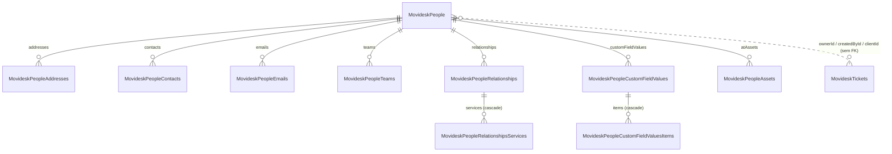

# Movidesk — Modelagem das tabelas de Pessoas

Proposta de tabelas e relacionamentos para a integração de pessoas da Movidesk (`MovideskPeopleService.GetPeople`),
com base na [documentação da API de Pessoas](https://atendimento.movidesk.com/kb/pt-br/article/189/movidesk-person-api)
(atualizada em 25/08/2026) e em respostas reais da API (seção 10). Segue as mesmas regras e decisões já aplicadas em
[MOVIDESK-MODELAGEM-TICKETS.md](MOVIDESK-MODELAGEM-TICKETS.md).

> **Scripts aplicados em 20/10/2026:** `Script007_Create_Movidesk_People_Tables.sql`, `Script008_Create_Movidesk_People_Sync_Procedures.sql`
> e os jobs 3516–3525 no `Script005` (com o título do 3001 renomeado para `MovideskGetPeople`). Todos rodaram sem erro num
> banco temporário local, junto com um teste de dois lotes da exclusão. O código C# (seção 8) ainda não foi alterado.

**Nomenclatura:** `Person` só para uma pessoa (a classe `Person`, a coluna `personId`, `GetPersonById`); `People` para o
plural (tabelas `MovideskPeople*`, `GetPeople`, pastas `People`).

---

## 1. Ponto de partida

| O que existe | Estado |
|---|---|
| Tabelas | **Nenhuma.** O `people.sql` antigo foi removido junto com os outros scripts fora do padrão. |
| DTOs (`Dtos/Reads/Person`) | Cobrem o layout da documentação, tudo como `string`. |
| Entidades (`Entities/Reads/Person`) | No formato antigo: sem `doc_company`, sem `integrated_or_updated_at`, sem tipos anuláveis, e com erros (seção 8). |
| Service / repositório | `MovideskPeopleService` (com `GetPersonById`/`GetPersons`) e `MovideskPeopleRepository` existem vazios, já injetados. |
| Auditoria | `EnumJob.MovideskGetPersons = 3001` no código e no `Script005`. |

A seção 8 lista as renomeações para seguir a nomenclatura (`GetPersons` → `GetPeople`, pastas `Person` → `People` etc.).

---

## 2. Regras gerais (as mesmas dos tickets)

| Regra | Como fica |
|---|---|
| Duas tabelas por entidade | `[untreated].X` + `[general].X`, merge pela `sp_X_Sync` gerada por `sp_Create_Merge_Procedure`. |
| `integrated_or_updated_at datetime` | Primeira coluna. **Um horário por lote** (a pessoa e todas as filhas do lote gravam o mesmo valor). |
| `doc_company nvarchar(14)` | Em todas as tabelas, primeira coluna da PK e das FKs. O mesmo Cód. Ref. pode existir em duas contas Movidesk. |
| Nomes das colunas | Iguais às propriedades da entidade C# (camelCase da API). |
| Texto | `nvarchar`. |
| Valores ausentes | Tipos anuláveis (`NullableConverters` do `Domain.Shared`), não `1990-01-01` / `0`. |
| Itens removidos na Movidesk | `when not matched by source then delete` limitado pela pessoa (seção 5), como nos tickets. |

---

## 3. Visão geral



Todas as chaves começam por `doc_company`; a tabela mostra o restante.

| # | Tabela | Origem na API | Chave primária (depois de `doc_company`) |
|---|---|---|---|
| 1 | `MovideskPeople` | `person` | `id` |
| 2 | `MovideskPeopleAddresses` | `addresses[]` | `personId, id` (gerado) |
| 3 | `MovideskPeopleContacts` | `contacts[]` | `personId, id` (gerado) |
| 4 | `MovideskPeopleEmails` | `emails[]` | `personId, id` (gerado) |
| 5 | `MovideskPeopleTeams` | `teams[]` | `personId, team` |
| 6 | `MovideskPeopleRelationships` | `relationships[]` | `personId, id` (ver 4.6) |
| 7 | `MovideskPeopleRelationshipsServices` | `relationships[].services[]` | `personId, relationshipId, id` |
| 8 | `MovideskPeopleCustomFieldValues` | `customFieldValues[]` | `personId, customFieldId, customFieldRuleId, line` |
| 9 | `MovideskPeopleCustomFieldValuesItems` | `customFieldValues[].items[]` | as 4 acima + `id` (gerado) |
| 10 | `MovideskPeopleAssets` | `atAssets[]` | `personId, id` |
| — | `MovideskPersonTypes`, `MovideskProfileTypes` | tabelas de valores da documentação | `id` |

---

## 4. Decisões de modelagem (o porquê)

### 4.1 `id` da pessoa como `nvarchar(64)`
O Cód. Ref. é alfanumérico (`string(64)`). É o mesmo valor que os tickets guardam em `ownerId`, `createdById`,
`clientId`, `organizationId` etc. As respostas reais trouxeram só ids numéricos, mas a documentação permite letras,
então não dá para usar `bigint` como nos tickets.

### 4.2 Relação com os tickets: só por junção
Como decidido na modelagem de tickets (4.2), **sem FK** entre as tabelas de tickets e `MovideskPeople`: as duas
sincronizações rodam em horários diferentes e a API de pessoas tem `DELETE`. A ligação é
`MovideskTickets (doc_company, ownerId) = MovideskPeople (doc_company, id)`, e o mesmo para os outros campos de pessoa.

### 4.3 Campos que ficam de fora ou entram
| Campo | Decisão | Motivo |
|---|---|---|
| `password` | Fora | A documentação diz que é "somente para gravação e não pode ser obtido na consulta"; não veio nas respostas. O DTO e a entidade atuais têm o campo; sai dos dois. |
| `relationships[].isGetMethod` | Fora | Não documentado; veio `true` em todos os relacionamentos das respostas reais. É um indicador da própria API para leitura, sem informação da pessoa. |
| `accountEmail` | Fora (por enquanto) | Não documentado; veio `null` nas 6 pessoas consultadas, então o tipo é desconhecido. Entra quando aparecer com valor. |
| `addresses[].countryId` | **Entra** (`int`) | Não documentado, mas veio preenchido (`1058`, Brasil) nos dois endereços consultados. |

### 4.4 Nomes das colunas de pessoa
- `createdBy` e `changedBy` já vêm como Cód. Ref. (texto), não como objeto. Ficam como `createdById` e `changedById`,
  com o sufixo `Id` usado nos tickets. `bossId` já tem o sufixo.
- Nas filhas, a coluna que liga à pessoa é sempre `personId` (singular: aponta para uma pessoa).
- **Itens de campo adicional (decidido):** o item tem um campo `personId` próprio (a pessoa escolhida numa lista de
  pessoas), que colidiria com a coluna `personId` da ligação. Os campos do item ficam `itemPersonId` e `itemClientId`
  na tabela e na entidade; o DTO continua lendo `personId`/`clientId` da API.

### 4.5 Chaves das listas
| Lista | Chave | Por quê |
|---|---|---|
| `teams[]` | `team` | É uma lista de nomes, como as tags dos tickets. |
| `relationships[]` | `id` (Cód. Ref. da organização) | Ver 4.6. |
| `relationships[].services[]` | `relationshipId, id` | O `id` do serviço é um `int` da Movidesk. |
| `atAssets[]` | `id` | Cód. Ref. do ativo. |
| `customFieldValues[]` | `customFieldId, customFieldRuleId, line` | Igual aos tickets. |
| `addresses[]`, `contacts[]`, `emails[]` | `id` gerado (posição na lista) | Decidido para os três. Não há campo único garantido: dois endereços ou contatos podem ter o mesmo tipo, e o mesmo e-mail pode aparecer com dois tipos. |
| `customFieldValues[].items[]` | `id` gerado | Igual aos tickets. |

**Por que o id gerado é seguro aqui:** com a exclusão limitada pela pessoa (seção 5), a lista inteira é regravada a cada
vez que a pessoa muda. Se a Movidesk reordenar os itens, as posições são reatribuídas e as linhas que sobrarem são
apagadas, sem duplicar.

### 4.6 Relacionamento sem organização (decidido: opção A)
A documentação permite um `relationships[]` **sem `id`**, para configurar SLA e serviços sem ligar a pessoa a uma
organização, e as respostas reais confirmaram: a empresa consultada e uma das pessoas da lista têm um relacionamento
com `id = null` e `name = null`.

**Gravar `null` daria erro?** Sim, por dois motivos:
1. **Chave primária não aceita nulo.** No SQL Server, toda coluna de uma `primary key` é obrigatoriamente
   `not null`; o insert do merge falharia com "Cannot insert the value NULL into column 'id'".
2. **O merge não casaria a linha.** A procedure gerada compara `target.id = source.id`, e `null = null` é falso em SQL.
   Mesmo sem a PK, a mesma linha seria inserida de novo a cada execução, sem nunca ser atualizada.

Opções:

| Opção | Como fica | Prós | Contras |
|---|---|---|---|
| **A (escolhida)** | `id = ''` (texto vazio) quando a API manda `null` | A chave continua sendo o Cód. Ref. da organização; o relacionamento com empresa casa direto com `MovideskPeople.id`; os serviços continuam ligados por `relationshipId`. Só pode haver um sem organização por pessoa, então a chave continua única. | `''` é um valor "mágico": consultas que listam organizações precisam filtrar `id <> ''`. |
| B | `id` gerado (posição) na chave + coluna `organizationId nvarchar(64) null` | Guarda o `null` de verdade. | A ligação com a organização sai da chave; os serviços passam a apontar para a posição do relacionamento, que muda se a Movidesk reordenar a lista. |

### 4.7 Tabelas de valores sem FK
`personType` (1 Pessoa, 2 Empresa, 4 Departamento) e `profileType` (1 Agente, 2 Cliente, 3 Agente e Cliente) viram
`MovideskPersonTypes` e `MovideskProfileTypes`, carregadas pelo script, **sem FK** e sem `doc_company`, pelo mesmo
motivo das origens de ticket. Também servem para os `personType`/`profileType` que os tickets recebem.

### 4.8 Pessoas apagadas na Movidesk
A API tem `DELETE /persons`. Uma pessoa apagada deixa de aparecer na listagem, e a sincronização incremental não fica
sabendo; ela continua em `MovideskPeople`. Pessoas **desativadas** aparecem com `isActive = false`, e isso a
sincronização pega. Detectar exclusões exigiria uma carga completa periódica comparando os ids; fica fora desta
modelagem.

---

## 5. Itens removidos: mesma condição dos tickets

As filhas usam a opção `@delete_condition` do `sp_Create_Merge_Procedure` (já implementada), trocando o ticket pela
pessoa:
```sql
exists (
	select 1
	from [general].MovideskPeople p
	where p.doc_company = target.doc_company
	and p.id = target.personId
	and p.integrated_or_updated_at > target.integrated_or_updated_at
)
```
- As netas (`RelationshipsServices`, `CustomFieldValuesItems`) usam a mesma condição, porque também têm `personId`.
- FKs das netas para o nível do meio com **`on delete cascade`**, como nos tickets.
- `MovideskPeople` em si é gerada **sem** a opção: a pessoa nunca é apagada por esse fluxo (4.8).

---

## 6. DDL proposto (`general`)

As tabelas `untreated` são iguais, sem `constraint` e sem `not null`.

```sql
create table [general].MovideskPeople (
	integrated_or_updated_at	datetime,
	doc_company					nvarchar(14) not null,
	id							nvarchar(64) not null,
	codeReferenceAdditional		nvarchar(64),
	isActive					bit,
	personType					int,			-- 1 Pessoa, 2 Empresa, 4 Departamento
	profileType					int,			-- 1 Agente, 2 Cliente, 3 Agente e Cliente
	accessProfile				nvarchar(128),
	corporateName				nvarchar(128),
	businessName				nvarchar(128),
	businessBranch				nvarchar(128),
	cpfCnpj						nvarchar(14),
	userName					nvarchar(64),
	[role]						nvarchar(128),
	bossId						nvarchar(64),
	bossName					nvarchar(128),
	classification				nvarchar(128),
	cultureId					nvarchar(32),
	timeZoneId					nvarchar(64),
	authenticateOn				nvarchar(max),
	createdDate					datetime,
	createdById					nvarchar(128),	-- createdBy da API (Cód. Ref.)
	changedDate					datetime,		-- nulo para quem nunca foi alterado (ver 10)
	changedById					nvarchar(128),	-- changedBy da API (Cód. Ref.)
	observations				nvarchar(max),
constraint [PK_MovideskPeople] primary key (doc_company asc, id asc));

create table [general].MovideskPeopleAddresses (
	integrated_or_updated_at	datetime,
	doc_company					nvarchar(14) not null,
	personId					nvarchar(64) not null,
	id							int not null,	-- gerado em C#, posição na lista
	addressType					nvarchar(128),
	country						nvarchar(128),
	countryId					int,			-- não documentado, vem na resposta real
	postalCode					nvarchar(32),
	[state]						nvarchar(128),
	city						nvarchar(128),
	district					nvarchar(128),
	street						nvarchar(128),
	number						nvarchar(32),
	complement					nvarchar(128),
	reference					nvarchar(128),
	isDefault					bit,
constraint [PK_MovideskPeopleAddresses] primary key (doc_company asc, personId asc, id asc));

create table [general].MovideskPeopleContacts (
	integrated_or_updated_at	datetime,
	doc_company					nvarchar(14) not null,
	personId					nvarchar(64) not null,
	id							int not null,	-- gerado em C#, posição na lista
	contactType					nvarchar(128),
	contact						nvarchar(128),
	isDefault					bit,
constraint [PK_MovideskPeopleContacts] primary key (doc_company asc, personId asc, id asc));

create table [general].MovideskPeopleEmails (
	integrated_or_updated_at	datetime,
	doc_company					nvarchar(14) not null,
	personId					nvarchar(64) not null,
	id							int not null,	-- gerado em C#, posição na lista
	emailType					nvarchar(128),
	email						nvarchar(128),
	isDefault					bit,
constraint [PK_MovideskPeopleEmails] primary key (doc_company asc, personId asc, id asc));

create table [general].MovideskPeopleTeams (
	integrated_or_updated_at	datetime,
	doc_company					nvarchar(14) not null,
	personId					nvarchar(64) not null,
	team						nvarchar(128) not null,
constraint [PK_MovideskPeopleTeams] primary key (doc_company asc, personId asc, team asc));

create table [general].MovideskPeopleRelationships (
	integrated_or_updated_at			datetime,
	doc_company							nvarchar(14) not null,
	personId							nvarchar(64) not null,
	id									nvarchar(64) not null,	-- Cód. Ref. da organização ('' quando a API manda null, ver 4.6)
	[name]								nvarchar(128),
	slaAgreement						nvarchar(128),
	forceChildrenToHaveSomeAgreement	bit,
	allowAllServices					bit,
	includeInParents					bit,
	loadChildOrganizations				bit,
constraint [PK_MovideskPeopleRelationships] primary key (doc_company asc, personId asc, id asc));

create table [general].MovideskPeopleRelationshipsServices (
	integrated_or_updated_at	datetime,
	doc_company					nvarchar(14) not null,
	personId					nvarchar(64) not null,
	relationshipId				nvarchar(64) not null,
	id							int not null,	-- id do serviço na Movidesk
	[name]						nvarchar(128),
	copyToChildren				bit,
constraint [PK_MovideskPeopleRelationshipsServices] primary key (doc_company asc, personId asc, relationshipId asc, id asc));

create table [general].MovideskPeopleCustomFieldValues (
	integrated_or_updated_at	datetime,
	doc_company					nvarchar(14) not null,
	personId					nvarchar(64) not null,
	customFieldId				int not null,
	customFieldRuleId			int not null,
	line						int not null,
	[value]						nvarchar(max),
constraint [PK_MovideskPeopleCustomFieldValues] primary key (doc_company asc, personId asc, customFieldId asc, customFieldRuleId asc, line asc));

create table [general].MovideskPeopleCustomFieldValuesItems (
	integrated_or_updated_at	datetime,
	doc_company					nvarchar(14) not null,
	personId					nvarchar(64) not null,
	customFieldId				int not null,
	customFieldRuleId			int not null,
	line						int not null,
	id							int not null,	-- gerado em C#, posição na lista
	itemPersonId				nvarchar(64),	-- personId do item (ver 4.4)
	itemClientId				nvarchar(64),	-- clientId do item (ver 4.4)
	team						nvarchar(128),
	customFieldItem				nvarchar(256),
	storageFileGuid				nvarchar(36),	-- como nos tickets (campo do tipo arquivo); não documentado
	[fileName]					nvarchar(255),	-- idem
constraint [PK_MovideskPeopleCustomFieldValuesItems] primary key (doc_company asc, personId asc, customFieldId asc, customFieldRuleId asc, line asc, id asc));

create table [general].MovideskPeopleAssets (
	integrated_or_updated_at	datetime,
	doc_company					nvarchar(14) not null,
	personId					nvarchar(64) not null,
	id							nvarchar(64) not null,
	[name]						nvarchar(64),
	label						nvarchar(64),
constraint [PK_MovideskPeopleAssets] primary key (doc_company asc, personId asc, id asc));
```

### Chaves estrangeiras
```sql
-- filhas -> pessoa (sem cascade: a pessoa nunca é apagada por este fluxo)
alter table [general].MovideskPeopleAddresses         add constraint [FK_MovideskPeopleAddresses]         foreign key (doc_company, personId) references [general].MovideskPeople (doc_company, id);
alter table [general].MovideskPeopleContacts          add constraint [FK_MovideskPeopleContacts]          foreign key (doc_company, personId) references [general].MovideskPeople (doc_company, id);
alter table [general].MovideskPeopleEmails            add constraint [FK_MovideskPeopleEmails]            foreign key (doc_company, personId) references [general].MovideskPeople (doc_company, id);
alter table [general].MovideskPeopleTeams             add constraint [FK_MovideskPeopleTeams]             foreign key (doc_company, personId) references [general].MovideskPeople (doc_company, id);
alter table [general].MovideskPeopleRelationships     add constraint [FK_MovideskPeopleRelationships]     foreign key (doc_company, personId) references [general].MovideskPeople (doc_company, id);
alter table [general].MovideskPeopleCustomFieldValues add constraint [FK_MovideskPeopleCustomFieldValues] foreign key (doc_company, personId) references [general].MovideskPeople (doc_company, id);
alter table [general].MovideskPeopleAssets            add constraint [FK_MovideskPeopleAssets]            foreign key (doc_company, personId) references [general].MovideskPeople (doc_company, id);

-- netas -> nível do meio (com cascade)
alter table [general].MovideskPeopleRelationshipsServices  add constraint [FK_MovideskPeopleRelationshipsServices]  foreign key (doc_company, personId, relationshipId) references [general].MovideskPeopleRelationships (doc_company, personId, id) on delete cascade;
alter table [general].MovideskPeopleCustomFieldValuesItems add constraint [FK_MovideskPeopleCustomFieldValuesItems] foreign key (doc_company, personId, customFieldId, customFieldRuleId, line) references [general].MovideskPeopleCustomFieldValues (doc_company, personId, customFieldId, customFieldRuleId, line) on delete cascade;
```
Sem FK de propósito: `bossId`, `createdById`, `changedById` e os `id` de organização em `MovideskPeopleRelationships`
(outra pessoa, que pode não estar carregada), `itemPersonId`/`itemClientId`, `personType`/`profileType`, e qualquer
ligação com os tickets (4.2).

### Tabelas de valores (só `general`, sem merge, sem `doc_company`)
```sql
create table [general].MovideskPersonTypes (id int not null primary key, [description] nvarchar(60) not null);
insert into [general].MovideskPersonTypes (id, [description]) values (1, N'Pessoa'), (2, N'Empresa'), (4, N'Departamento');

create table [general].MovideskProfileTypes (id int not null primary key, [description] nvarchar(60) not null);
insert into [general].MovideskProfileTypes (id, [description]) values (1, N'Agente'), (2, N'Cliente'), (3, N'Agente e Cliente');
```

---

## 7. Scripts, merges e jobs

### Arquivos
| Arquivo | Conteúdo |
|---|---|
| `Script007_Create_Movidesk_People_Tables.sql` | seção 6 (untreated + general + FKs + valores) |
| `Script008_Create_Movidesk_People_Sync_Procedures.sql` | `sp_Create_Merge_Procedure` das 10 tabelas; as 9 filhas com `@delete_condition` (seção 5) |
| `Script005_Insert_Movidesk_Values_Into_Jobs_Table.sql` | **acrescentar** os jobs abaixo (decidido) |

**Atenção:** o DbUp não roda de novo um script que já rodou. Num banco onde o `Script005` já foi executado (por
exemplo, o local, se já subiu os scripts de tickets), as linhas novas precisam ser inseridas à mão, como no job 3002.

### Ordem no repositório
1. bulk insert de todas as `untreated` com o **mesmo `integrated_or_updated_at`**;
2. merge de `MovideskPeople`;
3. merges de `MovideskPeopleRelationships` e `MovideskPeopleCustomFieldValues`;
4. merges das demais filhas e netas, **sempre os 10**, mesmo sem linhas no lote (é o merge que apaga as listas que
   ficaram vazias).

### Jobs (`auditing.Jobs`, no `Script005`)
A faixa 3500–3515 é dos tickets; pessoas começam em 3516.

| IdJob | Título | IdParent | IdType |
|---|---|---|---|
| 3001 | `MovideskGetPeople` (hoje `MovideskGetPersons`, renomeado; ver 8) | 30 | 2 |
| 3516 | `sp_MovideskPeople_Sync` | 3001 | 1 |
| 3517–3525 | `sp_MovideskPeople<Filha>_Sync`, uma por tabela, na ordem da seção 3 | 3001 | 1 |

---

## 8. Impactos no código (próxima etapa)

### Renomeações (`Person` só no singular)
| Hoje | Passa a ser |
|---|---|
| `EnumJob.MovideskGetPersons` | `EnumJob.MovideskGetPeople` (mesmo valor, 3001) |
| Título `MovideskGetPersons` no `Script005` | `MovideskGetPeople` |
| `IMovideskPeopleService.GetPersons()` | `GetPeople()` (o `GetPersonById()` continua, é de uma pessoa) |
| `Dtos/Reads/Person/`, `Entities/Reads/Person/` | `Dtos/Reads/People/`, `Entities/Reads/People/` (as classes continuam `Person`, `Address` etc.), como `Reads/Tickets` |
| `Validations/Person/` | `Validations/People/` |
| Endpoint comentado `Persons` no controller | `People` |
| Chave de cache | `Movidesk:People:{doc_company}` |

### Entidades atuais: problemas encontrados
| Arquivo | Problema |
|---|---|
| Todas | Sem `doc_company` e `integrated_or_updated_at`; os tipos não seguem a decisão de anuláveis. |
| `Address.cs` | **Não tem a propriedade `city`** (o DTO tem) e não tem construtor vazio, que o `CreateSystemDataTable` precisa. Falta `id` gerado. `countryId` fica (4.3), como `int?`. |
| `Person.cs` | Guarda `password`, que a API nunca devolve (4.3). `createdBy`/`changedBy` passam a `createdById`/`changedById`; `changedDate` passa a `DateTime?` (vem nulo). |
| `Contact.cs`, `Email.cs` | Falta o `id` gerado (4.5). |
| `CustomFieldValueItem.cs` | `clientId` como `int` (a API manda texto, como nos tickets); não tem `customFieldRuleId`, `line` nem `id`, que fazem parte da chave; não tem `itemPersonId`, `storageFileGuid`, `fileName`. |
| `CustomFieldValue.cs` | Mesmo molde dos tickets: `doc_company`, `integrated_or_updated_at` e itens com posição. |
| `Relationship.cs` | `isGetMethod` sai (4.3); `id` nulo vira `''` (opção A da 4.6). |
| `Team.cs` | Tem `id` gerado; a chave passa a ser o próprio `team` (4.5). |
| DTO `Person.cs` | + `accountEmail` só quando aparecer com valor (4.3). |

### Service (`MovideskPeopleService.GetPeople`)
- Laço por empresa, como o `GetTickets`, com um horário por lote.
- **Todos os perfis** (decidido): agentes e clientes, sem o filtro `profileType eq 2/3` do código antigo, porque os
  tickets apontam para agentes como responsáveis.
- **Janela de busca (ver 10):** `changedDate` vem **nulo** para quem nunca foi alterado depois de criado. Um filtro só
  por `changedDate` perderia pessoas novas. O filtro passa a ser
  `changedDate ge {desde} or createdDate ge {desde}`, com `desde = MAX(coalesce(changedDate, createdDate)) − 1 hora` da
  empresa. A primeira carga (banco vazio) traz as pessoas criadas ou alteradas nos **últimos 12 meses** (decidido em
  21/10/2026, ver [IMPLEMENTACAO-MOVIDESK-GETPEOPLE.md](IMPLEMENTACAO-MOVIDESK-GETPEOPLE.md) 6.2); quem não muda há mais
  tempo só entra quando for alterado.
- **Sem `$expand` e sem `$select`:** a listagem devolveu todas as listas (`addresses`, `emails`, `relationships` etc.)
  sem `$expand` (seção 10).
- Paginação com `$top`/`$skip` e 6 s entre páginas (10 requisições por minuto); `$orderby=changedDate` funciona.
- Cache de estado por empresa comparando `coalesce(changedDate, createdDate)`.

---

## 9. Diferenças em relação ao `people.sql` antigo

| Antes | Agora |
|---|---|
| Tabelas `MovideskPersons*`, só `general`, sem empresa | `MovideskPeople*`, `untreated` + `general` + merge, `doc_company` em todas |
| `varchar` | `nvarchar` |
| Ids gerados sem exclusão | Ids gerados com exclusão limitada pela pessoa |
| Sem tratamento de itens removidos | `@delete_condition` + `on delete cascade` nas netas |

---

## 10. Validação com respostas reais

Consultei em 20/10/2026 três pessoas por id (`GET /persons?id=...`) e uma listagem de três
(`GET /persons?$top=3&$orderby=changedDate desc`, sem `$select`/`$expand`). As respostas estão, com dados mockados, em
`src/Backend/Modules/General/Movidesk/Responsed Jsons/`:

| Arquivo | Perfil |
|---|---|
| `Person/GetPersonById/json-returned-by-api-end-point-agent.json` | pessoa, Agente e Cliente, 3 organizações, 2 equipes, 1 contato, 1 e-mail |
| `Person/GetPersonById/json-returned-by-api-end-point-client.json` | pessoa, Cliente, com superior (`bossId`/`bossName`), 2 organizações |
| `Person/GetPersonById/json-returned-by-api-end-point-company.json` | empresa, Cliente, 1 endereço, `changedDate` nulo, relacionamento sem organização |
| `People/GetPeople/json-returned-by-api-end-point.json` | listagem com 3 pessoas |

Os ids falsos são os mesmos dos JSONs de tickets (a mesma pessoa tem o mesmo id nos dois); nomes, documentos, e-mails,
telefones, endereços, equipes e perfis foram trocados. Datas, tipos e booleanos são os reais.

### Confirmado
| Ponto | O que a resposta mostrou |
|---|---|
| Listas sem `$expand` | A listagem trouxe `addresses`, `contacts`, `emails`, `teams`, `relationships`, `customFieldValues` e `atAssets` em cada pessoa. |
| `$orderby=changedDate` | Aceito. |
| `$filter` com `or` entre `changedDate` e `createdDate` | Aceito; devolve a união dos dois filtros (teste em 21/10/2026, [IMPLEMENTACAO-MOVIDESK-GETPEOPLE.md](IMPLEMENTACAO-MOVIDESK-GETPEOPLE.md) seção 10). |
| Ids como texto | `id`, `bossId`, `createdBy`, `changedBy` e `relationships[].id` vêm como texto numérico. |
| `relationships[].id` nulo | A empresa e uma pessoa da lista têm um relacionamento com `id = null` e `name = null` (4.6). |
| `countryId` | Veio `1058` nos dois endereços (4.3). |
| `isGetMethod` | Veio `true` em todos os relacionamentos (4.3). |
| Ids da pessoa nos tickets | As pessoas consultadas são as mesmas que aparecem como `ownerId`/`createdById`/`organizationId` nos tickets 69255 e 1000. |

### Achados que mudaram a modelagem
| Achado | Consequência |
|---|---|
| **`changedDate` nulo** na empresa criada em 2021 e nunca alterada | Sincronização por `changedDate or createdDate` e coluna anulável (8). |
| `accountEmail` (não documentado), `null` nas 6 pessoas | Fora até aparecer com valor (4.3). |
| `corporateName` vem `''` em uma pessoa e `null` em outras | Gravado como vier; vazio e nulo não são diferenciados. |
| `postalCode` sem o zero inicial (7 dígitos em vez de 8) | Gravado como vier; é texto, então não perde mais nada no banco, mas o zero já vem perdido da Movidesk. |

### Ainda não validado
Nenhuma das pessoas tinha **campos adicionais, ativos ou serviços** em organizações (`services` vazio, porque todas
têm `allowAllServices = true`). Essas três tabelas continuam validadas só pela documentação.

---

## 11. Decisões

### Aplicadas (20/10/2026)
| # | Decisão | Onde |
|---|---|---|
| 1 | Tabelas `MovideskPeople*`; `Person` só no singular | todo o documento, 8 |
| 2 | Validação com respostas reais antes dos scripts | 10 |
| 3 | Campos do item de campo adicional como `itemPersonId`/`itemClientId` | 4.4, 6 |
| 4 | E-mails com `id` gerado | 4.5, 6 |
| 5 | Jobs de pessoas acrescentados no `Script005` | 7 |
| 6 | Sincronizar todos os perfis (agentes e clientes) | 8 |
| 7 | Relacionamento sem organização gravado com `id = ''` (opção A) | 4.6, 6, 8 |

Não há decisões pendentes; o próximo passo é gerar os scripts da seção 7.
