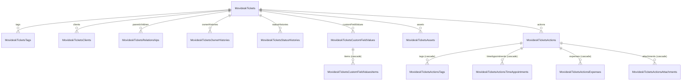

# Movidesk — Modelagem das tabelas de Tickets

Proposta de tabelas e relacionamentos para a integração de tickets da Movidesk, com base na
[documentação da API de Tickets](https://atendimento.movidesk.com/kb/pt-br/article/256/movidesk-ticket-api)
(atualizada em 20/08/2026), em duas respostas reais da API (seção 11) e no padrão de scripts já usado no
módulo AfterSale.

> **Aplicado em 18/10/2026:** os scripts da seção 7 estão em `Infrastructure.Movidesk/Scripts/SQLServer` e a
> alteração da seção 5 está no `Script003_Create_Merge_Procedure.sql` do Shared. Todos rodaram sem erro num banco
> temporário local, junto com um teste de dois lotes da exclusão. O código C# (seção 8) ainda não foi alterado.

---

## 1. O que foi feito nos scripts

Foram removidos de `Infrastructure.Movidesk/Scripts/SQLServer` os 9 scripts que não seguiam o padrão `Script*`:
`activities.sql`, `articles.sql`, `merged_tickets.sql`, `parametros.sql`, `people.sql`, `services.sql`,
`survey.sql`, `tickets.sql` e `time_agreements.sql`. Eles continuam no histórico do git, se precisar consultar.

Ficaram:
- `Script001_Insert_Movidesk_Values_Into_Apps_Table.sql`
- `Script002_Insert_Movidesk_Values_Into_Jobs_Table.sql` (todo comentado)
- `MySQL/migrator.csx` e `PostgreSQL/migrator.csx` (ferramenta do DbUp, não é script)

**Atenção:** `people.sql` criava as tabelas de pessoas usadas por `GetPersons`. Elas vão ter um script próprio
quando chegarmos no service de pessoas (seção 4.2). Também não existe `migrator.csx` na pasta `SQLServer` do
Movidesk, ao contrário do AfterSale; vale copiar o do AfterSale.

---

## 2. Regras gerais (as mesmas do AfterSale)

| Regra | Como fica no Movidesk |
|---|---|
| Duas tabelas por entidade | `[untreated].X` recebe o bulk insert; `[general].X` é a tabela final. A `sp_X_Sync` gerada por `sp_Create_Merge_Procedure` faz o merge entre elas. |
| `integrated_or_updated_at datetime` | Primeira coluna de todas as tabelas. O gerador usa essa coluna para remover duplicados, e no Movidesk ela também decide o que apagar (seção 4.8). |
| Empresa | **`doc_company nvarchar(14)`** em todas as tabelas, logo depois de `integrated_or_updated_at`, e como **primeira coluna da PK e das FKs**, igual ao AfterSale. Hoje há uma conta Movidesk, mas a modelagem já aceita várias: o mesmo número de ticket pode existir em duas contas. |
| Chave primária | Só em `general`. O gerador do merge **exige** PK, porque casa os registros por ela. |
| `untreated` | Mesmas colunas, sem `not null` e sem PK/FK. |
| Chaves estrangeiras | Só em `general`, criadas no fim do script com `alter table ... add constraint`. |
| Nomes das colunas | **Iguais às propriedades da entidade C#, inclusive maiúsculas/minúsculas**, porque o bulk insert mapeia pelo nome. A API da Movidesk é camelCase, então as colunas também ficam em camelCase (`createdDate`, `ownerTeam`...). `doc_company` e `integrated_or_updated_at` seguem o nome usado no resto do sistema. |
| Texto | `nvarchar` (os scripts antigos usavam `varchar`, e já tinham caracteres corrompidos como `Formul�rio`). |

### Parâmetros por empresa
Hoje o token é lido de `GENERAL.PARAMETROS_MOVIDESK` (`CreateGetTokenQuery`), uma única linha. Proposta, no
mesmo formato de `AfterSaleParameters`:

```sql
create table [general].MovideskParameters (
	integrated_or_updated_at	datetime,
	id							int not null identity primary key,
	doc_company					nvarchar(14) not null,
	token						uniqueidentifier
);
```

O service passa a fazer um laço por empresa, como no AfterSale, e preenche `doc_company` em todas as entidades.

---

## 3. Visão geral



Todas as chaves começam por `doc_company`; a tabela abaixo mostra o restante.

| # | Tabela | Origem na API | Chave primária (depois de `doc_company`) |
|---|---|---|---|
| 1 | `MovideskTickets` | `ticket` | `id` |
| 2 | `MovideskTicketsTags` | `ticket.tags[]` | `ticketId, tag` |
| 3 | `MovideskTicketsClients` | `ticket.clients[]` | `ticketId, clientId` |
| 4 | `MovideskTicketsRelationships` | `ticket.parentTickets[]` + `ticket.childrenTickets[]` | `ticketId, relatedTicketId` |
| 5 | `MovideskTicketsOwnerHistories` | `ticket.ownerHistories[]` | `ticketId, id` (gerado) |
| 6 | `MovideskTicketsStatusHistories` | `ticket.statusHistories[]` | `ticketId, id` (gerado) |
| 7 | `MovideskTicketsCustomFieldValues` | `ticket.customFieldValues[]` | `ticketId, customFieldId, customFieldRuleId, line` |
| 8 | `MovideskTicketsCustomFieldValuesItems` | `ticket.customFieldValues[].items[]` | as 4 acima + `id` (gerado) |
| 9 | `MovideskTicketsAssets` | `ticket.assets[]` | `ticketId, id` |
| 10 | `MovideskTicketsActions` | `ticket.actions[]` | `ticketId, id` |
| 11 | `MovideskTicketsActionsTags` | `actions[].tags[]` | `ticketId, actionId, tag` |
| 12 | `MovideskTicketsActionsTimeAppointments` | `actions[].timeAppointments[]` | `ticketId, actionId, id` |
| 13 | `MovideskTicketsActionsExpenses` | `actions[].expenses[]` | `ticketId, actionId, id` |
| 14 | `MovideskTicketsActionsAttachments` | `actions[].attachments[]` | `ticketId, actionId, path` |
| — | `MovideskTicketsOrigins`, `MovideskTicketsTypes` | tabelas de valores da documentação | `id` |

---

## 4. Decisões de modelagem (o porquê)

### 4.1 `ticketId` como `bigint`
A documentação diz `string(10)` para `ticket.id`, mas o valor é sempre numérico ("Número do ticket"; nas respostas
reais, `"69255"` e `"1000"`). Em vez de `int`, fica **`bigint`**: o limite do `int` (2.147.483.647) está longe dos
números atuais, mas o `bigint` custa só 4 bytes a mais por linha e elimina o risco de overflow, inclusive com
várias contas. Vale para `ticketId` em todas as tabelas, `MovideskTickets.id` e `relatedTicketId`.

Os ids que a Movidesk gera para toda a conta também ficam `bigint`: `timeAppointments[].id` e `expenses[].id`.
`actions[].id` continua `int`, porque é a numeração da ação dentro do ticket (1, 2, 3...).

O DTO continua `string`, e a entidade converte com `ConvertToInt64Validation`.

### 4.2 Pessoas: só o id no ticket, sem tabela de pessoas no fluxo de tickets
`owner`, `createdBy`, `slaSolutionChangedBy`, `clients[]`, `clients[].organization` e os `createdBy`/`changedBy` de
ações, apontamentos, despesas, anexos e históricos são o mesmo objeto `person` resumido (`id, businessName, email,
phone, personType, profileType`).

A [API de Pessoas](https://atendimento.movidesk.com/kb/pt-br/article/189/movidesk-person-api) (`GET /persons`)
devolve tudo isso e mais: o mesmo `id` (Cód. Ref., `string(64)`), `businessName`, `corporateName`, `cpfCnpj`,
`isActive`, e as listas `emails`, `contacts` (onde fica o telefone), `addresses` e `relationships` (as
organizações). Por isso **`MovideskTicketsPersons` foi retirada**: o service de pessoas vai manter
`general.MovideskPersons` (e filhas), e os tickets guardam só o id.

- As colunas de pessoa levam o sufixo `Id`: `ownerId`, `createdById`, `slaSolutionChangedById`, `clientId`,
  `organizationId`, `changedById`.
- **Sem FK** para a futura `MovideskPersons`. A API de pessoas tem `DELETE`, então um ticket pode citar uma pessoa
  que não existe mais; e as duas sincronizações rodam em horários diferentes, então o ticket pode chegar antes da
  pessoa. O relacionamento fica por junção: `(doc_company, ownerId) = MovideskPersons (doc_company, id)`.
- Os campos de endereço que vêm em `clients[]` (`address`, `cep`, `city`...) ficam de fora. Nas respostas reais
  vieram todos nulos, e o endereço da pessoa vem completo em `persons.addresses[]`.

### 4.3 Equipes inline
`createdByTeam` (`{ id, name }`) aparece em apontamentos e despesas. Em vez de mais uma tabela, ficam duas
colunas: `createdByTeamId int` e `createdByTeamName nvarchar(128)`. `ownerTeam` já é só o nome.

### 4.4 Chaves naturais em vez de ids gerados, sempre que a API permite
Os scripts antigos geravam um `id` sequencial em C# para tags, anexos etc. Isso quebra quando a API muda a
ordem da lista: o mesmo registro ganha outro id e o merge cria duplicados. Proposta:

| Lista | Chave antiga | Chave proposta |
|---|---|---|
| tags do ticket / da ação | `id` gerado | o próprio texto da `tag` |
| anexos | `id` gerado | `path` (é o hash do arquivo) |
| clientes | — | `clientId` |
| tickets pai/filho | `id` | `relatedTicketId` |
| campos adicionais | `ticketId, customFieldId` | `ticketId, customFieldId, customFieldRuleId, line` |

A chave antiga de campos adicionais estava errada: a documentação diz que uma regra pode ter várias linhas
(`line`), então o mesmo campo pode aparecer mais de uma vez no ticket.

Ids gerados ficam só onde não há alternativa: **históricos** (ordenados por `changedDate` antes de numerar,
o que é estável porque o histórico só cresce) e **itens de campo adicional** (podem vir sem `customFieldItem`,
como nas listas de pessoas e nos campos de arquivo).

### 4.5 Pais e filhos numa tabela só
`parentTickets` e `childrenTickets` têm o mesmo layout. Ficam em `MovideskTicketsRelationships` com uma coluna
`relationType` (`'Parent'` / `'Child'`). O script antigo tinha `isParent` e `isChildren` ao mesmo tempo, o que
permitia combinações sem sentido. **Sem FK** em `relatedTicketId`: o ticket relacionado pode ter mais de 90 dias
(só existe em `/tickets/past`) ou ainda não ter sido carregado.

### 4.6 O que fica de fora
| Campo / lista | Motivo |
|---|---|
| `satisfactionSurveyResponses` | A documentação diz que está depreciado e **não é mais retornado**. Deve vir da API de Pesquisa de satisfação, em outra tabela. |
| `serviceFull` | Repete `serviceFirstLevel`, `serviceSecondLevel` e `serviceThirdLevel`, que já são colunas do ticket (confirmado nas respostas reais, seção 11). Num serviço de 4 níveis, a raiz só aparece no `serviceFull`; o caminho completo sai de `MovideskServices` pela hierarquia a partir de `serviceFirstLevelId` ([IMPLEMENTACAO-MOVIDESK-SERVICES.md](IMPLEMENTACAO-MOVIDESK-SERVICES.md) 3.4). |
| `assets[].categoryFull` | Mesmo caso: repete `categoryFirstLevel/Second/Third`. |
| `movideskTicketNumber`, `linkedToIntegratedTicketNumber`, `webhookEvents` | Vêm na resposta real, mas não estão na documentação e vieram `null`, então o tipo é desconhecido. Entram quando aparecer um ticket com valor. |
| endereço em `clients[]` | Ver 4.2. |

`canceledIn` e `isDeleted` do ticket não estão na documentação, mas **vêm na resposta real** e por isso entram na tabela.

### 4.7 Tabelas de valores sem FK
As origens (`origin`) e tipos (`type`) entram como tabelas de consulta, carregadas pelo script. **Sem FK** a
partir de `MovideskTickets`/`MovideskTicketsActions`: se a Movidesk criar a origem 26, a FK faria o merge do lote
inteiro falhar. As listas de origem de ticket e de ação são quase iguais (a de ação tem também `0` e `6`), então
uma tabela única `MovideskTicketsOrigins` com 0–25 atende às duas. Como são valores da Movidesk, iguais para
qualquer conta, essas duas tabelas **não** têm `doc_company`.

### 4.8 Itens removidos na Movidesk: `when not matched by source then delete` no gerador
Na Movidesk, um PATCH **sobrescreve a lista inteira**: se alguém remover uma tag ou um cliente do ticket, a linha
precisa sair de `general`. O merge gerado hoje só faz *insert* e *update*, então a linha ficaria para sempre.

A solução é uma opção nova no `sp_Create_Merge_Procedure`, para qualquer tabela que precise dela (detalhes e impacto
no AfterSale na seção 5).

**Por que não um `delete` simples quando não está no lote:** a `untreated` só tem o lote atual (os tickets
alterados na última janela). Um `when not matched by source then delete` sem condição apagaria de `general` as
tags de **todos** os outros tickets. A exclusão precisa se limitar aos tickets que vieram no lote.

**Como limitar:** pelo `integrated_or_updated_at`. O C# passa a gravar **o mesmo valor** (o horário de início da
execução) no ticket e em todas as linhas filhas do lote. O merge do ticket roda primeiro e atualiza
`MovideskTickets.integrated_or_updated_at` para o horário novo. No merge da filha:
- as linhas que vieram no lote são atualizadas e passam a ter o horário novo;
- uma linha que **não** veio no lote e cujo ticket foi atualizado agora fica com um horário **mais antigo que o do
  ticket**: foi removida na Movidesk e é apagada;
- as linhas de tickets que não vieram no lote têm o mesmo horário do ticket (do lote anterior) e não são tocadas.

Condição usada em todas as filhas e netas (todas têm `ticketId`):

```sql
exists (
	select 1
	from [general].MovideskTickets p
	where p.doc_company = target.doc_company
	and p.id = target.ticketId
	and p.integrated_or_updated_at > target.integrated_or_updated_at
)
```

Isso cobre também a lista que ficou **vazia** (todas as tags removidas), caso em que a `untreated` da filha não tem
nenhuma linha daquele ticket. Testei a lógica em `tempdb` no SQL Server local, com tabelas temporárias, simulando
um ticket com uma tag removida, um ticket que ficou sem tags e um ticket fora do lote: só as duas linhas removidas
foram apagadas.

**Netas e `on delete cascade`:** os merges rodam do pai para os filhos (por causa das FKs nos inserts). Se uma ação
for removida, o merge de ações tenta apagá-la antes do merge das tags dessa ação, e a FK impediria. Por isso as FKs
das netas para o nível do meio (`ActionsTags`, `ActionsTimeAppointments`, `ActionsExpenses`, `ActionsAttachments` →
`Actions`; `CustomFieldValuesItems` → `CustomFieldValues`) usam **`on delete cascade`**. Também testei em `tempdb`:
a ação removida é apagada pelo merge e a tag dela sai junto. As FKs para `MovideskTickets` ficam sem cascade, porque
o ticket nunca é apagado por esse fluxo.

**O ticket em si não é apagado.** O merge de `MovideskTickets` é gerado sem a opção. Tickets excluídos na Movidesk
são outro assunto.

---

## 5. Alteração no `sp_Create_Merge_Procedure`

Arquivo: `src/Backend/Shared/Infrastructure.Shared/Scripts/SQLServer/Script003_Create_Merge_Procedure.sql`.

### 5.1 O que muda
1. **Novo parâmetro opcional** `@delete_condition nvarchar(max) = null`: a condição (com o alias `target`) que
   limita a exclusão.
   ```sql
   create or alter procedure [dbo].[sp_Create_Merge_Procedure] (
   	@schema_name nvarchar(50),
   	@table_name nvarchar(50),
   	@execute bit = 0,
   	@delete_condition nvarchar(max) = null
   ) as
   ```
2. **Novo bloco**, montado só quando o parâmetro vem preenchido e concatenado depois de `@sql_merge_ins`:
   ```sql
   declare @sql_merge_del nvarchar(max) = iif(
   	@delete_condition is null,
   	'',
   	concat(
   		"	when not matched by source and (", @delete_condition, ") then", char(10),
   		"	delete", char(10), char(10)
   	)
   );
   ```
   e na montagem final: `@sql_merge_ins, @sql_merge_del, @sql_log_final`.
3. **Rótulo do `output`:** hoje é `iif($action = 'update', 'atualizados', 'inseridos')`, que marcaria uma exclusão
   como "inseridos". Passa a ser
   `case $action when 'UPDATE' then 'atualizados' when 'INSERT' then 'inseridos' else 'excluidos' end`.
   A `chave` já usa `coalesce(inserted.x, deleted.x)`, então funciona para as linhas apagadas.
4. `@procedure_version` de `'0.8.0'` para `'0.9.0'`.

Nada muda no restante: remoção de duplicados, limpeza da `untreated` (as chaves apagadas não existem na
`untreated`, então o `join @output` não as encontra) e log final.

### 5.2 Chamada para o Movidesk
```sql
declare @delete_by_ticket nvarchar(max) = 'exists (select 1 from [general].MovideskTickets p where p.doc_company = target.doc_company and p.id = target.ticketId and p.integrated_or_updated_at > target.integrated_or_updated_at)';

exec dbo.sp_Create_Merge_Procedure @schema_name = 'general', @table_name = 'MovideskTickets', @execute = 1;
exec dbo.sp_Create_Merge_Procedure @schema_name = 'general', @table_name = 'MovideskTicketsTags', @execute = 1, @delete_condition = @delete_by_ticket;
-- ... o mesmo para as outras 12 tabelas
```

### 5.3 Impacto no AfterSale (verificado)
- As **37 chamadas** do gerador no AfterSale (`Script005_Create_AfterSale_Sync_Procedures.sql`) passam só
  `@schema_name`, `@table_name` e `@execute`, por nome. Sem `@delete_condition`, o bloco novo fica vazio e a
  procedure gerada tem **exatamente o mesmo merge** de hoje.
- A única diferença no texto gerado é o rótulo do `output` (`case` no lugar de `iif`). Para update e insert ele
  devolve os mesmos textos (`atualizados`, `inseridos`), então o log em `auditing` não muda.
- As procedures do AfterSale que já existem no banco não são tocadas. Só mudariam se o `Script005` rodasse de novo,
  e o resultado seria equivalente.
- Nenhuma outra parte do repositório chama `sp_Create_Merge_Procedure` (procurei em todos os `.sql`).

### 5.4 Custo
`when not matched by source` avalia **todas** as linhas da tabela de destino, não só as do lote. Com a condição
acima, cada linha faz uma busca pela PK de `MovideskTickets` (`doc_company, id`), o que é barato, mas a tabela filha
inteira é lida a cada execução. Para o volume atual não é problema; se as tabelas crescerem muito, a alternativa é
filtrar o destino por uma CTE.

---

## 6. DDL proposto (`general`)

As tabelas `untreated` são iguais, sem `constraint` e sem `not null`.

```sql
create table [general].MovideskTickets (
	integrated_or_updated_at	datetime,
	doc_company					nvarchar(14) not null,
	id							bigint not null,
	protocol					nvarchar(30),
	[type]						int,
	[subject]					nvarchar(350),
	category					nvarchar(128),
	urgency						nvarchar(128),
	[status]					nvarchar(128),
	baseStatus					nvarchar(128),
	justification				nvarchar(128),
	origin						int,
	createdDate					datetime,
	originEmailAccount			nvarchar(128),
	ownerId						nvarchar(64),
	ownerTeam					nvarchar(128),
	createdById					nvarchar(64),
	serviceFirstLevelId			int,
	serviceFirstLevel			nvarchar(1024),
	serviceSecondLevel			nvarchar(1024),
	serviceThirdLevel			nvarchar(1024),
	contactForm					nvarchar(128),
	cc							nvarchar(1024),
	resolvedIn					datetime,
	reopenedIn					datetime,
	closedIn					datetime,
	canceledIn					datetime,	-- não documentado, vem na resposta real
	isDeleted					bit,		-- não documentado, vem na resposta real
	lastActionDate				datetime,
	actionCount					int,
	lastUpdate					datetime,
	lifetimeWorkingTime			int,
	stoppedTime					int,
	stoppedTimeWorkingTime		int,
	resolvedInFirstCall			bit,
	chatWidget					nvarchar(128),
	chatGroup					nvarchar(128),
	chatTalkTime				int,
	chatWaitingTime				int,
	[sequence]					int,
	slaAgreement				nvarchar(128),
	slaAgreementRule			nvarchar(128),
	slaSolutionTime				int,
	slaResponseTime				int,
	slaSolutionChangedByUser	bit,
	slaSolutionChangedById		nvarchar(64),
	slaSolutionDate				datetime,
	slaSolutionDateIsPaused		bit,
	slaResponseDate				datetime,
	slaRealResponseDate			datetime,
	jiraIssueKey				nvarchar(64),
	redmineIssueId				int,
constraint [PK_MovideskTickets] primary key (doc_company asc, id asc));

create table [general].MovideskTicketsTags (
	integrated_or_updated_at	datetime,
	doc_company					nvarchar(14) not null,
	ticketId					bigint not null,
	tag							nvarchar(128) not null,
constraint [PK_MovideskTicketsTags] primary key (doc_company asc, ticketId asc, tag asc));

create table [general].MovideskTicketsClients (
	integrated_or_updated_at	datetime,
	doc_company					nvarchar(14) not null,
	ticketId					bigint not null,
	clientId					nvarchar(64) not null,
	organizationId				nvarchar(64),
	isDeleted					bit,
constraint [PK_MovideskTicketsClients] primary key (doc_company asc, ticketId asc, clientId asc));

create table [general].MovideskTicketsRelationships (
	integrated_or_updated_at	datetime,
	doc_company					nvarchar(14) not null,
	ticketId					bigint not null,
	relatedTicketId				bigint not null,
	relationType				nvarchar(10) not null, -- 'Parent' | 'Child'
	[subject]					nvarchar(350),
	isDeleted					bit,
constraint [PK_MovideskTicketsRelationships] primary key (doc_company asc, ticketId asc, relatedTicketId asc));

create table [general].MovideskTicketsOwnerHistories (
	integrated_or_updated_at	datetime,
	doc_company					nvarchar(14) not null,
	ticketId					bigint not null,
	id							int not null, -- gerado em C#, na ordem de changedDate
	ownerTeam					nvarchar(128),
	ownerId						nvarchar(64),
	permanencyTimeFullTime		decimal(18,2),
	permanencyTimeWorkingTime	decimal(18,2),
	changedById					nvarchar(64),
	changedDate					datetime,
constraint [PK_MovideskTicketsOwnerHistories] primary key (doc_company asc, ticketId asc, id asc));

create table [general].MovideskTicketsStatusHistories (
	integrated_or_updated_at	datetime,
	doc_company					nvarchar(14) not null,
	ticketId					bigint not null,
	id							int not null, -- gerado em C#, na ordem de changedDate
	[status]					nvarchar(128),
	justification				nvarchar(128),
	permanencyTimeFullTime		decimal(18,2),
	permanencyTimeWorkingTime	decimal(18,2),
	changedById					nvarchar(64),
	changedDate					datetime,
constraint [PK_MovideskTicketsStatusHistories] primary key (doc_company asc, ticketId asc, id asc));

create table [general].MovideskTicketsCustomFieldValues (
	integrated_or_updated_at	datetime,
	doc_company					nvarchar(14) not null,
	ticketId					bigint not null,
	customFieldId				int not null,
	customFieldRuleId			int not null,
	line						int not null,
	[value]						nvarchar(max),
constraint [PK_MovideskTicketsCustomFieldValues] primary key (doc_company asc, ticketId asc, customFieldId asc, customFieldRuleId asc, line asc));

create table [general].MovideskTicketsCustomFieldValuesItems (
	integrated_or_updated_at	datetime,
	doc_company					nvarchar(14) not null,
	ticketId					bigint not null,
	customFieldId				int not null,
	customFieldRuleId			int not null,
	line						int not null,
	id							int not null, -- gerado em C#, posição na lista
	personId					nvarchar(64),
	clientId					nvarchar(64),
	team						nvarchar(128),
	customFieldItem				nvarchar(256),
	storageFileGuid				nvarchar(36),	-- não documentado: campo adicional do tipo arquivo (vem '' nos demais)
	[fileName]					nvarchar(255),	-- não documentado: campo adicional do tipo arquivo
constraint [PK_MovideskTicketsCustomFieldValuesItems] primary key (doc_company asc, ticketId asc, customFieldId asc, customFieldRuleId asc, line asc, id asc));

create table [general].MovideskTicketsAssets (
	integrated_or_updated_at	datetime,
	doc_company					nvarchar(14) not null,
	ticketId					bigint not null,
	id							nvarchar(64) not null,
	[name]						nvarchar(128),
	label						nvarchar(128),
	serialNumber				nvarchar(128),
	categoryFirstLevel			nvarchar(128),
	categorySecondLevel			nvarchar(128),
	categoryThirdLevel			nvarchar(128),
	isDeleted					bit,
constraint [PK_MovideskTicketsAssets] primary key (doc_company asc, ticketId asc, id asc));

create table [general].MovideskTicketsActions (
	integrated_or_updated_at	datetime,
	doc_company					nvarchar(14) not null,
	ticketId					bigint not null,
	id							int not null,
	[type]						int,
	origin						int,
	[description]				nvarchar(max),
	htmlDescription				nvarchar(max), -- só vem na busca por id (ver 8)
	[status]					nvarchar(128),
	justification				nvarchar(128),
	createdDate					datetime,
	createdById					nvarchar(64),
	isDeleted					bit,
constraint [PK_MovideskTicketsActions] primary key (doc_company asc, ticketId asc, id asc));

create table [general].MovideskTicketsActionsTags (
	integrated_or_updated_at	datetime,
	doc_company					nvarchar(14) not null,
	ticketId					bigint not null,
	actionId					int not null,
	tag							nvarchar(128) not null,
constraint [PK_MovideskTicketsActionsTags] primary key (doc_company asc, ticketId asc, actionId asc, tag asc));

create table [general].MovideskTicketsActionsTimeAppointments (
	integrated_or_updated_at	datetime,
	doc_company					nvarchar(14) not null,
	ticketId					bigint not null,
	actionId					int not null,
	id							bigint not null,
	activity					nvarchar(128),
	[date]						datetime,
	periodStart					time,
	periodEnd					time,
	workTime					time,
	accountedTime				decimal(18,10),
	workTypeName				nvarchar(128),
	createdById					nvarchar(64),
	createdByTeamId				int,
	createdByTeamName			nvarchar(128),
constraint [PK_MovideskTicketsActionsTimeAppointments] primary key (doc_company asc, ticketId asc, actionId asc, id asc));

create table [general].MovideskTicketsActionsExpenses (
	integrated_or_updated_at	datetime,
	doc_company					nvarchar(14) not null,
	ticketId					bigint not null,
	actionId					int not null,
	id							bigint not null,
	[type]						nvarchar(128),
	serviceReport				nvarchar(128),
	createdById					nvarchar(64),
	createdByTeamId				int,
	createdByTeamName			nvarchar(128),
	[date]						datetime,
	quantity					int,
	[value]						decimal(18,2),
constraint [PK_MovideskTicketsActionsExpenses] primary key (doc_company asc, ticketId asc, actionId asc, id asc));

create table [general].MovideskTicketsActionsAttachments (
	integrated_or_updated_at	datetime,
	doc_company					nvarchar(14) not null,
	ticketId					bigint not null,
	actionId					int not null,
	[path]						nvarchar(255) not null,
	[fileName]					nvarchar(255),
	createdById					nvarchar(64),
	createdDate					datetime,
constraint [PK_MovideskTicketsActionsAttachments] primary key (doc_company asc, ticketId asc, actionId asc, [path] asc));
```

### Chaves estrangeiras

```sql
-- filhas -> ticket (sem cascade: o ticket nunca é apagado por este fluxo)
alter table [general].MovideskTicketsTags              add constraint [FK_MovideskTicketsTags]              foreign key (doc_company, ticketId) references [general].MovideskTickets (doc_company, id);
alter table [general].MovideskTicketsClients           add constraint [FK_MovideskTicketsClients]           foreign key (doc_company, ticketId) references [general].MovideskTickets (doc_company, id);
alter table [general].MovideskTicketsRelationships     add constraint [FK_MovideskTicketsRelationships]     foreign key (doc_company, ticketId) references [general].MovideskTickets (doc_company, id);
alter table [general].MovideskTicketsOwnerHistories    add constraint [FK_MovideskTicketsOwnerHistories]    foreign key (doc_company, ticketId) references [general].MovideskTickets (doc_company, id);
alter table [general].MovideskTicketsStatusHistories   add constraint [FK_MovideskTicketsStatusHistories]   foreign key (doc_company, ticketId) references [general].MovideskTickets (doc_company, id);
alter table [general].MovideskTicketsCustomFieldValues add constraint [FK_MovideskTicketsCustomFieldValues] foreign key (doc_company, ticketId) references [general].MovideskTickets (doc_company, id);
alter table [general].MovideskTicketsAssets            add constraint [FK_MovideskTicketsAssets]            foreign key (doc_company, ticketId) references [general].MovideskTickets (doc_company, id);
alter table [general].MovideskTicketsActions           add constraint [FK_MovideskTicketsActions]           foreign key (doc_company, ticketId) references [general].MovideskTickets (doc_company, id);

-- netas -> nível do meio (com cascade: ver 4.8)
alter table [general].MovideskTicketsCustomFieldValuesItems  add constraint [FK_MovideskTicketsCustomFieldValuesItems]  foreign key (doc_company, ticketId, customFieldId, customFieldRuleId, line) references [general].MovideskTicketsCustomFieldValues (doc_company, ticketId, customFieldId, customFieldRuleId, line) on delete cascade;
alter table [general].MovideskTicketsActionsTags             add constraint [FK_MovideskTicketsActionsTags]             foreign key (doc_company, ticketId, actionId) references [general].MovideskTicketsActions (doc_company, ticketId, id) on delete cascade;
alter table [general].MovideskTicketsActionsTimeAppointments add constraint [FK_MovideskTicketsActionsTimeAppointments] foreign key (doc_company, ticketId, actionId) references [general].MovideskTicketsActions (doc_company, ticketId, id) on delete cascade;
alter table [general].MovideskTicketsActionsExpenses         add constraint [FK_MovideskTicketsActionsExpenses]         foreign key (doc_company, ticketId, actionId) references [general].MovideskTicketsActions (doc_company, ticketId, id) on delete cascade;
alter table [general].MovideskTicketsActionsAttachments      add constraint [FK_MovideskTicketsActionsAttachments]      foreign key (doc_company, ticketId, actionId) references [general].MovideskTicketsActions (doc_company, ticketId, id) on delete cascade;
```

Sem FK de propósito: colunas de pessoa (4.2), `relatedTicketId` (4.5), `origin`/`type` (4.7).

### Tabelas de valores (só `general`, sem merge, sem `doc_company`)

```sql
create table [general].MovideskTicketsOrigins (id int not null primary key, [name] nvarchar(60) not null, [description] nvarchar(128));
create table [general].MovideskTicketsTypes   (id int not null primary key, [description] nvarchar(60) not null); -- 1 Interno, 2 Público (vale para ticket e ação)
```
Os valores de origem (0 a 25) estão na seção "Ações" da documentação.

---

## 7. Ordem dos scripts, merges e jobs

### Arquivos (renumeração aprovada)
O DbUp roda os scripts em ordem alfabética e grava os que já rodaram. Como o `Script002` atual (jobs) está todo
comentado e nenhum script de tabela existe ainda, a renumeração não tem impacto:

| Arquivo | Conteúdo |
|---|---|
| `Script001_Create_Movidesk_Parameters_Table.sql` | `general.MovideskParameters` (seção 2) |
| `Script002_Create_Movidesk_Tickets_Tables.sql` | seção 6 (untreated + general + FKs + valores) |
| `Script003_Create_Movidesk_Sync_Procedures.sql` | `sp_Create_Merge_Procedure` das 14 tabelas (seção 5.2) |
| `Script004_Insert_Movidesk_Values_Into_Apps_Table.sql` | atual `Script001` |
| `Script005_Insert_Movidesk_Values_Into_Jobs_Table.sql` | atual `Script002`, descomentado e atualizado |

A alteração do gerador (seção 5) fica no `Script003_Create_Merge_Procedure.sql` do Shared, que roda antes dos
scripts dos módulos.

### Ordem no repositório
1. bulk insert de todas as `untreated`, com o **mesmo `integrated_or_updated_at`** em todas as linhas do lote;
2. merge de `MovideskTickets`;
3. merges de `MovideskTicketsActions` e `MovideskTicketsCustomFieldValues`;
4. merges das demais filhas e netas.

O pai precisa vir antes por dois motivos: as FKs nos inserts e a condição de exclusão, que compara com o horário
já atualizado do ticket.

### Jobs (`auditing.Jobs`, faixa aprovada 3500–3515)
Cada `sp_<Tabela>_Sync` precisa estar cadastrada (o `sp_Log_Start` falha quando não encontra o job).

| IdJob | Título | IdParent | IdType |
|---|---|---|---|
| 3000 | `MovideskGetTickets` (já existe no `EnumJob`) | 30 | 2 |
| 3500 | `sp_MovideskTickets_Sync` | 3000 | 1 |
| 3501–3513 | `sp_MovideskTickets<Filha>_Sync`, uma por tabela, na ordem da seção 3 | 3000 | 1 |
| 3514–3515 | livres | — | — |

Os títulos antigos (`P_MovideskTickets_Sincronizacao`) não batem com o nome que o gerador procura
(`sp_<Tabela>_Sync`) e serão trocados. A faixa de pessoas, que usava 3500–3504 no script antigo, fica para depois
de 3515.

---

## 8. Impactos no código (próxima etapa)

- **Empresas:** `GetTokenAsync` passa a devolver uma lista de `(doc_company, token)`, e o `GetTickets` faz um laço
  por empresa, como o AfterSale. Todas as entidades recebem `doc_company`.
- **Horário do lote (decidido):** o service calcula o horário uma vez por empresa, no início do laço (no fuso
  `E. South America Standard Time`, como o AfterSale), e passa o mesmo valor ao construtor do `Ticket`, que repassa
  às filhas e netas. Nenhuma entidade do Movidesk calcula o próprio `integrated_or_updated_at`; é isso que faz a
  exclusão da 4.8 funcionar.
- **Filtro do `GetTickets`:** hoje filtra por `createdDate` dos últimos 7 dias, então um ticket antigo que foi
  atualizado nunca é relido. O certo para sincronização é `lastUpdate ge <última execução>`. E `/tickets` só traz
  `lastUpdate` dos últimos 90 dias; a carga inicial de tickets mais antigos usa `/tickets/past`.
- **`htmlDescription`:** a listagem não devolve esse campo; só a busca por id ou `/tickets/htmldescription`.
  A coluna fica nula na sincronização em lote, a menos que se decida buscar ticket a ticket.
- **Limite da API:** 10 requisições por minuto, e 3 erros seguidos bloqueiam por 60 s (depois 120 s e 300 s,
  informado no header `retry-after`). A paginação com `$top`/`$skip` precisa respeitar isso.
- **`$select` é obrigatório** na listagem; `$count` não é suportado.
- **Entidades:** passam a ter os nomes de coluna da seção 6 (`ownerId`, `createdById`, `relatedTicketId`...), e o
  `Ticket` atual tem trechos copiados de `Person` (`emails`, `relationships`, `personDto`) que não compilam.

---

## 9. Resumo das diferenças em relação ao `tickets.sql` antigo

| Antes | Agora |
|---|---|
| Só `general` | `untreated` + `general` + merge gerado |
| Sem empresa | `doc_company` em todas as tabelas, na PK e nas FKs |
| `varchar` | `nvarchar` |
| `ticketId varchar(10)` | `bigint` |
| PK de campos adicionais `(ticketId, customFieldId)` | `(doc_company, ticketId, customFieldId, customFieldRuleId, line)` |
| ids gerados para tags e anexos | chave natural (`tag`, `path`) |
| `MovideskTicketsFamilies` com `isParent` + `isChildren` | `MovideskTicketsRelationships` com `relationType` |
| `MovideskTicketsServicesFull`, categoria completa de ativos | removidas (repetem as colunas de nível) |
| `MovideskTicketsSatisfactionSurveyResponses` | removida (API depreciada) |
| `MovideskTicketsTeams` sem PK | equipe inline em apontamentos e despesas |
| FK de clientes para `MovideskPeople` | só o id; dados da pessoa ficam com o futuro service de pessoas |
| FK de ações para tabela de tipos | sem FK para tabelas de valores |
| `accountedTime decimal(10,10)` (só aceita valores < 1) | `decimal(18,10)` |
| nada para itens removidos na Movidesk | `when not matched by source then delete` opcional no gerador + `on delete cascade` nas netas |

---

## 10. Decisões

### Aplicadas (revisão de 17/10/2026)
| # | Decisão | Onde |
|---|---|---|
| 1 | `doc_company` em todas as tabelas, para trabalhar com mais de uma empresa | 2, 6 |
| 2 | Sem `MovideskTicketsPersons`; os dados de pessoa ficam com o service de pessoas | 4.2 |
| 3 | Itens removidos tratados por `when not matched by source then delete` no `sp_Create_Merge_Procedure`, opcional, sem afetar o AfterSale | 4.8, 5 |
| 4 | `serviceFull` e `categoryFull` removidos | 4.6 |
| 5 | `ticketId` como `bigint` | 4.1 |
| 6 | Renumerar os scripts | 7 |
| 7 | Jobs na faixa 3500–3515 | 7 |

### Aplicadas (revisão de 18/10/2026)
| # | Decisão | Onde |
|---|---|---|
| 8 | `on delete cascade` nas FKs das netas para o nível do meio (`ActionsTags`, `ActionsTimeAppointments`, `ActionsExpenses`, `ActionsAttachments` → `Actions`; `CustomFieldValuesItems` → `CustomFieldValues`). As FKs para `MovideskTickets` continuam sem cascade. | 4.8, 6 |
| 9 | Um horário por lote: as entidades do Movidesk recebem `integrated_or_updated_at` pelo construtor, um valor único por execução e por empresa, gravado no ticket e em todas as suas filhas e netas. Diferente do AfterSale, onde cada entidade calcula o seu. | 4.8, 7, 8 |

Não há decisões pendentes; o próximo passo é gerar os scripts da seção 7 e a alteração do gerador da seção 5.

---

## 11. Validação com respostas reais (tickets 69255 e 1000)

Consultei `GET /tickets?id=...` (busca por id, sem `$select`) em 16/10/2026 e comparei cada campo com a
modelagem acima:

| Ticket | Perfil | O que cobriu |
|---|---|---|
| 69255 | aberto em 15/10/2026, status Novo | 1 ação, 1 cliente, 16 campos adicionais (formulário atual, regra `132441`), campo do tipo arquivo |
| 1000 | aberto em 09/11/2021, status Fechado | 2 ações com **anexos**, 2 linhas de responsáveis, 3 de status, 13 campos adicionais (formulário antigo, regra `44550`), datas de resolução/fechamento e tempos preenchidos |

As duas respostas estão em `src/Backend/Modules/General/Movidesk/Responsed Jsons/Ticket/GetTicketById/`
(`json-returned-by-api-end-point-new-form.json` = 69255 e `...-old-form.json` = 1000), com nomes, e-mails,
telefones, ids de pessoa, textos, anexos e valores dos campos adicionais trocados por dados de exemplo. A estrutura,
os tipos, os nulos, as datas e o formato dos valores (vírgula/ponto, quantidade de dígitos) foram mantidos.

As listas de **tags, apontamentos, despesas, ativos e tickets pai/filho** vieram vazias nos dois, então essas
tabelas continuam validadas só pela documentação. Um ticket com apontamento de horas ou com ticket filho
cobriria o que falta.

### Confirmado
| Ponto da modelagem | O que a resposta mostrou |
|---|---|
| 4.1 `ticketId` numérico | `"id"` vem como **texto** (`"69255"`, `"1000"`), mas sempre numérico; a conversão na entidade é válida. `actions[].id` vem como número (`1`, `2`). |
| 4.2 pessoas por id | `owner`, `createdBy`, `slaSolutionChangedBy`, `clients[]`, `organization` e os `changedBy` dos históricos repetem os mesmos 6 campos da pessoa resumida. A mesma pessoa aparece 8 vezes no ticket 69255. |
| ids de pessoa como texto | `clients[].organization.id` e, nos campos adicionais, `items[].clientId` vêm como texto numérico (ex.: `"1000000002"` e `"1000000003"` nos JSONs mockados). A documentação diz `int` para `clientId`/`personId`; `nvarchar(64)` está certo, e bate com o `id string(64)` da API de pessoas. |
| 4.4 históricos sem id | `ownerHistories[]` e `statusHistories[]` não têm `id`; o id gerado é necessário. |
| 4.4 PK de campos adicionais | Os 16 + 13 campos têm `(customFieldId, customFieldRuleId, line)` únicos dentro de cada ticket. |
| 4.4 id gerado nos itens | O campo `89318` (arquivo) tem um item sem `customFieldItem`, só com `storageFileGuid`. Não há chave natural. |
| 4.6 `serviceFull` redundante | Sempre os mesmos valores dos níveis. **Correção (21/10/2026):** o `serviceFull` vai da raiz do catálogo até o serviço selecionado, e a API numera os níveis a partir do selecionado: `serviceFirstLevel` é o serviço selecionado (o mais fundo, o mesmo do `serviceFirstLevelId`), `serviceSecondLevel` é o pai dele e `serviceThirdLevel` o avô. Conferido com o catálogo real e com tickets de serviço no 4º nível. Ticket 69255: `["Serviço nível 3", "Serviço nível 2", "Serviço nível 1"]`. Ticket 1000, serviço de 2 níveis: `["Serviço nível 2", "Serviço nível 1"]`, com `serviceThirdLevel = null`. |
| 4.7 origem 0 | `actions[].origin` = `0` ("First Action") e `2`, cobertas pela tabela única de origens. |
| anexos com chave `path` | Ticket 1000: um anexo em cada ação, `path` com 32 caracteres hexadecimais, únicos. `fileName` chega a 57 caracteres; `nvarchar(255)` atende. |
| históricos com nulos | Ticket 1000: a primeira linha de `ownerHistories` tem `owner = null` e `ownerTeam = null` (ticket ainda sem responsável), e a última de `statusHistories` tem `changedBy = null` (fechamento automático). A linha atual de cada histórico tem `permanencyTime* = null`. Todas essas colunas aceitam nulo. |
| ordem dos históricos | Os `changedDate` vêm em ordem crescente e sem repetição dentro de cada histórico, o que dá um id gerado estável. A primeira linha (17:32) é **anterior** ao `createdDate` do ticket (17:41); não validar uma data contra a outra. |
| `permanencyTime*` | Segundos com fração (`432583.916713`, `63089.171960499996`). `decimal(18,2)` guarda o valor e só perde a fração abaixo do centésimo. |
| tamanho das ações | `htmlDescription` com 3.744 caracteres (tabela HTML); `nvarchar(max)` é necessário. Na busca por id ele vem preenchido. |
| `nvarchar` | O JSON é UTF-8 válido, com acentos (`Solicitação de serviço`, `Média`). |

### Ajustado no DDL por causa das respostas
| Tabela | Mudança | Motivo |
|---|---|---|
| `MovideskTickets` | + `canceledIn datetime`, `isDeleted bit` | Vêm na resposta, mesmo fora da documentação. |
| `MovideskTicketsCustomFieldValuesItems` | + `storageFileGuid nvarchar(36)`, `fileName nvarchar(255)` | Itens de campos do tipo arquivo. Nos demais itens, `storageFileGuid` vem `""`. |

### Pontos de atenção para o código
- **Nome do campo:** a API devolve `lifeTimeWorkingTime` (T maiúsculo), enquanto a documentação escreve
  `lifetimeWorkingTime`. O Newtonsoft ignora a diferença na leitura, e a coluna segue o nome da propriedade da entidade.
- **`value` dos campos adicionais é texto livre:** datas vêm como `2026-10-14T00:00:00.000Z` e números aparecem nos
  dois formatos no mesmo ticket (`"1500.00"` e `"1500,00"`); no ticket 1000 também `"1698,30"` e `"0,00"`. Manter
  `nvarchar(max)` e converter só na camada que usar o valor.
- **Campo presente e vazio:** no ticket 1000, o campo `90558` vem com `value = null` e `items = []`. Ainda assim gera
  uma linha em `MovideskTicketsCustomFieldValues`; a entidade não deve descartá-lo.
- **Fatura (`BuildInvoicesFromTickets`):** o código antigo lê os campos adicionais `90558`, `90580`, `90581`, `90584`,
  `90585`... Eles existem no ticket 1000 (formulário antigo, regra `44550`), mas **não** no 69255, que usa o formulário
  atual (regra `132441`, campos `2507xx`–`2513xx`). O código também compara `serviceFirstLevel` com nomes como
  `"01 - ..."`, e os nomes reais de primeiro nível não seguem mais esse formato. Essa rotina precisa ser refeita
  para o formulário novo quando chegarmos nela.
