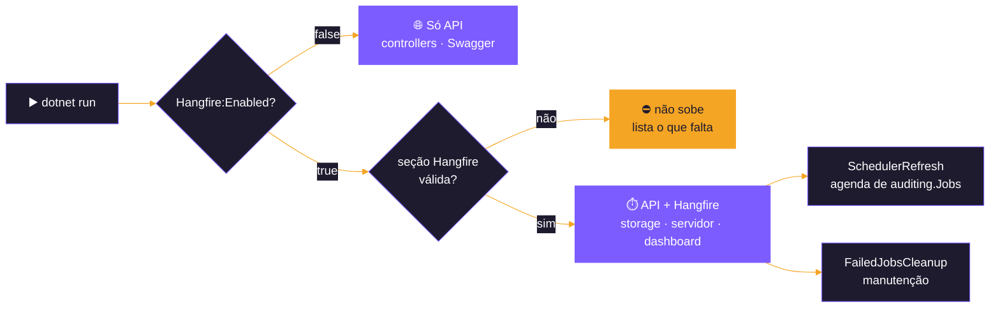
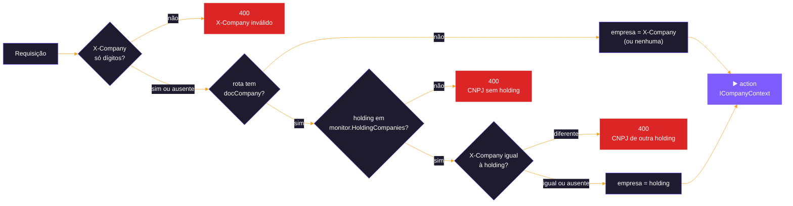
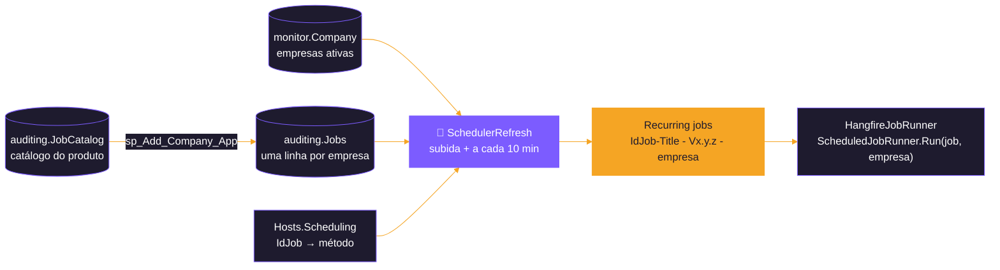
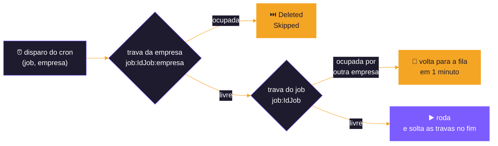

<p align="center">
  
</p>

# 🌐 Host WebApi

<p align="center">
  
  
  
  <br>
  
  
  
  
</p>

<p align="center">
  <b>Registra os módulos, expõe as rotas de cada leitura e escrita e, quando ligado, agenda os jobs com o Hangfire.</b>
</p>

<p align="center">
  <a href="#-os-dois-modos">Modos</a> ·
  <a href="#️-como-rodar">Como rodar</a> ·
  <a href="#️-rotas-por-módulo">Rotas</a> ·
  <a href="#-empresa-da-execução-nas-rotas">Empresa</a> ·
  <a href="#️-agenda-dos-jobs-com-o-hangfire-ligado">Agenda</a> ·
  <a href="#-concorrência">Concorrência</a> ·
  <a href="#-configuração">Configuração</a>
</p>

---

Host web do sistema de integrações: registra os módulos, expõe as rotas que disparam cada leitura e escrita e, quando
ligado, roda o **Hangfire**, que agenda os jobs recorrentes a partir de `auditing.Jobs`. Até 30/10/2026 o projeto se
chamava `Hangfire`; as decisões e o histórico de cada passo estão em [docs/PLANO-HOST-WEBAPI.md](docs/PLANO-HOST-WEBAPI.md).

| | Item | Valor |
|:---:|---|---|
| 💻 | **Plataforma** | .NET 10 (`net10.0`), ASP.NET Core |
| ⏱️ | **Agendador** | Hangfire 1.8 com storage SQL Server, opcional (`Hangfire:Enabled`) |
| 🔗 | **Endereço local** | `http://localhost:5252` (Swagger em `/swagger`, dashboard em `/hangfire`) |
| 🏢 | **Empresa** | por (job, empresa) na agenda; nas rotas, `X-Company` ou a holding do `{docCompany}` |
| 🔐 | **Autenticação da API** | desligada por enquanto: o `[Authorize]` dos controllers está comentado |

<p align="center">
  
  <br><sub><b>Swagger</b> — uma tag por service, agrupadas por módulo</sub>
</p>

---

## 🔀 Os dois modos

O mesmo projeto sobe de dois jeitos, escolhidos por `Hangfire:Enabled`:

| `Hangfire:Enabled` | O host sobe como |
|---|---|
| 🌐 `false` (padrão do `appsettings.json`) | **só API**: controllers e Swagger. Nada do Hangfire é registrado e o storage dele nem é acessado. Os jobs rodam pelas rotas, chamadas por quem quiser disparar |
| ⏱️ `true` | **API + Hangfire**: o mesmo da API, mais o storage, o servidor, o dashboard, a agenda montada a partir de `auditing.Jobs` e os jobs de manutenção |



Com o Hangfire ligado, a seção `Hangfire` é validada na subida: faltando um parâmetro obrigatório (a connection string do
storage, o usuário e a senha do dashboard...), o host não sobe e a mensagem lista o que falta.

> [!WARNING]
> **Um host de agenda por vez:** o Hangfire deste host, os WebJobs do host [WebJob](../WebJob/README.md) e o serviço do
> host [Worker](../Worker/README.md) (Quartz.NET) leem a mesma agenda de `auditing.Jobs` e só um agenda por vez no mesmo
> banco. Antes de ligar o Hangfire, parar os WebJobs no App Service e o serviço do Worker; antes de usar um dos outros
> dois, `Hangfire:Enabled = false` aqui (as rotas continuam para disparo manual: o modo só API combina com qualquer um
> deles). Se dois ficarem ligados por um tempo numa troca, a trava de concorrência ([abaixo](#-concorrência)) ainda impede
> que um mesmo job rode junto nos dois.

---

## ▶️ Como rodar

**Só API:**

```bash
dotnet run --project src/Backend/Hosts/WebApi --launch-profile http
```

**Com o Hangfire**, as credenciais do dashboard vêm de variável de ambiente, nunca do `appsettings.json`:

```bash
Hangfire__Enabled=true Hangfire__Dashboard__UserName="<usuário>" Hangfire__Dashboard__Password="<senha>" dotnet run --project src/Backend/Hosts/WebApi --launch-profile http
```

> [!TIP]
> Para usar user-secrets no lugar das variáveis, o projeto precisa de um `UserSecretsId`, que ainda não tem: rodar uma
> vez `dotnet user-secrets init --project src/Backend/Hosts/WebApi` (ele grava o id no `WebApi.csproj`) e depois
> `dotnet user-secrets set "Hangfire:Dashboard:Password" "<senha>" --project src/Backend/Hosts/WebApi`.

> [!IMPORTANT]
> Antes de ligar o Hangfire num banco, ele precisa ter `auditing.Jobs` com as colunas `IsActive`, `RunningDailyAt`,
> `Queue` e `Company` (Script001 do Shared) e **pelo menos uma empresa ativa** em `monitor.Company`, com os módulos
> contratados (`auditing.sp_Add_Company` e `auditing.sp_Add_Company_App`, ou o
> [`tools/seeds/Import-TestSeeds.ps1`](../../../../tools/seeds/Import-TestSeeds.ps1) num banco de teste). Sem empresa, a
> agenda fica vazia. Um banco que rodou os scripts antes de 30/10/2026 precisa do ajuste descrito no plano, §4.8.

> [!CAUTION]
> O [WebApi.http](WebApi.http) tem exemplos de rotas de cada módulo. Cada chamada roda a integração **de verdade** contra
> a API e o banco configurados.

---

## 🗂️ Estrutura

```text
WebApi/
├── Controllers/          rotas por módulo (DataWarehouse, General, LinxCommerce, LinxMicrovix, Shippment, Totvs)
├── Extensions/
│   ├── BuilderExtensions.cs    controllers, Swagger, CORS e o filtro global de empresa
│   ├── CompanyContextFilter.cs empresa da execução nas rotas (X-Company ou a holding do {docCompany})
│   ├── ServicesExtensions.cs   registro dos módulos e, com Hangfire:Enabled, do Hangfire (AddHangfireService)
│   └── AppUseExtensions.cs     pipeline e, com Hangfire:Enabled, dashboard e jobs de manutenção (UseHangfire)
├── Scheduling/
│   ├── HangfireSettings.cs, HangfireSettingsValidator.cs   seção Hangfire e a validação na subida
│   ├── DashboardBasicAuthorizationFilter.cs                usuário e senha do dashboard
│   ├── JobExpirationTimeoutFilter.cs                       retenção dos jobs concluídos
│   ├── SkipConcurrentExecutionFilter.cs                    travas da empresa e do job
│   ├── SchedulerRefreshJob.cs, FailedJobsCleanupJob.cs     jobs de manutenção
│   └── HangfireJobRunner.cs                                o que o Hangfire executa: repassa ao ScheduledJobRunner
├── appsettings.json
├── WebApi.http
└── docs/PLANO-HOST-WEBAPI.md
```

Os mapas `IdJob → método` (`RecurringJobs/`), o `JobCron` e o `ScheduledJobRunner` ficam no projeto
`src/Backend/Hosts/Hosts.Scheduling`, que o WebApi, o WebJob e o Worker dividem.

---

## 🔧 Configuração

| Seção | Uso |
|---|---|
| `ConnectionStrings:Connection` | banco das integrações (módulos, `auditing`, `monitor` e, por padrão, o storage do Hangfire e a trava de concorrência) |
| `ConnectionStrings:AuditingConnection` | opcional: banco de `auditing`. Sem ela, o Shared usa a `Connection` trocando `NEWBLOOMERS` por `AUDITING` no nome |
| `Hangfire` | tudo do Hangfire (tabela abaixo) |
| `AfterSale`, `Movidesk`, `LinxMicrovix`, `Totvs`... | `BaseUrl` e as opções de cada módulo (ver o README do módulo) |

<details>
<summary><b>⏱️ Seção <code>Hangfire</code> (valores do <code>appsettings.json</code>)</b></summary>

| Parâmetro | Valor | Uso |
|---|---|---|
| `Enabled` | `false` | liga o Hangfire |
| `TimeZone` | `America/Sao_Paulo` | fuso de toda a agenda (crons e `RunningDailyAt`) |
| `Storage:ConnectionStringName` | `Connection` | connection string do storage. Para um banco só do Hangfire, criar outra entrada em `ConnectionStrings` e apontar para ela |
| `Storage:SchemaName` | `HangFire` | schema das tabelas do Hangfire, que ele mesmo cria (`PrepareSchemaIfNecessary`), fora do DbUp |
| `Storage:JobExpirationTimeoutInMinutes` | `30` | por quanto tempo um job concluído fica no storage (o padrão do Hangfire é 1 dia) |
| `Storage:QueuePollIntervalInSeconds` | `15` | de quanto em quanto tempo o servidor consulta as filas |
| `Storage:CommandBatchMaxTimeoutInMinutes`, `SlidingInvisibilityTimeoutInMinutes` | `5` | timeouts do storage SQL Server |
| `Server:ServerName` | vazio | nome do servidor no dashboard; vazio usa o nome da máquina |
| `Server:Queues` | `[ "default" ]` | filas que este servidor atende |
| `Server:WorkerCount` | `20` | workers |
| `Schedule:RefreshIntervalInMinutes` | `10` | intervalo do `SchedulerRefresh` (tem que virar cron: dividir a hora ou ser horas que dividem o dia) |
| `Concurrency:MaxConsecutiveSkips` | `5` | pulos seguidos de um job até o aviso no log |
| `Maintenance:FailedJobsRetentionInDays` | `2` | depois de quantos dias uma falha sai da tela de Failed |
| `Dashboard:Path` | `/hangfire` | rota do dashboard |
| `Dashboard:ReadOnly` | `false` | dashboard só para consulta |
| `Dashboard:StatsPollingIntervalInSeconds` | `30` | atualização das estatísticas do dashboard aberto |
| `Dashboard:UserName`, `Password` | vazios | credenciais do dashboard: variável de ambiente (`Hangfire__Dashboard__Password`) ou user-secrets |

</details>

---

## 🛣️ Rotas por módulo

Todas as rotas aparecem no Swagger (em `RELEASE`, os controllers ficam fora dele). As leituras recorrentes não têm
parâmetro; as sob demanda e as escritas pedem o CNPJ da empresa (`{docCompany}`, 14 dígitos) e o cabeçalho
**`X-User-Name`**, gravado no log de requisições do módulo.

| Módulo | Prefixo | Rotas | Detalhes |
|---|---|:---:|---|
| 🟣 **Totvs** | `TotvsJobs/Totvs` | **123** | [README](../../Modules/Totvs/README.md); escritas só com `Totvs:Writes:<grupo>:Enabled` |
| 🟣 **Linx Microvix** (ERP e B2C) | `LinxMicrovixJobs/LinxMicrovix` | **284** | [README](../../Modules/LinxMicrovix/LinxMicrovix%20-%20Outbound%20Web%20Service/README.md) |
| 🟣 **Linx Commerce** | `LinxCommerceJobs/LinxCommerce` | **12** | [README](../../Modules/LinxCommerce/README.md) |
| 🟣 **Movidesk** | `MovideskJobs/Movidesk` | **16** | [README](../../Modules/General/Movidesk/README.md) |
| 🟣 **AfterSale** | `AfterSaleJobs/AfterSale` | **24** | [README](../../Modules/General/AfterSale/README.md) |
| 🟠 **Data warehouse** | `DataWarehouseJobs/DataWarehouse` | **5** | [funcionamento e fluxo](../../Modules/DataWarehouse/docs/DATAWAREHOUSE-FUNCIONAMENTO-E-FLUXO.md); 200 concluída, 500 falha, 409 outra carga rodando |

<details>
<summary><b>🖼️ Exemplo: rotas do AfterSale no Swagger</b></summary>

<p align="center">
  
</p>

</details>

Os controllers de Dootax, Oto, FlashCourier, JadLog, StoneLogistica e TotalExpress existem, mas estão vazios: esses
módulos entram no host conforme forem migrados (plano, passo 6).

---

## 🏢 Empresa da execução nas rotas

Toda execução grava a empresa (a holding do painel) em `auditing.Logs`, `Messages` e `Records`
([cadastro de empresas](../../../../docs/PLANO-TELA-CADASTRO-EMPRESA.md), 4.4). Nas rotas, quem informa é o
**`CompanyContextFilter`**, global, antes da action:

* o cabeçalho **`X-Company`** (CNPJ da holding, só dígitos, em `monitor.Company`); ou
* sem ele, a holding do **`{docCompany}`** da rota em `monitor.HoldingCompanies`;
* com os dois, o `docCompany` precisa ser da holding informada.



> [!NOTE]
> Sem `X-Company` e sem `{docCompany}` (as leituras recorrentes), a rota segue sem empresa e o `LoggerService` recusa abrir
> o log. Para disparar uma leitura recorrente pela rota, mande o `X-Company`.

```http
POST http://localhost:5252/MovideskJobs/Movidesk/Tickets
X-Company: 44065634000106

GET  http://localhost:5252/MovideskJobs/Movidesk/Tickets/38367316000199/1
X-User-Name: fulano
```

---

## ⏱️ Agenda dos jobs (com o Hangfire ligado)

A agenda vem inteira de `auditing.Jobs`: a tabela diz **se** e **quando** cada job roda, para **qual empresa** e em que
fila; o host diz **o que** ele executa.

| Coluna | Uso |
|---|---|
| `IsActive` | só os jobs com 1 entram na agenda. Nasce 0 em todo insert: nada roda sem um `UPDATE` |
| `IntervalTimeInMinutes` | intervalo; 0 = sob demanda, fora da agenda |
| `RunningDailyAt` | preenchida, o job é diário e roda nessa hora (só com intervalo 1440). Os diários dos scripts estão às 23:00 |
| `Queue` | fila do Hangfire (`default` até existir um segundo servidor) |
| `Company` | empresa (holding) da linha: uma linha por (job, empresa), criada por `auditing.sp_Add_Company_App` a partir do catálogo `auditing.JobCatalog` |

Só os jobs de integração (`IdType = 2`) entram na agenda; os de procedure (`IdType = 1`) são chamados pelo próprio
service, depois da carga. Só entram as empresas **ativas** em `monitor.Company`.

**Do registro ao cron:** 3 vira `*/3 * * * *`, 60 vira `0 * * * *`, 120 vira `0 */2 * * *` e um diário às 23:00 vira
`0 23 * * *`, no fuso de `Hangfire:TimeZone`. Um intervalo que o cron não representa (que não divide a hora ou o dia)
fica fora da agenda, com aviso no log.

**O `SchedulerRefresh`** monta a agenda: roda na subida e a cada `Schedule:RefreshIntervalInMinutes`. Ele lê
`auditing.Jobs`, inclui na agenda os jobs ativos que têm método no mapa, altera os que mudaram e remove os que ficaram
inativos, sem intervalo, de empresa desativada ou saíram do mapa. Um `UPDATE` na tabela vale, no máximo, no ciclo
seguinte. Os recurring jobs da agenda são **um por (job, empresa ativa)** e se chamam
`<IdJob>-<Title> - V<versão> - <empresa>` (ex.: `9002-DataWarehouseShortCycle - V1.0.0 - 44065634000106`), com a versão
do `[JobVersion]` do método ([abaixo](#️-versão-dos-jobs)). O resultado de cada releitura aparece no dashboard e no log
(`Agenda: N job(s) na agenda...`), com os avisos.



**Ligar e desligar jobs:**

```sql
-- liga um job de uma empresa
UPDATE [auditing].[Jobs] SET IsActive = 1 WHERE IdType = 2 AND IdJob = 3000 AND Company = '<CNPJ da holding>';

-- liga um módulo inteiro de uma empresa, pela faixa de IdJob (ex.: Movidesk, 3000 a 3499)
UPDATE [auditing].[Jobs] SET IsActive = 1 WHERE IdType = 2 AND IdJob BETWEEN 3000 AND 3499 AND IntervalTimeInMinutes > 0 AND Company = '<CNPJ da holding>';

-- muda a hora de um diário (todas as empresas)
UPDATE [auditing].[Jobs] SET RunningDailyAt = '02:30' WHERE IdType = 2 AND IdJob = 9001;

-- desliga (todas as empresas)
UPDATE [auditing].[Jobs] SET IsActive = 0 WHERE IdType = 2 AND IdJob = 3000;
```

> [!TIP]
> Para não esperar o ciclo, o `SchedulerRefresh` pode ser disparado na hora pela página de jobs recorrentes do dashboard.

---

## 🏷️ Versão dos jobs

Cada método de service chamado por um job recorrente tem **`[JobVersion("MAJOR.MINOR.PATCH")]`** no método da classe do
service (não na interface), e a versão vai no nome do recurring job. Para saber o que roda em cada ambiente, basta olhar
o dashboard. Ao mudar o código de um job, mude a versão no mesmo método: **PATCH** numa correção, **MINOR** numa mudança
compatível, **MAJOR** quando muda o que o job grava de um jeito que quebra quem lê. Com a versão nova, o
`SchedulerRefresh` troca o job antigo pelo novo na releitura seguinte.

> [!IMPORTANT]
> Um método do mapa sem o atributo impede o host de subir com o Hangfire ligado.

---

## 🔒 Concorrência

Um recurring job do Hangfire não sabe se a execução anterior terminou. Para dois disparos do mesmo job nunca rodarem
juntos, um filtro do host (**`SkipConcurrentExecutionFilter`**) pede, antes de cada execução, travas do `IJobLock` do
Shared (`sp_getapplock` no banco das integrações, sem esperar e presas à sessão). Com um recurring job por (job, empresa),
são **duas travas**:

| | Trava | Chave | Ocupada |
|:---:|---|---|---|
| 🏢 | **da empresa** | `<chave do job>:<empresa>` (ex.: `job:3000:44065634000106`) | a execução anterior da mesma empresa ainda roda: **pula** — vai para `Deleted` com o motivo `Skipped: previous execution of <chave> still running` e o worker fica livre |
| 🧩 | **do job** | `job:<IdJob>` (os jobs do DW dividem `group:datawarehouse`, porque escrevem nas mesmas landings) | outra empresa roda o mesmo job, que escreve nas mesmas tabelas (`untreated` e a `sp_*_Sync`): **volta para a fila em 1 minuto** (`Rescheduled: job:<IdJob> running for another company`), sem perder o horário |



Depois de `Concurrency:MaxConsecutiveSkips` pulos seguidos, sai um aviso no log: o job está lento demais para o
intervalo, e a correção é aumentar o intervalo na tabela. Uma execução adiada pode rodar logo antes do disparo seguinte
da mesma empresa; as duas rodam em sequência (a trava da empresa impede rodarem juntas).

> [!WARNING]
> As **rotas dos controllers ficam fora da trava**: um disparo manual durante a execução agendada roda junto com ela. As
> rotas são para uso manual e consciente (o DW continua com a própria trava no processo, que devolve 409).

---

## 🧹 Dashboard e manutenção

* 🔐 O dashboard pede usuário e senha (Basic Authentication, `Dashboard:UserName` e `Password`). Basic manda a senha em
  cada requisição: **fora do `localhost`, só por HTTPS**.
* 🗑️ Jobs concluídos (`Succeeded` e `Deleted`, inclusive os pulos) saem do storage depois de
  `Storage:JobExpirationTimeoutInMinutes`. O histórico que importa fica em `auditing.Logs` e `auditing.Messages`.
* ❌ Uma falha fica em `Failed` (as tentativas automáticas estão em 0) até o `FailedJobsCleanup`, que roda a cada hora,
  no minuto 15, e passa para `Deleted` as falhas com mais de `Maintenance:FailedJobsRetentionInDays`.
* ⚙️ `SchedulerRefresh` e `FailedJobsCleanup` são do próprio host: não estão em `auditing.Jobs` e só somem com
  `Hangfire:Enabled = false`.

---

## ➕ Um job ou um módulo novo

* **Job recorrente novo num módulo do host:** a linha no script de jobs da service (vai para `auditing.JobCatalog`, com
  `RunningDailyAt` e `Queue`, ver [PADRAO-CODIGO-E-SCRIPTS-INTEGRACOES.md](../../../../docs/PADRAO-CODIGO-E-SCRIPTS-INTEGRACOES.md)
  §3.1), a rota no controller, a entrada no mapa do módulo em
  `src/Backend/Hosts/Hosts.Scheduling/RecurringJobs/<Módulo>RecurringJobs.cs`, com o método sem parâmetros do service, e
  `[JobVersion("1.0.0")]` no método da classe do service. Para as empresas que já têm o módulo, `auditing.sp_Add_Company_App`
  de novo cria a linha em `auditing.Jobs` (inativa, sem duplicar as outras). Sem o mapa, o `SchedulerRefresh` avisa e
  deixa o job fora da agenda.
* **Módulo novo:** referência no `WebApi.csproj`, registro no `ServicesExtensions`, controller, o mapa
  `<Módulo>RecurringJobs.cs` incluído no `RecurringJobMap` e o script de jobs com as colunas novas (plano, passo 6).

---

<p align="center">
  <br>
  <sub>Host WebApi · <a href="../../../../README.md">voltar ao README do repositório</a></sub>
</p>
