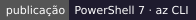
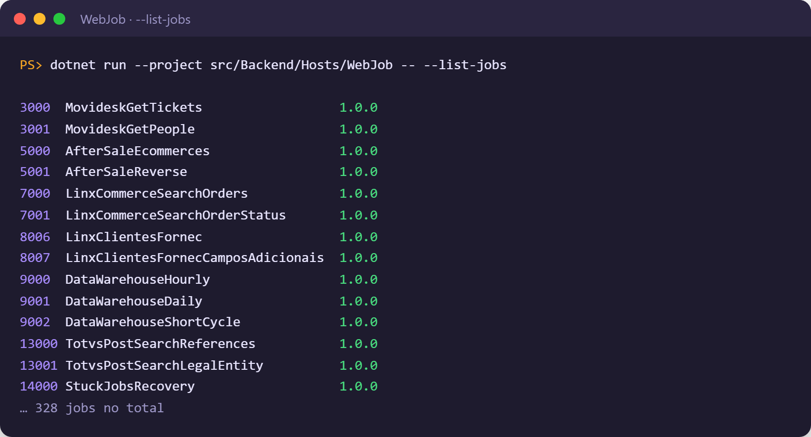
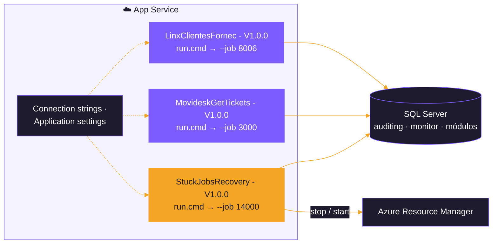
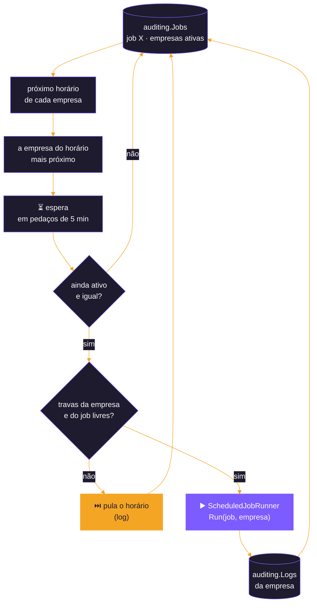
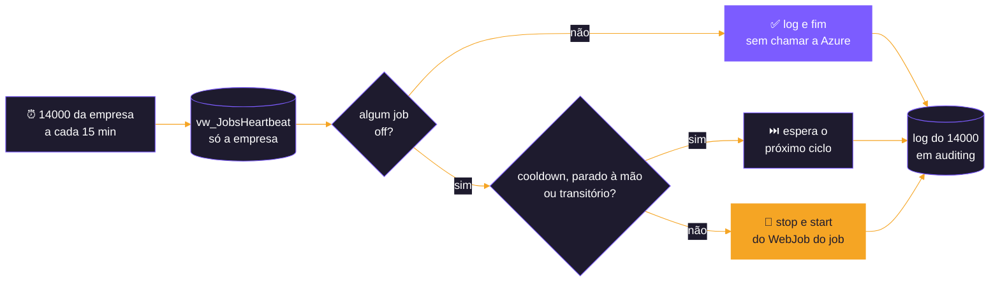

<div align="center">


</div>

# ☁️ Host WebJob

<div align="center">

  

  

</div>

<p align="center">
  <b>Roda cada job recorrente como um WebJob contínuo na Azure, para todas as empresas ativas, com a agenda lida de <code>auditing.Jobs</code>.</b>
</p>

<p align="center">
  <a href="#️-como-rodar-no-local">Como rodar</a> ·
  <a href="#️-agenda">Agenda</a> ·
  <a href="#-concorrência">Concorrência</a> ·
  <a href="#-publicação">Publicação</a> ·
  <a href="#-recuperação-de-jobs-travados">Recuperação</a> ·
  <a href="#-configuração">Configuração</a>
</p>

---

Host que roda os jobs recorrentes como **WebJobs contínuos na Azure**, no lugar do WebJob do sistema antigo. Cada WebJob
é um processo deste projeto que roda **um job só** (`--job <IdJob>`), **para todas as empresas ativas**, uma de cada vez,
com a agenda lida de `auditing.Jobs`. Até 30/10/2026 o projeto se chamava `AzureWebJob`; as decisões e o histórico de cada
passo estão em [docs/PLANO-HOST-WEBJOB.md](docs/PLANO-HOST-WEBJOB.md).

| | Item | Valor |
|:---:|---|---|
| 💻 | **Plataforma** | .NET 10 (`net10.0`), worker (`Microsoft.NET.Sdk.Worker`), sem o Azure WebJobs SDK |
| 📅 | **Agenda** | `auditing.Jobs`, uma linha por (job, empresa), relida a cada ciclo; nada de `[TimerTrigger]` no código |
| ⚙️ | **Um processo** | um job (`--job <IdJob>`) para todas as empresas ativas; na Azure, um WebJob por job, chamado `<Title> - V<versão>` |
| 🚀 | **Publicação** | `Publish/publish-webjob.ps1` com os perfis de `Publish/publish-profiles.psd1` |
| 🩺 | **Recuperação** | job 14000 `StuckJobsRecovery`, um por empresa, só neste host |

---

## 🔀 Um host de agenda por vez

O WebApi (com o Hangfire), o WebJob e o [Worker](../Worker/README.md) (serviço do Windows com o Quartz.NET) ficam na
mesma solution para a equipe escolher como orquestrar os jobs, mas **só um agenda por vez** no mesmo banco: o Hangfire do
WebApi, os WebJobs publicados ou o serviço do Worker.

* ➡️ **Para o WebJob:** `Hangfire:Enabled = false` no WebApi (as rotas continuam disponíveis para disparo manual) e o
  serviço do Worker parado, e só então publicar ou iniciar os WebJobs.
* ⬅️ **Do WebJob para outro host:** parar os WebJobs no App Service (ou tirá-los do perfil e publicar com
  `-RemoveMissing`) e só então ligar o Hangfire ou iniciar o Worker.

> [!NOTE]
> Se, numa troca, dois ficarem ligados por um tempo, a trava ([abaixo](#-concorrência)) ainda impede que um mesmo job rode
> junto nos dois, mas não que rode duas vezes no mesmo ciclo (visto no teste entre o Hangfire e o Worker: APIs lidas em
> dobro). A coluna `Queue` é só a fila do Hangfire: não divide jobs entre os hosts.

---

## ▶️ Como rodar no local

> [!TIP]
> O banco precisa das tabelas (Shared e módulos) e de uma empresa ativa com os módulos contratados. A tela
> [`tools/migrators/Invoke-Migrators.ps1`](../../../../tools/migrators/Invoke-Migrators.ps1) com o host **WebJob (Azure)**
> marcado faz as duas coisas num banco de teste (opção **Banco de teste**); o WebJob não tem tabelas próprias.

O job vem da linha de comando. A connection string fica fora do `appsettings.json`: user-secrets (o projeto já tem o
`UserSecretsId`) ou variável de ambiente.

```bash
dotnet user-secrets set "ConnectionStrings:Connection" "<connection string>" --project src/Backend/Hosts/WebJob
```

```bash
dotnet run --project src/Backend/Hosts/WebJob -- --job 9002
```

Listar os jobs que o host conhece (IdJob, título e versão, separados por tabulação), **sem subir o host nem acessar o
banco**:

```bash
dotnet run --project src/Backend/Hosts/WebJob -- --list-jobs
```

<div align="center">



<sub><b>--list-jobs</b> — trecho da saída (o script de publicação lê o título e a versão daqui)</sub>

</div>

Sem `--job`, ou com um `TimeZone` inválido, o processo encerra com código 1. Com um job que não está nos mapas, ele avisa
no log e fica parado (na Azure, um WebJob contínuo que termina é reiniciado em laço).

> [!CAUTION]
> Testes de banco: num banco de teste na instância SQL Server do Docker, nunca no LocalDB. Um banco carregado pelo
> [`tools/seeds/Import-TestSeeds.ps1`](../../../../tools/seeds/Import-TestSeeds.ps1) tem as **credenciais reais** dos
> módulos: aponte as `BaseUrl` para uma porta local fechada (ex.: `Movidesk__BaseUrl=http://127.0.0.1:9/`).

---

## ☁️ Como roda na Azure

Cada WebJob publicado é uma pasta `App_Data/jobs/continuous/<nome>` no App Service, com o build, o `settings.job`
(`"is_singleton": true`: com mais de uma instância no App Service, ele roda numa só) e um `run.cmd` que chama o host com o
`--job` daquele WebJob (`dotnet WebJob.dll --job 8006`, ou `WebJob.exe --job 8006` com `SelfContained`).



O zip não leva `ConnectionStrings`: elas ficam nas configurações do App Service (Connection strings ou Application
settings, ex.: `ConnectionStrings__Connection`) e valem para todos os WebJobs dele. O mesmo vale para qualquer
parâmetro que mude por ambiente (ex.: `Recovery__AppServiceName`).

**O que o App Service precisa** (conferido no teste C7, 03/11/2026, com 12 WebJobs num App Service de teste):

| | Item | Detalhe |
|:---:|---|---|
| 🪟 | Plano **Windows**, Basic ou acima | WebJob contínuo exige **Always On**, que não existe no Free/Shared. Runtime `dotnet:10` disponível (perfil com `SelfContained = $false`); 64 bits ligado |
| 📏 | **Tamanho do plano** | Um **B1** (1 núcleo, 1,75 GB) com 12 WebJobs, o painel e o WebApi ficou em 100% de CPU e 96% de memória: a leitura das notas da Totvs levou 5 vezes mais e foi cancelada. Para produção, um plano maior (B2, S1, P0v3) ou menos processos por plano ([ponto 12](../../../../docs/PROPOSTA-TESTES-CENARIOS-HOSPEDAGEM.md#83-pontos-em-aberto)) |
| 🗄️ | Banco | Connection string do tipo `SQLAzure` (ou `SQLServer`); no firewall do Azure SQL, os **IPs de saída** do App Service (`outboundIpAddresses`) |
| 🕒 | Fuso | O App Service roda em UTC; os WebJobs usam `WebJob:TimeZone` e gravam em horário de Brasília, então `RunningDailyAt` vale no horário de Brasília |
| 🔁 | Reinício | `az webapp restart` no meio de um ciclo: os WebJobs voltam sozinhos e o ciclo seguinte é normal. As execuções interrompidas não deixam registro em `auditing.Logs` (o log só é gravado no fim) |

> [!NOTE]
> Na sandbox do App Service, uma chamada a uma porta local fechada (a `BaseUrl` `http://127.0.0.1:9/` dos testes sem API)
> falha com `An attempt was made to access a socket in a way forbidden by its access permissions`, e não com "conexão
> recusada" como no local. É esperado.

---

## 🗂️ Estrutura

```text
WebJob/
├── Program.cs                      --list-jobs, --job e o JobScheduleWorker
├── Extensions/ServicesExtensions.cs   registro dos módulos, do executor e da recuperação
├── Scheduling/
│   ├── WebJobSettings.cs           seção WebJob
│   ├── JobScheduleWorker.cs        a agenda do processo: lê auditing.Jobs (todas as empresas), espera, trava e roda
│   └── WebJobRecurringJobs.cs      os mapas compartilhados mais os jobs só deste host (14000)
├── Recovery/
│   ├── RecoverySettings.cs         seção Recovery
│   ├── AzureWebJobsClient.cs       API do Azure Resource Manager: listar, parar e iniciar WebJobs
│   └── StuckJobsRecovery.cs        RecoverStuckJobs(): heartbeat da empresa e reinício
├── Publish/
│   ├── publish-webjob.ps1          script de publicação
│   └── publish-profiles.psd1       perfis (dev, teste, prod)
├── settings.job
├── appsettings.json
└── docs/PLANO-HOST-WEBJOB.md
```

Os mapas `IdJob → método` (`RecurringJobs/`), o `JobCron` e o `ScheduledJobRunner` ficam no projeto
`src/Backend/Hosts/Hosts.Scheduling`, que o WebJob, o WebApi e o Worker dividem.

---

## 🔧 Configuração

| Seção | Uso |
|---|---|
| `ConnectionStrings:Connection` | banco das integrações (módulos, `auditing`, `monitor` e a trava de concorrência) |
| `ConnectionStrings:AuditingConnection` | opcional: banco de `auditing`. Sem ela, o Shared usa a `Connection` trocando `NEWBLOOMERS` por `AUDITING` no nome |
| `WebJob` | a agenda do processo (tabela abaixo) |
| `Recovery` | a recuperação dos WebJobs travados (ver [Recuperação](#-recuperação-de-jobs-travados)) |
| `AfterSale`, `Movidesk`, `LinxMicrovix`, `Totvs`... | `BaseUrl` e as opções de cada módulo (ver o README do módulo) |

Seção `WebJob`:

| Parâmetro | Valor | Uso |
|---|---|---|
| `IdJob` | — | o job do processo; vem de `--job` |
| `TimeZone` | `America/Sao_Paulo` | fuso da agenda (intervalos e `RunningDailyAt`), o mesmo do Hangfire do WebApi |
| `RecheckIntervalInMinutes` | `5` | de quanto em quanto tempo o processo relê `auditing.Jobs` enquanto espera |
| `MaxConsecutiveSkips` | `5` | pulos seguidos (trava ocupada) até o aviso no log |

---

## 📅 Agenda

A agenda vem de `auditing.Jobs`, com as mesmas colunas e regras do Hangfire do WebApi:

| Coluna | Uso |
|---|---|
| `IsActive` | só com 1 o job roda. Nasce 0 em todo insert: nada roda sem um `UPDATE` |
| `IntervalTimeInMinutes` | intervalo; 0 = sob demanda, não roda |
| `RunningDailyAt` | preenchida, o job é diário e roda nessa hora (só com intervalo 1440). Os diários dos scripts estão às 23:00 |
| `Queue` | não usada neste host (é a fila do Hangfire) |
| `Company` | empresa (holding) da linha; só entram as empresas ativas em `monitor.Company` |

Os horários seguem as regras do cron do WebApi, no fuso de `WebJob:TimeZone`: 3 roda nos minutos múltiplos de 3, 60 no
minuto 0 de cada hora, 120 a cada 2 horas cheias, e um diário na hora de `RunningDailyAt`. Um intervalo que não divide a
hora nem o dia fica sem agenda, com aviso no log.

**A cada ciclo, o processo:**

1. lê as linhas do job em `auditing.Jobs` (`IdType = 2`), **uma por empresa ativa**, e calcula o próximo horário de cada
   empresa; o mais próximo é o da vez;
2. espera, em pedaços de no máximo `RecheckIntervalInMinutes`;
3. relê a linha daquela empresa logo antes de rodar: um job desligado durante a espera não roda nem no horário já
   calculado;
4. pede as travas e roda o método do mapa pelo `ScheduledJobRunner`, num escopo com a empresa (`ICompanyContext`), que
   grava em `auditing.Logs` e `auditing.Messages` (inclusive o erro, quando a execução falha) e volta ao item 1.



As empresas rodam **uma de cada vez** neste processo. Uma execução longa não deixa a mesma empresa rodar de novo os
horários que passaram durante ela; as outras empresas rodam em seguida os horários delas que já passaram. Uma empresa
inativa (ou nova) conta a partir de agora: ao ligar, não roda de uma vez os horários em que estava desligada.

Uma mudança na tabela vale, no máximo, depois de `RecheckIntervalInMinutes` ou no horário seguinte, **sem republicar**.

```sql
-- liga um job de uma empresa
UPDATE [auditing].[Jobs] SET IsActive = 1 WHERE IdType = 2 AND IdJob = 3000 AND Company = '<CNPJ da holding>';

-- muda o intervalo (todas as empresas)
UPDATE [auditing].[Jobs] SET IntervalTimeInMinutes = 15 WHERE IdType = 2 AND IdJob = 3000;

-- muda a hora de um diário
UPDATE [auditing].[Jobs] SET RunningDailyAt = '02:30' WHERE IdType = 2 AND IdJob = 9001;

-- desliga (o WebJob continua no ar, esperando)
UPDATE [auditing].[Jobs] SET IsActive = 0 WHERE IdType = 2 AND IdJob = 3000;
```

> [!IMPORTANT]
> Um job ativo só roda se tiver WebJob publicado: ligar na tabela não cria o WebJob, e um WebJob publicado de um job
> inativo (em todas as empresas) fica só esperando.

Os jobs de procedures (`ProceduresRecurringJobs.cs` em `Hosts.Scheduling`) estão comentados até as procedures existirem
neste repositório; ao descomentar um, ele precisa da linha em `auditing.Jobs`, do WebJob no perfil e de receber a
empresa (`@Company`).

---

## 🔒 Concorrência

Antes de cada execução, o processo pede as travas do `IJobLock` do Shared (`sp_getapplock` no banco das integrações,
sem esperar), com as mesmas chaves do Hangfire do WebApi e do Worker:

| | Trava | Chave | Para quê |
|:---:|---|---|---|
| 🏢 | **da empresa** | `<chave do job>:<empresa>` | a execução anterior da mesma empresa (em outro host ou na versão antiga) |
| 🧩 | **do job** | `job:<IdJob>`, e `group:datawarehouse` para os jobs do DW | outra empresa ou outro host rodando o mesmo job, que escreve nas mesmas tabelas (`untreated` e a `sp_*_Sync`) |

Qualquer uma ocupada, o horário é **pulado** com o registro no log, e depois de `MaxConsecutiveSkips` pulos seguidos sai
um aviso: o job está lento demais para o intervalo. Como as chaves são as mesmas, um job nunca roda junto nem entre um
WebJob e o WebApi.

---

## 🏷️ Versão dos jobs

Cada método chamado por um job recorrente tem **`[JobVersion("MAJOR.MINOR.PATCH")]`** no método da classe do service, e a
versão vai no nome do WebJob: `LinxClientesFornec - V1.0.0`. Ao mudar o código de um job, mude a versão no mesmo método
(**PATCH** numa correção, **MINOR** numa mudança compatível, **MAJOR** quando muda o que o job grava de um jeito que
quebra quem lê) e republique o job: o script cria o WebJob da versão nova e apaga o da anterior.

> [!IMPORTANT]
> Um método do mapa sem o atributo, ou um job sem título, impede o host de subir.

---

## 🚀 Publicação

O `Publish/publish-webjob.ps1` (PowerShell 7 e Azure CLI, com `az login`) publica um WebJob contínuo por job do perfil.

**Perfis** (`Publish/publish-profiles.psd1`, só nomes de recursos, nenhum segredo; o arquivo não vai para o zip):

| Chave | Uso |
|---|---|
| `DefaultProfile` | perfil usado sem `-Profile` (`dev`) |
| `SubscriptionId` | assinatura; vazio = a padrão do `az login` |
| `ResourceGroup`, `AppServiceName` | onde ficam os WebJobs |
| `NameFormat` | `Spaces` = `<Title> - V<versão>`; `Safe` = `<Title>-V<versão com _>` (ex.: `LinxClientesFornec-V1_0_0`), o formato reserva se a Azure não aceitar espaço e ponto no nome |
| `SelfContained` | `$false`: o App Service precisa do runtime do .NET 10; `$true`: publica para `win-x64` com o runtime junto (zip maior) |
| `Jobs` | os `IdJob` que viram WebJob neste ambiente (ex.: `@(8000, 3000, 8006)`) |

**Como publica:** um `dotnet publish` (Release); `WebJob.dll --list-jobs` dá o título e a versão de cada job; para cada
`IdJob` do perfil, um zip com `App_Data/jobs/continuous/<nome>` (o build, o `run.cmd` e o `settings.job`), publicado com
`az webapp deploy --type zip --clean false`. O WebJob é substituído no lugar, e o da versão anterior do mesmo job é
apagado.

```mermaid
%%{init: {'theme':'base','themeVariables':{'primaryColor':'#1e1b2e','primaryTextColor':'#ffffff','primaryBorderColor':'#7c5cff','lineColor':'#f5a524','textColor':'#1e1b2e','clusterBkg':'#f5f3ff','clusterBorder':'#7c5cff','titleColor':'#1e1b2e','edgeLabelBackground':'#1e1b2e'}}}%%
flowchart LR
    PROF["publish-profiles.psd1<br/>Jobs do perfil"] --> PS["publish-webjob.ps1"]
    PS --> PUB["dotnet publish<br/>Release"]
    PUB --> LIST["WebJob.dll --list-jobs<br/>título e versão"]
    LIST --> ZIP["um zip por IdJob<br/>App_Data/jobs/continuous/nome"]
    ZIP --> DEP["az webapp deploy<br/>--type zip --clean false"]
    DEP --> OLD["apaga o WebJob<br/>da versão anterior"]

    classDef accent fill:#7c5cff,stroke:#7c5cff,color:#ffffff
    classDef warm fill:#f5a524,stroke:#f5a524,color:#1e1b2e
    class PS accent
    class DEP warm
```



```powershell
# o que o perfil publicaria e os WebJobs que já existem no App Service, sem publicar
./src/Backend/Hosts/WebJob/Publish/publish-webjob.ps1 -Profile dev -ListJobs

# build e zips, sem chamar a Azure
./src/Backend/Hosts/WebJob/Publish/publish-webjob.ps1 -Profile dev -DryRun

# publica todos os jobs do perfil, ou só alguns
./src/Backend/Hosts/WebJob/Publish/publish-webjob.ps1 -Profile prod
./src/Backend/Hosts/WebJob/Publish/publish-webjob.ps1 -Profile prod -Jobs 8006,3000

# publica e apaga os WebJobs deste host cujo job saiu do perfil
./src/Backend/Hosts/WebJob/Publish/publish-webjob.ps1 -Profile prod -RemoveMissing
```

Outros parâmetros: `-ProfilesFile` (outro arquivo de perfis, para pipeline ou teste).

**Conferido numa publicação real** (perfil `teste`, 03/11/2026): a Azure aceita espaço e ponto no nome
(`NameFormat = 'Spaces'`), o App Service Windows tem o runtime do .NET 10 (`SelfContained = $false`), cada WebJob publica
em cerca de 1 minuto e sobe `Running`.

> [!WARNING]
> **Ainda não conferido:** a troca de versão (publicar uma versão nova e o script apagar o WebJob da anterior). Cada zip
> tem cerca de 15 MB: com muitos jobs no mesmo App Service, conferir o espaço em disco do plano.

> [!CAUTION]
> O perfil `dev` publica no `app-dev-webjobs-2`, na mesma assinatura da NEWBLOOMERS que tem produção. O perfil `teste`
> aponta para o grupo `rg-etl-teste`, criado e apagado pelo
> [`tools/azure/New-AzureTestResources.ps1`](../../../../tools/azure/New-AzureTestResources.ps1) só para os testes: sem
> esse grupo, publicar com ele falha.

---

## 🩺 Recuperação de jobs travados

O job **14000 `StuckJobsRecovery`** (app 140 `Hosts`, a cada 15 minutos) roda o `RecoverStuckJobs()` num WebJob próprio,
só neste host (no Hangfire do WebApi ele não tem método). **Toda empresa tem o seu 14000**, criado junto com ela por
`auditing.sp_Add_Company`; cada um lê o heartbeat **só dos jobs da sua empresa** e só chama a Azure quando algum está com
o **heartbeat off**:

1. lê `auditing.vw_JobsHeartbeat` da empresa (uma consulta, apoiada no índice `IX_Logs_Heartbeat`);
2. **off** = job ativo sem execução terminada há mais que 1 × o intervalo (`IntervalTimeInMinutes` + `GraceMinutes`, que
   é 0); num diário, sem execução terminada desde o último horário de `RunningDailyAt`. Um job que nunca rodou fica fora
   até a primeira execução;
3. nenhum off: registra isso no log e termina, sem chamar a Azure;
4. algum off: lista os WebJobs do App Service e reinicia (stop e start) o do job, achado pelo título em qualquer versão,
   com as proteções do sistema antigo: um WebJob reiniciado não é reiniciado de novo antes de `RestartCooldownMinutes`, um
   WebJob parado à mão não é retomado e um em estado transitório espera o próximo ciclo.



Tudo vai para o log do job 14000 em `auditing`: os jobs off, o motivo e o que foi reiniciado. O WebJob reiniciado é o do
job, que atende todas as empresas.

> [!WARNING]
> **Execuções longas:** os services gravam o log só no fim, então uma execução longa e saudável aparece como off e seria
> reiniciada no meio (também uma de 3 minutos que está rodando na hora da checagem). Para esses jobs, um limite próprio
> em `Recovery:Thresholds` ou a exclusão em `Recovery:IgnoredJobs`.

Seção `Recovery`:

| Parâmetro | Valor | Uso |
|---|---|---|
| `DryRun` | `false` | `true`: registra no log o que reiniciaria, sem chamar a Azure |
| `TenantId`, `SubscriptionId`, `ResourceGroup`, `AppServiceName` | vazios | onde estão os WebJobs |
| `NameFormat` | `Spaces` | o mesmo do perfil de publicação |
| `GraceMinutes` | `0` | folga somada ao intervalo (0 = a regra de 1 × o intervalo) |
| `RestartCooldownMinutes` | `30` | espera mínima entre dois reinícios do mesmo WebJob, e o tempo que ele tem para terminar a primeira execução |
| `Thresholds` | `{}` | limite próprio por `IdJob`, em minutos (ex.: `{ "13017": 240 }`), no lugar do intervalo |
| `IgnoredJobs` | `[]` | `IdJob` que a recuperação nunca reinicia |

**Autenticação na Azure:** só o `DefaultAzureCredential`, sem segredo na configuração. Na Azure, a **identidade
gerenciada** do App Service, que precisa estar ligada e ter permissão de listar, parar e iniciar os WebJobs dele; no
local, o `az login`. Um service principal, se um dia precisar, entra pelas variáveis `AZURE_CLIENT_ID`,
`AZURE_TENANT_ID` e `AZURE_CLIENT_SECRET`, que o `DefaultAzureCredential` já lê.

> [!TIP]
> Para ligar: `UPDATE [auditing].[Jobs] SET IsActive = 1 WHERE IdType = 2 AND IdJob = 14000 AND Company = '<CNPJ da holding>';`
> e o 14000 no `Jobs` do perfil. Para começar só observando, `Recovery__DryRun=true` no App Service.

> [!IMPORTANT]
> **Ainda não conferido na Azure real.** No teste C7 a identidade gerenciada foi ligada, mas dar a ela o papel
> **Website Contributor** no App Service pede `Microsoft.Authorization/roleAssignments/write` (Owner ou User Access
> Administrator), que a conta usada não tinha; sem o papel, a recuperação não lista nem reinicia os WebJobs. Antes de
> contar com ela em produção, alguém com essa permissão dá o papel e o reinício é testado com `Recovery__DryRun=true` e
> depois de verdade ([ponto 13](../../../../docs/PROPOSTA-TESTES-CENARIOS-HOSPEDAGEM.md#83-pontos-em-aberto)).

---

## ➕ Um job ou um módulo novo

* **Job recorrente novo num módulo do host:** a linha no script de jobs da service (vai para `auditing.JobCatalog`, com
  `RunningDailyAt` e `Queue`, ver [PADRAO-CODIGO-E-SCRIPTS-INTEGRACOES.md](../../../../docs/PADRAO-CODIGO-E-SCRIPTS-INTEGRACOES.md)
  §3.1), a entrada no mapa do módulo em `src/Backend/Hosts/Hosts.Scheduling/RecurringJobs/<Módulo>RecurringJobs.cs`,
  `[JobVersion("1.0.0")]` no método da classe do service e o `IdJob` no `Jobs` do perfil de publicação. Para as empresas
  que já têm o módulo, `auditing.sp_Add_Company_App` de novo cria a linha em `auditing.Jobs` (inativa, sem duplicar).
* **Módulo novo:** referência no `WebJob.csproj` e registro no `ServicesExtensions` (também no WebApi), o mapa
  `<Módulo>RecurringJobs.cs` incluído no `RecurringJobMap` e o script de jobs com as colunas novas.
* **Job só deste host** (como o 14000): a entrada em `Scheduling/WebJobRecurringJobs.cs`.

---

<div align="center">


<sub>Host WebJob · <a href="../../../../README.md">voltar ao README do repositório</a></sub>

</div>
