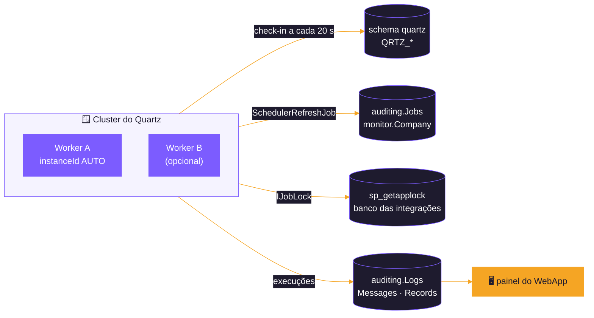
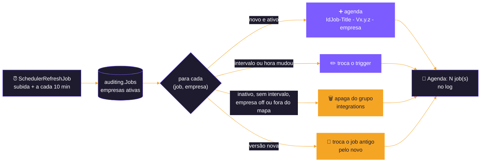
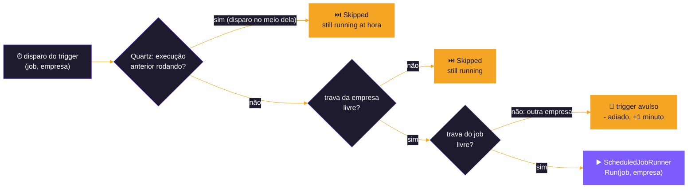
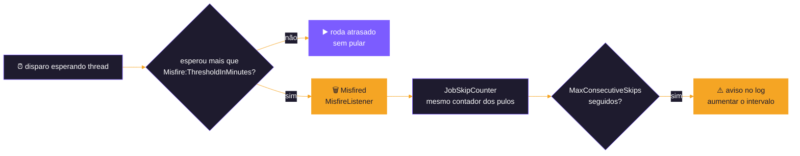

<p align="center">
  
</p>

# 🪟 Host Worker

<p align="center">
  
  
  
  <br>
  
  
  
  
</p>

<p align="center">
  <b>Um processo só, como serviço do Windows, para todos os jobs ativos de todas as empresas, com o Quartz.NET em cluster.</b>
</p>

<p align="center">
  <a href="#️-como-rodar-no-local">Como rodar</a> ·
  <a href="#-agenda">Agenda</a> ·
  <a href="#-concorrência">Concorrência</a> ·
  <a href="#-onde-ver-o-que-rodou">Onde ver</a> ·
  <a href="#-publicação-como-serviço-do-windows">Publicação</a> ·
  <a href="#-configuração">Configuração</a>
</p>

---

Host que roda os jobs recorrentes com o agendador **Quartz.NET**, como **serviço do Windows**: um processo só para todos
os jobs ativos de `auditing.Jobs`. É a terceira opção de orquestração, ao lado do Hangfire do WebApi e dos WebJobs. Até
01/11/2026 o projeto se chamava `Quartz` (e era só o modelo `dotnet new worker`). As decisões e o histórico de cada passo
estão em [docs/PLANO-HOST-WORKER.md](docs/PLANO-HOST-WORKER.md).

| | Item | Valor |
|:---:|---|---|
| 💻 | **Plataforma** | .NET 10 (`net10.0`), worker (`Microsoft.NET.Sdk.Worker`) |
| ⏱️ | **Agendador** | Quartz.NET 3.19.1, `AdoJobStore` em cluster no banco das integrações (schema `quartz`) |
| 📅 | **Agenda** | `auditing.Jobs`, uma linha por (job, empresa), relida pelo `SchedulerRefreshJob` |
| 🔒 | **Concorrência** | `[DisallowConcurrentExecution]` do Quartz + `IJobLock` do Shared, com as chaves dos outros hosts |
| 🪟 | **Onde roda** | serviço do Windows (`EtlWorker`), publicado por `Publish/publish-worker.ps1` |
| 🖥️ | **Painel** | nenhum: o que rodou fica em `auditing` e no painel do WebApp |



---

## 🔀 Um host de agenda por vez

O WebApi (com o Hangfire), o WebJob e o Worker ficam na mesma solution para a equipe escolher como orquestrar os jobs,
mas **só um agenda por vez** no mesmo banco.

* ➡️ **Para ligar o Worker:** `Hangfire:Enabled = false` no WebApi (as rotas continuam para disparo manual) e os WebJobs
  parados no App Service; só então instalar ou iniciar o serviço.
* ⬅️ **Para sair do Worker:** parar o serviço (`Stop-Service EtlWorker`, ou `Quartz:Enabled = false`) e só então ligar o
  outro host.

> [!TIP]
> Uma combinação natural é o WebApi em modo só API, para as rotas manuais, com o Worker agendando. Na subida, o Worker
> avisa no log se encontrar um servidor do Hangfire com heartbeat recente no mesmo banco (`[HangFire].[Server]`); ele sobe
> assim mesmo, porque a trava ([abaixo](#-concorrência)) impede que um job rode junto nos dois. Os WebJobs não são
> conferidos.

---

## ▶️ Como rodar no local

A connection string fica fora do `appsettings.json`: user-secrets (o projeto já tem o `UserSecretsId`) ou variável de
ambiente.

```bash
dotnet user-secrets set "ConnectionStrings:Connection" "<connection string>" --project src/Backend/Hosts/Worker
```

O banco precisa das tabelas do Quartz. O migrator do host roda **depois do migrator do Shared** (ver
[MIGRATOR-CSX.md](../../../../docs/MIGRATOR-CSX.md)):

```bash
cd src/Backend/Hosts/Worker/Scripts/SQLServer && dotnet script migrator.csx -- "<connection string>"
```

```bash
dotnet run --project src/Backend/Hosts/Worker
```

No console, o host sobe igual ao serviço (o `AddWindowsService` só age dentro de um serviço). Com `Quartz:Enabled = false`
ele sobe sem agendar nada, para conferir configuração e conexão. Sem nenhuma empresa ativa em `monitor.Company` (com os
módulos contratados), a agenda fica vazia.

> [!CAUTION]
> Testes de banco: num banco de teste na instância SQL Server do Docker, nunca no LocalDB. **Um banco carregado pelo
> [`tools/seeds/Import-TestSeeds.ps1`](../../../../tools/seeds/Import-TestSeeds.ps1) tem as credenciais reais dos
> módulos** (os scripts de `Seeds/SQLServer`): num teste, aponte as `BaseUrl` dos módulos para uma porta local fechada
> (ex.: `Movidesk__BaseUrl=http://127.0.0.1:9/`), senão os jobs ativos chamam as APIs de verdade.

---

## 🗂️ Estrutura

```text
Worker/
├── Program.cs                         serviço do Windows, módulos e Quartz
├── Extensions/ServicesExtensions.cs   AddServices (módulos e executor), AddQuartzService, AddWindowsServiceHosting
├── Scheduling/
│   ├── QuartzSettings.cs, QuartzSettingsValidator.cs   seção Quartz e a validação na subida
│   ├── QuartzJobRunner.cs        o job do Quartz para todos os jobs da agenda: pulo, travas, adiamento e execução
│   ├── SchedulerRefreshJob.cs    a agenda a partir de auditing.Jobs (um job por empresa)
│   ├── JobSkipCounter.cs         pulos seguidos por job e o aviso
│   ├── MisfireListener.cs        descartes pelo misfire, no mesmo contador
│   └── SchedulingHostGuard.cs    aviso de Hangfire agendando no mesmo banco
├── Scripts/SQLServer/            tabelas do Quartz (schema quartz) e o migrator.csx
├── Publish/
│   ├── publish-worker.ps1        script de publicação
│   └── publish-profiles.psd1     perfis (dev, prod)
├── appsettings.json
└── docs/PLANO-HOST-WORKER.md
```

Os mapas `IdJob → método` (`RecurringJobs/`), o `JobCron` e o `ScheduledJobRunner` ficam no projeto
`src/Backend/Hosts/Hosts.Scheduling`, que o Worker, o WebApi e o WebJob dividem.

---

## 🔧 Configuração

| Seção | Uso |
|---|---|
| `ConnectionStrings:Connection` | banco das integrações (módulos, `auditing`, `monitor`, tabelas do Quartz e a trava de concorrência) |
| `ConnectionStrings:AuditingConnection` | opcional: banco de `auditing`. Sem ela, o Shared usa a `Connection` trocando `NEWBLOOMERS` por `AUDITING` no nome |
| `Quartz` | o agendador (tabela abaixo) |
| `Service:Name` | nome do serviço do Windows e origem no Log de Eventos (`EtlWorker`); o script grava o do perfil |
| `Logging:EventLog` | o que vai para o Log de Eventos (`Warning` para cima) |
| `AfterSale`, `Movidesk`, `LinxMicrovix`, `Totvs`... | `BaseUrl` e as opções de cada módulo (ver o README do módulo) |

<details>
<summary><b>⏱️ Seção <code>Quartz</code></b> (nossa, estruturada como a do Hangfire; não é a seção de chaves <code>quartz.*</code> da documentação do Quartz.NET)</summary>

| Parâmetro | Valor | Uso |
|---|---|---|
| `Enabled` | `true` | `false`: o host sobe sem o Quartz |
| `SchedulerName` | `Worker` | o mesmo em todos os Workers do cluster; cada processo tem o seu `instanceId` (`AUTO`) |
| `TimeZone` | `America/Sao_Paulo` | fuso de todos os triggers |
| `Storage:ConnectionStringName` | `Connection` | onde ficam as tabelas do Quartz |
| `Storage:TablePrefix` | `quartz.QRTZ_` | schema e prefixo das tabelas (sem colchetes) |
| `Storage:Clustered` | `true` | cluster ligado desde o início: um segundo Worker no mesmo banco é seguro |
| `Storage:ClusterCheckinIntervalInSeconds` | `20` | de quanto em quanto tempo cada Worker avisa que está vivo |
| `Threads:MaxConcurrency` | `20` | execuções ao mesmo tempo |
| `Misfire:ThresholdInMinutes` | `15` | quanto um disparo pode esperar thread antes de ser descartado |
| `Schedule:RefreshIntervalInMinutes` | `10` | intervalo do `SchedulerRefreshJob` (tem que virar cron) |
| `Concurrency:MaxConsecutiveSkips` | `5` | pulos seguidos de um job até o aviso no log |
| `Shutdown:TimeoutInMinutes` | `5` | quanto a parada espera as execuções em andamento |

</details>

> [!IMPORTANT]
> Um parâmetro inválido (fuso desconhecido, connection string que não existe...) impede o host de subir, com a mensagem do
> que falta.

---

## 📅 Agenda

A agenda vem de `auditing.Jobs`, com as mesmas colunas e regras do Hangfire do WebApi:

| Coluna | Uso |
|---|---|
| `IsActive` | só com 1 o job entra na agenda. Nasce 0 em todo insert |
| `IntervalTimeInMinutes` | intervalo; 0 = sob demanda, fora da agenda |
| `RunningDailyAt` | preenchida, o job é diário e roda nessa hora (só com intervalo 1440) |
| `Queue` | não usada neste host (é a fila do Hangfire) |
| `Company` | empresa (holding) da linha; só entram as empresas ativas em `monitor.Company` |

**Do registro ao cron do Quartz:** 3 vira `0 */3 * * * ?`, 60 vira `0 0 * * * ?`, 120 vira `0 0 */2 * * ?` e um diário
às 23:00 vira `0 0 23 * * ?`, no fuso de `Quartz:TimeZone`. Um intervalo que não divide a hora nem o dia fica fora, com
aviso no log.

**O `SchedulerRefreshJob`** roda na subida e a cada `Schedule:RefreshIntervalInMinutes`: lê `auditing.Jobs` e, no grupo
`integrations` do Quartz, agenda os jobs novos, troca o trigger dos que mudaram e apaga os que ficaram inativos, sem
intervalo ou saíram do mapa (uma execução em andamento termina normalmente). Há **um job do Quartz por (job, empresa
ativa em `monitor.Company`)**, chamado `<IdJob>-<Title> - V<versão> - <empresa>`, com o `IdJob` e a empresa no
`JobDataMap`; a execução roda com essa empresa (`ScheduledJobRunner.Run(definição, empresa)`). Uma empresa desativada sai
da agenda na releitura seguinte. Um `UPDATE` na tabela vale, no máximo, na releitura seguinte; o resumo de cada releitura
vai para o log (`Agenda: N job(s) na agenda...`).



```sql
-- liga um job de uma empresa
UPDATE [auditing].[Jobs] SET IsActive = 1 WHERE IdType = 2 AND IdJob = 3000 AND Company = '<CNPJ da holding>';

-- liga um módulo inteiro, pela faixa de IdJob (ex.: Movidesk, 3000 a 3499)
UPDATE [auditing].[Jobs] SET IsActive = 1 WHERE IdType = 2 AND IdJob BETWEEN 3000 AND 3499 AND IntervalTimeInMinutes > 0;

-- muda a hora de um diário
UPDATE [auditing].[Jobs] SET RunningDailyAt = '02:30' WHERE IdType = 2 AND IdJob = 9001;

-- desliga
UPDATE [auditing].[Jobs] SET IsActive = 0 WHERE IdType = 2 AND IdJob = 3000;
```

Sem filtro de `Company`, os outros exemplos valem para todas as empresas.

> [!NOTE]
> O 14000 (`StuckJobsRecovery`) só existe no WebJob: ativo, o Worker avisa que ele não tem método. Um job desligado com o
> Worker parado pode rodar uma vez quando o Worker volta, antes de a primeira releitura terminar.

---

## 🔒 Concorrência

Duas execuções do mesmo job nunca rodam juntas, nem entre Workers, nem entre o Worker e outro host. São **duas camadas**:

1. **Quartz:** o `[DisallowConcurrentExecution]` não dispara um job (mesmo nome no Quartz) enquanto a execução anterior
   dele roda, também entre os Workers do cluster. Sem thread nem conexão ocupadas.
2. **`IJobLock` do Shared** (`sp_getapplock` no banco das integrações, sem esperar): a mesma trava e as mesmas chaves do
   WebApi e do WebJob (`job:<IdJob>`, e `group:datawarehouse` para os jobs do DW). Cobre o que o Quartz não vê: os jobs do
   DW, que são jobs diferentes escrevendo nas mesmas tabelas; a troca de versão, em que o job antigo e o novo têm nomes
   diferentes; e outro host agendando.

**Por empresa** ([cadastro de empresas](../../../../docs/PLANO-TELA-CADASTRO-EMPRESA.md), 4.4): são duas chaves, como no
WebApi.

| | Chave | Ocupada | O que acontece |
|:---:|---|---|---|
| 🏢 | **da empresa** — `<chave do job>:<empresa>` (ex.: `job:3000:<CNPJ>` ou `group:datawarehouse:<CNPJ>`) | a execução anterior da mesma empresa ainda roda (em outro host ou na versão antiga), ou outro job do DW da mesma empresa | **pula** |
| 🧩 | **do job** — `job:<IdJob>` | outra empresa roda o mesmo job (todas escrevem nas mesmas tabelas: `untreated` e a `sp_*_Sync`) | **adia**: um trigger avulso (`<nome do job> - adiado`) dispara o mesmo job **1 minuto depois** (`Rescheduled: job:<IdJob> running for another company`). Um adiamento pendente por job de cada vez |



**Quando um disparo pula (como no Hangfire):** cada job guarda no Quartz o início e o fim da última execução. Um disparo
agendado **entre o início e o fim** da execução anterior aconteceu com ela rodando e é pulado
(`Skipped: previous execution of job:<IdJob> still running at <hora>`). Um disparo que só esperou thread roda atrasado,
sem pular. Com a trava ocupada por outro job do grupo ou outro host, o pulo é
`Skipped: previous execution of <chave> still running`.

| Situação (job de 3 min) | O que acontece |
|---|---|
| ⏱️ a execução das 10:00 leva 4 minutos | o disparo das 10:03 pula; o das 10:06 roda |
| ⌛ o disparo das 10:03 espera 2 minutos por thread | roda às 10:05, sem pular |
| 🗑️ o disparo espera thread mais que `Misfire:ThresholdInMinutes` (15) | é descartado (`Misfired: waited more than 15 minute(s)`) e o job volta no horário seguinte |
| 💤 o Worker ficou parado 10 minutos | na volta, os disparos perdidos viram uma execução só |
| 💤 o Worker ficou parado 1 hora | os disparos perdidos são descartados; o job volta no horário seguinte |
| 🏛️ dois jobs do DW no mesmo minuto | o primeiro pega `group:datawarehouse`; o segundo pula pela trava |
| 🏢 o mesmo job de duas empresas no mesmo minuto | a primeira roda; a segunda é adiada 1 minuto e roda em seguida |
| 💥 o Worker cai no meio de um job | a trava é solta junto com a conexão; o cluster libera o job, sem reexecutar |



Depois de `Concurrency:MaxConsecutiveSkips` pulos seguidos de um job, sai um aviso (`warn`) no log: o job está lento
demais para o intervalo, e a correção é aumentar o intervalo na tabela. O contador é do processo.

> [!WARNING]
> **As rotas do WebApi ficam fora da trava:** um disparo manual durante a execução agendada no Worker roda junto com ela.
> As rotas são para uso manual e consciente (o DW continua com a própria trava no processo, que devolve 409).

---

## 🏷️ Versão dos jobs

Cada método chamado por um job recorrente tem **`[JobVersion("MAJOR.MINOR.PATCH")]`** no método da classe do service, e a
versão vai no nome do job no Quartz (`8006-LinxClientesFornec - V1.0.0 - <empresa>`). Com uma versão nova, a releitura
seguinte troca o job antigo pelo novo; se o antigo ainda estiver rodando, o novo pula pela trava (`job:<IdJob>` não tem a
versão). Um método do mapa sem o atributo impede o host de subir.

> [!IMPORTANT]
> **Com dois Workers, atualize os dois em seguida:** em versões diferentes, cada um troca o job pela versão do seu código a
> cada releitura.

---

## 📊 Onde ver o que rodou

Não há dashboard. O histórico fica onde fica para os três hosts:

* 📝 `auditing.Logs` e `auditing.Messages`: cada execução, com a empresa e o erro quando falha (o `ScheduledJobRunner`
  grava e não deixa a exceção subir; não há retentativa);
* 🩺 `auditing.vw_JobsHeartbeat`: a última execução terminada de cada job ativo, por empresa;
* 🖥️ o painel do WebApp;
* 📜 o log do Worker: o resumo de cada releitura, os pulos, os adiamentos, os descartes e os avisos. Como serviço,
  `Warning` para cima vai também para o Log de Eventos do Windows (origem `EtlWorker`).

As tabelas do Quartz não guardam execuções terminadas, então não crescem nem precisam de limpeza.

---

## 🚀 Publicação como serviço do Windows

O `Publish/publish-worker.ps1` (PowerShell 7, **como administrador** na máquina de destino) publica o Worker na máquina do
perfil: a local ou uma VM, por PowerShell Remoting.

**Perfis** (`Publish/publish-profiles.psd1`, sem segredo; o arquivo não vai para o pacote):

| Chave | Uso |
|---|---|
| `DefaultProfile` | perfil usado sem `-Profile` (`dev`) |
| `ComputerName` | vazio = a máquina local; preenchido = a VM, por PowerShell Remoting |
| `InstallPath` | pasta do serviço (`C:\Services\EtlWorker`) |
| `ServiceName`, `DisplayName` | nome do serviço (o mesmo `Service:Name` do host) e o de exibição |
| `ServiceAccount` | vazio = a conta virtual `NT SERVICE\<ServiceName>`, sem senha; preenchido = uma conta de domínio (a senha é pedida na primeira instalação) |
| `Environment` | `DOTNET_ENVIRONMENT` do serviço (`Production`): qual `appsettings.<Environment>.json` da pasta é lido |
| `SelfContained` | `$true`: o pacote leva o runtime (`win-x64`) e a máquina não precisa do .NET 10 |

**O que o script faz:**

```mermaid
%%{init: {'theme':'base','themeVariables':{'primaryColor':'#1e1b2e','primaryTextColor':'#ffffff','primaryBorderColor':'#7c5cff','lineColor':'#f5a524','textColor':'#1e1b2e','clusterBkg':'#f5f3ff','clusterBorder':'#7c5cff','titleColor':'#1e1b2e','edgeLabelBackground':'#1e1b2e'}}}%%
flowchart LR
    P1["1️⃣ dotnet publish<br/>pacote sem appsettings.ambiente"] --> P2["2️⃣ para o serviço<br/>espera os jobs"]
    P2 --> P3["3️⃣ espelha o build<br/>mantém appsettings.Production"]
    P3 --> P4["4️⃣ cria o serviço<br/>(só na 1ª vez)"]
    P4 --> P5["5️⃣ DOTNET_ENVIRONMENT<br/>e Service__Name"]
    P5 --> P6["6️⃣ inicia e confere<br/>15 s depois"]

    classDef accent fill:#7c5cff,stroke:#7c5cff,color:#ffffff
    classDef warm fill:#f5a524,stroke:#f5a524,color:#1e1b2e
    class P1 accent
    class P6 warm
```



1. `dotnet publish` (Release) e um pacote sem os `appsettings.<ambiente>.json`; recusa um `appsettings.json` com
   `ConnectionStrings`;
2. para o serviço e espera (a parada espera os jobs em andamento, até `Quartz:Shutdown:TimeoutInMinutes`);
3. espelha o build na pasta do serviço sem apagar nem sobrescrever o `appsettings.Production.json` de lá;
4. na primeira vez, cria o serviço: início automático atrasado, reinício automático se o processo cair (1 minuto, até três
   vezes por dia), a conta do perfil com leitura da pasta e a origem no Log de Eventos;
5. grava `DOTNET_ENVIRONMENT` e `Service__Name` no ambiente do serviço;
6. inicia o serviço e confere que ele continua rodando 15 s depois (senão, aponta o Log de Eventos).

```powershell
# build e pacote, sem tocar na máquina
./src/Backend/Hosts/Worker/Publish/publish-worker.ps1 -Profile dev -DryRun

# instala ou atualiza o serviço
./src/Backend/Hosts/Worker/Publish/publish-worker.ps1 -Profile prod

# para e remove o serviço (a pasta fica, com o appsettings.Production.json)
./src/Backend/Hosts/Worker/Publish/publish-worker.ps1 -Profile prod -Uninstall
```

> [!IMPORTANT]
> **Antes da primeira instalação:** o migrator do host no banco (tabelas do Quartz) e, na pasta do serviço, um
> `appsettings.Production.json` com a connection string (ou a connection string numa variável de ambiente do serviço).
> Com a conta virtual e o SQL Server em outra máquina com autenticação integrada, o login no banco é o da conta da
> máquina (`DOMÍNIO\<máquina>$`).

> [!WARNING]
> **Ainda não conferido numa instalação real:** a criação do serviço pelo script e a parada esperando um job em andamento
> (com um job lento rodando, `Stop-Service EtlWorker` só termina quando o job termina).

---

## ➕ Um job ou um módulo novo

* **Job recorrente novo num módulo do host:** a linha no script de jobs da service (vai para `auditing.JobCatalog`, com
  `RunningDailyAt` e `Queue`, ver [PADRAO-CODIGO-E-SCRIPTS-INTEGRACOES.md](../../../../docs/PADRAO-CODIGO-E-SCRIPTS-INTEGRACOES.md)
  §3.1), a entrada no mapa do módulo em `src/Backend/Hosts/Hosts.Scheduling/RecurringJobs/<Módulo>RecurringJobs.cs` e
  `[JobVersion("1.0.0")]` no método da classe do service. Para as empresas que já têm o módulo,
  `auditing.sp_Add_Company_App` de novo cria a linha em `auditing.Jobs` (inativa, sem duplicar). Ligado em
  `auditing.Jobs`, ele entra na agenda na releitura seguinte, sem republicar.
* **Módulo novo:** referência no `Worker.csproj` e registro no `ServicesExtensions.AddServices` (também no WebApi e no
  WebJob), o mapa `<Módulo>RecurringJobs.cs` incluído no `RecurringJobMap` e o script de jobs com as colunas novas.

---

<p align="center">
  <br>
  <sub>Host Worker · <a href="../../../../README.md">voltar ao README do repositório</a></sub>
</p>
