# Data warehouse do NEWBLOOMERS · Funcionamento e fluxo de execução

Este documento explica, com diagramas, como o módulo `DataWarehouse` funciona hoje: de onde vêm os dados, quem dispara cada carga, em que ordem as procedures rodam e como o resultado é registrado. As decisões de modelagem, o DDL e as justificativas estão no guia em [src/Backend/Modules/DataWarehouse/docs](00-ordem-de-leitura.md); os números de seção citados aqui (por exemplo, "10.1") são os desse guia.

Código de referência:

| Peça | Arquivo |
|---|---|
| Rotas de disparo | [DataWarehouseController.cs](../../../Hosts/WebApi/Controllers/DataWarehouse/DataWarehouseController.cs) |
| Orquestração (ordem dos passos, trava, log, checagens) | [DataWarehouseService.cs](../Application.DataWarehouse/Services/DataWarehouseService.cs) |
| Acesso ao banco (procedures, catálogo, checagens) | [DataWarehouseRepository.cs](../Infrastructure.DataWarehouse/Repositorys/DataWarehouseRepository.cs) |
| Jobs registrados em `auditing` | [EnumJob.cs](../Domain.DataWarehouse/Enums/EnumJob.cs) |
| Objetos do banco (DbUp) | [Scripts/SQLServer](../Infrastructure.DataWarehouse/Scripts/SQLServer) e [migrator.csx](../Infrastructure.DataWarehouse/Scripts/SQLServer/migrator.csx) |

---

## 1. A ideia em uma frase

O DW mora **no mesmo banco** das integrações. As integrações gravam as tabelas confiáveis (`totvs.*`, `linxmicrovix.*`, `movidesk.*`, `aftersale.*`); o DW lê essas tabelas por **procedures T-SQL** chamadas em ordem fixa por um job .NET, e o trabalho pesado (MERGE, snapshot, dimensões, fatos) acontece todo dentro do SQL Server. O código C# só decide **a ordem**, **registra o log** e **impede duas cargas ao mesmo tempo**.

---

## 2. Camadas de dados

Cada seta é uma família de procedures (ou de views). Os dados só andam para a direita.

```mermaid
flowchart LR
    subgraph ORIGEM["Integrações (outros módulos)"]
        API["APIs: Totvs, Linx Microvix,<br/>Linx Commerce, Movidesk, AfterSale"]
        UNT["untreated.*<br/>(carga bruta)"]
        TRUST["totvs.* · linxmicrovix.* · linxcommerce.*<br/>movidesk.* · aftersale.*<br/>(tabelas confiáveis,<br/>integrated_or_updated_at)"]
        API --> UNT -->|"sp_*_Sync (MERGE)"| TRUST
    end

    subgraph DW["Data warehouse (mesmo banco)"]
        LAND["dw_landing.*<br/>estado que o DW viu<br/>(sem dado pessoal)"]
        HIST["dw_history.*<br/>versões SCD2"]
        INTER["dw_intermediate.vw_*<br/>unificação Totvs + Linx,<br/>regras, canal, tipo do pedido"]
        STAR["datawarehouse.*<br/>Dim* e Fact*<br/>(estrela Kimball)"]
        MART["datamart.*<br/>agregados (DailySales)"]
        PII["dw_personal_data.*<br/>dado pessoal em claro<br/>(acesso restrito dw_pii)"]
        OUT["dw_outbound.*<br/>views por consumidor"]
    end

    TRUST -->|"dw_landing.sp_#lt;Tabela#gt;_Load"| LAND
    LAND -->|"dw_history.sp_#lt;Tabela#gt;_Snapshot"| HIST
    TRUST -->|"dw_personal_data.sp_*_Load"| PII
    LAND --> INTER
    HIST --> INTER
    INTER -->|"datawarehouse.sp_Dim*/Fact*_Load"| STAR
    PII -->|"doc_hash, doc_masked (com pepper)"| STAR
    STAR -->|"datamart.sp_*_Refresh"| MART
    INTER --> OUT
    STAR --> OUT
    PII -.->|"só OtoCustomers e<br/>LogisticsShipments"| OUT

    MART --> BI["Ferramentas de BI"]
    OUT --> SAIDA["Módulos de saída: Oto, Pagarme,<br/>Dootax, Mobsim, logística"]

    subgraph TRANS["Transversais"]
        CTRL["dw_control.*<br/>Watermark, LandingSource,<br/>CheckResult"]
        REF["dw_reference.*<br/>feriados, ChannelRules,<br/>BrandSeries, ValueCodes..."]
        AUD["auditing.*<br/>Logs e Messages"]
    end
```

| Schema | Papel | Se for perdido |
|---|---|---|
| `dw_landing` | Espelho incremental das tabelas confiáveis, com `row_hash`, `loaded_at` e `missing_since` | Recarrega da origem zerando o watermark |
| `dw_history` | Versões com `valid_from`, `valid_to`, `is_current` | **Não recupera**: a origem só guarda o estado atual. Depende do backup |
| `dw_intermediate` | Views com as regras de negócio e o formato unificado dos ERPs | Recria pelo script |
| `datawarehouse` | Dimensões e fatos | Recarrega de landing e history |
| `datamart` | Agregados para BI | Recalcula |
| `dw_personal_data` | Nome, documento, endereço, e-mail, telefone: só a versão atual | Recria da origem |
| `dw_outbound` | Views que os módulos de saída varrem por `updated_at` | Recria pelo script |
| `dw_control` | Watermarks, catálogo de origens e resultado das checagens | Zerar watermark = refazer pela janela inicial |

---

## 3. Componentes de código

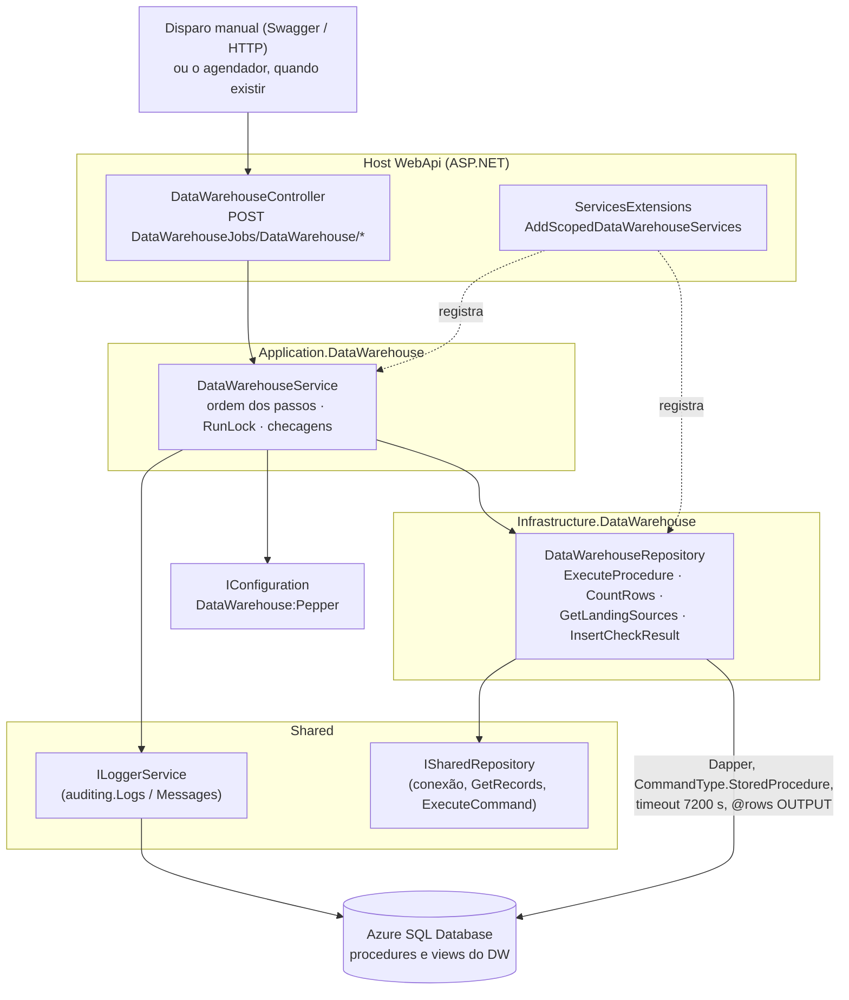

Pontos importantes do código:

- **O service não tem SQL de negócio.** Cada passo é `Step("[schema].sp_Nome")`, que chama `ExecuteProcedure`, mede o tempo e grava no log `"<procedure>: N linha(s) em X s"`. Toda procedure devolve as linhas afetadas no parâmetro de saída `@rows`.
- **Os nomes das procedures de landing e snapshot vêm do catálogo** `dw_control.LandingSource` (só as linhas com `is_enabled = 1`): `sp_<source_table>_Load`, `sp_<source_table>_DetectMissing`, `sp_<source_table>_Snapshot`. Ligar uma origem nova é inserir no catálogo, sem mexer no C#.
- **Proteção contra injeção:** como os nomes são montados como texto, o repositório só aceita `schema.nome` com letras, números e sublinhado (regex `ObjectName`), tanto para procedure quanto para view.
- **Timeout de 2 horas** por procedure, porque a carga inicial dos fatos passa dos 45 minutos padrão do Shared.
- **Watermark não aparece no C#:** ler e avançar o `dw_control.Watermark` é responsabilidade de cada procedure de carga.

---

## 4. Os cinco jobs

| Rota (`POST DataWarehouseJobs/DataWarehouse/...`) | Método do service | Job (`auditing`) | Quando roda | O que faz |
|---|---|---|---|---|
| `RunHourly` | `RunHourly()` | 9000 `DataWarehouseHourly` | A cada hora | Sequência 10.1 sem os passos diários |
| `RunDaily` | `RunDaily()` | 9001 `DataWarehouseDaily` | Uma vez por dia, no fim do dia | Sequência 10.1 completa: + exclusões de filhas, snapshots diários, `DimDate` e, no dia 1, o estoque do mês |
| `RunShortCycle` | `RunShortCycle()` | 9002 `DataWarehouseShortCycle` | A cada 3 minutos | Só landing de pedidos, notas e clientes + dado pessoal, para a logística (10.3) |
| `RunMonthlyStock?positionDate=yyyy-MM-dd` | `RunMonthlyStock(date)` | 9003 `DataWarehouseMonthlyStock` | Manual | Refaz a posição de estoque de um fim de mês (sem data: último dia do mês anterior) |
| `RunLinxLegacy` | `RunLinxLegacy()` | 9004 `DataWarehouseLinxLegacy` | Uma vez (fase 3), reexecutável | Carga única do legado Linx Microvix (10.2) |

> Hoje **não há agendamento recorrente** do DW no Hangfire: as rotas são o disparo manual e o ponto que o agendador vai chamar. Quando ele for codificado, precisa de `DisableConcurrentExecution` (ver seção 9). O `[Authorize]` do controller está comentado e, em `RELEASE`, as rotas ficam fora do Swagger.

---

## 5. Fluxo de uma requisição

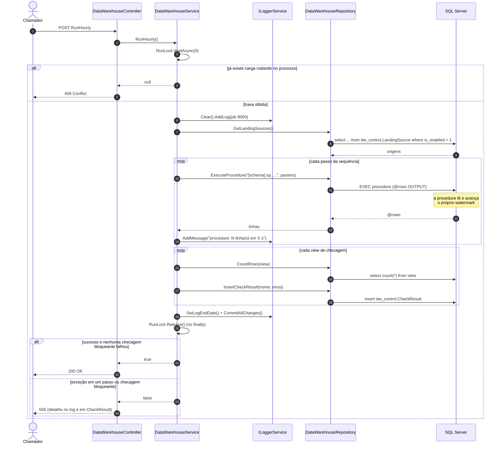

Uma exceção em qualquer passo **interrompe a carga** ali mesmo: os passos seguintes não rodam, a mensagem e o stack trace vão para o log e a resposta é 500. Como cada procedure só avança o watermark depois do próprio sucesso, a próxima execução retoma de onde parou.

---

## 6. Sequência horária e diária (10.1)

`RunHourly` e `RunDaily` usam o mesmo método `Run(job, daily)`. Os losangos marcam o que só entra no ciclo diário.

```mermaid
flowchart TD
    START(["Run(job, daily)"]) --> LOCK{"RunLock livre?"}
    LOCK -- não --> R409(["null → 409"])
    LOCK -- sim --> CAT["Lê dw_control.LandingSource<br/>(is_enabled = 1)"]

    CAT --> P2["<b>Passo 2 · Landing</b><br/>para cada origem:<br/>dw_landing.sp_#lt;Tabela#gt;_Load"]

    P2 --> D3{"daily?"}
    D3 -- sim --> P3["<b>Passo 3 · Exclusões</b><br/>origens com detect_missing:<br/>dw_landing.sp_#lt;Tabela#gt;_DetectMissing"]
    D3 -- não --> P4
    P3 --> P4["<b>Passo 4 · Snapshots SCD2</b><br/>history_frequency = hourly<br/>+ daily (só no diário)<br/>dw_history.sp_#lt;Tabela#gt;_Snapshot"]

    P4 --> P5["<b>Passo 5 · Dado pessoal</b><br/>sp_Customer_Load<br/>sp_OrderShippingAddress_Load<br/>sp_ServiceCustomer_Load"]

    P5 --> D6{"daily?"}
    D6 -- sim --> DATE["sp_DimDate_Load"]
    D6 -- não --> DIMS
    DATE --> DIMS["<b>Passo 6a · Dimensões</b><br/>Store, Product, Customer*, Seller,<br/>Supplier, PaymentMethod, Operation,<br/>Channel, Brand, SalesRepresentative,<br/>Region, Promotion"]

    DIMS --> FACTS["<b>Passo 6b · Fatos</b><br/>SalesItem, OrderItem, InvoicePayment,<br/>Ticket*, Refund*, PurchaseOrderItem,<br/>AccountsPayable, Commission*,<br/>StoreReception, ApiRequest"]

    FACTS --> D1{"daily e hoje é dia 1<br/>(horário de Brasília)?"}
    D1 -- sim --> STOCK["sp_FactMonthlyStock_Load<br/>(mês que fechou)"]
    D1 -- não --> MART
    STOCK --> MART["<b>Passo 6c · Agregado</b><br/>datamart.sp_DailySales_Refresh"]

    MART --> P7["<b>Passo 7 · Checagens</b><br/>RunChecks()"]
    P7 --> BLK{"alguma checagem<br/>bloqueante com erro?"}
    BLK -- não --> OK(["true → 200"])
    BLK -- sim --> FAIL(["false → 500"])

    P2 -. exceção em qualquer passo .-> ERR(["false → 500<br/>carga interrompida"])
```

`*` = **passo com pepper** (`PepperStep`): `sp_DimCustomer_Load`, `sp_FactTicket_Load`, `sp_FactRefund_Load` e `sp_FactCommission_Load` calculam o `doc_hash` (SHA-256 do documento com um segredo) e recebem `@pepper` de `DataWarehouse:Pepper`. Se a configuração estiver vazia, **essas procedures são puladas** com um aviso no log e o resto da carga segue; a tabela fica como estava.

A ordem importa porque cada passo lê o que o anterior gravou: as dimensões precisam do dado pessoal (hash do cliente), os fatos precisam das dimensões (chaves substitutas) e o agregado precisa dos fatos.

---

## 7. Dentro de uma origem: landing e snapshot

As procedures de landing e de snapshot não são escritas à mão: são **geradas a partir do catálogo** na migração, por `dw_landing.sp_Create_Landing` (Script010) e `dw_history.sp_Create_History` (Script020).

### 7.1 Na migração: o catálogo gera os objetos

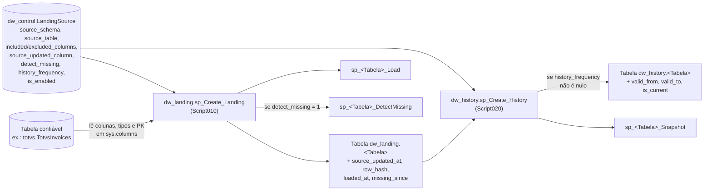

As colunas de dado pessoal ficam fora da landing pelo catálogo (`excluded_columns`), e por isso também ficam fora do histórico. Elas vão direto da origem para `dw_personal_data`.

### 7.2 Na execução: o que cada procedure gerada faz

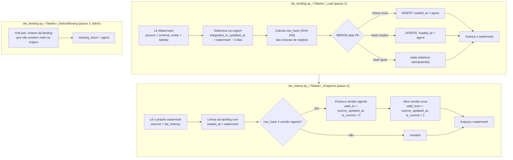

- A **sobreposição de 3 dias** cobre linhas que ficaram visíveis tarde (commit atrasado na origem); o MERGE por chave garante que reler não duplica.
- O hash **ignora colunas de controle** (`integrated_or_updated_at`, `maxChangeFilterDate`, `lastChangeDate`, `json_hash`...): só mudança de negócio gera versão nova.
- O snapshot trabalha **só sobre o que a carga acabou de gravar** (`loaded_at`), por isso cabe a cada hora sem crescer com o tamanho do histórico.
- A **data da versão vem da origem** (`source_updated_at`), não da hora em que o snapshot rodou.
- Notas e pedidos têm snapshot `hourly`; cadastros, saldos, custos e preços, `daily`; lojas e produtos do Linx, `once` (só na carga do legado).

---

## 8. Ciclos especiais

### 8.1 Ciclo curto da logística (10.3) — a cada 3 minutos

A logística precisa do pedido e do endereço logo depois que os jobs da Totvs os trazem. O ciclo curto roda só dois passos da sequência, para sete origens fixas (`ShortCycleTables` no service).

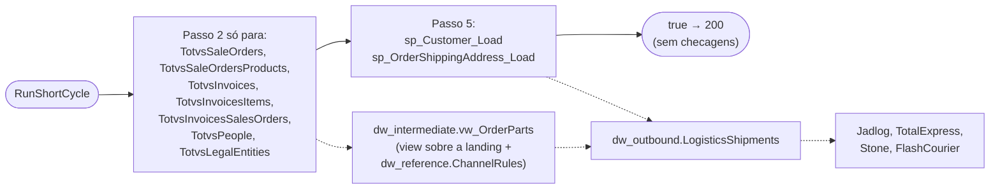

As views da logística não dependem de dimensões nem fatos, então ficam frescas sem o passo 6. Quando o ciclo horário roda depois, o passo 2 encontra a landing já atualizada e carrega só o que restou; o `loaded_at` garante que tudo que o ciclo curto gravou entra no snapshot seguinte.

### 8.2 Carga única do legado Linx (10.2)

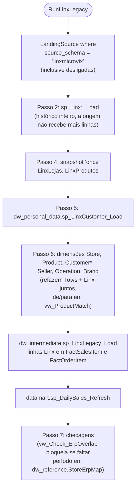

### 8.3 Posição de estoque de um mês (8.5)

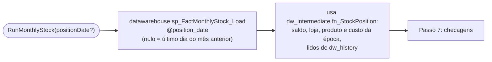

O ciclo diário do dia 1 já faz isso automaticamente para o mês que fechou; a rota serve para refazer um mês.

---

## 9. Concorrência

Os ciclos horário, diário e curto escrevem nas mesmas landings, então só uma carga roda por vez.

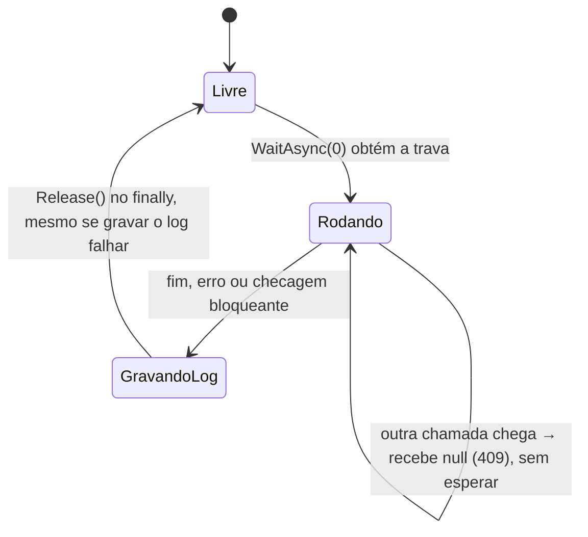

- A trava é um `SemaphoreSlim(1, 1)` **estático**, então vale para o processo inteiro, entre todos os cinco jobs.
- `WaitAsync(0)` não enfileira: se o ciclo curto cair durante o horário, ele simplesmente devolve 409 e roda na próxima janela de 3 minutos.
- A trava **não vale entre processos** (duas instâncias do host). Por isso o agendador, quando existir, precisa de `DisableConcurrentExecution` no Hangfire.

---

## 10. Checagens de qualidade (passo 7)

Cada checagem é uma view que devolve as linhas com erro. O service conta as linhas, grava em `dw_control.CheckResult` (que não é apagada pela limpeza de 15 dias do `auditing`) e decide o resultado.

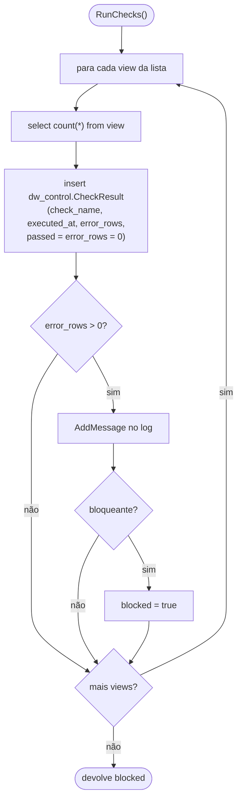

| View | Bloqueia | O que pega |
|---|---|---|
| `datawarehouse.vw_Check_FactSalesItemGrain` | Sim | Grão duplicado em `FactSalesItem` |
| `datawarehouse.vw_Check_ErpOverlap` | Sim | Mesma loja (CNPJ) e dia vindo da Totvs e do Linx |
| `datawarehouse.vw_Check_ProductMatch` | Não | Produto Linx sem de/para |
| `datawarehouse.vw_Check_UnknownMembers` | Não | Fatos apontando para membro desconhecido |
| `datawarehouse.vw_Check_ItemProducts` | Não | Soma dos produtos de um item ≠ valor do item |
| `datawarehouse.vw_Check_OrderTypeUnknown` | Não | Pedido sem tipo reconhecido |
| `datawarehouse.vw_Check_MissingChildren` | Não | Filhas apagadas na origem (`missing_since`) |
| `datamart.vw_Check_InvoicedReconciliation` | Não | Total mensal por loja diferente do fechamento de referência |
| `datawarehouse.vw_Check_StockNegativeOrNoCost` | Não | Posição de estoque negativa ou sem custo |

Uma checagem bloqueante **não desfaz** a carga (os dados já foram gravados): ela só faz o job terminar como falha (500), para chamar atenção. O ciclo curto não roda checagens.

---

## 11. Quem consome o DW

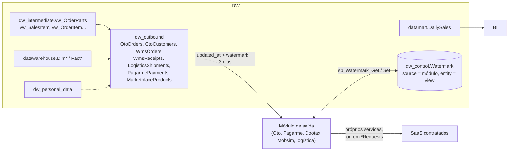

O DW **não envia nada** para fora: cada módulo de saída varre a sua view em `dw_outbound` pelo `updated_at`, com o próprio watermark, e continua enviando pelos próprios services. A regra de canal, tipo e número do pedido fica num lugar só (`vw_OrderParts`), e cada view monta o formato que o SaaS espera.

---

## 12. Criação dos objetos (migração)

Os objetos do DW são criados pelo DbUp, via `dotnet script migrator.csx "<connection string>"`, que executa os scripts em ordem numérica, uma vez cada. O migrator do DW roda **por último**, depois dos migrators dos módulos de origem, porque as views referenciam tabelas de origem e o SQL Server as valida na criação.

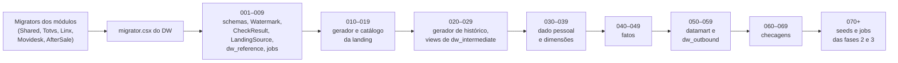

Detalhes por script em [06-procedures-e-projeto.md](06-procedures-e-projeto.md), seção 9.

---

## 13. Resumo para operar

1. **Primeira vez:** rodar os migrators dos módulos, depois o do DW; cadastrar `DataWarehouse:Pepper` na configuração; ligar no catálogo as origens que já têm carga (`TotvsBalances` nasce desligada).
2. **Rotina:** `RunShortCycle` a cada 3 min, `RunHourly` a cada hora, `RunDaily` no fim do dia. Uma chamada que encontra outra rodando recebe 409 e não faz nada.
3. **Diagnóstico:** cada execução fica em `auditing.Logs` / `auditing.Messages` com o tempo e as linhas de cada procedure; o histórico das checagens fica em `dw_control.CheckResult`.
4. **Refazer:** `RunMonthlyStock?positionDate=...` para um mês de estoque; `RunLinxLegacy` para o legado; para recarregar uma origem do zero, zerar o watermark dela em `dw_control.Watermark` (volta à janela inicial da 5.2, regra 5).
