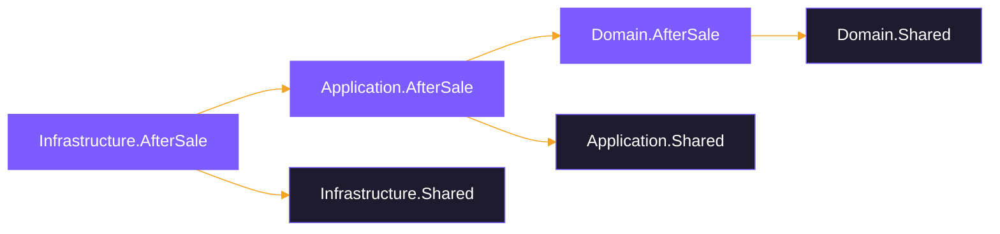
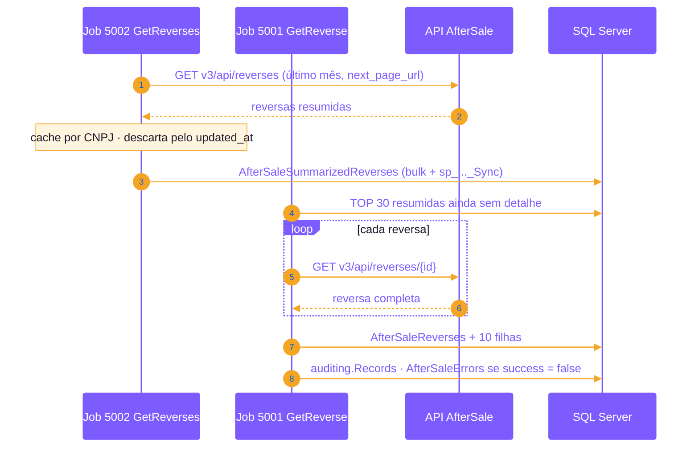
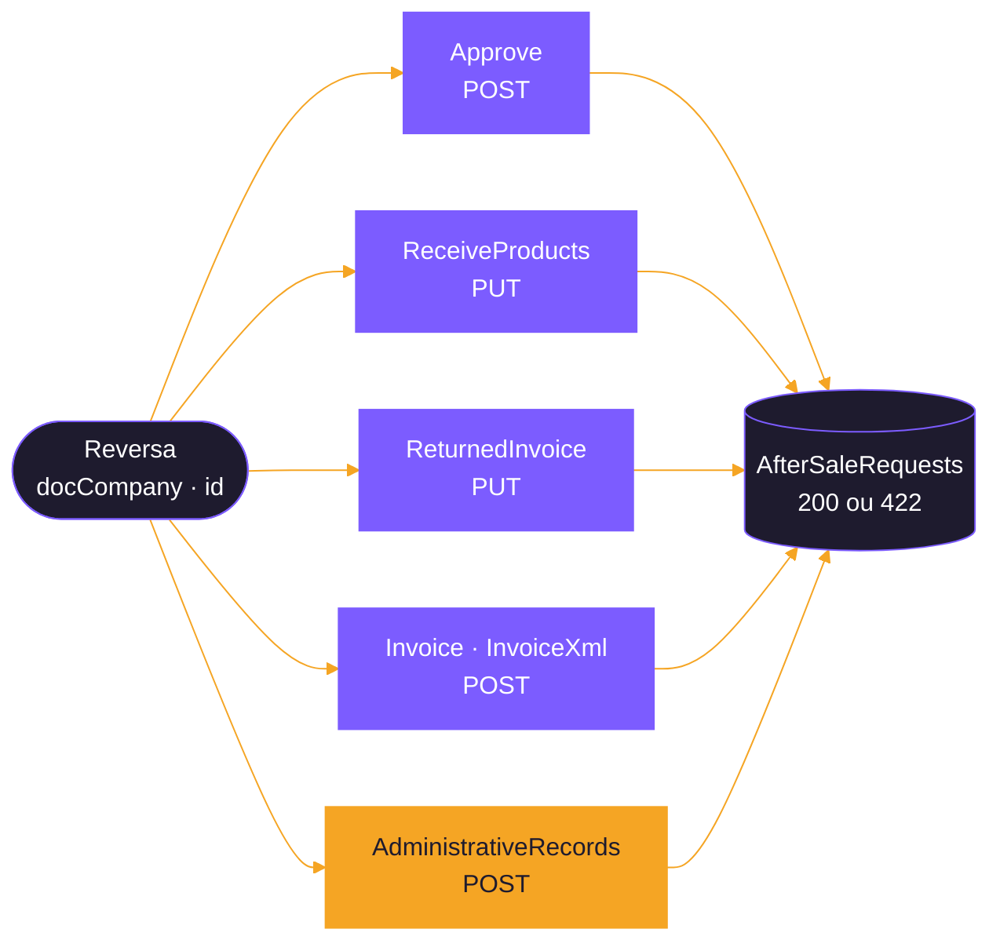
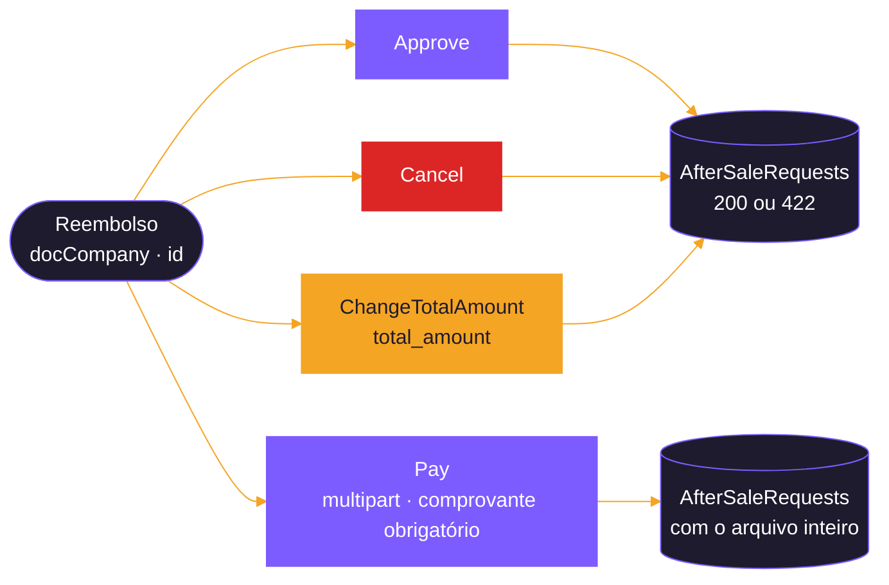
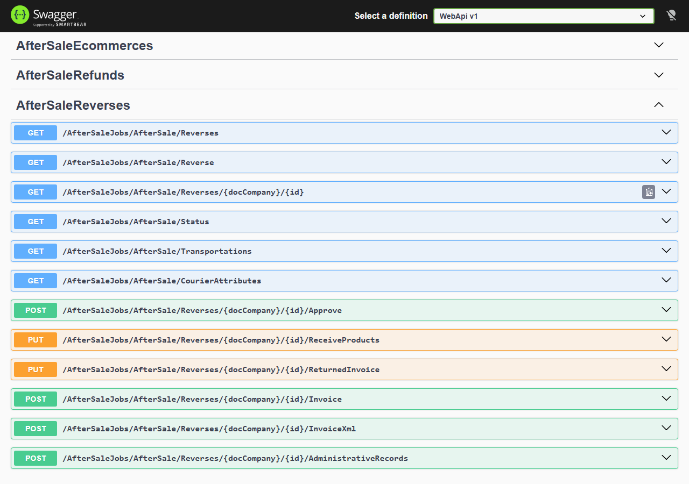
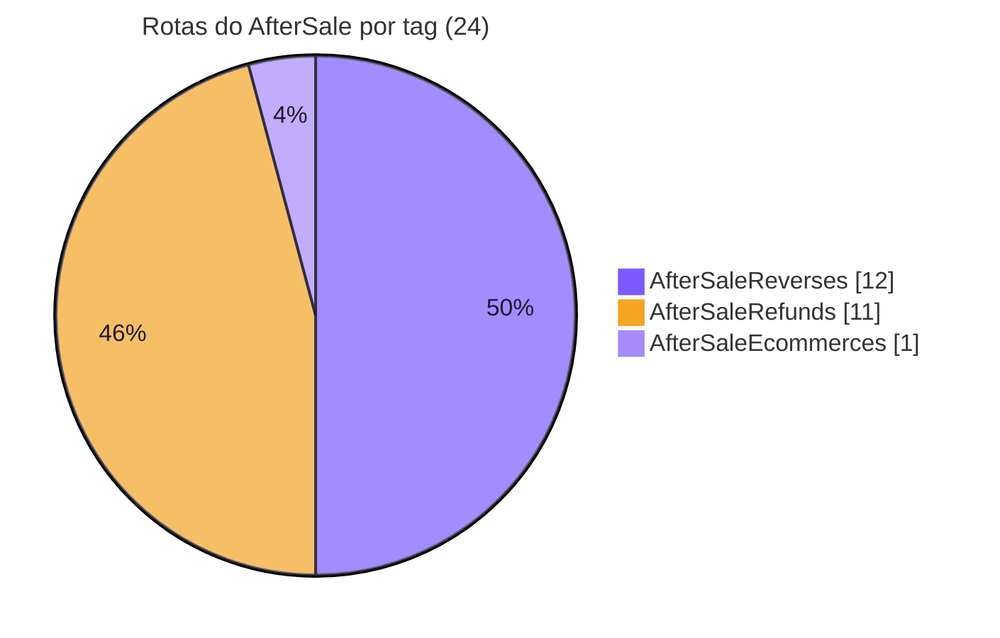
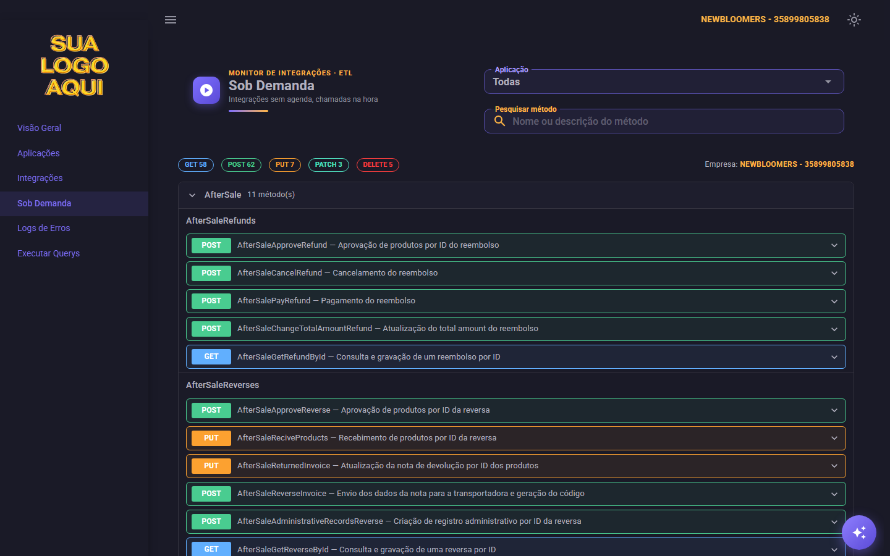
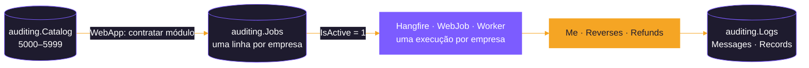

<div align="center">


</div>

# 🔁 AfterSale

<div align="center">

   

   

</div>

<p align="center">
  <b>Pacote de DLLs para integração com a AfterSale (Troque Fácil): pós-venda, reversas e reembolsos.</b>
</p>

<p align="center">
  <a href="#-sobre-o-pacote">Sobre</a> ·
  <a href="#-applicationaftersale">Services</a> ·
  <a href="#-infrastructureaftersale">Scripts</a> ·
  <a href="#-endpoints-expostos-aftersalecontroller">Endpoints</a> ·
  <a href="#-auditoria-jobs">Jobs</a> ·
  <a href="#-pendências-conhecidas">Pendências</a>
</p>

## 🔁 O que é o Troque Fácil?
O **Troque Fácil**, desenvolvido pela **Aftersale**, é uma plataforma de automação de pós-venda voltada para lojas virtuais (e-commerce).

O objetivo é simplificar e digitalizar o processo de trocas, devoluções e logística reversa, substituindo a burocracia do atendimento tradicional por um sistema de autoatendimento.

### Como funciona
* **Autoatendimento**: o próprio consumidor entra na plataforma da loja, seleciona o produto que deseja trocar ou devolver e escolhe o motivo, tudo de forma autônoma.
* **Logística reversa**: o sistema gera automaticamente as etiquetas de envio pelos Correios ou transportadoras parceiras.
* **Vale-troca ou reembolso**: facilita a emissão de vales-compras para que o cliente escolha outro item na loja, auxiliando o e-commerce a reter a venda.

### Principais benefícios
* **Para a loja**: reduz a sobrecarga da equipe de atendimento (SAC), automatiza a geração de etiquetas e fornece relatórios de desempenho e comportamento do consumidor.
* **Para o cliente**: oferece uma experiência mais transparente e rápida, o que aumenta a confiança e a chance de recompra.

Para acessar o painel administrativo ou conhecer mais sobre a solução, visite o [**Portal Aftersale**](https://admin.troquefacil.com.br/login) ou a integração em plataformas parceiras na [**Central de Ajuda - Olist**](https://ajuda.olist.com/ecommerce-pedidos/ecommerce-integracao-aftersale-troque-facil).

---

## 📦 Sobre o pacote

Módulo do sistema de integrações (ETL) responsável por:

* **ler** os dados da API da AfterSale (e-commerce, reversas, reembolsos e tabelas de domínio) e gravá-los no banco SQL Server, empresa por empresa, pelos hosts de agenda (Hangfire do WebApi, WebJob ou Worker) ou pelas rotas;
* **executar ações** na AfterSale (aprovar, receber produtos, informar notas, pagar e cancelar reembolsos etc.) sob demanda, a partir de um sistema externo, registrando quem pediu cada alteração.

| Item | Valor |
|---|---|
| Plataforma | .NET 10 (`net10.0`) |
| Arquitetura | Clean Architecture em três assemblies: Domain, Application e Infrastructure |
| API consumida | Send4 / AfterSale — `https://api.send4.com.br/` |
| Documentação da API | [AfterSale Public API 1.0.8 (SwaggerHub)](https://app.swaggerhub.com/apis/send42/public-api/1.0.8) |
| Banco de dados | SQL Server (schemas `untreated`, `aftersale` e `auditing`; o `Script001` cria `aftersale` e `untreated` quando não existem) |
| Multiempresa | Sim: cada CNPJ cadastrado em `aftersale.AfterSaleParameters` tem o seu token; o CNPJ (`doc_company`) faz parte da chave das tabelas. Cada execução é de uma **empresa** (`ICompanyContext`, com a holding dela em `auditing.Companies`) e lê só o token dessa empresa (`doc_company` = a empresa da execução) |
| Host | `src/Backend/Hosts/WebApi` (controller `AfterSaleController`); agenda pelos hosts `WebApi` (Hangfire), `WebJob` ou `Worker` |

### Disclaimer sobre a documentação da API

> [!NOTE]
> A documentação pública da AfterSale está desatualizada em vários pontos. Com um Bearer Token válido, foi feita uma requisição em cada end-point e a resposta real trouxe campos diferentes dos documentados.

Por isso foi feito um de/para entre o JSON da documentação e o JSON retornado pela API. Campos que não aparecem nos dois não foram contemplados, porque não foi possível afirmar o seu tipo. Os JSONs usados estão na pasta [`Responsed Jsons`](#-pasta-docsresponsed-jsons).

---

## 🧱 Arquitetura

```
AfterSale/
├── Domain.AfterSale          ← contratos, DTOs, entidades e enums (sem dependência de infraestrutura)
├── Application.AfterSale     ← services (regras de integração), queries SQL e validações
├── Infrastructure.AfterSale  ← repositórios, injeção de dependência e scripts de banco
└── docs                      ← propostas, planos e implementações do módulo
    └── Responsed Jsons  ← JSONs de referência usados para montar DTOs e entidades
```

### Referências entre projetos



| Assembly | Pacotes NuGet | Referências |
|---|---|---|
| `Domain.AfterSale` | `Newtonsoft.Json` 13.0.4 | `Domain.Shared` |
| `Application.AfterSale` | `Microsoft.Extensions.Caching.Memory` 10.0.8, `Newtonsoft.Json` 13.0.4 | `Application.Shared`, `Domain.AfterSale` |
| `Infrastructure.AfterSale` | — | `Infrastructure.Shared`, `Application.AfterSale`, `Domain.AfterSale` |

Do projeto Shared o módulo usa: `IApiClient`/`ApiClient` (cliente HTTP), `ILoggerService` (auditoria),
`ISharedRepository` (consultas, bulk insert e chamada das procedures de merge),
`ConverterValidatorsExtensions` (conversões de string para os tipos das entidades) e
`NullableConverters` (conversões que mantêm o `null` da API, usadas nas datas).

---

## 🧬 Domain.AfterSale

```
Domain.AfterSale/
├── Abstractions/Repositorys/   ← interfaces dos repositórios
├── Dtos/
│   ├── Reads/                  ← respostas das rotas GET da API
│   │   ├── Me/
│   │   ├── Refunds/            (Actions, Banks, GetRefund, SearchRefunds, Status, Types)
│   │   └── Reverses/           (CourierAttributes, GetReverse, History, SearchReverses, Status, Transportations)
│   └── Writes/                 ← corpo e resposta das rotas POST/PUT da API
│       ├── Base/               (ResponseRoot: success, message, error, error_code, message_translated)
│       ├── Refunds/            (Approve, Cancel, Pay, ChangeTotalAmount)
│       └── Reverses/           (AdministrativeRecords, Approve, Invoice, ReceiveProducts, ReturnedInvoice)
├── Entities/
│   ├── Errors/                 (Error → aftersale.AfterSaleErrors)
│   ├── Parameters/             (Company → aftersale.AfterSaleParameters)
│   ├── Reads/                  ← o que é gravado a partir das rotas GET
│   │   ├── Me/
│   │   ├── Refunds/
│   │   └── Reverses/
│   └── Writes/
│       └── Requests/           (Request → aftersale.AfterSaleRequests)
└── Enums/                      (EnumJob)
```

### Convenções

* **DTOs** espelham o JSON da API, com propriedades `string` e nomes em `snake_case` iguais aos da API. Cada rota tem uma pasta com um `Root.cs` (objeto raiz do JSON) e um arquivo por objeto aninhado.
* Nas rotas de escrita, cada pasta tem `Request/` (corpo enviado) e `Response/` (resposta), cada uma com o seu `Root`. As respostas herdam de `Dtos/Writes/Base/ResponseRoot`.
* **Entidades** têm os tipos fortes das colunas (`Int64`, `DateTime?`, `decimal`, `Guid`...), convertem os campos do DTO no construtor com `ConverterValidatorsExtensions` e cortam textos no tamanho da coluna.
* **Datas** seguem o padrão do Movidesk: as que vêm da API são `DateTime?` e são convertidas com `NullableConverters.ToNullableDateTime`. Assim, um valor nulo ou vazio é gravado como `NULL`. Um texto preenchido mas inválido, ou anterior a 1753, continua virando `01/01/1990`, para não quebrar o bulk insert. Ficam como `DateTime` com valor:
  * `integrated_or_updated_at` e `request_date`, preenchidas pelo sistema com o horário de Brasília;
  * `date` de `AfterSaleRefundsStatusHistories`, que faz parte da chave primária e por isso mantém o fallback `01/01/1990`.
  
  Guia: [`src/Backend/Modules/General/AfterSale/docs/PROPOSTA-DATAS-NULAS-AFTERSALE.md`](docs/PROPOSTA-DATAS-NULAS-AFTERSALE.md).
* As entidades de reversas e de reembolsos usadas pelos métodos implementados têm `doc_company` (CNPJ da empresa), que faz parte da chave primária da tabela. Ainda **sem** `doc_company`: `Me` (dados do e-commerce) e `Reverses/History`, cujo método está pendente (ver [Pendências](#-pendências-conhecidas)).
* Listas filhas usam `[SkipProperty]` para não virarem coluna no bulk insert. O bulk insert mapeia as colunas **pelo nome** da propriedade.
* `EnumJob` deve ficar em sincronia com os scripts de jobs de cada pasta (`Script0NN_Insert_AfterSale_*_Jobs_Into_Jobs_Table.sql`).

### Repositórios (interfaces)

| Interface | Responsabilidade |
|---|---|
| `IAfterSaleRepository` | Empresas (`GetCompanys`, `GetCompany`) e log das chamadas de escrita (`InsertIntoAfterSaleRequests`) |
| `IAfterSaleMeRepository` | Dados do e-commerce (`/me`) |
| `IAfterSaleReversesRepository` | Reversas resumidas e detalhadas, status, transportadoras, courier attributes e erros |
| `IAfterSaleRefundsRepository` | Reembolsos resumidos e detalhados (pendentes de detalhe, busca por ids, bulk insert das 8 tabelas), status, ações, bancos, tipos e erros |

---

## 🧠 Application.AfterSale

```
Application.AfterSale/
├── Abstractions/
│   ├── Handlers/Commands/      (IAfterSaleCommandHandler e um por service: Refunds e Reverses)
│   └── Services/               (IAfterSaleService, IAfterSaleMeService, IAfterSaleReversesService, IAfterSaleRefundsService)
├── Handlers/Commands/          (monta as queries SQL: AfterSaleRefunds/ReversesCommandHandler, usados pelo repositório de cada service, e o AfterSaleCommandHandler com as comuns)
├── Services/                   (AfterSaleService, AfterSaleMeService, AfterSaleReversesService, AfterSaleRefundsService)
└── Validations/                (FluentValidation por DTO, nas mesmas pastas dos DTOs: Reads/Me, Reads/Refunds/*, Reads/Reverses/*)
```

### Services e métodos

**`AfterSaleService`** — operações comuns aos services de reversas e reembolsos

| Método | O que faz |
|---|---|
| `SaveRequest` | Grava uma chamada de escrita (POST/PUT) em `aftersale.AfterSaleRequests`, ligada ao `Execution` do log aberto por quem chama |

**`AfterSaleMeService`**

| Método | Rota da API | Tabelas | Job | Situação |
|---|---|---|---|---|
| `GetMe` | `GET v3/api/me` | `AfterSaleEcommerces` e tabelas filhas | 5000 | Implementado |

**`AfterSaleReversesService`**

| Método | Rota da API | Tabela(s) | Job | Situação |
|---|---|---|---|---|
| `GetReverses` | `GET v3/api/reverses` (último mês, paginado) | `AfterSaleSummarizedReverses` | 5002 | Implementado |
| `GetReverse` | `GET v3/api/reverses/{id}` (reversas resumidas ainda sem detalhe, 30 por execução) | `AfterSaleReverses` e 10 tabelas filhas | 5001 | Implementado |
| `GetReverseById` | `GET v3/api/reverses/{id}` (uma reversa, sob demanda) | `AfterSaleReverses` e 10 tabelas filhas + `AfterSaleRequests` (log) | 5022 | Implementado |
| `GetStatus` | `GET v3/api/reverses/status` | `AfterSaleStatusReverses` | 5009 | Implementado |
| `GetTransportations` | `GET v3/api/transportations` | `AfterSaleTransportationsReverses` | 5003 | Implementado |
| `GetCourierAttributes` | `GET v3/api/reverses/{id}/get-courier-attributes` | `AfterSaleCourierAttributes`, `AfterSaleCourierAttributesFields` | 5004 | Implementado |
| `PostApproveReverseById` | `POST v3/api/reverses/{id}/approve` | `AfterSaleRequests` (log) | 5005 | Implementado |
| `PutReciveProductsById` | `PUT v3/api/reverses/{id}/receive-products` | `AfterSaleRequests` (log) | 5006 | Implementado |
| `PutReturnedInvoiceById` | `PUT v3/api/reverses/{id}/products/returned-invoice` | `AfterSaleRequests` (log) | 5007 | Implementado |
| `PostReverseInvoiceById` | `POST v3/api/reverses/{id}/invoice` (JSON com os campos da nota) | `AfterSaleRequests` (log) | 5008 | Implementado |
| `PostReverseInvoiceXmlById` | `POST v3/api/reverses/{id}/invoice` (arquivo XML) | `AfterSaleRequests` (log, com o XML inteiro) | 5008 | Implementado |
| `PostAdministrativeRecordById` | `POST v3/api/reverses/{id}/administrative-records` | `AfterSaleRequests` (log) | 5021 | Implementado |

**`AfterSaleRefundsService`**

| Método | Rota da API | Tabela(s) | Job | Situação |
|---|---|---|---|---|
| `GetRefunds` | `GET v3/api/refunds` (último mês, paginado) | `AfterSaleSummarizedRefunds` | 5012 | Implementado |
| `GetStatus` | `GET v3/api/refunds/status` | `AfterSaleStatusRefunds` | 5013 | Implementado |
| `GetActions` | `GET v3/api/refunds/actions` | `AfterSaleActionsRefunds` | 5014 | Implementado |
| `GetBanks` | `GET v3/api/refunds/banks` | `AfterSaleBanksRefunds` | 5015 | Implementado |
| `GetTypes` | `GET v3/api/refunds/types` | `AfterSaleTypesRefunds` (chave pelo nome) | 5016 | Implementado |
| `GetRefund` | `GET v3/api/refunds/{id}` (reembolsos resumidos ainda sem detalhe, 30 por execução) | `AfterSaleRefunds` e 7 tabelas filhas | 5011 | Implementado |
| `GetRefundById` | `GET v3/api/refunds/{id}` (um reembolso, sob demanda) | `AfterSaleRefunds` e 7 tabelas filhas + `AfterSaleRequests` (log) | 5023 | Implementado |
| `PostApproveRefundById` | `POST v3/api/refunds/{id}/approve` | `AfterSaleRequests` (log) | 5017 | Implementado |
| `PostCancelRefundById` | `POST v3/api/refunds/{id}/cancel` | `AfterSaleRequests` (log) | 5018 | Implementado |
| `PostPayRefundById` | `POST v3/api/refunds/{id}/pay` (multipart, comprovante obrigatório) | `AfterSaleRequests` (log, com o arquivo inteiro) | 5019 | Implementado |
| `PostChangeTotalAmountRefundById` | `POST v3/api/refunds/{id}/change-total-amount` | `AfterSaleRequests` (log) | 5020 | Implementado |

### Fluxo das leituras (GET)

Todas as leituras seguem o mesmo desenho, documentado em [`docs/PADRAO-CACHE-INTEGRACOES.md`](../../../../../docs/PADRAO-CACHE-INTEGRACOES.md):

1. abre um log em `auditing.Logs` com o job do método;
2. com o token da empresa da execução (`AfterSaleParameters` com `doc_company` = a empresa), chama a API (seguindo `next_page_url` nas rotas paginadas, com pausa para respeitar o limite de requisições da AfterSale);
3. monta um cache em memória (`IMemoryCache`, 2h absoluto / 30 min deslizante) **por empresa**, com o que já está gravado no banco;
4. descarta o que não mudou (por `updated_at` nas listas de reversas/reembolsos, ou por comparação dos campos nas tabelas de domínio);
5. valida os DTOs (FluentValidation) e registra as inconsistências em `auditing.Messages`;
6. converte para entidades, faz bulk insert na tabela `untreated` e chama a procedure de merge `aftersale.sp_<Tabela>_Sync`;
7. grava cada registro integrado em `auditing.Records` e, quando a API não devolve sucesso, um erro em `aftersale.AfterSaleErrors`.

| Chave de cache | Usada por |
|---|---|
| `AfterSale:GetMeHashes` | `GetMe` |
| `AfterSale:SummarizedReverses:<cnpj>` | `GetReverses` |
| `AfterSale:Reverses:<cnpj>` | `GetReverse` |
| `AfterSale:StatusReverses:<cnpj>` | `GetStatus` (reversas) |
| `AfterSale:TransportationsReverses:<cnpj>` | `GetTransportations` |
| `AfterSale:CourierAttributes:<cnpj>` | `GetCourierAttributes` |
| `AfterSale:SummarizedRefunds:<cnpj>` | `GetRefunds` |
| `AfterSale:StatusRefunds:<cnpj>` | `GetStatus` (reembolsos) |
| `AfterSale:ActionsRefunds:<cnpj>` | `GetActions` |
| `AfterSale:BanksRefunds:<cnpj>` | `GetBanks` |
| `AfterSale:TypesRefunds:<cnpj>` | `GetTypes` |
| `AfterSale:Refunds:<cnpj>` | `GetRefund` |

`GetReverse` e `GetRefund` só buscam o detalhe de quem está na tabela resumida e ainda não está na
tabela de detalhe (`TOP 30`, por causa do limite de requisições da API). Por isso dependem de
`GetReverses` / `GetRefunds` terem rodado antes.



O mesmo vale para os reembolsos: `GetRefunds` (5012) grava os resumidos e `GetRefund` (5011) busca o detalhe.

`GetReverseById` e `GetRefundById` gravam sempre, sem consultar o cache. Quando o cache de
`GetReverse` / `GetRefund` da empresa está carregado, eles também o atualizam, para que a próxima
execução em lote não regrave o registro.

### Fluxo das escritas (POST/PUT)

As ações passam por um fluxo comum em cada service (`SendReverseAction` / `SendRefundAction`):

1. abre um log em `auditing.Logs` com o job da ação;
2. busca a empresa pelo CNPJ recebido e usa o token dela;
3. envia o corpo à API **sem os campos nulos** (para a API não interpretar `null` como "limpar");
4. grava a chamada em `aftersale.AfterSaleRequests` (via `AfterSaleService.SaveRequest`): usuário (`X-User-Name`), método, rota, CNPJ, id do registro, corpo enviado, resposta e se houve sucesso — inclusive quando a chamada falha antes de ter resposta (timeout, rede);
5. quando a API não devolve `success = true`, grava um erro em `aftersale.AfterSaleErrors`;
6. devolve a resposta da API, que o controller transforma em **200** (sucesso) ou **422** (sem sucesso).

**Ações sobre uma reversa** (cada ramo é uma rota; todas passam pelo `SendReverseAction`):



**Ações sobre um reembolso** (cada ramo é uma rota; todas passam pelo `SendRefundAction`):



Nas rotas com arquivo, o arquivo é gravado inteiro em `request_body`: o XML da nota (`InvoiceXml`) como texto, e o comprovante do `Pay` como texto (XML/texto) ou base64 (binário).

---

## 🔧 Infrastructure.AfterSale

```
Infrastructure.AfterSale/
├── DependencyInjection.cs      (AddScopedAfterSaleServices)
├── Repositorys/                (AfterSaleRepository, AfterSaleMeRepository, AfterSaleReversesRepository, AfterSaleRefundsRepository)
├── Scripts/
│   ├── SQLServer/              (scripts DbUp + migrator.csx)
│   ├── MySQL/                  (migrator.csx)
│   └── PostgreSQL/             (migrator.csx)
└── Seeds/SQLServer/            (parâmetros de uma empresa, fora do DbUp: só o tools/seeds/Import-TestSeeds.ps1 lê)
```

### Injeção de dependência

`AddScopedAfterSaleServices(IServiceCollection, IConfiguration)` registra:

* `IApiClient` com a chave `"AfterSaleAPI"` e o `HttpClient` nomeado `"AfterSaleAPI"` (base `AfterSale:BaseUrl`, timeout de 20 minutos);
* os quatro services (`AfterSaleService`, `AfterSaleMeService`, `AfterSaleReversesService`, `AfterSaleRefundsService`) e os quatro repositórios (`Scoped`);
* os command handlers: `IAfterSaleRefundsCommandHandler`, `IAfterSaleReversesCommandHandler` e o comum `IAfterSaleCommandHandler`;
* todos os validadores do assembly (`AddValidatorsFromAssemblyContaining<EcommerceValidation>()`).

O host chama o método em `Hosts/WebApi/Extensions/ServicesExtensions.cs`.

### Scripts de banco (SQL Server)

> [!TIP]
> Para subir as tabelas, use a tela [`Invoke-Migrators.ps1`](../../../../../tools/migrators/Invoke-Migrators.ps1) com o **AfterSale** marcado: ela roda o Shared antes do
> módulo, sem o problema do limite de 260 caracteres. Em linha de comando:
> `./tools/migrators/Invoke-Migrators.ps1 -NoGui -Database EtlTeste -Apps AfterSale -SchedulingHost WebApi`.

Executados uma única vez cada pelo DbUp (`Scripts/SQLServer/migrator.csx`), na ordem do número do arquivo. Uma correção de tabela, procedure ou view vai **no script de criação original**, não num `ALTER` novo ([padrão, §3.3](../../../../../docs/PADRAO-CODIGO-E-SCRIPTS-INTEGRACOES.md)); num banco que já rodou o script, a correção é aplicada à parte. Os scripts gerais ficam em `Parameters/` e cada service tem a sua pasta, com o trio tabelas, procedures e jobs.

| Pasta | Script | Conteúdo |
|---|---|---|
| `Parameters/` | `Script001_Create_AfterSale_Schema_And_Parameters_Table.sql` | Schemas `aftersale` e `untreated` (só se não existirem), `AfterSaleParameters` (CNPJ + token por empresa) e `AfterSaleErrors` |
| `Parameters/` | `Script002_Create_AfterSale_Errors_Sync_Procedures.sql` | Procedure de merge de `AfterSaleErrors` (comum a reembolsos e reversas) |
| `Parameters/` | `Script003_Insert_AfterSale_Values_Into_Apps_Table.sql` | App `50 - AfterSale` em `auditing.Apps` |
| `Parameters/` | `Script004_Insert_AfterSale_Errors_Jobs_Into_Jobs_Table.sql` | Job da procedure de `AfterSaleErrors` (5536) em `auditing.Catalog` |
| `Seeds/SQLServer/` (irmã de `Scripts/`) | `Script005_Insert_Values_Into_AfterSale_Parameters_Table.sql` | Empresas e tokens em `AfterSaleParameters`. **Fora do DbUp**: só o [`tools/seeds/Import-TestSeeds.ps1`](../../../../../tools/seeds/Import-TestSeeds.ps1) roda ([plano do cadastro](../../../../../docs/PLANO-TELA-CADASTRO-EMPRESA.md)) |
| `Parameters/` | `Script006_Create_AfterSale_Requests_Table.sql` | `aftersale.AfterSaleRequests` (log das chamadas de escrita), já com `integrated_or_updated_at` |
| `Me/` | `Script007`–`009` | `AfterSaleEcommerces`, `...MessagesPages`, `...MessagesMails`, `...Reasons`, `...SubReasons`, `...StringValues`; procedures de merge e jobs do e-commerce |
| `Refunds/` | `Script010`–`012` | `AfterSaleRefunds` e filhas (`CouldChangeStatusFor`, `OrdersPaymentsMethods`, `StatusHistories`, `TotalAmountHistories`, `Products`, `ProductsImages`, `ProductsImagesUrls`), `AfterSaleSummarizedRefunds`, `AfterSaleStatusRefunds`, `AfterSaleActionsRefunds`, `AfterSaleBanksRefunds`, `AfterSaleTypesRefunds`; procedures de merge e jobs dos reembolsos |
| `Reverses/` | `Script013`–`015` | `AfterSaleSummarizedReverses`, `AfterSaleReverses` e 10 filhas, `AfterSaleStatusReverses`, `AfterSaleTransportationsReverses`, `AfterSaleHistoriesReverses`, `AfterSaleCourierAttributes`, `AfterSaleCourierAttributesFields`, com PKs e FKs compostas por `doc_company`; procedures de merge e jobs das reversas |

Toda tabela de dados existe em dois schemas: `untreated` (recebe o bulk insert, sem chave) e
`aftersale` (tabela final, com PK). A procedure de merge leva os dados de uma para a outra. A
exceção é `aftersale.AfterSaleRequests`, que só recebe inserts e é gravada direto no `aftersale`.

---

## 🌐 Endpoints expostos (`AfterSaleController`)

Rota base: `AfterSaleJobs/AfterSale`.

<div align="center">



<sub><b>Swagger</b> do WebApi — tag <code>AfterSaleReverses</code> aberta</sub>

</div>


### Leituras (disparam a integração)

| Método | Rota | Service |
|---|---|---|
| GET | `Me` | `AfterSaleMeService.GetMe` |
| GET | `Reverses` | `AfterSaleReversesService.GetReverses` |
| GET | `Reverse` | `AfterSaleReversesService.GetReverse` |
| GET | `Reverses/{docCompany}/{id}` (cabeçalho `X-User-Name`) | `AfterSaleReversesService.GetReverseById` |
| GET | `Status` | `AfterSaleReversesService.GetStatus` |
| GET | `Transportations` | `AfterSaleReversesService.GetTransportations` |
| GET | `CourierAttributes` | `AfterSaleReversesService.GetCourierAttributes` |
| GET | `Refunds` | `AfterSaleRefundsService.GetRefunds` |
| GET | `Refund` | `AfterSaleRefundsService.GetRefund` |
| GET | `Refunds/{docCompany}/{id}` (cabeçalho `X-User-Name`) | `AfterSaleRefundsService.GetRefundById` |
| GET | `Refunds/Status` | `AfterSaleRefundsService.GetStatus` |
| GET | `Refunds/Actions` | `AfterSaleRefundsService.GetActions` |
| GET | `Refunds/Banks` | `AfterSaleRefundsService.GetBanks` |
| GET | `Refunds/Types` | `AfterSaleRefundsService.GetTypes` |

### Ações (chamadas por sistema externo)

Todas exigem o cabeçalho **`X-User-Name`** (até 100 caracteres) e o CNPJ da empresa na rota
(`{docCompany}`, 14 dígitos). Sem o cabeçalho ou com dados inválidos, a resposta é **400** antes de
chamar a API. O `{docCompany}` é a empresa da execução e precisa estar em `auditing.Companies`; o cabeçalho opcional
**`X-Company`** (CNPJ da empresa), se vier, precisa ser igual a ele (CNPJ não cadastrado ou `X-Company` diferente também
dão **400**).

| Método | Rota | Corpo | Service |
|---|---|---|---|
| POST | `Reverses/{docCompany}/{id}/Approve` | JSON | `PostApproveReverseById` |
| PUT | `Reverses/{docCompany}/{id}/ReceiveProducts` | JSON | `PutReciveProductsById` |
| PUT | `Reverses/{docCompany}/{id}/ReturnedInvoice` | JSON | `PutReturnedInvoiceById` |
| POST | `Reverses/{docCompany}/{id}/Invoice` | JSON (campos da nota) | `PostReverseInvoiceById` |
| POST | `Reverses/{docCompany}/{id}/InvoiceXml` | multipart (`xml`, obrigatório) | `PostReverseInvoiceXmlById` |
| POST | `Reverses/{docCompany}/{id}/AdministrativeRecords` | JSON | `PostAdministrativeRecordById` |
| POST | `Refunds/{docCompany}/{id}/Approve` | — | `PostApproveRefundById` |
| POST | `Refunds/{docCompany}/{id}/Cancel` | — | `PostCancelRefundById` |
| POST | `Refunds/{docCompany}/{id}/Pay` | multipart (`file` obrigatório, `voucher_redemption_code`, `observation`) | `PostPayRefundById` |
| POST | `Refunds/{docCompany}/{id}/ChangeTotalAmount` | JSON (`total_amount`) | `PostChangeTotalAmountRefundById` |

Resposta: **200** quando a AfterSale devolve `success = true`, **422** quando não (com `error`,
`error_code`, `message` e `message_translated`).

> [!CAUTION]
> As ações `approve`, `cancel` e `pay` alteram o estado na AfterSale (o `pay` registra o pagamento
> ao cliente). Teste com registros de teste antes de usar em produção.

<div align="center">



<sub><b>Sob Demanda</b> no Monitor de Integrações — as ações e leituras por id do AfterSale ficam no grupo do módulo</sub>

</div>

---

## 📝 Auditoria (jobs)

O catálogo fica em `auditing.Catalog` (scripts de jobs de `Parameters/`, `Me/`, `Refunds/` e `Reverses/`, sem agenda), com `IdParent = 50` (app AfterSale), e os mesmos
ids em `EnumJob`. Cada empresa recebe a sua cópia em `auditing.Jobs` (`Holder` e `Company` na chave) ao contratar o módulo
no WebApp (Cadastro › Módulos e Credenciais), com a agenda sugerida
([`AGENDA-SUGERIDA-JOBS.csv`](../../../../../docs/AGENDA-SUGERIDA-JOBS.csv)) e os jobs **inativos** até alguém ligar.



| Faixa | Tipo (`IdType`) | Conteúdo |
|---|---|---|
| 5000–5499 | 2 (Integração) | Leituras (`IntervalTimeInMinutes = 3`) e ações POST/PUT (`IntervalTimeInMinutes = 0`, executadas sob demanda) |
| 5500–5999 | 1 (Procedure) | Procedures de sincronização `sp_<Tabela>_Sync` |

| Id | Job | Id | Job |
|---|---|---|---|
| 5000 | `AfterSaleEcommerces` | 5011 | `AfterSaleRefund` |
| 5001 | `AfterSaleReverse` | 5012 | `AfterSaleRefunds` |
| 5002 | `AfterSaleReverses` | 5013 | `AfterSaleStatusRefunds` |
| 5003 | `AfterSaleTransportationsReverses` | 5014 | `AfterSaleActionsRefunds` |
| 5004 | `AfterSaleCourierAttributes` | 5015 | `AfterSaleBanksRefunds` |
| 5005 | `AfterSaleApproveReverse` | 5016 | `AfterSaleTypesRefunds` |
| 5006 | `AfterSaleReciveProducts` | 5017 | `AfterSaleApproveRefund` |
| 5007 | `AfterSaleReturnedInvoice` | 5018 | `AfterSaleCancelRefund` |
| 5008 | `AfterSaleReverseInvoice` | 5019 | `AfterSalePayRefund` |
| 5009 | `AfterSaleStatusReverses` | 5020 | `AfterSaleChangeTotalAmountRefund` |
| 5021 | `AfterSaleAdministrativeRecordsReverse` | 5023 | `AfterSaleGetRefundById` |
| 5022 | `AfterSaleGetReverseById` | | |

Toda execução grava `auditing.Logs` (com a `Company` da execução) e, conforme o caso, `auditing.Messages` (mensagens e erros de
validação) e `auditing.Records` (registros integrados).

Cada mensagem tem um nível ([`PROPOSTA-NIVEL-MENSAGEM-AUDITING.md`](../../../Shared/docs/PROPOSTA-NIVEL-MENSAGEM-AUDITING.md)):

| Nível | Mensagens |
|---|---|
| **Erro** (3) | `Resposta inválida da API AfterSale ...`, `Reversa X: resposta sem sucesso ao consultar courier attributes.` e `<Reversa/Reembolso> X: <mensagem da API>` quando a escrita falha |
| **Aviso** (2) | `Empresa X não cadastrada em aftersale.AfterSaleParameters.`, `<Reversa/Reembolso> X: CNPJ Y não encontrado em AfterSaleParameters.`, `CNPJ X não encontrado em AfterSaleParameters: N <reversa(s)/reembolso(s)> ignorada(s).` e as inconsistências da validação |
| **Informação** (1) | `Concluída com sucesso ...`, `<Reversa/Reembolso> X: concluída com sucesso.` e `<Reversa/Reembolso> X não encontrada na AfterSale` (consulta sob demanda) |

---

## 🔑 Configuração

| Onde | Chave | Uso |
|---|---|---|
| `appsettings.json` do host | `AfterSale:BaseUrl` | Endereço da API (`https://api.send4.com.br/`) |
| `appsettings.json` do host | `ConnectionStrings` | Conexão com o SQL Server (dados e auditoria) |
| Banco | `aftersale.AfterSaleParameters` | CNPJ (`doc_company`) e token de cada empresa |
| Banco | `auditing.Companies` | Empresas de cada holding; cada execução é de uma empresa e lê só o token dela |

> [!IMPORTANT]
> Os tokens ficam só no banco, carregados pela tela de cadastro do WebApp ou, em teste, pelo `tools/seeds/Import-TestSeeds.ps1`.

---

## 📁 Pasta `docs/Responsed Jsons`

JSONs de referência por rota (`Me`, `Refund/*`, `Reverse/*`), usados para montar DTOs e entidades:

| Arquivo | Conteúdo |
|---|---|
| `json-available-in-api-documentation.json` | Exemplo da documentação da API |
| `json-returned-by-api-end-point.json` | Resposta obtida da API |
| `json-used-in-project-to-build-dto.json` | Base usada para o DTO |
| `json-used-in-project-to-build-entity.json` | Base usada para a entidade |

---

## 🚧 Pendências conhecidas

* **Datas legadas `1990-01-01`**: registros gravados antes da mudança para datas anuláveis mantêm `01/01/1990` nas datas que vieram vazias, até serem reintegrados. O script avulso de limpeza está em [`src/Backend/Modules/General/AfterSale/docs/PROPOSTA-DATAS-NULAS-AFTERSALE.md`](docs/PROPOSTA-DATAS-NULAS-AFTERSALE.md) e ainda não foi executado. Consumidores fora do módulo que tratam `1990-01-01` como "sem data" precisam passar a usar `is null`.
* **Detalhes já gravados não são atualizados pelo lote**: `GetReverse` e `GetRefund` só leem quem ainda não tem detalhe. Alterações posteriores chegam apenas por `GetReverseById` / `GetRefundById`.
* **Histórico de reversas**: DTOs, entidade, tabela `AfterSaleHistoriesReverses` (já com `doc_company`) e a sua procedure de merge existem, mas não há método nem endpoint, e a entidade ainda não tem `doc_company`. O job 5010 e o da procedure (5516) saíram do `EnumJob` e dos scripts de jobs: voltam quando o método for escrito.
* ⚠️ **`Me`**: as entidades e tabelas do e-commerce ainda não têm `doc_company`, então os dados das duas empresas não são separados por CNPJ.
* **`AfterSaleErrors` nas tabelas de domínio de reembolsos** (`GetStatus`, `GetActions`, `GetBanks`, `GetTypes`): quando a API devolve `success = false`, nada é gravado. A decisão sobre o que gravar está pendente.
* **Pausas com `Thread.Sleep`** nas leituras paginadas (`GetReverses`, `GetRefunds`): bloqueiam a thread durante a espera; `await Task.Delay` seria o equivalente não bloqueante.

---

## 📚 Documentação complementar

Guias de alteração e decisões tomadas durante o desenvolvimento, na pasta [`docs/`](docs) do módulo (os padrões comuns ficam no `docs/` da raiz e em `src/Backend/Shared/docs`):

| Documento | Assunto |
|---|---|
| [`PADRAO-CACHE-INTEGRACOES.md`](../../../../../docs/PADRAO-CACHE-INTEGRACOES.md) | Padrão de cache das leituras |
| [`ALTERACOES-GETSTATUS-REVERSES.md`](docs/ALTERACOES-GETSTATUS-REVERSES.md), [`ALTERACOES-GETTRANSPORTATIONS-REVERSES.md`](docs/ALTERACOES-GETTRANSPORTATIONS-REVERSES.md), [`ALTERACOES-CNPJ-DEMAIS-METODOS-REVERSES.md`](docs/ALTERACOES-CNPJ-DEMAIS-METODOS-REVERSES.md) | CNPJ (`doc_company`) nas leituras de reversas |
| [`ANALISE-ROTAS-PUT-POST-REVERSAS.md`](docs/ANALISE-ROTAS-PUT-POST-REVERSAS.md) | Análise das rotas de escrita de reversas |
| [`PROPOSTA-LOG-REQUISICOES-ESCRITA.md`](docs/PROPOSTA-LOG-REQUISICOES-ESCRITA.md) | Log das chamadas de escrita (`AfterSaleRequests`) |
| [`ALTERACOES-MERGE-PROCEDURE-AUDITORIA.md`](../../../../../src/Backend/Shared/docs/ALTERACOES-MERGE-PROCEDURE-AUDITORIA.md) | Procedure de merge e relacionamentos da auditoria |
| [`IMPLEMENTACAO-GETREFUNDS.md`](docs/IMPLEMENTACAO-GETREFUNDS.md), [`IMPLEMENTACAO-GETREFUND.md`](docs/IMPLEMENTACAO-GETREFUND.md), [`IMPLEMENTACAO-REFUNDS-STATUS-ACTIONS-BANKS-TYPES.md`](docs/IMPLEMENTACAO-REFUNDS-STATUS-ACTIONS-BANKS-TYPES.md), [`IMPLEMENTACAO-REFUNDS-POSTS.md`](docs/IMPLEMENTACAO-REFUNDS-POSTS.md) | Implementação das rotas de reembolsos |
| [`PROPOSTA-DATAS-NULAS-AFTERSALE.md`](docs/PROPOSTA-DATAS-NULAS-AFTERSALE.md) | Datas anuláveis (`DateTime?`) no padrão do Movidesk |

---

<div align="center">


<sub>Sistema de integrações · feito com .NET 10</sub>

</div>
