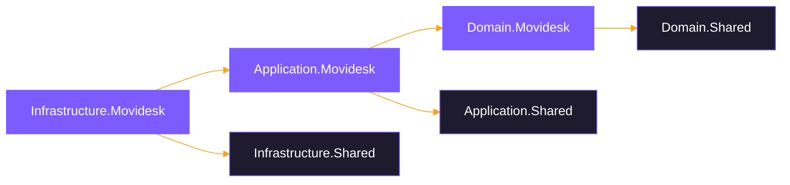
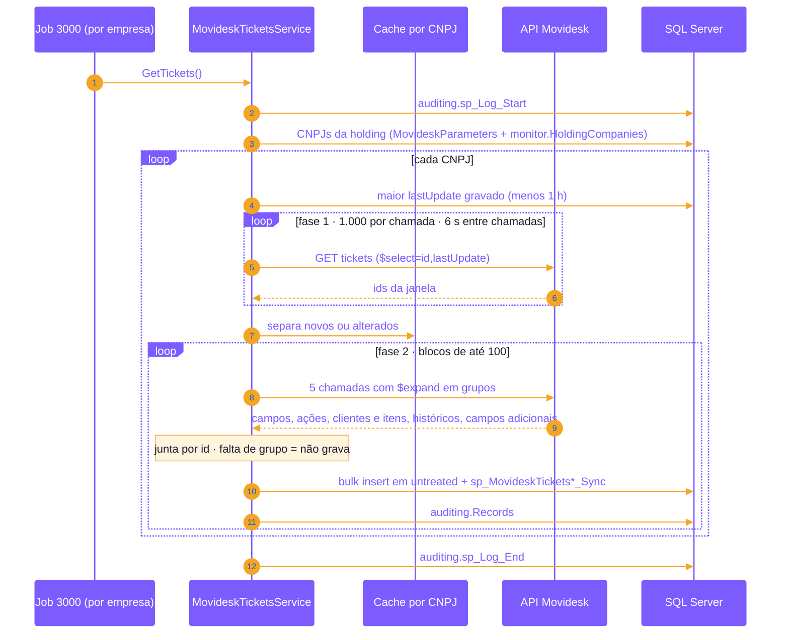
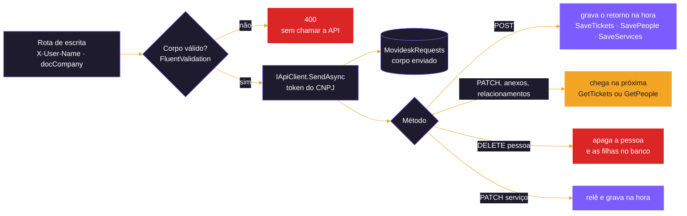
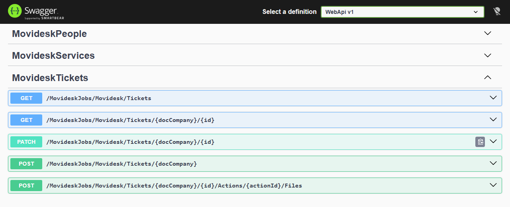
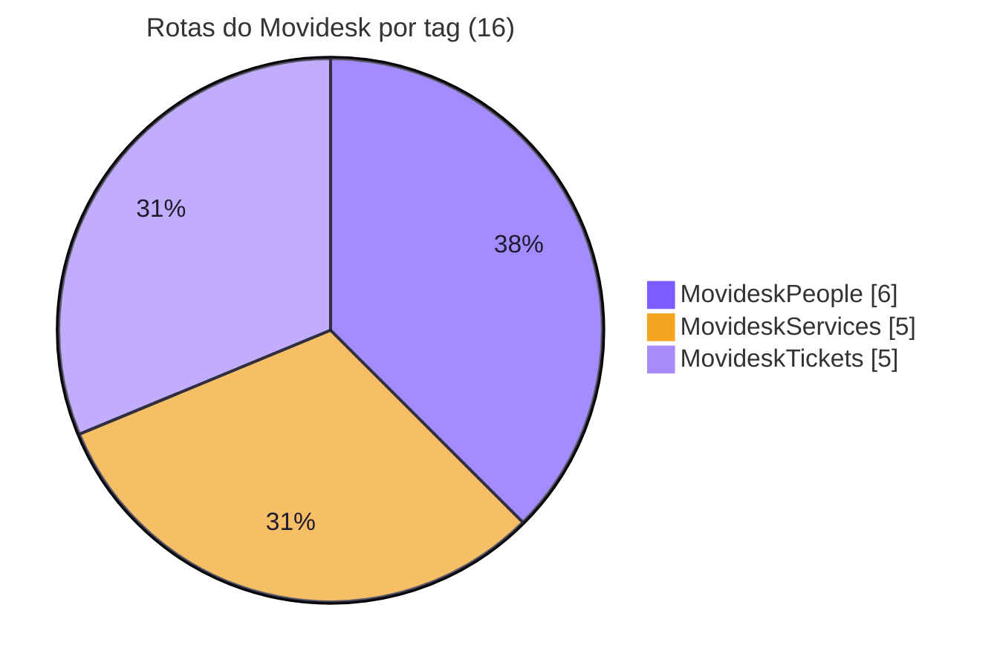
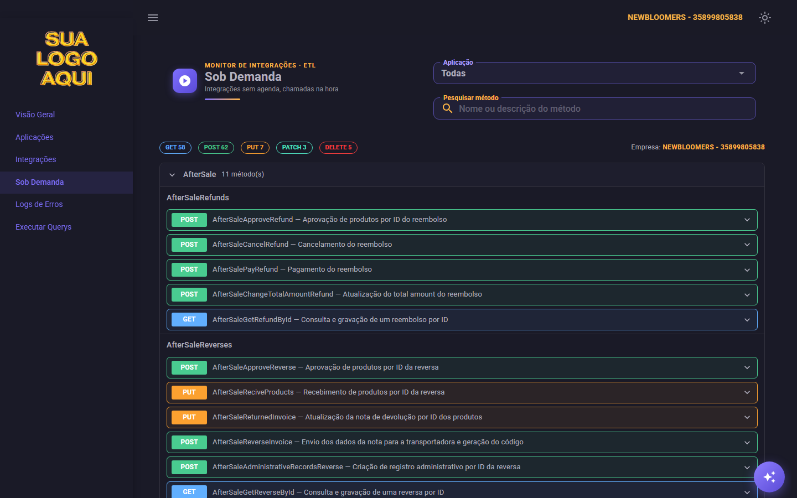
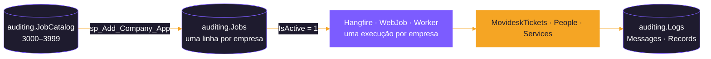

<p align="center">
  
</p>

# 🎧 Movidesk

<p align="center">
  
  
  
  
  <br>
  
  
  
  
  
</p>

<p align="center">
  <b>Pacote de DLLs para integração com a Movidesk: tickets, pessoas e serviços, lidos e escritos pela API pública v1.</b>
</p>

<p align="center">
  <a href="#-sobre-o-pacote">Sobre</a> ·
  <a href="#-applicationmovidesk">Services</a> ·
  <a href="#-infrastructuremovidesk">Scripts</a> ·
  <a href="#-endpoints-expostos-movideskcontroller">Endpoints</a> ·
  <a href="#-auditoria-jobs">Jobs</a> ·
  <a href="#-configuração">Configuração</a>
</p>

## 🎧 O que é a Movidesk?
A **Movidesk** é uma plataforma de help desk e service desk usada para organizar o atendimento ao cliente: pedidos de suporte, dúvidas e reclamações viram **tickets**, atendidos por agentes e equipes.

### Conceitos usados pela integração
* **Tickets**: cada atendimento, com assunto, status, responsável, ações (mensagens e anotações), histórico de status e de responsáveis, apontamentos de horas, despesas, anexos e campos adicionais.
* **Pessoas**: os cadastros da conta (agentes, clientes pessoa física e empresas), com endereços, contatos, e-mails, equipes, relacionamentos e campos adicionais.
* **Serviços**: o catálogo de serviços (até 4 níveis) que classifica os tickets, com as categorias permitidas em cada serviço.

Para conhecer a solução, visite o [**site da Movidesk**](https://www.movidesk.com/).

---

## 📦 Sobre o pacote

Módulo do sistema de integrações (ETL) responsável por **ler** os dados da API pública da Movidesk (tickets, pessoas e serviços) e gravá-los no banco SQL Server, empresa por empresa, e por **escrever** tickets na Movidesk:

* de forma **recorrente**, pelos hosts de agenda (Hangfire do WebApi, WebJob ou Worker), **uma execução por empresa** (leituras incrementais ou do catálogo inteiro);
* **sob demanda**, a partir de um sistema externo, buscando um único registro por id e registrando quem pediu cada chamada;
* **escrita** sob demanda, também registrando quem pediu cada chamada:
  * tickets: criar, alterar e enviar anexos para uma ação;
  * pessoas: criar, alterar, incluir organizações e excluir;
  * serviços: criar, alterar e excluir.

| Item | Valor |
|---|---|
| Plataforma | .NET 10 (`net10.0`) |
| Arquitetura | Clean Architecture em três assemblies: Domain, Application e Infrastructure |
| API consumida | Movidesk API pública v1 — `https://api.movidesk.com/public/v1/` |
| Documentação da API | [Tickets](https://atendimento.movidesk.com/kb/article/256/movidesk-ticket-api), [Pessoas](https://atendimento.movidesk.com/kb/article/189/movidesk-person-api), [Serviços](https://atendimento.movidesk.com/kb/article/7440/api-servicos) |
| Banco de dados | SQL Server (schemas `untreated`, `movidesk` e `auditing`; o `Script001` cria `movidesk` e `untreated` quando não existem) |
| Multiempresa | Sim: cada CNPJ cadastrado em `movidesk.MovideskParameters` tem o seu token; o CNPJ (`doc_company`) é a primeira coluna da chave de todas as tabelas. Cada execução é de uma **empresa do painel** (a holding, em `ICompanyContext`) e lê só os CNPJs ligados a ela em `monitor.HoldingCompanies` |
| Host | `src/Backend/Hosts/WebApi` (controller `MovideskController`); agenda pelos hosts `WebApi` (Hangfire), `WebJob` ou `Worker` |

### Limites da API

> [!WARNING]
> * **10 requisições por minuto** por token: as leituras esperam **6 segundos** entre uma chamada e outra.
> * **3 respostas de erro seguidas bloqueiam a API** por um tempo. Por isso, quando uma página volta inválida, a empresa é interrompida naquela execução em vez de tentar de novo.
> * O `GET /tickets` (lista) só devolve tickets atualizados nos **últimos 90 dias**; tickets mais antigos só pelo `GET Tickets/{docCompany}/{id}`.

### Disclaimer sobre a documentação da API
A modelagem foi conferida com respostas reais da API, porque a documentação não descreve tudo (por exemplo, a numeração dos níveis de serviço no ticket, `changedDate` nulo em pessoas nunca alteradas e o formato da resposta 404 de cada rota). Os JSONs usados estão na pasta [`Responsed Jsons`](#-pasta-docsresponsed-jsons), com os dados reais trocados por dados fictícios.

---

## 🧱 Arquitetura

```
Movidesk/
├── Domain.Movidesk          ← contratos, DTOs, entidades e enums (sem dependência de infraestrutura)
├── Application.Movidesk     ← services (regras de integração), queries SQL e validações
├── Infrastructure.Movidesk  ← repositórios, injeção de dependência e scripts de banco
└── docs                     ← propostas, planos e implementações do módulo
    └── Responsed Jsons  ← JSONs de referência (dados fictícios) usados para montar DTOs e entidades
```

### Referências entre projetos



| Assembly | Pacotes NuGet | Referências |
|---|---|---|
| `Domain.Movidesk` | `Newtonsoft.Json` 13.0.4 | `Domain.Shared` |
| `Application.Movidesk` | `Microsoft.Extensions.Caching.Memory` 10.0.8 | `Application.Shared`, `Domain.Movidesk` |
| `Infrastructure.Movidesk` | — | `Infrastructure.Shared`, `Application.Movidesk`, `Domain.Movidesk` |

Do projeto Shared o módulo usa:
* `IApiClient`/`ApiClient` (cliente HTTP);
* `ILoggerService` (auditoria);
* `ISharedRepository` (consultas, bulk insert e chamada das procedures de merge);
* `ConverterValidatorsExtensions` e `NullableConverters` (conversões de string para os tipos das entidades, mantendo `null` quando a API não manda o valor).

---

## 🧬 Domain.Movidesk

```
Domain.Movidesk/
├── Abstractions/Repositorys/   ← interfaces dos repositórios
├── Dtos/
│   └── Reads/                  ← respostas das rotas GET da API
│       ├── People/             (Person, Address, Contact, Email, Relationship, Service, CustomFieldValue, CustomFieldValueItem, Asset)
│       ├── Services/           (Service)
│       └── Tickets/            (Ticket, Action, Client, Person, OwnerHistory, StatusHistory, TimeAppointment, Expense, Attachment, Asset...)
├── Entities/
│   ├── Parameters/             (Company → movidesk.MovideskParameters)
│   ├── Reads/                  ← o que é gravado a partir das rotas GET
│   │   ├── People/
│   │   ├── Services/
│   │   └── Tickets/
│   └── Writes/
│       └── Requests/           (Request → movidesk.MovideskRequests)
└── Enums/                      (EnumJob)
```

### Convenções

* **DTOs** espelham o JSON da API: propriedades `string` com os nomes da API (`camelCase`). É **uma classe por arquivo**.
* **Entidades** têm os tipos das colunas e os **mesmos nomes das colunas**, porque o bulk insert mapeia as colunas pelo nome da propriedade.
  * Convertem os campos do DTO no construtor e cortam os textos no tamanho da coluna.
  * Campos opcionais ficam anuláveis (`int?`, `bool?`, `DateTime?`), para gravar `null` quando a API não manda o valor, em vez de `0` ou `false`.
* Toda entidade tem `doc_company` (CNPJ) e `integrated_or_updated_at`. Um registro e todas as suas filhas recebem **o mesmo horário de lote** (`MovideskService.GetBatchTime()`), que é a base da exclusão das filhas no merge (ver [Scripts](#scripts-de-banco-sql-server)).
* Listas filhas usam `[SkipProperty]` para não virarem coluna no bulk insert.
* Nomes: **Person** no singular e **People** no plural (`MovideskPeople`, `GetPeople`, `GetPersonById`).
* `EnumJob` deve ficar em sincronia com os scripts de jobs de cada pasta (`Script0NN_Insert_Movidesk_*_Jobs_Into_Jobs_Table.sql`).

### Repositórios (interfaces)

| Interface | Responsabilidade |
|---|---|
| `IMovideskRepository` | Empresas (`GetCompanys`, `GetCompany`) e log das chamadas sob demanda (`InsertIntoMovideskRequests`) |
| `IMovideskTicketsRepository` | Tickets e filhas (bulk insert + merges), última atualização por empresa e consulta por ids para o cache |
| `IMovideskPeopleRepository` | Pessoas e filhas (bulk insert + merges), última alteração por empresa e consulta por ids para o cache |
| `IMovideskServicesRepository` | Serviços e categorias (bulk insert + merges) |

---

## 🧠 Application.Movidesk

```
Application.Movidesk/
├── Abstractions/
│   ├── Handlers/Commands/      (IMovideskCommandHandler e um por service: Tickets e People)
│   └── Services/               (IMovideskService, IMovideskTicketsService, IMovideskPeopleService, IMovideskServicesService)
├── Handlers/Commands/          (monta as queries SQL: MovideskTickets/PeopleCommandHandler, usados pelo repositório de cada service, e o MovideskCommandHandler com as comuns)
├── Services/                   (MovideskService, MovideskTicketsService, MovideskPeopleService, MovideskServicesService)
└── Validations/                (FluentValidation por DTO, nas mesmas pastas dos DTOs: Reads/People, Reads/Services, Reads/Tickets e Writes/*)
```

### Services e métodos

**`MovideskService`**: operações comuns aos outros services

| Método | O que faz |
|---|---|
| `GetBatchTime` | Horário do lote (horário de Brasília), gravado igual no registro e em todas as filhas |
| `SaveRequest` | Grava uma chamada sob demanda em `movidesk.MovideskRequests`, ligada ao `Execution` do log aberto por quem chama. A rota é gravada **sem o token**; nas escritas, o corpo enviado vai em `request_body` |

**`MovideskTicketsService`**

| Método | Rota da API | Tabelas | Job | Execução |
|---|---|---|---|---|
| `GetTickets` | `GET tickets` (lista de ids por `lastUpdate`, depois blocos de 100 com o `$expand` em 5 chamadas) | `MovideskTickets` e 13 tabelas filhas/netas | 3000 | A cada 3 minutos |
| `GetTicketById` | `GET tickets?id={id}` | as mesmas + `MovideskRequests` (log) | 3002 | Sob demanda |
| `PostTicket` | `POST tickets?returnAllProperties=true` | `MovideskRequests` (log) e o ticket criado nas tabelas de tickets | 3006 | Sob demanda |
| `PatchTicketById` | `PATCH tickets?id={id}` | `MovideskRequests` (log) | 3007 | Sob demanda |
| `PostTicketFileUploadById` | `POST ticketFileUpload?id={id}&actionId={actionId}` | `MovideskRequests` (log, só metadados e SHA-256 dos arquivos) | 3008 | Sob demanda |

**`MovideskPeopleService`**

| Método | Rota da API | Tabelas | Job | Execução |
|---|---|---|---|---|
| `GetPeople` | `GET persons` (`$filter` por `changedDate` **ou** `createdDate`, paginado de 100 em 100) | `MovideskPeople` e 9 tabelas filhas/netas | 3001 | A cada 3 minutos |
| `GetPersonById` | `GET persons?id={id}` | as mesmas + `MovideskRequests` (log) | 3003 | Sob demanda |
| `PostPerson` | `POST persons?returnAllProperties=true` | `MovideskRequests` (log) e a pessoa criada nas tabelas de pessoas | 3009 | Sob demanda |
| `PatchPersonById` | `PATCH persons?id={id}` | `MovideskRequests` (log) | 3010 | Sob demanda |
| `PostPersonRelationshipsById` | `POST persons/relationships?id={id}` | `MovideskRequests` (log) | 3011 | Sob demanda |
| `DeletePersonById` | `DELETE persons?id={id}` | `MovideskRequests` (log); apaga a pessoa e as filhas do banco local | 3012 | Sob demanda |

**`MovideskServicesService`**

| Método | Rota da API | Tabelas | Job | Execução |
|---|---|---|---|---|
| `GetServices` | `GET services` (catálogo inteiro numa resposta, sem paginação) | `MovideskServices`, `MovideskServicesCategories` | 3004 | A cada 2 horas |
| `GetServiceById` | `GET services?id={id}` | as mesmas + `MovideskRequests` (log) | 3005 | Sob demanda |
| `PostService` | `POST services?returnAllProperties=true` | `MovideskRequests` (log) e o serviço criado nas tabelas de serviços | 3013 | Sob demanda |
| `PatchServiceById` | `PATCH services?id={id}`, depois `GET services?id={id}` | `MovideskRequests` (log) e o serviço relido | 3014 | Sob demanda |
| `DeleteServiceById` | `DELETE services?id={id}` | `MovideskRequests` (log); o serviço continua no banco local | 3015 | Sob demanda |

### Fluxo das leituras recorrentes (tickets e pessoas)

Seguem o padrão de [`docs/PADRAO-CACHE-INTEGRACOES.md`](../../../../../docs/PADRAO-CACHE-INTEGRACOES.md):

1. abre um log em `auditing.Logs` com o job do método;
2. para cada empresa de `MovideskParameters`, calcula a janela de busca:
   * **Tickets:** desde o maior `lastUpdate` gravado, menos 1 hora de folga. Com o banco vazio, os últimos 89 dias.
   * **Pessoas:** desde a maior data de alteração/criação gravada, menos 1 hora de folga. Com o banco vazio, os últimos 12 meses.
3. busca as páginas com `$skip` (`$top=100` nas pessoas), esperando 6 segundos entre as chamadas. Os tickets seguem um fluxo próprio, descrito logo abaixo;
4. monta um cache em memória **por empresa** (`IMemoryCache`, 2 h absoluto / 30 min deslizante) com o que já está gravado e descarta o que não mudou;
5. valida os DTOs (FluentValidation) e registra as inconsistências em `auditing.Messages`, sem barrar a gravação;
6. converte para entidades, faz o bulk insert nas tabelas `untreated` e chama as procedures de merge `movidesk.sp_<Tabela>_Sync`, do pai para os filhos;
7. grava cada registro integrado (com o JSON recebido) em `auditing.Records`.

**Tickets** com todas as listas expandidas numa chamada levam ~100 s por página e chegam a dar 504. Por isso o `GetTickets` trabalha em duas fases ([detalhes](docs/IMPLEMENTACAO-MOVIDESK-GETTICKETS-EXPAND-EM-GRUPOS.md)):

* **Fase 1:** lista só `id` e `lastUpdate` da janela (1.000 por chamada) e usa o cache para separar os tickets novos ou alterados.
* **Fase 2:** busca os alterados em blocos de até 100, por faixa de ids, com o `$expand` dividido em **5 chamadas** por bloco (campos, ações, clientes e itens, históricos, campos adicionais).
  * As respostas são juntadas por id e o bloco é gravado em seguida.
  * Um ticket que falte em algum grupo não é gravado (o merge apagaria as filhas que faltaram): vira mensagem e volta na próxima execução.



**Serviços** usam outro desenho, porque o catálogo é pequeno e vem inteiro numa chamada: o service calcula o hash SHA-256 da resposta de cada empresa e só regrava quando o catálogo mudou desde a última execução.

| Chave de cache | Conteúdo | Usada por |
|---|---|---|
| `Movidesk:Tickets:<cnpj>` | Tickets gravados (id → `lastUpdate`) | `GetTickets` |
| `Movidesk:People:<cnpj>` | Pessoas gravadas (id → datas) | `GetPeople` |
| `Movidesk:ServicesHash:<cnpj>` | Hash do último catálogo gravado (3 h, mais que o intervalo de 2 h do job) | `GetServices`; o `GetServiceById` remove a chave ao gravar |

### Fluxo das leituras sob demanda (um registro por id)

`GetTicketById`, `GetPersonById` e `GetServiceById` seguem o mesmo fluxo:

1. abre um log em `auditing.Logs` com o job do método;
2. busca a empresa pelo CNPJ recebido. Se ela não estiver cadastrada, devolve `null` sem chamar a API;
3. chama a API com o token da empresa e grava o registro como nas leituras recorrentes (mesmas tabelas e merges);
4. grava a chamada em `movidesk.MovideskRequests` (via `MovideskService.SaveRequest`). Isso inclui:
   * usuário (`X-User-Name`), método, rota sem o token, CNPJ, id, resposta e se houve sucesso;
   * também quando a chamada falha antes de ter resposta (timeout, rede);
5. devolve `true` (gravado), `false` (não existe na Movidesk) ou `null` (empresa não cadastrada ou resposta inválida).

A empresa da execução (a holding) vem do cabeçalho opcional **`X-Company`** ou, sem ele, da holding do `{docCompany}` em
`monitor.HoldingCompanies` (`CompanyContextFilter` do WebApi): CNPJ sem holding, `X-Company` de outra holding ou com algo além de
dígitos dão **400**.

Como a API indica "não encontrado":

| Rota | Resposta para id inexistente |
|---|---|
| `tickets?id=` | 404 com corpo vazio |
| `persons?id=` | 404 com `application/problem+json` (`"status": 404`) |
| `services?id=` | 404 com corpo vazio |

### Fluxo da escrita (tickets, pessoas e serviços)

Detalhes e decisões em [`src/Backend/Modules/General/Movidesk/docs/IMPLEMENTACAO-MOVIDESK-TICKETS-ESCRITA.md`](docs/IMPLEMENTACAO-MOVIDESK-TICKETS-ESCRITA.md), [`src/Backend/Modules/General/Movidesk/docs/IMPLEMENTACAO-MOVIDESK-PESSOAS-ESCRITA.md`](docs/IMPLEMENTACAO-MOVIDESK-PESSOAS-ESCRITA.md) e [`src/Backend/Modules/General/Movidesk/docs/IMPLEMENTACAO-MOVIDESK-SERVICES-ESCRITA.md`](docs/IMPLEMENTACAO-MOVIDESK-SERVICES-ESCRITA.md). Cada service tem o seu fluxo comum (`SendTicket`, `SendPerson` e `SendService`), e os três devolvem o mesmo `Dtos/Writes/Result`.

1. o controller valida o corpo (FluentValidation, `Validations/Writes/Tickets`, `Validations/Writes/People` e `Validations/Writes/Services`) e devolve **400** sem chamar a API, porque 3 erros seguidos bloqueiam a API por 60 s;
2. o service abre um log com o job da rota, busca a empresa pelo CNPJ e chama a API pelo `IApiClient.SendAsync`, que devolve o status HTTP (PATCH, relacionamentos e DELETE respondem 200 sem corpo);
3. a chamada vai para `movidesk.MovideskRequests` com o corpo enviado (`request_body`). Nos anexos, só nome, tipo, tamanho e SHA-256 de cada arquivo;
4. o banco é atualizado assim:
   * **POST:** com `returnAllProperties=true` a Movidesk devolve o ticket, a pessoa ou o serviço inteiro, que é gravado na hora pelo `SaveTickets`, `SavePeople` ou `SaveServices`;
   * **PATCH, anexos e relacionamentos:** não há releitura; a alteração chega pela próxima execução do `GetTickets` ou do `GetPeople` (até 3 minutos);
   * **DELETE de pessoa:** a pessoa e as filhas são apagadas do banco local, porque a merge de pessoas nunca apaga linhas;
   * **Serviços:** o PATCH relê o serviço e grava na hora, porque o `GetServices` só roda a cada 2 horas; o DELETE mantém o serviço no banco local (tickets antigos apontam para ele); toda escrita tira o hash do catálogo do cache, para o próximo `GetServices` regravar.



> [!IMPORTANT]
> **Cuidados do PATCH:** só os campos enviados mudam, mas **uma lista enviada substitui a lista inteira** (`{ "tags": [] }` apaga as tags de um ticket; `{ "emails": [] }`, os e-mails de uma pessoa). Em tickets, ações e apontamentos sem `id` são inseridos como novos. Em pessoas, para só acrescentar uma organização, use a rota de relacionamentos em vez de `relationships` no PATCH.

> [!NOTE]
> A integração **não aceita senha** de pessoa: um `password` enviado no corpo é ignorado e não chega ao log nem à Movidesk.

---

## 🔧 Infrastructure.Movidesk

```
Infrastructure.Movidesk/
├── DependencyInjection.cs      (AddScopedMovideskServices)
├── Repositorys/                (MovideskRepository, MovideskTicketsRepository, MovideskPeopleRepository, MovideskServicesRepository)
├── Scripts/
│   ├── SQLServer/              (scripts DbUp + migrator.csx)
│   ├── MySQL/                  (migrator.csx)
│   └── PostgreSQL/             (migrator.csx)
└── Seeds/SQLServer/            (parâmetros de uma empresa, fora do DbUp: só o tools/seeds/Import-TestSeeds.ps1 lê)
```

### Injeção de dependência

`AddScopedMovideskServices(IServiceCollection, IConfiguration)` registra:

* `IApiClient` com a chave `"MovideskAPI"` e o `HttpClient` nomeado `"MovideskAPI"` (base `Movidesk:BaseUrl`, timeout de 20 minutos);
* os quatro services e os quatro repositórios (`Scoped`);
* os command handlers: `IMovideskTicketsCommandHandler`, `IMovideskPeopleCommandHandler` e o comum `IMovideskCommandHandler`;
* todos os validadores do assembly (`AddValidatorsFromAssemblyContaining<TicketValidator>()`).

O host chama o método em `Hosts/WebApi/Extensions/ServicesExtensions.cs`.

### Scripts de banco (SQL Server)

O DbUp (`Scripts/SQLServer/migrator.csx`) executa cada script uma única vez, na ordem do número do arquivo. Alterar um script que já rodou não muda um banco existente: para isso é preciso um script novo. Os scripts gerais ficam em `Parameters/` e cada service tem a sua pasta, com o trio tabelas, procedures e jobs.

| Pasta | Script | Conteúdo |
|---|---|---|
| `Parameters/` | `Script001_Create_Movidesk_Parameters_Table.sql` | Schemas `movidesk` e `untreated` (só se não existirem) e `movidesk.MovideskParameters` (CNPJ + token por empresa) |
| `Parameters/` | `Script002_Insert_Movidesk_Values_Into_Apps_Table.sql` | App `30 - Movidesk` em `auditing.Apps` |
| `Seeds/SQLServer/` (irmã de `Scripts/`) | `Script003_Insert_Values_Into_Movidesk_Parameters_Table.sql` | Empresa e token em `MovideskParameters`. **Fora do DbUp**: só o [`tools/seeds/Import-TestSeeds.ps1`](../../../../../tools/seeds/Import-TestSeeds.ps1) roda ([plano do cadastro](../../../../../docs/PLANO-TELA-CADASTRO-EMPRESA.md)) |
| `Parameters/` | `Script004_Create_Movidesk_Requests_Table.sql` | `movidesk.MovideskRequests` (log das chamadas sob demanda), já com `integrated_or_updated_at` |
| `Tickets/` | `Script005`–`007` | `MovideskTickets`, as tabelas filhas e netas (tags, clientes, relacionamentos, históricos, campos adicionais, itens de configuração, ações e seus tags/apontamentos/despesas/anexos), mais os domínios `MovideskTicketsOrigins` e `MovideskTicketsTypes`; procedures de merge e jobs dos tickets |
| `People/` | `Script008`–`010` | `MovideskPeople`, as filhas e netas (endereços, contatos, e-mails, equipes, relacionamentos e seus serviços, campos adicionais, itens de configuração), mais os domínios `MovideskPersonTypes` e `MovideskProfileTypes`; procedures de merge e jobs das pessoas |
| `Services/` | `Script011`–`013` | `MovideskServices`, `MovideskServicesCategories` e os domínios `MovideskServiceTicketTypes` e `MovideskServiceAudiences`; procedures de merge e jobs dos serviços |

Os scripts `*_Jobs_Into_Jobs_Table.sql` inserem no **catálogo** `auditing.JobCatalog` (sem empresa). Os jobs sob demanda já nascem com os títulos do `EnumJob` (`MovideskGetTicketById`, `MovideskGetPersonById` e `MovideskGetServiceById`).

**Regras gerais das tabelas e dos merges:**
* Toda tabela de dados existe em dois schemas: `untreated` (recebe o bulk insert, sem chave) e `movidesk` (tabela final, com PK). As exceções são `movidesk.MovideskRequests`, que só recebe inserts, e as tabelas de domínio, preenchidas pelos próprios scripts.
* As procedures `movidesk.sp_<Tabela>_Sync` são geradas por `dbo.sp_Create_Merge_Procedure`, do projeto Shared.
* Nas tabelas filhas, o merge **apaga** as linhas que não vieram no lote quando o pai foi regravado (o `integrated_or_updated_at` do pai é mais recente que o da filha). Assim, um item removido na Movidesk também sai do banco.
* As netas têm FK com `on delete cascade`.
* Os registros principais (tickets, pessoas e serviços) **nunca são apagados**: um serviço removido do catálogo continua no banco.

---

## 🌐 Endpoints expostos (`MovideskController`)

Rota base: `MovideskJobs/Movidesk`.

<p align="center">
  
  <br><sub><b>Swagger</b> do WebApi — tag <code>MovideskTickets</code> aberta</sub>
</p>


### Leituras recorrentes (disparam a integração de todas as empresas)

| Método | Rota | Service |
|---|---|---|
| GET | `Tickets` | `MovideskTicketsService.GetTickets` |
| GET | `People` | `MovideskPeopleService.GetPeople` |
| GET | `Services` | `MovideskServicesService.GetServices` |

### Leituras sob demanda (chamadas por sistema externo)

Todas exigem:
* o cabeçalho **`X-User-Name`** (até 100 caracteres);
* o CNPJ da empresa na rota (`{docCompany}`, 14 dígitos).

Sem o cabeçalho, com o CNPJ inválido ou com um id fora do formato, a resposta é **400** (ou **404** pela restrição de rota), sem chamar a API. O cabeçalho opcional **`X-Company`** informa a holding; sem ele, vale a holding do `{docCompany}` em `monitor.HoldingCompanies`.

| Método | Rota | Formato do id | Service |
|---|---|---|---|
| GET | `Tickets/{docCompany}/{id}` | número ≥ 1 | `GetTicketById` |
| GET | `People/{docCompany}/{id}` | Cód. Ref., só letras e números, até 64 caracteres | `GetPersonById` |
| GET | `Services/{docCompany}/{id}` | número ≥ 1 | `GetServiceById` |

Respostas:

| Código | Quando |
|---|---|
| **200** | Registro gravado |
| **404** | O registro não existe na Movidesk |
| **422** | Empresa não cadastrada ou resposta inválida da API (detalhes no log da execução) |

### Escrita de tickets, pessoas e serviços (chamadas por sistema externo)

Mesmas exigências das leituras sob demanda (`X-User-Name` e `{docCompany}`), com o corpo validado antes de chamar a API.

| Método | Rota | Corpo | Service |
|---|---|---|---|
| POST | `Tickets/{docCompany}` | JSON do ticket (obrigatórios: `type`, `createdBy`, `clients`, `actions`) | `PostTicket` |
| PATCH | `Tickets/{docCompany}/{id}` | JSON só com o que muda | `PatchTicketById` |
| POST | `Tickets/{docCompany}/{id}/Actions/{actionId}/Files` | multipart (`files`, um ou mais, até 25 MB cada) | `PostTicketFileUploadById` |
| POST | `People/{docCompany}` | JSON da pessoa (obrigatórios: `id` só com letras e números, `isActive`, `personType`, `profileType`, `businessName`) | `PostPerson` |
| PATCH | `People/{docCompany}/{id}` | JSON só com o que muda | `PatchPersonById` |
| POST | `People/{docCompany}/{id}/Relationships` | `{ "relationships": [ ... ] }` (inclui sem mexer nas existentes) | `PostPersonRelationshipsById` |
| DELETE | `People/{docCompany}/{id}` | nenhum (**irreversível**) | `DeletePersonById` |
| POST | `Services/{docCompany}` | JSON do serviço (sem `id`: a Movidesk gera) | `PostService` |
| PATCH | `Services/{docCompany}/{id}` | JSON só com o que muda | `PatchServiceById` |
| DELETE | `Services/{docCompany}/{id}` | nenhum (**irreversível**) | `DeleteServiceById` |

| Código | Quando |
|---|---|
| **200** | Escrita aceita (`id` do ticket ou da pessoa e o retorno da Movidesk no corpo) |
| **400** | Corpo inválido, arquivo vazio ou acima de 25 MB |
| **422** | Empresa não cadastrada ou a Movidesk recusou (mensagem da API no corpo) |
| **429** | A Movidesk bloqueou por excesso de erros (`Retry-After`) |

> [!CAUTION]
> O `[Authorize]` do controller está comentado, como no AfterSale, porque o host ainda não tem um esquema de autenticação configurado.

<p align="center">
  
  <br><sub><b>Sob Demanda</b> no Monitor de Integrações — as rotas sem agenda do Movidesk ficam no grupo do módulo</sub>
</p>

---

## 📝 Auditoria (jobs)

O catálogo fica em `auditing.JobCatalog` (scripts de jobs de `Tickets/`, `People/` e `Services/`), com os mesmos ids em `EnumJob`. Cada empresa recebe a sua cópia em `auditing.Jobs` (`Company` na chave) ao contratar o módulo (`auditing.sp_Add_Company_App`), com os jobs **inativos** (`IsActive = 0`) até alguém ligar.



| Faixa | Tipo (`IdType`) | Conteúdo |
|---|---|---|
| 3000–3499 | 2 (Integração) | Leituras, com `IdParent = 30` (app Movidesk) |
| 3500–3999 | 1 (Procedure) | Procedures `sp_<Tabela>_Sync`, com `IdParent` = job da leitura (tickets 3500–3515, pessoas 3516–3525, serviços 3526–3527) |

| Id | Job | Intervalo |
|---|---|---|
| 3000 | `MovideskGetTickets` | 3 min |
| 3001 | `MovideskGetPeople` | 3 min |
| 3002 | `MovideskGetTicketById` | sob demanda |
| 3003 | `MovideskGetPersonById` | sob demanda |
| 3004 | `MovideskGetServices` | 120 min |
| 3005 | `MovideskGetServiceById` | sob demanda |
| 3006 | `MovideskPostTicket` | sob demanda (escrita) |
| 3007 | `MovideskPatchTicketById` | sob demanda (escrita) |
| 3008 | `MovideskPostTicketFileUploadById` | sob demanda (escrita) |
| 3009 | `MovideskPostPerson` | sob demanda (escrita) |
| 3010 | `MovideskPatchPersonById` | sob demanda (escrita) |
| 3011 | `MovideskPostPersonRelationshipsById` | sob demanda (escrita) |
| 3012 | `MovideskDeletePersonById` | sob demanda (escrita) |
| 3013 | `MovideskPostService` | sob demanda (escrita) |
| 3014 | `MovideskPatchServiceById` | sob demanda (escrita) |
| 3015 | `MovideskDeleteServiceById` | sob demanda (escrita) |

Toda execução grava `auditing.Logs` (com a `Company` da execução) e, conforme o caso:
* `auditing.Messages`, com mensagens e erros de validação;
* `auditing.Records`, com os registros integrados e o JSON recebido.

---

## 🔑 Configuração

| Onde | Chave | Uso |
|---|---|---|
| `appsettings.json` do host | `Movidesk:BaseUrl` | Endereço da API (`https://api.movidesk.com/public/v1/`) |
| `appsettings.json` do host | `ConnectionStrings` | Conexão com o SQL Server (dados e auditoria) |
| Banco | `movidesk.MovideskParameters` | CNPJ (`doc_company`) e token de cada empresa |
| Banco | `monitor.HoldingCompanies` | De/para CNPJ → holding (empresa do painel); só os CNPJs da holding da execução são lidos |

> [!IMPORTANT]
> Os tokens ficam só no banco e nunca são gravados em logs: a rota registrada em `MovideskRequests` não inclui o token.

---

## 📁 Pasta `docs/Responsed Jsons`

Respostas reais da API, com os dados trocados por **dados fictícios** para não expor informações no histórico do git:

| Pasta | Conteúdo |
|---|---|
| `Ticket/GetTicketById/` | Um ticket no formulário novo e um no formulário antigo |
| `People/GetPeople/` | Página da lista de pessoas |
| `Person/GetPersonById/` | Uma pessoa de cada perfil: agente, cliente e empresa |
| `Services/GetServices/` | Catálogo de serviços |
| `Service/GetServiceById/` | Um serviço por id |

---

## 📚 Documentação complementar

Guias de modelagem, implementação e decisões tomadas, na pasta [`docs/`](docs) do módulo (os padrões comuns ficam no `docs/` da raiz e em `src/Backend/Shared/docs`):

| Documento | Assunto |
|---|---|
| [`MOVIDESK-MODELAGEM-TICKETS.md`](docs/MOVIDESK-MODELAGEM-TICKETS.md) | Tabelas e relações dos tickets |
| [`IMPLEMENTACAO-MOVIDESK-GETTICKETS.md`](docs/IMPLEMENTACAO-MOVIDESK-GETTICKETS.md), [`IMPLEMENTACAO-MOVIDESK-GETTICKET.md`](docs/IMPLEMENTACAO-MOVIDESK-GETTICKET.md) | Leitura dos tickets (lista e por número) |
| [`MOVIDESK-MODELAGEM-PESSOAS.md`](docs/MOVIDESK-MODELAGEM-PESSOAS.md) | Tabelas e relações das pessoas |
| [`IMPLEMENTACAO-MOVIDESK-GETPEOPLE.md`](docs/IMPLEMENTACAO-MOVIDESK-GETPEOPLE.md), [`IMPLEMENTACAO-MOVIDESK-GETPERSON.md`](docs/IMPLEMENTACAO-MOVIDESK-GETPERSON.md) | Leitura das pessoas (lista e por Cód. Ref.) |
| [`IMPLEMENTACAO-MOVIDESK-SERVICES.md`](docs/IMPLEMENTACAO-MOVIDESK-SERVICES.md) | Tabelas e leitura do catálogo de serviços |
| [`IMPLEMENTACAO-MOVIDESK-TICKETS-ESCRITA.md`](docs/IMPLEMENTACAO-MOVIDESK-TICKETS-ESCRITA.md) | Criação, alteração e anexos de tickets |
| [`IMPLEMENTACAO-MOVIDESK-PESSOAS-ESCRITA.md`](docs/IMPLEMENTACAO-MOVIDESK-PESSOAS-ESCRITA.md) | Criação, alteração, relacionamentos e exclusão de pessoas |
| [`IMPLEMENTACAO-MOVIDESK-SERVICES-ESCRITA.md`](docs/IMPLEMENTACAO-MOVIDESK-SERVICES-ESCRITA.md) | Criação, alteração e exclusão de serviços |
| [`PADRAO-CACHE-INTEGRACOES.md`](../../../../../docs/PADRAO-CACHE-INTEGRACOES.md) | Padrão de cache das leituras |
| [`ALTERACOES-MERGE-PROCEDURE-AUDITORIA.md`](../../../../../src/Backend/Shared/docs/ALTERACOES-MERGE-PROCEDURE-AUDITORIA.md) | Procedure de merge e auditoria |

---

<p align="center">
  <br>
  <sub>Sistema de integrações · feito com .NET 10</sub>
</p>
