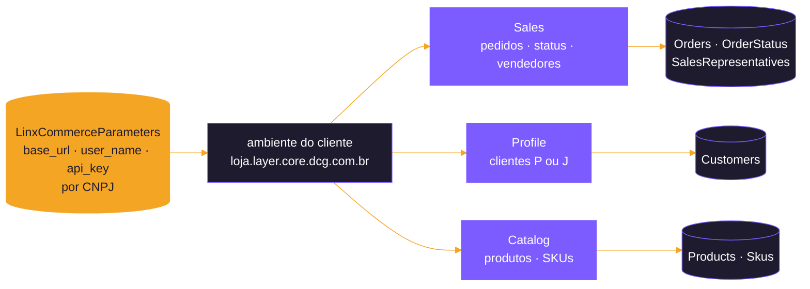
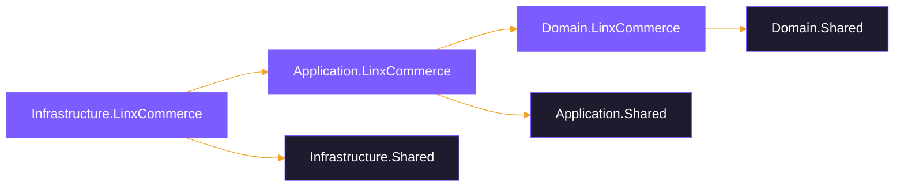
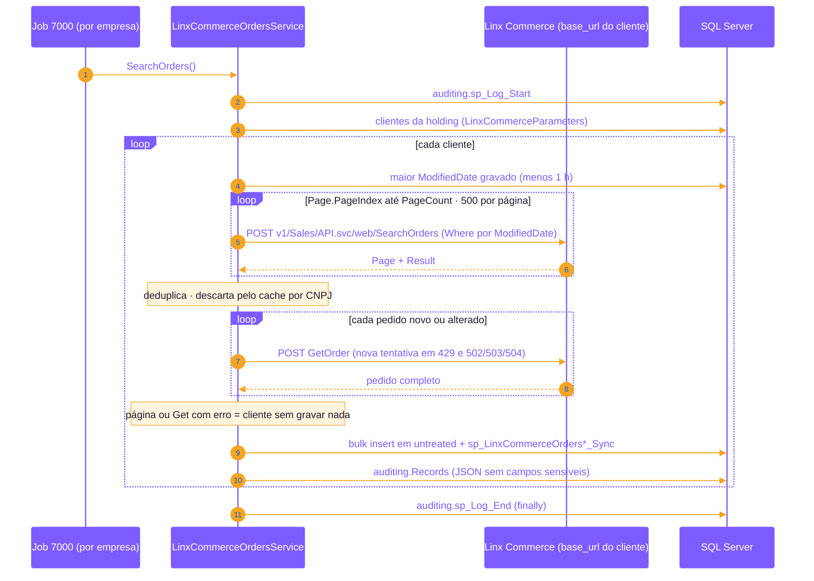
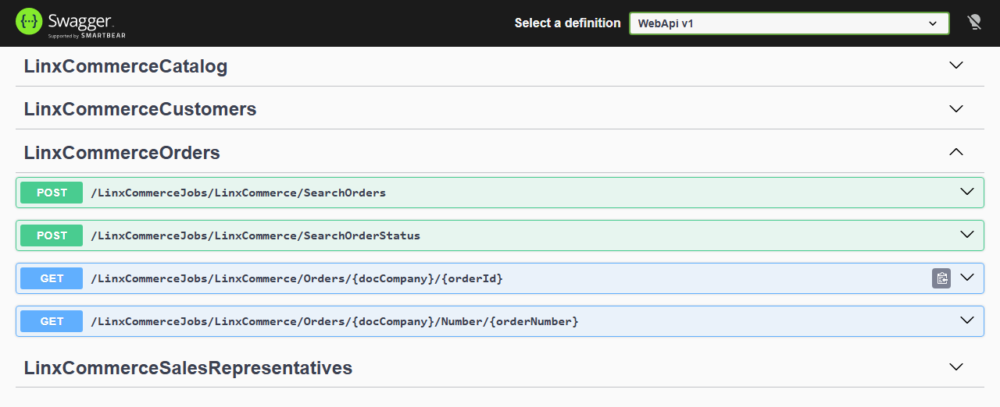
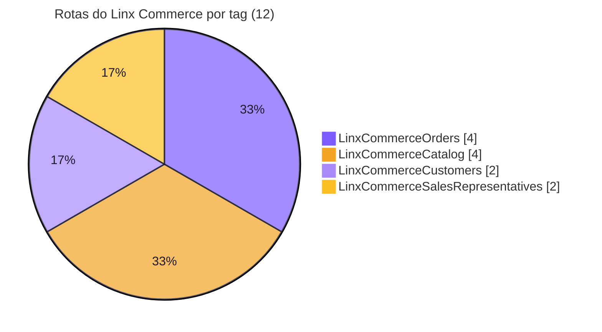
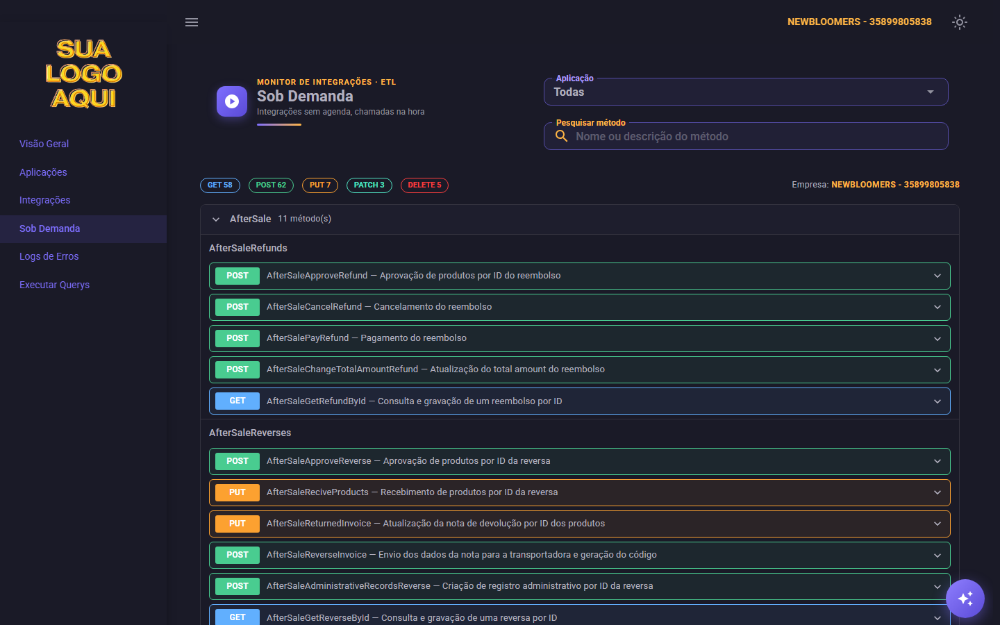
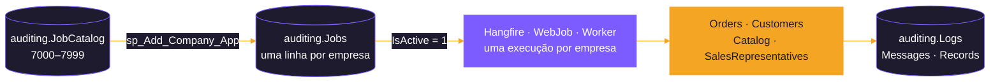

<div align="center">


</div>

# 🛒 Linx Commerce

<div align="center">

   

    

</div>

<p align="center">
  <b>Pacote de DLLs para integração com o Linx Commerce: pedidos, clientes, catálogo e vendedores, só leitura.</b>
</p>

<p align="center">
  <a href="#-sobre-o-pacote">Sobre</a> ·
  <a href="#-applicationlinxcommerce">Services</a> ·
  <a href="#-infrastructurelinxcommerce">Scripts</a> ·
  <a href="#-endpoints-expostos-linxcommercecontroller">Endpoints</a> ·
  <a href="#-auditoria-jobs">Jobs</a> ·
  <a href="#-pendências">Pendências</a>
</p>

## 🛒 O que é o Linx Commerce?
O **Linx Commerce** é a plataforma de e-commerce da Linx: catálogo (produtos e SKUs), clientes, pedidos, pagamentos, entregas e
vendedores. Cada cliente tem o seu ambiente (`https://<loja>.layer.core.dcg.com.br`), com as APIs `Sales`, `Profile`, `Catalog` e
`Queue` em `/v1/<Área>/API.svc/web/<Método>`. Na Newbloomers o ambiente era o da **Misha**.

### Conceitos usados pela integração
* **Busca e leitura**: cada recurso tem uma busca (`SearchOrders`, `SearchCustomer`...) que devolve a lista paginada (`Page` + `Result`)
  e um `Get` que devolve o registro completo (`GetOrder`, `GetPerson`...). As leituras usam a busca para achar o que mudou e o `Get`
  para ler cada registro.
* **Cliente pessoa física ou jurídica**: a busca diz o tipo (`CustomerType = "P"` ou `"J"`), e o registro vem do `GetPerson` ou do
  `GetCompany`.
* **SKU**: o id do SKU é o `ProductID` dele; o produto pai fica nas `ParentRelations`.


---

## 📦 Sobre o pacote

Módulo do sistema de integrações (ETL) responsável por **ler** os dados do Linx Commerce e gravá-los no banco SQL Server:

* de forma **recorrente**, pelos hosts de agenda (Hangfire do WebApi, WebJob ou Worker), uma execução por empresa, com leitura incremental pela data de alteração (`ModifiedDate`);
* **sob demanda**, a partir de um sistema externo, buscando um único registro por chave e registrando quem pediu cada chamada.

> [!NOTE]
> O módulo **não escreve** no Linx Commerce. As duas escritas do código antigo (rastreio do pedido e carteira de vendedores) não foram
> migradas: a da carteira apagava a carteira de todos os vendedores a cada execução
> ([`src/Backend/Modules/LinxCommerce/docs/PROPOSTA-PADRONIZACAO-LINXCOMMERCE.md`](docs/PROPOSTA-PADRONIZACAO-LINXCOMMERCE.md), §4.6).

| Item | Valor |
|---|---|
| Plataforma | .NET 10 (`net10.0`) |
| Arquitetura | Clean Architecture em três assemblies: Domain, Application e Infrastructure |
| API consumida | Linx Commerce — o endereço é **por cliente** (`base_url` de `linxcommerce.LinxCommerceParameters`), autenticação `Basic` com usuário e chave |
| Documentação da API | Nenhuma usada: o módulo foi escrito a partir do código antigo, sem credenciais (ver [Pendências](#-pendências)) |
| Banco de dados | SQL Server (schemas `untreated`, `linxcommerce` e `auditing`; o `Script001` cria `linxcommerce` quando não existe) |
| Multiempresa | Sim: cada CNPJ de `linxcommerce.LinxCommerceParameters` tem o seu ambiente e as suas credenciais. O CNPJ (`doc_company`) é a primeira coluna da chave de todas as tabelas. Cada execução é de uma **empresa do painel** (a holding, em `ICompanyContext`) e lê só os CNPJs ligados a ela em `monitor.HoldingCompanies` |
| Host | `src/Backend/Hosts/WebApi` (controller `LinxCommerceController`); agenda pelos hosts `WebApi` (Hangfire), `WebJob` ou `Worker` |

### Comportamentos da API que a integração trata

> [!WARNING]
> **Nada aqui foi conferido com a API real** (sem credenciais desde 2026): o que segue é o que o código antigo fazia, e cada ponto
> está marcado "a conferir" na proposta (§4.2 e §9). O módulo só foi testado contra uma **API simulada local**.

* **Filtro no `Where` em texto**, no formato `(ModifiedDate>="yyyy-MM-ddTHH:mm:ss" && ModifiedDate<="...")`, no horário de Brasília.
* **Paginação por `Page.PageIndex` (a partir de 0) e `PageSize`**, com o total de páginas em `Page.PageCount`. Só o `SearchOrders`
  paginava no código antigo; as outras buscas usam o mesmo envelope.
* **Datas com fuso** (ISO 8601) **ou no formato do WCF** (`/Date(1700000000000-0300)/`): as duas são aceitas e gravadas em
  `datetimeoffset`. Data sem fuso vale como horário de Brasília.
* **Erros**: um status HTTP de erro, uma exceção de rede ou um JSON inválido contam como falha. Como o Linx Commerce responde um id
  inexistente ainda está a conferir; o módulo trata como "não existe" o 404 e a resposta 2xx sem o registro pedido.
* **Corpo do `Get`**: o id puro (`"<OrderID>"`, `123`), salvo o `GetSalesRepresentative`, que recebe `{ "SalesRepresentativeID": 123 }`
  e devolve `{ "SalesRepresentative": {...} }`.

---

## 🧱 Arquitetura

```
LinxCommerce/
├── Domain.LinxCommerce          ← contratos, DTOs, entidades, conversores e enums (sem dependência de infraestrutura)
├── Application.LinxCommerce     ← services (regras de integração), queries SQL e validações
└── Infrastructure.LinxCommerce  ← repositórios, injeção de dependência e scripts de banco
```

### Referências entre projetos



| Assembly | Pacotes NuGet | Referências |
|---|---|---|
| `Domain.LinxCommerce` | `Newtonsoft.Json` 13.0.4 | `Domain.Shared` |
| `Application.LinxCommerce` | `Microsoft.Extensions.Caching.Memory` 10.0.8 | `Application.Shared`, `Domain.LinxCommerce` |
| `Infrastructure.LinxCommerce` | — | `Infrastructure.Shared`, `Application.LinxCommerce`, `Domain.LinxCommerce` |

Do projeto Shared o módulo usa:
* `IApiClient.SendAsync` (cliente HTTP que devolve status, corpo e cabeçalhos; aceita a rota absoluta, com o endereço do cliente);
* `ILoggerService` (auditoria);
* `ISharedRepository` (consultas, bulk insert e chamada das procedures de merge);
* `ConverterValidatorsExtensions` e `NullableConverters` (conversões de string para os tipos das entidades, mantendo `null` quando a
  API não manda o valor).

---

## 🧬 Domain.LinxCommerce

```
Domain.LinxCommerce/
├── Abstractions/Repositorys/   ← interfaces dos repositórios
├── Dtos/Reads/                 ← o JSON da API
│   ├── Base/                   (SearchResult<T>: Page + Result; OnDemandResponse<T> das rotas sob demanda)
│   ├── Orders/                 (SearchOrdersResult, Order e filhas, OrderStatus)
│   ├── Customers/              (SearchCustomerResult, Customer e filhas)
│   ├── Catalog/                (SearchProductResult, Product e filhas, SearchSkuResult, Sku e filhas)
│   └── SalesRepresentatives/   (SearchSalesRepresentativeResult, GetSalesRepresentative, SalesRepresentative e filhas)
├── Entities/
│   ├── Parameters/             (Company → linxcommerce.LinxCommerceParameters)
│   ├── Reads/                  ← o que é gravado, nas mesmas pastas dos DTOs
│   └── Requests/               (Request → linxcommerce.LinxCommerceRequests)
├── Enums/                      (EnumJob)
└── Extensions/                 (LinxCommerceConverters: datas com fuso ou do WCF, Int64, Guid, listas de ids como texto)
```

### Convenções

* **DTOs** espelham o JSON da API: propriedades `string` com os nomes da API, `{ get; init; }`, uma classe por arquivo. As listas de ids
  (`SkusIDs`, `WebSites`...) são `JToken`, porque o formato delas não foi conferido.
* **Campos sensíveis não existem nos DTOs**: `Password` e `CustomerHash` do cliente e, no pagamento, `Holder`, `NumberHint`,
  `SecurityCodeHint`, `PixQRCode` e `PixKey`. Eles também são tirados do JSON gravado em `auditing.Records` e em `LinxCommerceRequests`.
* **Entidades** têm os tipos das colunas e os **mesmos nomes das colunas**, porque o bulk insert mapeia as colunas pelo nome da
  propriedade. Convertem os campos do DTO no construtor, cortam os textos no tamanho da coluna e deixam anulável o que a API pode não
  mandar.
* **Objetos 1:1** da API (`PaymentInfo` do pagamento, `Contact` e `EmailConfirmation` do cliente, `Image` e `Video` da mídia, os sete
  objetos do vendedor) viram **colunas do pai**, com o nome do objeto como prefixo (`PaymentInfoAlias`, `ContactPhone`,
  `ImageRelativePath`). A nota do pedido (`OrderInvoice`) é a exceção: tem chave própria e fica em `LinxCommerceOrdersInvoices`.
* Toda entidade tem `doc_company` (CNPJ) e `integrated_or_updated_at`. Um registro e todas as suas filhas recebem **o mesmo horário
  de lote** (`LinxCommerceService.GetBatchTime()`), que é a base da exclusão das filhas no merge.
* Filhas levam a chave do pai na chave delas (os pacotes, o `OrderID` e o `OrderShipmentID`). O endereço do vendedor, sem id na API,
  usa a posição na lista (`AddressIndex`).
* Listas filhas usam `[SkipProperty]` para não virarem coluna no bulk insert.
* `EnumJob` deve ficar em sincronia com os scripts de jobs (`Script0NN_Insert_LinxCommerce_*_Jobs_Into_Jobs_Table.sql`).

### Repositórios (interfaces)

| Interface | Responsabilidade |
|---|---|
| `ILinxCommerceRepository` | Clientes (`GetCompanys`) e log das chamadas sob demanda (`InsertIntoLinxCommerceRequests`) |
| `ILinxCommerceOrdersRepository` | Pedidos e filhas, status de pedido, maior `ModifiedDate` e consulta por ids para o cache |
| `ILinxCommerceCustomersRepository` | Clientes e filhas, último lote gravado |
| `ILinxCommerceCatalogRepository` | Produtos e SKUs com filhas, maior `ModifiedDate` e consulta por ids para o cache |
| `ILinxCommerceSalesRepresentativesRepository` | Vendedores e filhas |

---

## 🧠 Application.LinxCommerce

```
Application.LinxCommerce/
├── Abstractions/
│   ├── Handlers/Commands/      (ILinxCommerceCommandHandler e um por service: Orders, Customers e Catalog)
│   └── Services/               (ILinxCommerceService e um por assunto)
├── Handlers/Commands/          (as queries SQL: LinxCommerceOrders/Customers/CatalogCommandHandler, usados pelo repositório de cada service, e o LinxCommerceCommandHandler com a comum)
├── Services/                   (LinxCommerceService e um por assunto)
└── Validations/                (um validador por DTO gravado, nas mesmas pastas dos DTOs: Reads/<assunto>; Reads/Base com as regras de data e decimal)
```

### `LinxCommerceService`: operações comuns aos outros services

| Método | O que faz |
|---|---|
| `GetBatchTime` | Horário do lote, em Brasília |
| `GetCompanys` / `GetCompany` | Clientes de `LinxCommerceParameters` ligados à holding da execução em `monitor.HoldingCompanies` (cache `LinxCommerce:Parameters:<empresa>`). Ignora, com mensagem no log, o cliente sem CNPJ de 14 dígitos ou sem `base_url` `https` (aceita `http://localhost`, para testes com API simulada), usuário ou chave |
| `ModifiedDateWindow` | O `Where` da janela pela data de alteração |
| `Search<T>` | Lê todas as páginas de uma busca (500 por página) e devolve cada item com o seu JSON; `null` se alguma página falhou |
| `Get<T>` | Lê um registro e devolve o DTO e o JSON sem os campos sensíveis; `null` se falhou |
| `ReadOnDemand<T>` | Chamada das rotas sob demanda: devolve status, DTO e JSON e grava a chamada em `LinxCommerceRequests`, inclusive quando falha |

Toda chamada é `POST` em `{base_url}/v1/{rota}` com `Authorization: Basic <usuário:chave>`, e tem **uma nova tentativa** em 429
(espera o `Retry-After`) e em 502/503/504 (espera 10 s).

### Services e métodos

| Service | Leitura recorrente | Sob demanda | Rotas do Linx Commerce |
|---|---|---|---|
| `LinxCommerceOrdersService` | `SearchOrders`, `SearchOrderStatus` | `GetOrder`, `GetOrderByNumber` | `Sales/SearchOrders`, `GetOrder`, `GetOrderByNumber`, `SearchOrderStatus` |
| `LinxCommerceCustomersService` | `SearchCustomer` | `GetCustomer` | `Profile/SearchCustomer`, `GetPerson`, `GetCompany` |
| `LinxCommerceCatalogService` | `SearchProduct`, `SearchSKU` | `GetProduct`, `GetSKU` | `Catalog/SearchProduct`, `GetProduct`, `SearchSKU`, `GetSKU` |
| `LinxCommerceSalesRepresentativesService` | `SearchSalesRepresentative` | `GetSalesRepresentative` | `Sales/SearchSalesRepresentative`, `GetSalesRepresentative` |

### Fluxo das leituras recorrentes

Seguem o padrão de [`docs/PADRAO-CACHE-INTEGRACOES.md`](../../../../docs/PADRAO-CACHE-INTEGRACOES.md):

1. abre um log em `auditing.Logs` com o job do método;
2. para cada cliente de `LinxCommerceParameters` da holding da execução, calcula a janela **a partir do banco**, com 1 hora de folga:

   | Recurso | Início da janela | Carga inicial (banco vazio) |
   |---|---|---|
   | Pedidos, produtos e SKUs | maior `ModifiedDate` gravado | pedidos desde 01/01/2025; produtos e SKUs desde 01/01/2000 |
   | Clientes | último lote gravado (`integrated_or_updated_at`): o cliente não tem data de alteração no código antigo | desde 01/01/2000 |
   | Status de pedido e vendedores | sem janela: lidos inteiros | — |

3. lê **todas as páginas** da busca. Uma página com erro interrompe o cliente sem gravar nada, para a janela da próxima execução não
   pular registros;
4. deduplica os ids e, em pedidos, produtos e SKUs, descarta pelo **cache em memória por cliente** (`IMemoryCache`, 2 h absoluto /
   30 min deslizante) o que já está gravado com a mesma data de alteração. Os ids que não estão no cache são lidos do banco, em lotes;
5. chama o `Get` de cada registro (no status de pedido, a própria busca já traz tudo). Um `Get` com erro, ou que devolve outro id,
   interrompe o cliente sem gravar nada;
6. valida os DTOs (FluentValidation) e registra as inconsistências em `auditing.Messages`, sem barrar a gravação;
7. converte para entidades, faz o bulk insert em `untreated` e chama as procedures `linxcommerce.sp_<Tabela>_Sync`, do pai para as
   filhas (a merge das filhas apaga o que saiu do pai);
8. grava cada registro integrado, com o JSON recebido sem os campos sensíveis, em `auditing.Records` e fecha o log num `finally`.



| Chave de cache | Conteúdo |
|---|---|
| `LinxCommerce:Parameters:<empresa>` | Clientes e credenciais de `LinxCommerceParameters`, por empresa da execução (`ICompanyContext`) |
| `LinxCommerce:Orders:<cnpj>` | `OrderID` → `ModifiedDate` gravada |
| `LinxCommerce:Products:<cnpj>`, `LinxCommerce:Skus:<cnpj>` | `ProductID` → `ModifiedDate` gravada |

### Fluxo das leituras sob demanda

1. abre um log em `auditing.Logs` com o job do método;
2. busca o cliente pelo CNPJ recebido. Se ele não estiver cadastrado, devolve `null` sem chamar a API;
3. chama o `Get` (no cliente, antes a busca por `CustomerID`, para saber se é `GetPerson` ou `GetCompany`) e grava o registro
   **sempre**, pelo mesmo método de gravação do job (mesmas tabelas, merges, validação e `auditing.Records`); o cache do job é
   atualizado se estiver carregado;
4. grava cada chamada em `linxcommerce.LinxCommerceRequests` (rota sem o endereço do cliente, corpo enviado, resposta sem os campos
   sensíveis, status), também quando ela falha antes de ter resposta;
5. devolve `true` (gravado), `false` (não existe no Linx Commerce) ou `null` (cliente não cadastrado ou resposta inválida).

---

## 🔧 Infrastructure.LinxCommerce

```
Infrastructure.LinxCommerce/
├── DependencyInjection.cs      (AddScopedLinxCommerceServices)
├── Repositorys/                (LinxCommerceRepository e um por assunto)
├── Scripts/
│   ├── SQLServer/              (migrator.csx, Parameters/ com os scripts gerais e uma pasta por service)
│   ├── MySQL/                  (migrator.csx)
│   └── PostgreSQL/             (migrator.csx)
└── Seeds/SQLServer/            (modelo .example das credenciais, fora do DbUp: só o tools/seeds/Import-TestSeeds.ps1 lê)
```

### Injeção de dependência

`AddScopedLinxCommerceServices(IServiceCollection, IConfiguration)` registra:

* `IApiClient` com a chave `"LinxCommerceAPI"` e o `HttpClient` nomeado `"LinxCommerceAPI"` **sem `BaseAddress`** (o endereço é de cada
  cliente) e timeout de 20 minutos;
* os services, os repositórios e os command handlers, um por service com query mais o comum `ILinxCommerceCommandHandler` (`Scoped`);
* todos os validadores do assembly numa chamada só (`AddValidatorsFromAssemblyContaining<OrderValidator>()`).

O host chama o método em `Hosts/WebApi/Extensions/ServicesExtensions.cs`.

### Scripts de banco (SQL Server)

> [!TIP]
> Para subir as tabelas, use a tela [`Invoke-Migrators.ps1`](../../../../tools/migrators/Invoke-Migrators.ps1) com o **LinxCommerce** marcado: ela roda o Shared antes do
> módulo, sem o problema do limite de 260 caracteres. Em linha de comando:
> `./tools/migrators/Invoke-Migrators.ps1 -NoGui -Database EtlTeste -Apps LinxCommerce -SchedulingHost WebApi`.

O DbUp executa cada script uma única vez, na ordem do número do arquivo. Uma correção de tabela, procedure ou view vai **no script de criação original**, não num `ALTER` novo ([padrão, §3.3](../../../../docs/PADRAO-CODIGO-E-SCRIPTS-INTEGRACOES.md)); num banco que já rodou o script, a correção é aplicada à parte. Os scripts gerais ficam em `Parameters/` e cada service tem a sua pasta, com o trio tabelas,
procedures e jobs (os recorrentes e os sob demanda do service, inseridos no catálogo `auditing.JobCatalog`); o `migrator.csx` lê as
subpastas.

| Pasta | Script | Conteúdo |
|---|---|---|
| `Parameters/` | `Script001_Create_LinxCommerce_Schema_And_Parameters_Table` | Schema `linxcommerce` e `LinxCommerceParameters` |
| `Parameters/` | `Script002_Insert_LinxCommerce_Values_Into_Apps_Table` | App `70 - LinxCommerce` |
| `Seeds/SQLServer/` (irmã de `Scripts/`) | `Script003_..._Parameters_Table.sql.example` | Modelo do insert das credenciais; o `.sql` real fica fora do git (`.gitignore`) e **fora do DbUp**: só o [`tools/seeds/Import-TestSeeds.ps1`](../../../../tools/seeds/Import-TestSeeds.ps1) roda. Uma cópia esquecida no caminho antigo (`Scripts/SQLServer/Parameters`) ainda seria executada pelo DbUp: mova para `Seeds/SQLServer` |
| `Parameters/` | `Script004_Create_LinxCommerce_Requests_Table` | `LinxCommerceRequests`, o log das chamadas sob demanda (só inserção, sem `untreated` nem merge), já com `integrated_or_updated_at` |
| `Orders/` | `Script005`–`007` | Pedidos (11 tabelas) e status de pedido: tabelas, procedures e jobs, com os sob demanda de pedido (7010 e 7011) |
| `Customers/` | `Script008`–`010` | Clientes (3 tabelas), com o sob demanda de cliente (7012) |
| `Catalog/` | `Script011`–`013` | Produtos (4 tabelas) e SKUs (3 tabelas), com os sob demanda de produto e SKU (7013 e 7014) |
| `SalesRepresentatives/` | `Script014`–`016` | Vendedores (3 tabelas), com o sob demanda de vendedor (7015) |

Tabelas, com a chave (além de `doc_company`):

| Assunto | Tabela pai | Filhas |
|---|---|---|
| Pedidos | `LinxCommerceOrders` (`OrderID`) | `Items` (`OrderItemID`), `Tags` (`TagID`), `Addresses` (`OrderAddressID`), `PaymentMethods` (`OrderPaymentMethodID`), `DeliveryMethods` (`OrderDeliveryMethodID`), `Discounts` (`DiscountID`), `Shipments` (`OrderShipmentID`) → `ShipmentsPackages` (`OrderShipmentID`, `OrderPackageID`), `Invoices` (`OrderInvoiceID`), `Properties` (`OrderPropertyID`); todas com o `OrderID` na chave |
| Status de pedido | `LinxCommerceOrderStatus` (`OrderStatusID`) | — |
| Clientes | `LinxCommerceCustomers` (`CustomerID`) | `Addresses` (`ID`), `Groups` (`CustomerGroupID`) |
| Produtos | `LinxCommerceProducts` (`ProductID`) | `MetadataValues` (`PropertyMetadataID`), `Medias` (`MediaID`), `MediaAssociations` (`ID`) |
| SKUs | `LinxCommerceSkus` (`ProductID`) | `MetadataValues` (`PropertyMetadataID`), `ParentRelations` (`ParentID`) |
| Vendedores | `LinxCommerceSalesRepresentatives` (`SalesRepresentativeID`) | `Addresses` (`AddressIndex`), `Customers` (`CustomerID`, a carteira) |

Os nomes completos das filhas levam o nome do pai (`LinxCommerceOrdersItems`, `LinxCommerceCustomersAddresses`). O schema legado
`linx_commerce`, que o Oto e a Stone leem, **não é tocado**.

---

## 🌐 Endpoints expostos (`LinxCommerceController`)

Rota base: `LinxCommerceJobs/LinxCommerce`. `POST` nas leituras recorrentes, `GET` nas leituras sob demanda.

<div align="center">



<sub><b>Swagger</b> do WebApi — tag <code>LinxCommerceOrders</code> aberta</sub>

</div>


### Leituras recorrentes (disparam a integração de todos os clientes)

| Método | Rota | Service |
|---|---|---|
| POST | `SearchOrders` | `LinxCommerceOrdersService.SearchOrders` |
| POST | `SearchOrderStatus` | `LinxCommerceOrdersService.SearchOrderStatus` |
| POST | `SearchCustomer` | `LinxCommerceCustomersService.SearchCustomer` |
| POST | `SearchProduct` | `LinxCommerceCatalogService.SearchProduct` |
| POST | `SearchSKU` | `LinxCommerceCatalogService.SearchSKU` |
| POST | `SearchSalesRepresentative` | `LinxCommerceSalesRepresentativesService.SearchSalesRepresentative` |

### Leituras sob demanda (chamadas por sistema externo)

Todas exigem:
* o cabeçalho **`X-User-Name`** (até 100 caracteres);
* o CNPJ do cliente na rota (`{docCompany}`, 14 dígitos);
* ids numéricos maiores que zero, `OrderID` como Guid e número do pedido com letras, números, `.`, `_` e `-` (até 50).

O cabeçalho opcional **`X-Company`** informa a holding; sem ele, vale a holding do `{docCompany}` em `monitor.HoldingCompanies`
(CNPJ sem holding ou `X-Company` de outra holding dão **400**).

| Método | Rota | Service |
|---|---|---|
| GET | `Orders/{docCompany}/{orderId}` | `LinxCommerceOrdersService.GetOrder` |
| GET | `Orders/{docCompany}/Number/{orderNumber}` | `LinxCommerceOrdersService.GetOrderByNumber` |
| GET | `Customers/{docCompany}/{customerId}` | `LinxCommerceCustomersService.GetCustomer` |
| GET | `Products/{docCompany}/{productId}` | `LinxCommerceCatalogService.GetProduct` |
| GET | `Skus/{docCompany}/{productId}` | `LinxCommerceCatalogService.GetSKU` |
| GET | `SalesRepresentatives/{docCompany}/{salesRepresentativeId}` | `LinxCommerceSalesRepresentativesService.GetSalesRepresentative` |

| Resposta | Quando |
|---|---|
| 200 | Registro gravado |
| 400 | Sem `X-User-Name`, CNPJ que não tem 14 dígitos ou chave inválida |
| 404 | Não existe no Linx Commerce (ou id zero, que não casa com a rota) |
| 422 | Cliente não cadastrado em `LinxCommerceParameters` ou resposta inválida do Linx Commerce (detalhe no log da execução) |

<div align="center">



<sub><b>Sob Demanda</b> no Monitor de Integrações — as leituras por chave do Linx Commerce ficam no grupo do módulo</sub>

</div>

---

## 📝 Auditoria (jobs)

O catálogo fica em `auditing.JobCatalog`, com os mesmos ids em `EnumJob`. Cada empresa recebe a sua cópia em `auditing.Jobs`
(`Company` na chave) ao contratar o módulo (`auditing.sp_Add_Company_App`), com os jobs **inativos** até alguém ligar.



| Faixa | Tipo (`IdType`) | Conteúdo |
|---|---|---|
| 7000–7499 | 2 (Integração) | Leituras, com `IdParent = 70` (app LinxCommerce); sob demanda a partir de 7010 |
| 7500–7999 | 1 (Procedure) | Procedures `sp_<Tabela>_Sync` (7500–7524), com `IdParent` = job da leitura e o mesmo intervalo |

| Id | Job | Intervalo |
|---|---|---|
| 7000 | `LinxCommerceSearchOrders` | 3 min |
| 7001 | `LinxCommerceSearchOrderStatus` | 1 dia |
| 7002 | `LinxCommerceSearchCustomer` | 60 min |
| 7003 | `LinxCommerceSearchProduct` | 60 min |
| 7004 | `LinxCommerceSearchSKU` | 60 min |
| 7005 | `LinxCommerceSearchSalesRepresentative` | 1 dia |
| 7010 | `LinxCommerceGetOrder` | sob demanda |
| 7011 | `LinxCommerceGetOrderByNumber` | sob demanda |
| 7012 | `LinxCommerceGetCustomer` | sob demanda |
| 7013 | `LinxCommerceGetProduct` | sob demanda |
| 7014 | `LinxCommerceGetSKU` | sob demanda |
| 7015 | `LinxCommerceGetSalesRepresentative` | sob demanda |

Os intervalos são ajustáveis por um `update` em `auditing.Jobs`, sem mudar o código. A ativação é por empresa (`IsActive` da linha da
empresa em `auditing.Jobs`). Sem cliente da holding em `LinxCommerceParameters`, cada job só registra "Nenhum cliente" e termina.

Cada mensagem de `auditing.Messages` tem um nível ([`PROPOSTA-NIVEL-MENSAGEM-AUDITING.md`](../../Shared/docs/PROPOSTA-NIVEL-MENSAGEM-AUDITING.md)):

| Nível | Mensagens |
|---|---|
| **Erro** (3) | `Erro do Linx Commerce em ...`, `Resposta inválida do Linx Commerce em ...` e `Falha ao chamar o Linx Commerce em ...` e `Get<...> do <registro> X ... devolveu outro <id>` (ou não devolveu o vendedor), que para a leitura do cliente sem gravar: o cliente ou o registro não foi carregado |
| **Aviso** (2) | `Empresa X não cadastrada em linxcommerce.LinxCommerceParameters.`, `Cliente X de linxcommerce.LinxCommerceParameters ignorado: ...` e as inconsistências da validação |
| **Informação** (1) | `Concluída com sucesso ...`, `Nenhum cliente em linxcommerce.LinxCommerceParameters: nada a ler.` e `<Pedido/Cliente/Produto/...> X não encontrado no Linx Commerce` (consulta sob demanda) |

---

## 🔑 Configuração

| Onde | Chave | Uso |
|---|---|---|
| `appsettings.json` do host | `ConnectionStrings` | Conexão com o SQL Server (dados e auditoria) |
| Banco | `linxcommerce.LinxCommerceParameters` | CNPJ (`doc_company`), endereço do ambiente (`base_url`) e credenciais (`user_name`, `api_key`) de cada cliente |
| Banco | `monitor.HoldingCompanies` | De/para CNPJ → holding (empresa do painel); só os clientes da holding da execução são lidos |

> [!IMPORTANT]
> O módulo não tem chave no `appsettings`: o endereço da API é de cada cliente. As credenciais vão para o banco pela tela de cadastro
> do WebApp ou, em teste, pelo `Seeds/SQLServer/Script003` (copiado do `.example`, fora do git) carregado pelo
> `tools/seeds/Import-TestSeeds.ps1`, e nunca são gravadas em logs nem em `LinxCommerceRequests`.

---

## 🚧 Pendências

> [!CAUTION]
> Sem credenciais nem API real conferida: **não cadastre cliente em `LinxCommerceParameters` em produção** até a conferência abaixo.

* **Credenciais e API real:** não há credenciais do Linx Commerce (out/2026). O módulo foi escrito a partir do código antigo e testado
  contra uma API simulada local; falta conferir com uma resposta real os nomes e tipos dos campos, o envelope e o `PageCount` das buscas,
  o filtro por `ModifiedDate` no `SearchCustomer` e no `SearchSalesRepresentative`, o formato das datas, como um id inexistente é
  respondido, as chaves das filhas e se o `SearchOrders` já traz o pedido completo (o que dispensaria um `GetOrder` por pedido). Até lá,
  não cadastre cliente em `LinxCommerceParameters` em produção.
* **Carga inicial:** os pedidos desde 01/01/2025 são lidos numa execução só, com um `GetOrder` por pedido; o tempo e a memória dela só
  se medem com a API real.
* **Escritas:** o rastreio do pedido e a carteira de vendedores não foram migrados; voltam só com a regra definida por quem usa
  (proposta, §4.6 e §10.2).
* **Consumidores do legado:** o Oto e a Stone continuam lendo `linx_commerce`; a adaptação para `linxcommerce` é decidida à parte.
* **Pasta `docs/Responsed Jsons`:** entra com as primeiras respostas reais, com os dados trocados por dados fictícios, como no Totvs.

---

## 📚 Documentação complementar

Na pasta [`docs/`](docs) do módulo e no `docs/` da raiz do repositório:

| Documento | Assunto |
|---|---|
| [`PROPOSTA-PADRONIZACAO-LINXCOMMERCE.md`](docs/PROPOSTA-PADRONIZACAO-LINXCOMMERCE.md) | Proposta, decisões pendentes, erros do código antigo e plano em fases da padronização do módulo |
| [`PADRAO-CACHE-INTEGRACOES.md`](../../../../docs/PADRAO-CACHE-INTEGRACOES.md) | Padrão de cache das leituras |

---

<div align="center">


<sub>Sistema de integrações · feito com .NET 10</sub>

</div>
