<div align="center">


</div>

# 🖥️ WebApp · Monitor de Integrações

<div align="center">

  

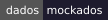  

</div>

<p align="center">
  <b>O painel que mostra as aplicações, os jobs, as execuções, as mensagens e os registros gravados em <code>auditing.*</code>.</b>
</p>

<p align="center">
  <a href="#️-como-rodar">Como rodar</a> ·
  <a href="#-telas">Telas</a> ·
  <a href="#-de-onde-vem-cada-número">Números</a> ·
  <a href="#-dados-mockados">Mock</a> ·
  <a href="#-cadastro-de-holdings-empresas-e-módulos">Cadastro</a> ·
  <a href="#-assistente-de-ia">Assistente</a> ·
  <a href="#️-estrutura">Estrutura</a>
</p>

---

## 🧭 Visão geral

Painel **"Monitor de Integrações (ETL)"**: mostra as aplicações, os jobs, as execuções, as mensagens e os registros que o
sistema de integrações grava nas tabelas `auditing.*`, e tem uma tela de consultas SQL de uso restrito. As decisões e o
histórico de cada fase estão em [docs/PLANO-WEBAPP.md](docs/PLANO-WEBAPP.md).

| | Item | Valor |
|:---:|---|---|
| 💻 | **Plataforma** | .NET 10 (`net10.0`), Blazor Web App com renderização interativa no servidor |
| 🧱 | **Componentes** | MudBlazor 9 |
| 🌐 | **Endereço local** | `http://localhost:5067` (perfil `http`) e `https://localhost:7236` (perfil `https`) |
| 🧪 | **Dados** | **mockados** por padrão; com `Database:Enabled = true`, o **banco** (fase 5): painel, cadastro e Executar Querys com Dapper ([abaixo](#️-banco-de-dados-fase-5)) |
| 🏢 | **Cadastro** | a holding nasce no **Primeiro acesso** da tela inicial (`/registration`), com o primeiro usuário; no painel, **Cadastros › Cadastrar Empresas**, **Cadastrar Usuário** e **Hosts de Agenda**; módulos e credenciais ficam na engrenagem de cada aplicação (mock ou banco, pela mesma chave). O que cada usuário vê e muda vem do **perfil** dele ([abaixo](#-perfis-de-acesso)) |
| 🏛️ | **Empresa logada** | escolhida no seletor do topo (holding e empresa por aba, guardadas no navegador); `LoggedCompany:DocCompany` e `LoggedCompany:Name` (padrão `NEWBLOOMERS - 44065634000106`) só dão a primeira escolha |
| 🔐 | **Autenticação** | usuário ou e-mail e senha de `monitor.Users` (hash PBKDF2), com cookie; sem login, o painel volta para a tela inicial. No mock: usuário `admin`, senha `admin1234` ([abaixo](#-login)) |

> [!NOTE]
> Sem `Database:Enabled`, os dados do painel são **mockados**: tudo o que você ativa, desativa, reconhece ou agenda some ao
> reiniciar o app.

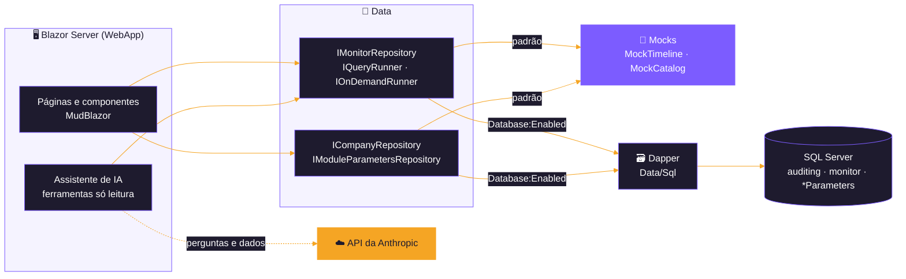

<sub>Sem API do host e sem o `Shared`: o painel lê o banco direto (ou o mock).</sub>

---

## ▶️ Como rodar

```bash
dotnet run --project src/Frontend/WebApp --launch-profile http
```

Não precisa de **banco**, de **API** nem de **configuração**: o painel sobe com os dados do mock. Os perfis do
`launchSettings.json` usam o ambiente `Development`.

### 🚢 Publicado (Production)

Conferido nos [testes de hospedagem](../../../docs/PROPOSTA-TESTES-CENARIOS-HOSPEDAGEM.md) de 02 e 03/11/2026: o painel
publicado atrás do nginx num container Linux (C2, C5) e num App Service Windows (C7), lendo SQL Server e Azure SQL com o
`etl_monitor`.

| | Item | Detalhe |
|:---:|---|---|
| ⚙️ | Configuração | Em `Production` os User Secrets não valem: `Database__Enabled`, `ConnectionStrings__Connection` e `ConnectionStrings__QueryConnection` vão por variável de ambiente ou App Settings |
| 🔒 | Perfis | As telas seguem o perfil e o dono de `monitor.Users`, igual em `Development` ([abaixo](#-perfis-de-acesso)) |
| 🔌 | WebSocket | O Blazor Server precisa de WebSocket. No nginx: `proxy_http_version 1.1`, os cabeçalhos `Upgrade`/`Connection` e `proxy_read_timeout` longo (1 h no teste); no App Service, **Web sockets** ligado; no IIS, o recurso WebSocket Protocol |
| 🔁 | Reinício | Depois de `docker restart`, o navegador recebe 502 e reconecta sozinho em ≈ 6 s, com circuito novo |
| 🔑 | Data Protection | As chaves ficam dentro do container (aviso no log) e se perdem ao recriá-lo: as sessões abertas caem. Para manter, um volume para as chaves |
| 🕒 | **Hora da tela** | As telas usam `DateTime.Now` (`Home`, `Integrations`, `Applications`, `Errors`, `HealthChip`, `DurationText`, `RecordsByDay`, `MessageCauses`): num servidor em UTC (container, App Service) o "Atualizado às" sai 3 h adiantado. Os horários das execuções, que vêm do banco, estão certos. Até a correção ([ponto 10](../../../docs/PROPOSTA-TESTES-CENARIOS-HOSPEDAGEM.md#83-pontos-em-aberto)), o contorno provável (não testado) é `TZ=America/Sao_Paulo` no container ou `WEBSITE_TIME_ZONE=E. South America Standard Time` no App Service Windows |
| ⏱️ | Desempenho | Visão geral em ≈ 100 ms durante a carga inicial de 3 meses, sem bloqueio no banco (`WITH (NOLOCK)`) |

---

## 🗺️ Telas

<div align="center">

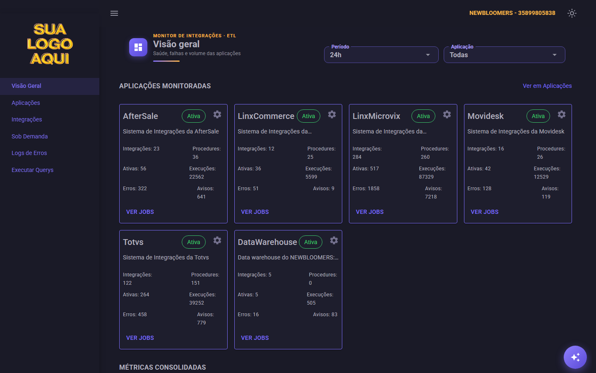

<sub><b>Visão Geral</b> — cards das aplicações com integrações, execuções, erros e avisos</sub>

</div>

| | Rota | Tela |
|:---:|---|---|
| 🔑 | `/` | **login**: usuário ou e-mail e senha (campos Outlined do MudBlazor, nas cores do tema claro no painel branco); abaixo de "Entrar", o botão **Primeiro acesso**, aberto a todos |
| 🏢 | `/registration` | **Holdings e Empresas** (o Primeiro acesso), fora do painel (sem menu nem seletor). Mostra **só a holding cadastrada nesta visita**: não lista as que já existem no banco, e a tabela começa com uma linha só, a do **Nova holding**. **Nova holding** grava a holding, a empresa que é a própria holding, os jobs dos hosts dela (inativos) e o **primeiro usuário**, numa transação; CNPJ já cadastrado mostra "A holding e a empresa ... já estão cadastradas" e nada é gravado. Editar uma holding sem usuário pede o primeiro. **Nova empresa** acrescenta um CNPJ à holding; **Abrir painel** entra no painel (com login). Aberto a todos |
| 🛡️ | `/admin/holdings` | **Todas as holdings**: **todas** as holdings e as empresas de cada uma, fora do painel; abre o painel de qualquer holding. Só do **dono**, pelo item do menu dele ([abaixo](#-perfis-de-acesso)) |
| 🏠 | `/home` | **visão geral**: cards das aplicações que a empresa contratou, ativas e inativas (os com problema primeiro), com **Adicionar aplicação** (no topo da seção e como último card) para contratar as que faltam, métricas com a taxa de sucesso por aplicação e o delta contra a janela anterior, "Falhas Ativas" com os jobs, registros por dia nos 7 últimos dias dentro do card de registros, painel de saúde com um grupo recolhível por aplicação (as com erro ou atraso primeiro e já abertas, até 10 integrações cada e o link para o resto em Integrações), atualizados a cada minuto |
| 🧩 | `/applications` | **todas as aplicações do catálogo**, com a imagem da empresa: as contratadas primeiro (o chip "Ativa" liga ou desliga o módulo; desligar pede confirmação) e depois as não contratadas, esmaecidas, com **Contratar**. A **engrenagem** abre Imagem, **Credenciais** (editável, segredos mascarados; **Testar conexão** existe, desabilitado, 4.6.1 do [plano](../../../docs/PLANO-TELA-CADASTRO-EMPRESA.md)), Parâmetros e **Contrato** (contratar ou remover o módulo, que só desativa os jobs) |
| 🔀 | `/integrations` | **Integrações** (era Jobs e Integrações): todos os jobs, num grupo recolhível por aplicação, com o filtro **Situação** (Ativos, Inativos e Todos; abre em Ativos), o de tipo (Todos, Integrações e Procedures), o de saúde (os contadores do topo são botões de filtro, com mais de um ao mesmo tempo; `?health=error,late`) e a busca. Na ordem do `IdJob`, cada integração com as procedures que chama dentro dela, o chip que liga ou desliga cada job (com "Desfazer"), duração e registros da última execução, e os botões Execuções, Executar agora e Reconhecer; cada job abre as execuções, mensagens e registros. O botão **Agenda** de cada aplicação põe a tabela em modo de edição da agenda. Os grupos começam fechados e abrem com uma aplicação só (`?app=70`), com o link de um job (`?job=3001&type=2`, em qualquer situação), com busca ou com filtro de saúde. As rotas `/jobs`, `/applications/jobs` e `/applications/{IdApp}/jobs` caem aqui; as `/applications/...` abrem em Todos |
| ⚠️ | `/errors` | **Logs de Erros**: mensagens de erro (e, se marcado, de aviso) do período, por aplicação, integração, procedure e causa, com busca pelo job e pelo texto; `?app=30&job=3001` abre o grupo |
| ▶️ | `/on-demand` | **Sob Demanda**: as integrações sem agenda, no estilo do Swagger (método, parâmetros, corpo JSON, Executar e resposta), com filtro por verbo nos contadores do topo. Gestor e Administrador ([abaixo](#-perfis-de-acesso)) |
| 💻 | `/queries` | **Executar Querys**, com favoritas e querys prontas na barra lateral; o chip do banco no topo é o próprio seletor. Só do **dono** ([abaixo](#-perfis-de-acesso)) |
| 🏢 | `/companies` | **Cadastros › Cadastrar Empresas**: as empresas da holding logada, com **Nova empresa** e a edição do nome fantasia. Gestor e Administrador |
| 👥 | `/users` | **Cadastros › Cadastrar Usuário**: os usuários do painel das empresas da holding logada, com a coluna **Perfil** (chip), **Novo usuário** (empresa, nome, usuário, e-mail, senha e perfil) e a edição (nome, e-mail, perfil e nova senha; o usuário não muda). Usuário e e-mail não se repetem; ninguém muda o próprio perfil. Gestor e Administrador |
| 🖧 | `/scheduling-hosts` | **Hosts de Agenda** (item próprio do menu): os hosts de agenda no ar neste banco (`auditing.SchedulingHosts`) e qual agenda. Só mostra: ligar e desligar um host continua na configuração dele, na publicação. Só do **dono** |

| 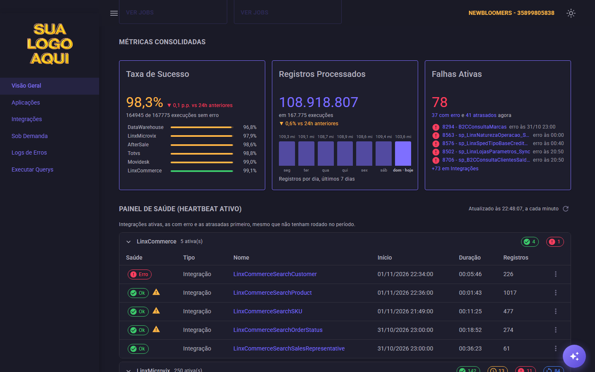<br> <sub><b>🏠 Visão Geral</b> — métricas, registros por dia, falhas ativas e painel de saúde</sub> | 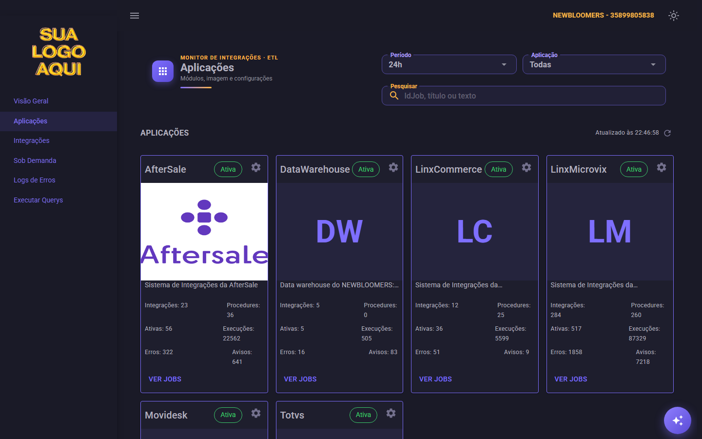<br> <sub><b>🧩 Aplicações</b> — imagem da empresa e o chip que liga ou desliga o módulo</sub> |
|:---:|:---:|
| 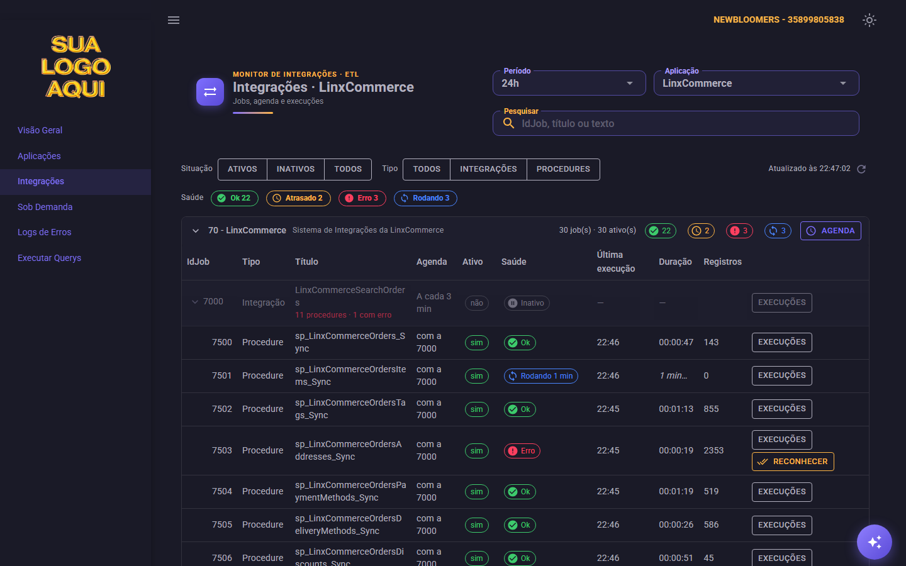<br> <sub><b>🔀 Integrações</b> — procedures dentro da integração, saúde, Executar agora e Agenda</sub> | 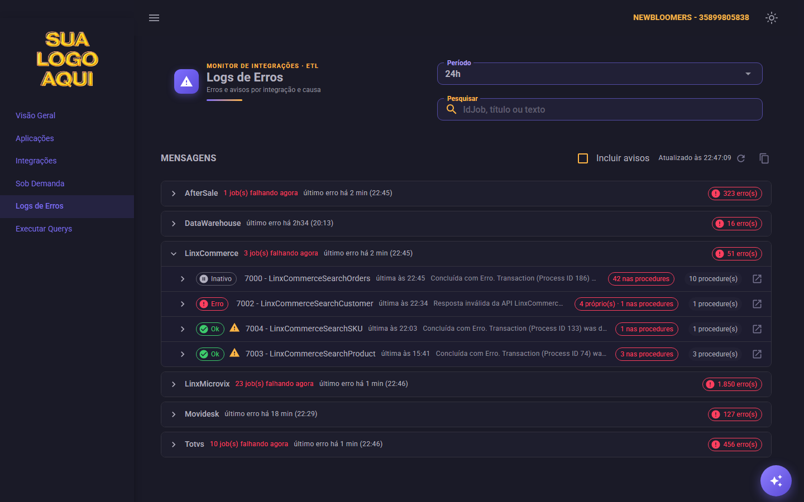<br> <sub><b>⚠️ Logs de Erros</b> — mensagens por aplicação, integração e causa</sub> |
| 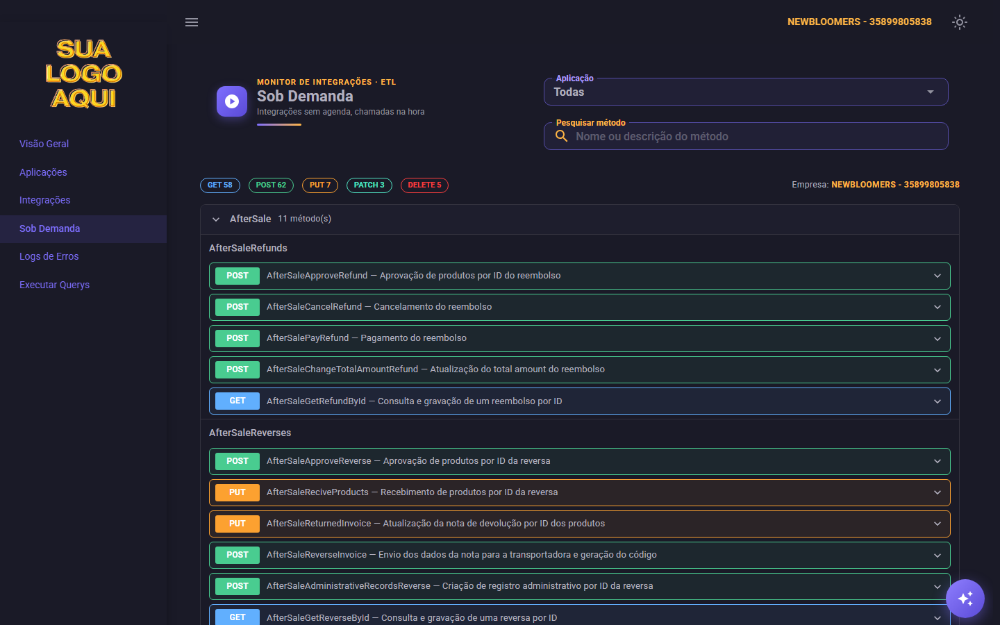<br> <sub><b>▶️ Sob Demanda</b> — integrações sem agenda, no estilo do Swagger</sub> | 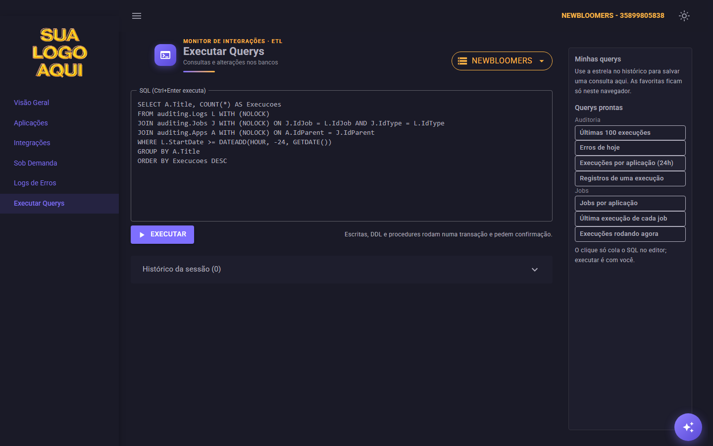<br> <sub><b>💻 Executar Querys</b> — SQL com favoritas e querys prontas</sub> |

O **menu lateral** tem Visão Geral, Aplicações, Integrações e Logs de Erros; Gestor e Administrador veem também Sob Demanda
e o grupo **Cadastros** (Cadastrar Empresas, Cadastrar Usuário), e o dono, Executar Querys, Hosts de Agenda e Todas as
holdings. No topo, o usuário logado e o botão **Sair**. As integrações sob demanda (sem agenda) **não aparecem** em Integrações nem no painel de saúde: ficam na tela Sob
Demanda.

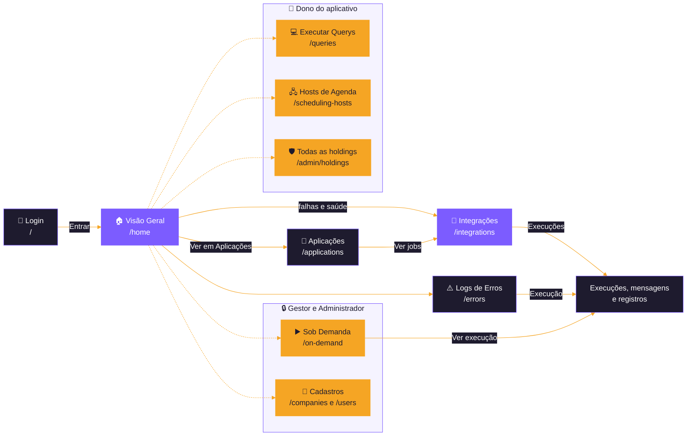

### 📱 Celular, tablet e tema

As telas funcionam **no celular e no tablet**. Abaixo de **960px**, o cabeçalho e os filtros ficam um embaixo do outro, os
cabeçalhos dos grupos quebram em duas linhas e, em Executar Querys, a barra de querys prontas vira um bloco recolhível
acima do editor. Abaixo de **600px**, as tabelas viram blocos (com menos colunas na Visão geral e em Integrações) e os
diálogos ocupam a tela toda. As regras ficam no fim do `wwwroot/css/app.css`.

<details>
<summary><b>🌗 Tema claro e 📱 celular</b></summary>

<div align="center">

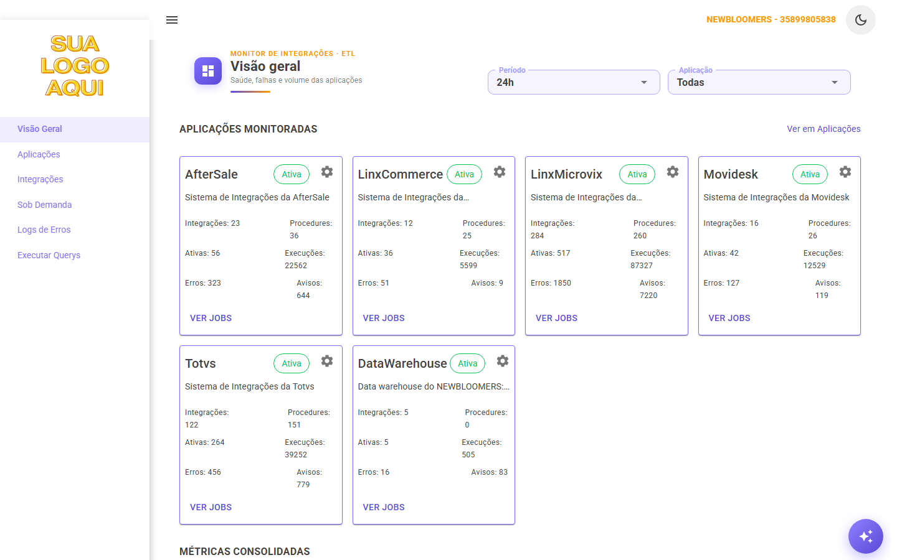

<sub><b>Tema claro</b> — a escolha fica salva no navegador</sub>

</div>

<div align="center">

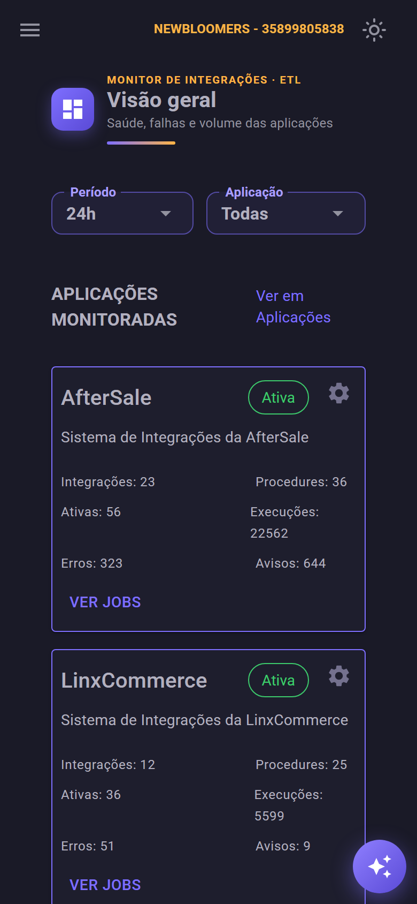 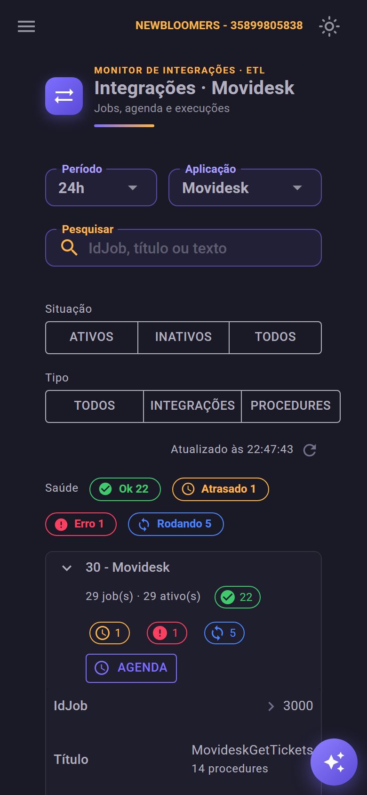

<sub><b>Celular</b> — tabelas em blocos e diálogos em tela cheia</sub>

</div>

</details>

* 🔗 **Período, aplicação, tipo e saúde ficam na URL** (`?period=7d&app=30`), então o link de uma tela abre do mesmo jeito
  para outra pessoa; sem `period` na URL, vale o último período escolhido na aba. A busca fica só na tela.
* 🧭 **Barra superior:** o botão que esconde o menu, a holding e o **seletor de empresa** (as empresas da holding; a
  escolha fica salva no navegador, e a troca de holding é pelo **Abrir painel** do cadastro) e o botão que troca entre o
  tema escuro e o claro; a escolha do tema também fica salva no navegador.
* 📄 **Paginação padrão:** 50 linhas nas grids de jobs, 5 nas execuções e 25 nas mensagens de erro.

### 🩺 Saúde, ações e agenda

O **chip de saúde** diz há quanto tempo: "Atrasado 1h40", "Rodando 2h13" (laranja quando passa de 1 × o intervalo), com o
detalhe no tooltip.

| | Ação | Onde | O que faz |
|:---:|---|---|---|
| ▶️ | **Executar agora** | linha da tela Integrações; menu ⋮ do painel de saúde | pede ao host uma execução fora da agenda; ao passar o mouse, diz quando sai a próxima pela agenda e por que o botão está desligado, quando estiver |
| ✅ | **Reconhecer** | idem, com Erro ou Atrasado | o job sai de "Falhas Ativas" até a próxima execução ou 24 h, com uma nota para o próximo turno |
| 🔎 | **Execução** | Logs de Erros | abre a execução da mensagem num diálogo, com o Guid, os registros e os links para o job e para a query pronta; os blocos de exceção, pilha e SQL têm botão de copiar, e **"Copiar tudo"** junta o contexto para um chamado |
| 🕒 | **Agenda** | cabeçalho de cada aplicação, só na tela Integrações | põe a tabela em modo de edição: intervalo, hora diária e fila das integrações só gravam em **"Salvar alterações"**, com confirmação |
| ⚙️ | **Engrenagem** | cards da Visão geral e de Aplicações | abre o diálogo com **Imagem**, **Credenciais** e **Parâmetros** |
| 🔄 | **Atualizado às** | Aplicações, Integrações e Logs de Erros | hora da última leitura e o botão de recarregar |

As **procedures** aparecem dentro da integração que as chama (o `IdParent` delas), com a setinha na linha da integração e o
resumo "11 procedures · 1 com erro".

> [!IMPORTANT]
> Ativar ou desativar um job ou um módulo, mudar a agenda, reconhecer uma falha, pedir uma execução e trocar a imagem de
> uma aplicação **só mudam o mock** e somem ao reiniciar o app. Com o banco, viram `UPDATE` em `auditing.Jobs.IsActive`,
> gravação em `monitor.JobAcknowledgement` e `monitor.AppImage` e o pedido lido pelo host, por empresa (a imagem, por holding)
> ([PROPOSTA-DOC-COMPANY-AUDITING.md](../../Backend/Shared/docs/PROPOSTA-DOC-COMPANY-AUDITING.md) e o passo 11.5 do plano).

🛟 **Erro do repositório** vira um aviso (Snackbar) e a tela continua com os dados que já tinha; uma exceção numa tela
mostra o cartão "Algo deu errado nesta tela", com "Tentar de novo", sem derrubar o painel.

---

## 🔢 De onde vem cada número

| Número | Origem |
|---|---|
| 🧩 **Integrações e procedures do card** | jobs da aplicação em `auditing.Jobs`, por `IdType` (2 e 1) |
| ✅ **Ativas** | jobs com `IsActive = 1` |
| 📊 **Execuções, registros, erros e avisos** | linhas de `auditing.Logs` no período, com os registros (`auditing.Records`) e as mensagens de nível 3 e 2 (`auditing.Messages`) de cada uma |
| 📈 **Taxa de sucesso** | execuções sem mensagem de erro ÷ execuções, no período; o delta compara com a janela anterior de mesmo tamanho |
| 🚨 **Falhas ativas** | jobs ativos com saúde **Erro** ou **Atrasado** agora, sem as falhas reconhecidas (contadas à parte) |
| 📅 **Registros por dia** | registros das execuções de cada um dos 7 últimos dias, com o filtro de aplicação (o período não muda o gráfico); hoje conta até agora |
| 🧠 **Causa (Logs de Erros)** | mensagens do job com o mesmo texto, trocando números e Guids por marcadores (`Data/MessageGrouping.cs`) |
| 🩺 **Saúde** | pela última execução do job: **Rodando** (sem fim), **Erro** (tem mensagem de erro), **Atrasado** (não começou nenhuma em 1 × o intervalo) ou **Ok**. Job sob demanda nunca fica atrasado, e job inativo não tem saúde |

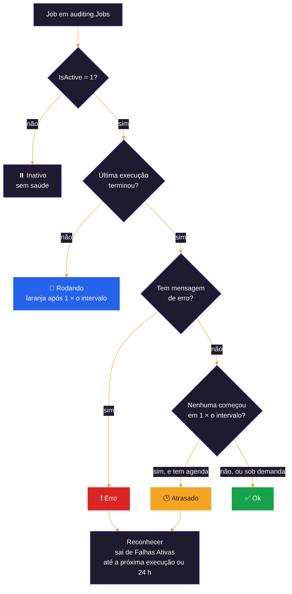

Nas procedures, o `IdParent` de `auditing.Jobs` é o job de integração que as chama, não a aplicação; o painel resolve a
aplicação pelo job pai (`JobModel.IdApp`). O nível das mensagens (informação, aviso e erro) segue a proposta
[PROPOSTA-NIVEL-MENSAGEM-AUDITING.md](../../Backend/Shared/docs/PROPOSTA-NIVEL-MENSAGEM-AUDITING.md), implementada em
03/11/2026: o painel lê `auditing.Messages.Level` (1 informação, 2 aviso, 3 erro). Só o erro põe o job em saúde de erro; o
aviso conta em "Warnings" e aparece na linha do heartbeat. `IsError` continua no banco como coluna calculada.

---

## 🧪 Dados mockados

| Arquivo | O que faz |
|---|---|
| 📚 `Data/Mocks/MockCatalog.cs` | as 6 aplicações e os 960 jobs dos módulos do host, copiados dos scripts de insert em `auditing.Apps` e `auditing.Jobs`. Job novo nos scripts entra aqui na mesma ordem |
| ⏱️ `Data/Mocks/MockTimeline.cs` | gera as execuções a partir da agenda de cada job, sem guardar nada: os dados são os mesmos a cada carga, e as execuções novas aparecem conforme o relógio anda. Uma parte dos jobs tem um perfil fixo (inativo, atrasado, falhando, com muitos avisos, sempre rodando ou travado além do intervalo), para todos os estados aparecerem; às 3h as integrações falham mais; "Executar agora" cria uma execução 1 minuto depois, sempre sem erro |
| 💬 `Data/Mocks/MockTexts.cs` | mensagens e registros, com os textos que os services gravam hoje |
| 💻 `Data/Mocks/MockQueryRunner.cs` | executor falso da tela de consultas ([abaixo](#-executar-querys)) |
| ▶️ `Data/Mocks/MockOnDemandRunner.cs` | executor falso da tela Sob Demanda ([abaixo](#️-sob-demanda)) |
| 🏢 `Data/Mocks/MockCompanyRepository.cs` | cadastro de holdings, empresas e módulos em memória ([abaixo](#-cadastro-de-holdings-empresas-e-módulos)) |

As telas só conhecem as interfaces `IMonitorRepository` e `IQueryRunner`: a chave `Database:Enabled` escolhe, no
`Program.cs`, entre o mock e o banco ([abaixo](#️-banco-de-dados-fase-5)), sem mudar nenhuma tela.

> [!TIP]
> Para ver o tratamento de erro sem banco, `MockMonitorRepository:FailureRate` (de 0 a 1, `0` por padrão) faz essa
> proporção das chamadas do mock falhar:
>
> ```bash
> dotnet user-secrets set "MockMonitorRepository:FailureRate" "0.3" --project src/Frontend/WebApp
> ```

---

## 🏢 Cadastro de holdings, empresas e módulos

O cadastro substituiu a antiga tela Windows Forms `Invoke-HostsConfig.ps1`
([proposta do schema auditing](../../../docs/PROPOSTA-SCHEMA-AUDITING-HOLDERS-CATALOG.md)). Grava direto, sem
procedures: `auditing.Holders`, `auditing.Companies`, `auditing.Jobs` e as tabelas `*Parameters` dos módulos.

| | Peça | O que faz |
|:---:|---|---|
| 🏢 | `ICompanyRepository` (`Data/ICompanyRepository.cs`) | lista e cria holdings (a holding, a empresa que é a própria holding e os jobs dos hosts, IdParent 140, inativos e com a agenda sugerida, numa transação) e empresas da holding; edita o nome fantasia. O CNPJ não muda (é a chave dos jobs e dos logs) e um CNPJ já cadastrado, nesta ou em outra holding, é recusado; aceita o CNPJ formatado e grava só os dígitos (11 ou 14). Lista os módulos do catálogo com os jobs da empresa, e contrata (jobs do `auditing.fn_CatalogTree`, inativos, com a agenda escolhida; rodar de novo não duplica) ou remove (desativa os jobs, que os logs referenciam) um módulo |
| 🔑 | `IModuleParametersRepository` | lê e grava a linha de `*Parameters` do módulo da empresa (`doc_company` = a empresa, que precisa estar em `auditing.Companies`). **Segredos nunca voltam** (a leitura diz só se estão definidos) e segredo vazio mantém o gravado |
| 📋 | `Data/ModuleDefinitions.cs` | os campos de cada módulo (Movidesk, AfterSale, LinxCommerce, LinxMicrovix e Totvs; DataWarehouse não tem parâmetros), com rótulo, obrigatório, segredo, tipo (texto, `https://` ou GUID) e tamanho. Tabela e colunas do SQL só vêm daqui |
| 🗓️ | `Data/JobAgenda.cs` | a agenda sugerida de cada job: o [`docs/AGENDA-SUGERIDA-JOBS.csv`](../../../docs/AGENDA-SUGERIDA-JOBS.csv) embutido no assembly (o catálogo não tem agenda) |
| 🏛️ | `Data/LoggedCompanyStorage.cs` | a holding e a empresa escolhidas, guardadas no navegador (`ProtectedLocalStorage`); o seletor do topo e o **Abrir painel** gravam. O usuário logado só vê a holding dele: uma escolha de outra holding vira a empresa do usuário. **Usuário da holding** (a empresa dele é a própria holding) escolhe qualquer empresa dela; **usuário de uma empresa** só tem a dele no seletor, não vê o nome da holding e, em Cadastrar Empresas e Cadastrar Usuário, vê só a empresa dele e os usuários dela (sem Nova empresa) |
| 👥 | `IUserRepository` (`Data/IUserRepository.cs`) | confere o login (usuário ou e-mail), lista, cria e edita os usuários de `monitor.Users`; as regras (campos, senha de 8 caracteres ou mais, hash PBKDF2 do `PasswordHasher` do ASP.NET Core) ficam em `Data/UserAccounts.cs`, iguais no mock e no banco |
| 🧪 | `Data/Mocks/MockCompanyRepository.cs`, `MockUserRepository.cs` | o mesmo contrato em memória, com as mesmas regras |
| 🗃️ | `Data/Sql/SqlCompanyRepository.cs`, `SqlModuleParametersRepository.cs`, `SqlUserRepository.cs` | Dapper sobre `ConnectionStrings:Connection` |

Os erros de regra chegam à tela como `CompanyRegistrationException` (`Code` 50001 para CNPJ já cadastrado, 50002 para
empresa não cadastrada, 0 para a validação do WebApp).

### 🔑 Login

A tela inicial confere usuário (ou e-mail) e senha em `monitor.Users` (tabela do `Script008_Create_Monitor_Schema.sql` do
Shared; o `etl_monitor` tem INSERT e UPDATE nela). Como a tela é interativa e não grava cookie, ela pede um ticket de uso
único (`SignInTickets`, um minuto) e recarrega em `/account/signin`, que grava o cookie `etl-monitor` (8 horas, renovado com
o uso) com o usuário, a empresa e a holding dele, o perfil (`ClaimTypes.Role`) e, no dono, `etl:owner`
(`Data/AccountEndpoints.cs`). Por isso a troca de perfil vale a partir do próximo login. **Sair**, no topo, é um POST com antiforgery
para `/account/signout`. Sem o cookie, o `MainLayout` volta para a tela inicial antes de mostrar qualquer tela.

No mock, o usuário `admin` (senha `admin1234`) está na holding da configuração e é **Administrador e dono**. Uma holding que
já existia antes do login não tem usuário: editar a holding em `/registration` pede o primeiro. O que cada um vê vem do
perfil ([abaixo](#-perfis-de-acesso)).

**Credencial antes de ativar:** ativar um job ou um módulo de um módulo com API externa (Totvs, LinxMicrovix,
LinxCommerce, Movidesk, AfterSale) sem a credencial da empresa abre primeiro o formulário dela e, depois, pede
confirmação de que o host vai chamar a API de verdade.

> [!WARNING]
> O mock é o padrão; `Database:Enabled = true` liga o **Dapper** junto com o resto do painel
> ([abaixo](#️-banco-de-dados-fase-5)).

---

## 🗄️ Banco de dados (fase 5)

Com `Database:Enabled = true`, o WebApp lê e grava no banco principal com **Dapper**, sem API e sem projetos Shared
([plano, fase 5](docs/PLANO-WEBAPP.md#fase-5--banco-de-dados)):

| | Peça | O que faz |
|:---:|---|---|
| 📊 | `Data/Sql/SqlMonitorRepository.cs` | o `IMonitorRepository` real: `auditing.*` e `monitor.*` da empresa do seletor, tudo `WITH (NOLOCK)` e com as contagens prontas no SQL. Jobs e totais por período num cache de 30 s, que toda escrita daqui invalida. Saúde, reconhecimento e ordem iguais às do mock |
| 💻 | `Data/Sql/SqlQueryRunner.cs` | o `IQueryRunner` real, com a connection string própria (`etl_query`). Todo comando roda numa transação: o SELECT é desfeito no fim, e o resto espera Confirmar ou Desfazer (sem resposta, é desfeito aqui mesmo, também com a aba fechada). Timeout de 30 s, cada comando no log com banco, duração, linhas e desfecho |
| 🔌 | `Data/Sql/MainDatabase.cs` | a conexão com o banco principal e a hora de Brasília das tabelas |

| Chave (User Secrets) | Valor |
|---|---|
| `Database:Enabled` | `true` liga o banco; `false` (padrão do `appsettings.json`) fica no mock |
| `ConnectionStrings:Connection` | banco principal, com o usuário `etl_monitor` |
| `ConnectionStrings:QueryConnection` | o mesmo servidor, com o usuário `etl_query` (só para Executar Querys) |
| `LoggedCompany:DocCompany` | só a primeira escolha do seletor do topo (padrão `44065634000106`), se estiver em `auditing.Companies` |
| `Assistant:ApiKey` | opcional: liga o assistente ([abaixo](#-assistente-de-ia)) |

Na máquina de desenvolvimento, as chaves vão à mão para os User Secrets, contra o SQL Server do Docker (troque
`SEU_BANCO` e `SUA_SENHA`; o banco precisa dos migrators, e a holding e as empresas entram depois, pelo cadastro) e
reinicie o WebApp, porque a troca entre mock e banco só acontece quando ele sobe:

```bash
dotnet user-secrets set "Database:Enabled" "true" --project src/Frontend/WebApp
```

As connection strings (`Connection` e `QueryConnection`) ficam no `appsettings.json` do WebApp, gravadas pelo
`Invoke-Migrators.ps1` no fim da migração (passo 2); para outro banco, rode o migrator para ele ou edite a seção
`ConnectionStrings` do arquivo.

Em homologação e produção, as connection strings usam os usuários próprios, nunca o `sa`: `User Id=etl_monitor` na
`Connection` e `User Id=etl_query` na `QueryConnection`.

Os usuários `etl_monitor` e `etl_query` saem das procedures `dbo.sp_Create_Monitor_User` e `dbo.sp_Grant_Query_User`
(Script009 do Shared). A senha nunca fica em script: quem tem `ALTER ANY LOGIN` roda as procedures com ela, à mão, ou
pelo `tools/migrators/Invoke-Migrators.ps1`, com as senhas da seção "Usuários de banco do WebApp" (ou `-MonitorPassword`
e `-QueryPassword` com `-NoGui`), que vão só para o migrator do Shared. Rodando o `migrator.csx` do Shared à mão, as
variáveis de ambiente `ETL_MONITOR_PASSWORD` e `ETL_QUERY_PASSWORD` fazem o mesmo. Banco criado depois:
`EXEC dbo.sp_Grant_Query_User @database = N'<banco>'`.

> [!IMPORTANT]
> Ainda sem banco: **Executar agora** (o host não lê pedidos de execução; o botão avisa que não foi possível) e a tela
> **Sob Demanda** (continua simulada, até o executor que chama o WebApi). As telas usam a hora de Brasília
> (`MainDatabase.LocalNow()`), qualquer que seja o fuso do servidor: num container ou no App Service, em UTC, o
> "Atualizado às" mostrava a hora do servidor (testes C5 e A9).

---

## 🔒 Perfis de acesso

O acesso vem do usuário logado, em `monitor.Users` (`Script008_Create_Monitor_Schema.sql` do Shared): a coluna `Profile`
(com CHECK) e a coluna `IsOwner`. A antiga chave `Admin:Enabled` não existe mais. Os perfis valem sempre **dentro da
holding** do usuário: uma holding nunca vê outra, nem com o perfil Administrador.

| | Perfil | O que faz |
|:---:|---|---|
| 👁️ | **Visualizador** | só vê Visão Geral, Aplicações, Integrações e Logs de Erros; os botões de escrita não aparecem e a engrenagem abre só para ver |
| 🛠️ | **Gestor** | vê e muda o painel da empresa: liga e desliga aplicações e jobs, Agenda, Executar agora, Reconhecer falha, Adicionar aplicação, Contratar, a engrenagem (imagem, credenciais, contrato), **Sob Demanda** e **Cadastros** (`/companies` e `/users`). Dá os perfis Gestor e Visualizador |
| 🏛️ | **Administrador** | administra a holding: tudo o que o Gestor faz e, além disso, dá o perfil Administrador |

O **dono do aplicativo** (`IsOwner`) não é um perfil e não muda pelo painel. Só ele vê **Executar Querys** (`/queries`),
**Registros no SQL** (atalho do diálogo de execução), **Hosts de Agenda** (`/scheduling-hosts`) e **Todas as holdings**
(`/admin/holdings`), e só ele abre o painel de qualquer holding.

- O primeiro usuário do banco (banco sem nenhum usuário) nasce **Administrador e dono**.
- O primeiro usuário de cada holding nova, no Primeiro acesso, nasce **Gestor**.
- Ninguém muda o próprio perfil. A troca vale a partir do próximo login (o perfil vai no cookie).
- Continua a regra das empresas: usuário da holding vê todas as empresas dela; usuário de uma empresa só vê a dele.
- O **Primeiro acesso** (`/registration`) é aberto a todos e não lista as holdings do banco, só a cadastrada na visita.

O menu só mostra o que o perfil abre, e as telas conferem de novo: abrir o endereço direto de `/queries` ou `/on-demand`
sem acesso cai na página de não encontrado.

> [!CAUTION]
> Banco que já tinha a `monitor.Users` sem as colunas `Profile` e `IsOwner` precisa ser **recriado**: o DbUp não roda o
> Script008 de novo.

---

## ✨ Assistente de IA

<div align="center">

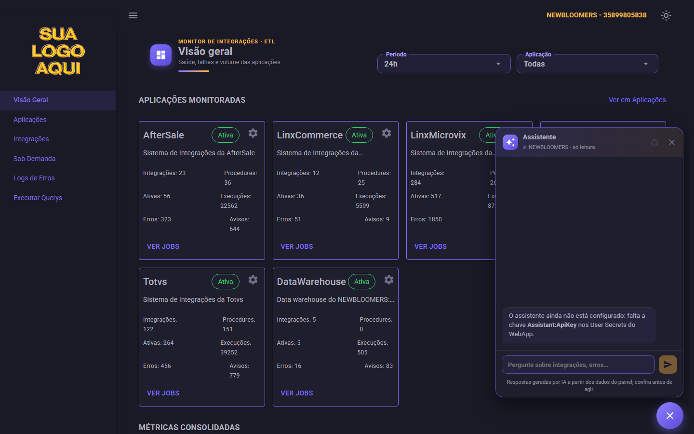

<sub><b>Assistente</b> — sem a chave, o chat avisa que não está configurado</sub>

</div>

O **botão roxo** no canto inferior direito (todas as telas, menos o login) abre um chat com o Claude (`claude-opus-5-5`, API
da Anthropic, pacote NuGet `Anthropic`). Ele responde sobre integrações, erros e execuções da empresa do seletor consultando
ferramentas **só de leitura** em cima do `IMonitorRepository` (`Data/AssistantTools.cs`): saúde das integrações, resumo do
período, busca de jobs, execuções de um job e causas de erro. **Não executa, não reconhece, não liga nem desliga nada, não
roda querys e não vê credenciais nem parâmetros dos módulos.** As respostas chegam aos poucos (streaming) e trazem links
para as telas do painel; se o filtro de segurança recusar uma pergunta, o servidor tenta com o `claude-opus-4-8` na mesma
chamada (fallback do lado do servidor).

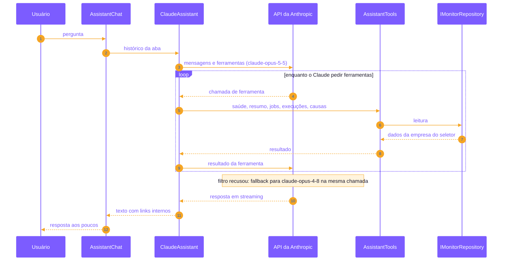

A chave fica nos **User Secrets**, nunca no `appsettings.json`; sem ela, o chat avisa que não está configurado:

```bash
dotnet user-secrets set "Assistant:ApiKey" "<chave da Anthropic>" --project src/Frontend/WebApp
```

> [!WARNING]
> As perguntas e os dados que as ferramentas consultam (nomes de jobs, mensagens de erro) **vão para a API da Anthropic**,
> e cada pergunta tem custo de uso. A conversa fica só na aba aberta, em memória: some ao recarregar a página ou em
> "Nova conversa".

**Código:** `Components/Assistant/AssistantChat.razor` (botão e painel, no `MainLayout`), `Data/ClaudeAssistant.cs` (laço
de ferramentas com streaming) e `Components/Assistant/AssistantMarkdown.cs` (negrito, listas e links internos; o resto
vira texto).

---

## 💻 Executar Querys

O que a tela faz:

- 🗄️ seletor de banco, com o banco escolhido sempre em destaque;
- ⌨️ editor de SQL, com `Ctrl+Enter` para executar e botão para cancelar;
- 📄 resultado paginado, cortado em **1.000 linhas** (com aviso), com filtro por qualquer célula e ordenação pelas colunas,
  e exportação para CSV no formato do Excel em português ("Exportar filtrado" exporta só o que a grade mostra);
- ⚠️ `INSERT`, `UPDATE`, `DELETE`, `MERGE`, `CREATE`, `ALTER`, `DROP`, `TRUNCATE` e `EXEC` pedem confirmação; `UPDATE` ou
  `DELETE` sem `WHERE`, `DROP` e `TRUNCATE` ganham um segundo aviso. Comentários e texto entre aspas não contam;
- ↩️ a alteração fica numa transação, com **Confirmar** e **Desfazer**; sem resposta em **60 s**, ou saindo da tela, ela é
  desfeita;
- ⭐ histórico das 20 últimas consultas e até 30 favoritas com nome (a estrela no histórico), guardados no navegador; as
  favoritas ficam em "Minhas querys", acima das querys prontas.

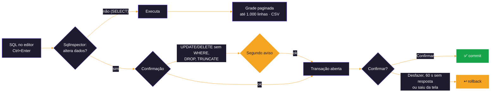

> [!NOTE]
> **No mock, nada chega a um banco:** os bancos são `NEWBLOOMERS`, `AUDITING` e `Company`, o `SELECT` devolve colunas
> tiradas do próprio SQL e linhas geradas, SQL com a palavra `erro` isolada (por exemplo `dbo.erro`; `IsError` não conta)
> simula um erro do SQL Server e `WAITFOR` demora 8 s, para testar o cancelamento.

---

## ▶️ Sob Demanda

Só para Gestor e Administrador ([acima](#-perfis-de-acesso)); o Visualizador não vê o item no menu.

Até a fase 5, o `MockOnDemandRunner` **não chama o host**: o catálogo sai das descrições dos jobs, a resposta é simulada (um
em cada seis GETs devolve 404) e a chamada que roda vira uma execução do job, que "Ver execução" abre.

---

## 🗂️ Estrutura

```text
WebApp/
├── Components/
│   ├── Assistant/      AssistantChat (botão e painel) e AssistantMarkdown
│   ├── Cards/          AppCard e os logos das aplicações
│   ├── Display/        textos, cores e ícones de saúde e nível, chip de saúde, gráficos, copiar, atualizar, paginador,
│   │                   tratamento de erro (PageGuard) e traduções do MudBlazor
│   ├── Executions/     execuções de um job, ações do job, detalhe de uma execução e de uma mensagem, causas e mensagens
│   ├── Filters/        filtros do topo das telas e o período da aba (FilterSession)
│   ├── Loadings/       SpaceLoading, o carregamento padrão do app
│   ├── MessageBoxes/   ModuleConfigurations (abas Imagem, Credenciais e Parâmetros), execução de uma mensagem,
│   │                   nota do reconhecimento, nome da favorita e os diálogos do cadastro (holding e empresa,
│   │                   contratar módulo, credencial)
│   ├── NavMenus/       menu lateral
│   └── OnDemand/       componentes da tela Sob Demanda
├── Data/               IMonitorRepository, IQueryRunner, IOnDemandRunner, ICompanyRepository, ModuleDefinitions,
│   │                   SqlInspector, acesso à tela de consultas, assistente (ClaudeAssistant, AssistantTools)
│   ├── Mocks/          mocks do painel, das consultas, do Sob Demanda e do cadastro
│   └── Sql/            Dapper do painel e do cadastro (SqlMonitorRepository, SqlCompanyRepository, SqlModuleParametersRepository)
├── Layout/             MainLayout (barra, menu e tema) e BlankLayout (login)
├── Models/             modelos de leitura, sem nada de Blazor (vão para um projeto próprio quando o MAUI chegar)
├── Pages/              uma página por rota
└── wwwroot/            app.css, app.js e imagens
```

Os arquivos do `wwwroot` entram no `App.razor` por `@Assets["..."]`, com a versão do conteúdo no endereço: depois de
uma mudança no CSS ou no JavaScript, o navegador baixa o arquivo novo **sem precisar limpar o cache**.

---

## 🚀 Próximas fases

| Fase | O que entra |
|---|---|
| 🗄️ **5 — Banco de dados** | usuários de banco pelo DbUp, `MonitorRepository` com Dapper no banco principal e `QueryRunner` real |
| 🏢 **4.6.1 do cadastro — Testar conexão** | o botão **Testar conexão** por módulo, hoje desabilitado na aba Credenciais da engrenagem, em Aplicações ([plano](../../../docs/PLANO-TELA-CADASTRO-EMPRESA.md)) |
| 🔐 **6 — Autenticação** | o login com `monitor.Users` e os perfis (Administrador, Gestor, Visualizador e o dono) já existem; falta, se for o caso, o Microsoft Entra ID |
| 📱 **7 — App MAUI** | os mesmos dados no app, por uma API |

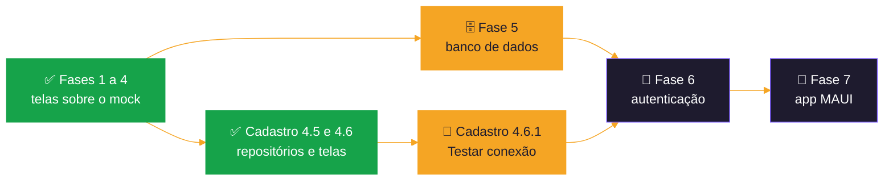

---

<div align="center">


<sub>Monitor de Integrações · Blazor + MudBlazor · .NET 10</sub>

</div>
